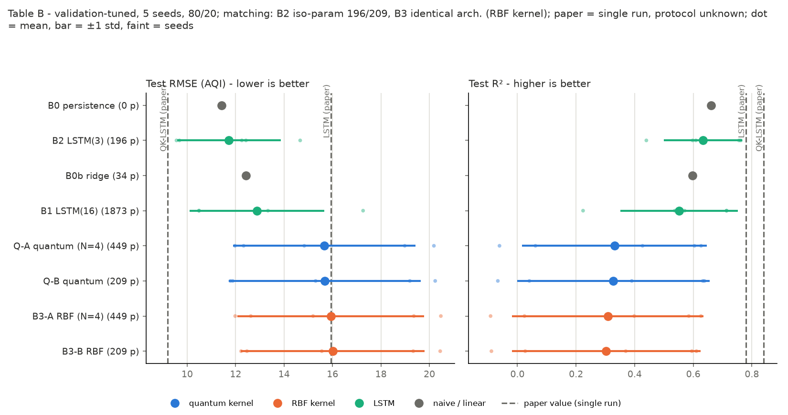
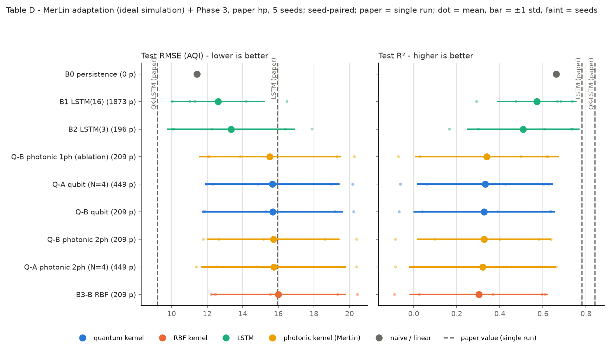

# Quantum Kernel-Based LSTM for Climate Time-Series Forecasting — Reproduction

**Status: complete through Phase 8**, plus two post-handoff checks: S7, fresh seeds 5–9, and S8, causal preprocessing. Phases 1–8 covered reproduction, the MerLin photonic adaptation, the fair comparison, documentation, the notebook and handoff. Photonic translation status: **`MERLIN_IMPLEMENTATION`**.

**Verdict:**
- The paper's comparative claims (C1 accuracy, C2 compactness, C4 quantum kernel as the source of the gain) are **unsupported** under a fair, multi-seed protocol. QK-LSTM is better than the LSTM in no setting tested.
- How strongly the data contradict C1 depends on the setting:
  - With the paper's preprocessing, QK-LSTM is significantly *worse* than the LSTMs on seeds 0–4.
  - On fresh seeds 5–9 it is still worse on average, but significantly worse in only 2 of 4 decisive comparisons.
  - With causal preprocessing it is not separated from the paper's LSTM.
- Its metric values are **not reproduced**.
- Its Table II parameter counts **are reproduced exactly**.

**Start with `notebook.ipynb`**: a runnable scientific walkthrough (about 70 s on CPU) that recomputes every decisive number from the stored run artifacts. `LOG.md` is the full working record; `INSIGHTS.md` holds reusable lessons.

## Reference and Attribution

- Paper: *Quantum Kernel-Based Long Short-term Memory for Climate Time-Series Forecasting*, arXiv preprint, 2024.
- Authors: Yu-Chao Hsu, Nan-Yow Chen, Tai-Yu Li, Po-Heng (Henry) Lee, Kuan-Cheng Chen.
- arXiv: https://arxiv.org/abs/2412.08851 (parent QK-LSTM paper: https://arxiv.org/abs/2411.13225).
- Original repository: none released. The authors' code was searched for on GitHub, Hugging Face, Semantic Scholar and author pages (LOG.md, Available Resources).
- License: all code in this folder is an independent reimplementation under the repository's MIT license. Cite the arXiv preprint when using it.

## Original Paper

QK-LSTM keeps the LSTM recurrences but replaces each gate's linear map `W[h_{t-1}, x_t] + b` with a weighted sum of quantum-kernel values against reference vectors, `sum_j alpha_j k(v_t, v_j) + b` (Eq. 6). The kernel is a 4-qubit fidelity kernel `k = |<0|U^dagger(v_j) U(v_t)|0>|^2` built from Hadamard, R_y/R_z angle encoding and a CNOT chain.

The task is one-step daily Air Quality Index (AQI) forecasting for Bengaluru from 11 pollutant concentrations, using Central Pollution Control Board (CPCB) data for 2015–2020. Metrics are RMSE, MAE, MAPE and R².

The paper claims QK-LSTM beats a classical LSTM on all four metrics (Table I: RMSE 9.20 vs 15.94, MAE 7.15 vs 11.07, MAPE 9.14% vs 13.32%, R² 0.84 vs 0.78) with 209 instead of 1,873 trainable parameters (Table II). Both results come from a single run.

Secondary claims:
- QK-LSTM tracks the 2020 test period more faithfully (Fig. 3).
- The quantum kernel supplies the expressiveness (Sec. III-B, V; argued, not tested).
- Block-encoding and GPU tensor networks give scalability (Sec. V; no experiment).

## Reproduction Scope, Claims, and Deviations

What was reproduced:
- Table I (RMSE, MAE, MAPE, R² for QK-LSTM and LSTM), Table II (parameter counts) and Fig. 3 (prediction traces).
- Data: full Bengaluru data at the paper's Table II hyperparameters (20 epochs, batch 1, lr 1e-3, sequence length 3, hidden 16, 4 qubits).
- **5 seeds per model** (the paper reports single runs).
- Local CPU, PyTorch 2.12.1, exact statevector simulation.

Implemented (details and rationale in LOG.md, Reproducibility Assessment and Disagreement records D1–D3):

- **Two QK-LSTM variants**, because the paper's equations contradict its parameter count (LOG.md, disagreement D1):
  - **Q-A (Eq. 6):** `Linear(27->4)` compression of `[h; x]`, then a quantum fidelity kernel against N fixed training-set references, with per-gate `alpha in R^{N x 16}` (449 parameters for N=4).
  - **Q-B (count-matched):** `Linear(27->4)`, then the kernel against 4 references, then one shared `Linear(4->16)` gate pre-activation. This has exactly 209 parameters, the only decomposition found that also reproduces the parent paper's 183.
- **Paper baseline B1:** `torch.nn.LSTM(11,16)` + `Linear(16,1)`, exactly 1,873 parameters.
- **Additional fair baselines (not in the paper):**
  - B0: persistence, AQI(t+1) = AQI(t);
  - B0b: ridge regression on the 3×11 window (34 parameters);
  - B2: parameter-matched LSTM `nn.LSTM(11,3)` (196 parameters);
  - B3: the Q-A and Q-B architectures with a classical RBF kernel instead of the quantum kernel (isolates the quantum kernel).
- **Deviations and assumptions:**
  - **Split:** chronological 80/20 (test = 402 days, 2019-05-27 to 2020-07-01) rather than the text's "2020 as test". This is an assumption: the test window the paper used cannot be established from its text or Fig. 3. Calendar-2020 is run as a sensitivity split (S2).
  - **Preprocessing:** outlier and scaling statistics are fitted on training days only. Outliers (|Z| > 3) become missing and are filled by linear interpolation in time, as in the paper's Eq. 3 (`dataset.fill = "interpolate"`, the default). Only days with an observed AQI are scored.
    - Interpolation is two-sided: it uses later observations. In this data there is no future-dependent interpolation in test inputs and no interpolation across the train/test boundary.
    - However, 712 of 1,604 training windows contain values filled from later days.
    - A causal alternative (`dataset.fill = "causal"`, carry the last observation forward) is tested in S8.
  - **Training:** Adam (the paper says "SGD or Adam"), next-day horizon, min-max scaling to [0, 1], final-epoch evaluation.
  - **Kernel:** angle map θ = φ = z (unstated in the paper); exact statevector simulation with autograd instead of parameter-shift (identical forward pass and gradient on an ideal simulator; unit-tested).
- **Finding during implementation:** with the paper's text circuit, the CNOT chain cancels in the overlap and the kernel factorises into 4 single-qubit fidelities (no entanglement effect). The Fig. 2(d) layout does not factorise, and both layouts are implemented.
- **Not reproduced:** no hardware runs or block-encoding / tensor-network scalability claims (Sec. V has no experiments).
- **MerLin photonic adaptation (Phase 4; an adaptation, not part of the paper):** the qubit fidelity kernel is replaced by a 2-photon, 4-mode linear-optical fidelity kernel (`lib/qk_lstm_merlin.py`, MerLin `FidelityKernel`). Everything else stays the same: gate wiring, parameter counts (209 / 449; 0 trainable circuit parameters), data and protocol. It is computed in `FOCK` space because MerLin 0.4.1's `UNBUNCHED` fidelity kernel renormalises over collision-free outcomes, which makes it asymmetric and not a fidelity. For the collision-free input state |1,0,1,0⟩ the FOCK value equals what threshold detectors measure without postselection.

Claim inventory (C1–C5) with evidence and status: `LOG.md`, Claim Inventory.

## Project Layout

```text
papers/QK_LSTM/
├── cli.json                 # paper CLI flags (authoritative schema)
├── configs/                 # defaults.json + one config per experiment/variant; configs/sweeps/ holds sweep plans
├── lib/
│   ├── data.py              # CPCB loader, preprocessing, windows, build_dataloader(cfg, split)
│   ├── quantum_kernel.py    # 4-qubit statevector feature map, fidelity kernel, RBF kernel
│   ├── models.py            # QKLSTMCell (Q-A/Q-B; quantum/RBF/photonic), LSTM, ridge
│   ├── qk_lstm_merlin.py    # MerLin photonic fidelity kernel (Phase 4 adaptation)
│   ├── training.py          # Adam/SGD training loop, prediction
│   ├── metrics.py           # RMSE, MAE, MAPE, R^2 (Eq. 20-23)
│   ├── experiment_logging.py
│   └── runner.py            # train_and_evaluate(cfg, run_dir)
├── tests/                   # 43 tests (kernel, models, MerLin, CLI, end-to-end)
├── utils/                   # sweep coordinator, reports, statistics, plots, README tables
├── results/                 # curated tables and figures referenced below
└── outdir/                  # raw runs and sweeps (not committed)
```

## Install and How to Run

```bash
# From the repository root (Python 3.12)
python3.12 -m venv .venv
.venv/bin/pip install -r papers/QK_LSTM/requirements.txt
```

Quick smoke runs (reduced: 1 epoch on 64 windows; not results):

```bash
.venv/bin/python implementation.py --paper QK_LSTM --config configs/aqi_qklstm_count209_reduced.json
.venv/bin/python implementation.py --paper QK_LSTM --config configs/aqi_qklstm_eq6_reduced.json
```

Paper-setting single runs (20 epochs, batch 1, lr 1e-3):

```bash
.venv/bin/python implementation.py --paper QK_LSTM --config configs/aqi_qklstm_count209_original.json --seed 0
.venv/bin/python implementation.py --paper QK_LSTM --config configs/aqi_qklstm_eq6_original.json --seed 0
.venv/bin/python implementation.py --paper QK_LSTM --config configs/aqi_lstm_classical.json --seed 0
```

From inside the paper folder, use `python ../../implementation.py --config configs/<name>.json`.

Multi-seed sweeps (as run for the results below; each writes `outdir/sweeps/<sweep_id>/` with `sweep.log`, `sweep_status.json`, `summary.json`):

```bash
.venv/bin/python papers/QK_LSTM/utils/sweep.py --plan papers/QK_LSTM/configs/sweeps/s1_paper_hp.json --max-parallel 3
.venv/bin/python papers/QK_LSTM/utils/sweep.py --plan papers/QK_LSTM/configs/sweeps/s6_merlin.json --max-parallel 3
```

Rebuild the reports and tables from the run artifacts:

```bash
.venv/bin/python papers/QK_LSTM/utils/report_sweep.py papers/QK_LSTM/outdir/sweeps/<sweep_id>
.venv/bin/python papers/QK_LSTM/utils/claim_statistics.py --spec papers/QK_LSTM/results/claims/table_b_tuned.spec.json
.venv/bin/python papers/QK_LSTM/utils/phase5_comparison.py --spec papers/QK_LSTM/results/phase5/phase5_spec.json --out papers/QK_LSTM/results/phase5
.venv/bin/python papers/QK_LSTM/utils/results_tables.py
```

## Configuration

`configs/defaults.json` is Q-B at the paper's Table II settings. Each named config overlays it:

| Config | Model | Params |
|---|---|---|
| `aqi_qklstm_count209_original.json` | Q-B QK-LSTM | 209 |
| `aqi_qklstm_eq6_original.json` | Q-A QK-LSTM (Eq. 6, N=4) | 449 |
| `aqi_lstm_classical.json` | B1 paper LSTM | 1,873 |
| `aqi_lstm_matched_classical.json` | B2 matched LSTM | 196 |
| `aqi_rbfkernel_count209_classical.json` / `aqi_rbfkernel_eq6_classical.json` | B3 RBF-kernel ablations | 209 / 449 |
| `aqi_persistence_classical.json` | B0 persistence | 0 |
| `aqi_ridge_classical.json` | B0b ridge | 34 |
| `aqi_qklstm_{count209,eq6}_reduced.json` | smoke runs | — |
| `aqi_qklstm_count209_merlin.json` / `aqi_qklstm_eq6_merlin.json` | MerLin adaptation: Q-B / Q-A with the 2-photon photonic kernel | 209 / 449 |
| `aqi_qklstm_count209_merlin_1photon_ablation.json` | single-photon ablation (not the photonic implementation) | 209 |
| `sweeps/s8_causal_{lstm16,qb_quantum,qb_rbf}.json` | B1 / Q-B / B3-B with causal gap filling (`dataset.fill = "causal"`), used by sweep S8 | 1,873 / 209 / 209 |

Useful flags (see `cli.json`):
- `--split-scheme date --test-start 2020-01-01` for the calendar-2020 test;
- `--validation-fraction 0.1` for validation-only tuning runs;
- `--n-references`, `--angle-map {identity,arctan,tanh_pi}`, `--circuit-layout {text,figure}`, `--optimizer {adam,sgd}`, `--lr`, `--epochs`;
- `--sweep-id`, `--candidate`, `--repetition` for sweep bookkeeping.

Global flags: `--seed`, `--device`, `--outdir`, `--data-root`, `--log-level`, `--config`.

Each run writes `outdir/run_YYYYMMDD-HHMMSS/` with `run.log`, `run_status.json`, `config_snapshot.json`, `metrics.json` (per-split metrics in AQI units, on observed targets and on all targets), `predictions.csv` and `model_state.pt`.

## Data

- **File:** `data/QK_LSTM/cpcb_aqi_india_2015_2020/city_day.csv`, from Kaggle "Air Quality Data in India (2015–2020)" (https://www.kaggle.com/datasets/rohanrao/air-quality-data-in-india). CC0 as reported on the page; the underlying data is CPCB's, the paper's ref. [31]. Placed by the user on 2026-10-21. SHA-256 `0d84b21c3e4878bbad8df362f2ab05f61ad959538dddf5918e714077ed3c1847`.
- **Subset used:** Bengaluru, 2,009 daily rows from 2015-01-01 to 2020-07-01. Xylene is entirely missing, which leaves the paper's 11 features.
- **Inferred, not confirmed:** that this compilation is the paper's data rests on the matching schema, time range and feature count.
- **Data root:** `<repo>/data` by default. Override with `DATA_DIR=/abs/path` or `--data-root /abs/path`.

## Results Obtained and Comparison with the Paper

All values are local runs unless labelled "paper". Metric: test set, AQI units, observed targets only. Split: chronological 80/20 (test 402 days, 2019-05-27..2020-07-01). "±" is the **sample standard deviation across seeds** (ddof = 1).

### Paper items (generated by `utils/results_tables.py`; `results/paper_items.md`)

| Paper item | Claim tested | Paper value | Reproduced value (mean ± sample std over seeds) | Delta | Metric agreement | Trend agreement | Claim support | Seeds | Comment |
|---|---|---:|---:|---:|---|---|---|---:|---|
| Table I, QK-LSTM RMSE | C1 | 9.20 | 15.68 ± 3.97 (paper hp (S1)) | +6.48 | not matched | reversed ranking (LSTM better than QK-LSTM) | unsupported | 5 | Q-B quantum; observed AQI targets; 80/20 split |
| Table I, QK-LSTM RMSE | C1 | 9.20 | 15.68 ± 3.97 (tuned (S1/S4)) | +6.48 | not matched | reversed ranking (LSTM better than QK-LSTM) | unsupported | 5 | Q-B quantum; observed AQI targets; 80/20 split; tuned = S1 runs (S3 selected the paper configuration) |
| Table I, QK-LSTM MAE | C1 | 7.15 | 12.38 ± 4.01 (paper hp (S1)) | +5.23 | not matched | reversed ranking (LSTM better than QK-LSTM) | unsupported | 5 | Q-B quantum; observed AQI targets; 80/20 split |
| Table I, QK-LSTM MAE | C1 | 7.15 | 12.38 ± 4.01 (tuned (S1/S4)) | +5.23 | not matched | reversed ranking (LSTM better than QK-LSTM) | unsupported | 5 | Q-B quantum; observed AQI targets; 80/20 split; tuned = S1 runs (S3 selected the paper configuration) |
| Table I, QK-LSTM MAPE | C1 | 9.14 | 16.53 ± 5.96 (paper hp (S1)) | +7.39 | not matched | reversed ranking (LSTM better than QK-LSTM) | unsupported | 5 | Q-B quantum; observed AQI targets; 80/20 split |
| Table I, QK-LSTM MAPE | C1 | 9.14 | 16.53 ± 5.96 (tuned (S1/S4)) | +7.39 | not matched | reversed ranking (LSTM better than QK-LSTM) | unsupported | 5 | Q-B quantum; observed AQI targets; 80/20 split; tuned = S1 runs (S3 selected the paper configuration) |
| Table I, QK-LSTM R2 | C1 | 0.84 | 0.33 ± 0.33 (paper hp (S1)) | -0.51 | not matched | reversed ranking (LSTM better than QK-LSTM) | unsupported | 5 | Q-B quantum; observed AQI targets; 80/20 split |
| Table I, QK-LSTM R2 | C1 | 0.84 | 0.33 ± 0.33 (tuned (S1/S4)) | -0.51 | not matched | reversed ranking (LSTM better than QK-LSTM) | unsupported | 5 | Q-B quantum; observed AQI targets; 80/20 split; tuned = S1 runs (S3 selected the paper configuration) |
| Table I, LSTM RMSE | C1 (paper baseline) | 15.94 | 12.61 ± 2.66 (paper hp (S1)) | -3.33 | not matched | reversed ranking (LSTM better than QK-LSTM) | unsupported | 5 | B1 LSTM(16); observed AQI targets; 80/20 split |
| Table I, LSTM RMSE | C1 (paper baseline) | 15.94 | 12.88 ± 2.78 (tuned (S1/S4)) | -3.06 | not matched | reversed ranking (LSTM better than QK-LSTM) | unsupported | 5 | B1 LSTM(16); observed AQI targets; 80/20 split |
| Table I, LSTM MAE | C1 (paper baseline) | 11.07 | 10.06 ± 2.67 (paper hp (S1)) | -1.01 | within 1 std | reversed ranking (LSTM better than QK-LSTM) | unsupported | 5 | B1 LSTM(16); observed AQI targets; 80/20 split |
| Table I, LSTM MAE | C1 (paper baseline) | 11.07 | 10.22 ± 3.05 (tuned (S1/S4)) | -0.85 | within 1 std | reversed ranking (LSTM better than QK-LSTM) | unsupported | 5 | B1 LSTM(16); observed AQI targets; 80/20 split |
| Table I, LSTM MAPE | C1 (paper baseline) | 13.32 | 13.45 ± 4.05 (paper hp (S1)) | +0.13 | within 1 std | reversed ranking (LSTM better than QK-LSTM) | unsupported | 5 | B1 LSTM(16); observed AQI targets; 80/20 split |
| Table I, LSTM MAPE | C1 (paper baseline) | 13.32 | 13.92 ± 4.60 (tuned (S1/S4)) | +0.60 | within 1 std | reversed ranking (LSTM better than QK-LSTM) | unsupported | 5 | B1 LSTM(16); observed AQI targets; 80/20 split |
| Table I, LSTM R2 | C1 (paper baseline) | 0.78 | 0.57 ± 0.18 (paper hp (S1)) | -0.21 | not matched | reversed ranking (LSTM better than QK-LSTM) | unsupported | 5 | B1 LSTM(16); observed AQI targets; 80/20 split |
| Table I, LSTM R2 | C1 (paper baseline) | 0.78 | 0.55 ± 0.20 (tuned (S1/S4)) | -0.23 | not matched | reversed ranking (LSTM better than QK-LSTM) | unsupported | 5 | B1 LSTM(16); observed AQI targets; 80/20 split |
| Table II, QK-LSTM trainable params | C2 | 209 | 209 | +0 | exact | count ratio reproduced (9.0×) | count reproduced; compactness advantage unsupported (196-param LSTM more accurate) | — | Linear(27→4)+Linear(4→16)+Linear(16→1) |
| Table II, LSTM trainable params | C2 | 1873 | 1873 | +0 | exact | count ratio reproduced (9.0×) | count reproduced; compactness advantage unsupported (196-param LSTM more accurate) | — | nn.LSTM(11,16)+Linear(16,1) |
| Fig. 3(a–d) traces | C3 | qualitative | `results/s1_paper_hp/{test,full_period}_predictions.png` | — | n/a | not reproduced (our QK-LSTM is biased in 2019-12..2020-02; our LSTM is not) | unsupported | 1 (median seed) | median-RMSE seed |

Metric agreement:
- **Not reproduced** for QK-LSTM: our RMSE is about 70% higher than the paper's.
- The LSTM's MAE and MAPE fall within one sample std of the paper; its RMSE is *better* than the paper's.
- The paper's ranking is **reversed**.

The paper's Table I cannot come from two single, pooled evaluations on the same test targets using the paper's own metric definitions (Eq. 20, 23), even allowing for rounding. On one test set var(y) = RMSE²/(1−R²) must agree across rows, but the QK-LSTM row implies a test std of 23.0 and the LSTM row 34.0; allowing ±0.005 rounding gives non-overlapping variance ranges (512–547 vs 1,129–1,183). The cause is unknown. One candidate is that the paper's "R²" was computed as a squared correlation, which ignores systematic bias. Our paper-style LSTM's squared correlation is 0.75 (standard R² 0.57), close to the paper's 0.78; see `results/r2_variant_check.md`. Rescaling the data cannot explain it: standard R² is unchanged by a common affine rescaling. Same-day (nowcasting) evaluation brings ridge (9.43) and the LSTM (10.34) close to the paper's QK-LSTM level, but not QK-LSTM (15.33). See `LOG.md`, Gap Diagnosis.

### Headline: equal-budget, validation-tuned comparison (`results/claims/table_b_tuned.md`)

Scope: **paper-accurate data and split, validation-tuned lr/N/alpha** (S3, validation only); 5 seeds 0-4. Kernel models, ridge, persistence: S3 selected the S1 configuration (S1 runs reused). LSTMs: selected lr 0.01 (S4 runs).

| Model | Params | Seeds | RMSE | MAE | MAPE (%) | R² |
|---|---:|---:|---:|---:|---:|---:|
| B0 persistence | 0 | 5 | 11.42 ± 0.00 | 8.00 ± 0.00 | 10.11 ± 0.00 | 0.661 ± 0.000 |
| B2 LSTM(3) | 196 | 5 | 11.72 ± 2.14 | 9.29 ± 2.24 | 12.62 ± 3.65 | 0.633 ± 0.133 |
| B0b ridge | 34 | 5 | 12.42 ± 0.00 | 10.21 ± 0.00 | 14.15 ± 0.00 | 0.598 ± 0.000 |
| B1 LSTM(16) | 1873 | 5 | 12.88 ± 2.78 | 10.22 ± 3.05 | 13.92 ± 4.60 | 0.552 ± 0.200 |
| Q-A quantum (N=4) | 449 | 5 | 15.66 ± 3.77 | 12.20 ± 3.80 | 16.24 ± 5.67 | 0.332 ± 0.315 |
| Q-B quantum | 209 | 5 | 15.68 ± 3.97 | 12.38 ± 4.01 | 16.53 ± 5.96 | 0.327 ± 0.328 |
| B3-A RBF (N=4) | 449 | 5 | 15.93 ± 3.85 | 12.48 ± 3.91 | 16.62 ± 5.88 | 0.308 ± 0.327 |
| B3-B RBF | 209 | 5 | 16.01 ± 3.80 | 12.67 ± 3.92 | 16.90 ± 5.89 | 0.303 ± 0.322 |
| QK-LSTM (paper) | 209 | 1 | 9.20 | 7.15 | 9.14 | 0.84 |
| LSTM (paper) | 1873 | 1 | 15.94 | 11.07 | 13.32 | 0.78 |



Prediction traces (median-RMSE seed): `results/s1_paper_hp/test_predictions.png` (Fig. 3(c, d) analogue) and `results/s1_paper_hp/full_period_predictions.png` (Fig. 3(a, b) analogue).

### All sweeps (generated; full candidate tables linked)

| Sweep | Purpose | Metric / direction / selection | Split | Checkpoint | Aggregation | Successful / expected runs | Coverage | Full candidate table |
|---|---|---|---|---|---|---:|---|---|
| `s1_paper_hp_20261021-134301` | S1: all models at paper hyperparameters | test RMSE (observed AQI), minimize; comparison; no selection | 80/20 test | final epoch | mean ± sample std over seeds | 40 / 40 | COMPLETE SWEEP | `results/s1_paper_hp/report.md` |
| `s2_split2020_20261021-142942` | S2: calendar-2020 split sensitivity | test RMSE (observed AQI), minimize; comparison; no selection | calendar-2020 test | final epoch | mean ± sample std over seeds | 40 / 40 | COMPLETE SWEEP | `results/s2_split2020/report.md` |
| `s3_val_tuning_20261021-142942` | S3: equal-budget validation tuning + D2/angle-map checks | validation RMSE (observed AQI), minimize; ties within 1% go to fewer params then smaller lr (ridge: larger alpha); per-family selection | validation (2018-12-18..2019-05-26) | final epoch | mean ± sample std over seeds | 102 / 102 | COMPLETE SWEEP | `results/s3_val_tuning/selection.md` |
| `s4_tuned_test_20261021-152814` | S4: tuned LSTMs on test | test RMSE (observed AQI), minimize; comparison; no selection | 80/20 test | final epoch | mean ± sample std over seeds | 10 / 10 | COMPLETE SWEEP | `results/s4_tuned_test/report.md` |
| `s5_gap_diagnostics_20261021-153326` | S5: gap diagnostics (same-day horizon; known-answer attempt 1) | test RMSE / R² (diagnostic); diagnostic; no selection | 80/20 test | final epoch | mean ± sample std over seeds | 12 / 18 | PARTIAL SWEEP (PARTIAL) | `results/s5_gap_diagnostics/report.md` |
| `s5b_known_answer_attempt2_20261021-154126` | S5b: known-answer attempt 2 (supersedes the 6 S5 failures) | test R² > 0.95 (known answer); diagnostic; no selection | 80/20 test | final epoch | mean ± sample std over seeds | 6 / 6 | COMPLETE SWEEP | `results/s5b_known_answer_attempt2/report.md` |
| `s5c_known_answer_clean_20261021-155457` | S5c: clean known-answer (preprocessing disabled) | test R² > 0.95 (known answer); diagnostic; no selection | 80/20 test | final epoch | mean ± sample std over seeds | 6 / 6 | COMPLETE SWEEP | `results/s5c_known_answer_clean/report.md` |
| `s6_merlin_20261021-183822` | S6: MerLin photonic adaptation | test RMSE (observed AQI), minimize; preservation tolerance ±1.0; comparison; no selection | 80/20 test | final epoch | mean ± sample std over seeds | 15 / 15 | COMPLETE SWEEP | `results/s6_merlin/report.md` |
| `s7_fresh_seeds_20261029-161122` | S7: decisive comparisons on fresh seeds 5-9 (post-handoff check) | test RMSE (observed AQI), minimize; paired 95% CI rule; replication on fresh seeds 5-9; no selection | 80/20 test | final epoch | mean ± sample std over seeds | 25 / 25 | COMPLETE SWEEP | `results/s7_fresh_seeds/comparison.md` |
| `s8_causal_fill_20261029-162724` | S8: causal preprocessing check (post-handoff) | test RMSE (observed AQI), minimize; paired 95% CI vs S1; causal (forward-fill) preprocessing check; no selection | 80/20 test | final epoch | mean ± sample std over seeds | 15 / 15 | COMPLETE SWEEP | `results/s8_causal_fill/comparison.md` |

Notes:
- **S5:** 6 known-answer runs failed on attempt 1 because of a loader bug, which was fixed. They were rerun as attempt 2 in S5b, so S5 counts 12/18 and S5b 6/6.
- **S3 selection:** for every kernel family the validation selection is the paper configuration (lr 1e-3, N=4); for the LSTMs it is lr 0.01; for ridge, α = 1.0 (α 0.001–1.0 tie within 1%).
- **Partial sweep and exclusions:** S5 remains a **PARTIAL SWEEP** (12/18 completed). Its 6 known-answer runs failed on attempt 1 (loader bug) and were superseded by attempt 2 in S5b (6/6) and by the clean known-answer check S5c (6/6). S5 is diagnostic only and enters no claim comparison. Every sweep used in a claim comparison (S1, S2, S3, S4, S6, S7, S8) is a COMPLETE SWEEP, and no run was excluded from them. The coordinator self-test `s0` is infrastructure only.
- **S7 and S8** were added after handoff, in response to an independent review. Their decision rules were written in `LOG.md` before launch.

### Robustness checks after handoff (S7 fresh seeds, S8 causal preprocessing)

**S7: fresh seeds 5–9** (`results/s7_fresh_seeds/comparison.md`). The decisive comparisons were re-run on seeds never used before. ΔRMSE = QK-LSTM (Q-B) − baseline, paired 95% CI:

| Comparison | ΔRMSE [95% CI] | QK better on seeds | Decision |
|---|---:|---:|---|
| (a) vs paper LSTM(16), lr 1e-3 | +3.25 [+0.93, +5.58] | 0/5 | worse |
| (b) vs LSTM(3), lr 1e-3 | +2.30 [−0.56, +5.17] | 1/5 | not separated |
| (c) vs paper LSTM(16), lr 1e-2 | +1.99 [−0.81, +4.80] | 2/5 | not separated |
| (d) vs LSTM(3), lr 1e-2 | +2.68 [+1.57, +3.78] | 0/5 | worse |

Outcome against the pre-declared rule: **partially replicated**.
- QK-LSTM has the higher mean RMSE in every comparison, but only 2 of 4 comparisons are significant at n = 5.
- A supplementary pooled analysis of seeds 0–9, which was not pre-declared, gives "worse" in all four (`results/s7_fresh_seeds/pooled_seeds_0_9.md`).

**S8: causal preprocessing** (`results/s8_causal_fill/comparison.md`). The paper's LSTM, Q-B and its RBF control were re-run with causal gap filling, on seeds 0–4 paired with S1. The 402 test days are identical.

| Comparison | ΔRMSE [95% CI] | Decision |
|---|---:|---|
| paper LSTM(16): causal − original | +2.63 [+1.08, +4.18] | changed (worse) |
| Q-B quantum: causal − original | +0.62 [−0.21, +1.45] | not changed |
| Q-B RBF: causal − original | +0.41 [−0.64, +1.46] | not changed |
| QK-LSTM − paper LSTM, causal | +1.06 [−0.97, +3.10] (QK better on 1/5) | not separated |
| quantum − RBF, causal | −0.11 [−0.58, +0.35] | not separated |
| difference-in-differences (quantum − RBF) | +0.21 [−0.27, +0.69] | not separated |

The paper's two-sided interpolation helps the LSTM much more than the kernel models. Under causal preprocessing:
- the LSTM's significant advantage over QK-LSTM disappears;
- every learned model falls further behind persistence;
- the quantum − RBF difference is unchanged.

The size-matched LSTM(3) and the tuned learning rates were not re-run causally.

**R² definition check** (`results/r2_variant_check.md`). Squared correlation gives higher values than standard R² for biased forecasters: QK-LSTM 0.67 vs 0.33, and the paper-style LSTM 0.75 vs 0.57. This is one candidate explanation for Table I's internal inconsistency, but it is not established.

## Fair Baselines

The paper's only baseline is one untuned run of a 1,873-parameter LSTM. It is not capacity-matched to the 209-parameter QK-LSTM and gives no naive or kernel control, so the baseline state is `MISSING_OR_UNFAIR`.

The fair baselines planned before any results were obtained (Phase 1) were run with an identical protocol:
- **B2:** a 196-parameter LSTM, matched within ±10% of Q-B's parameters.
- **B3:** the QK-LSTM architecture with a classical RBF kernel, with identical parameters and seed-paired initialisation.
- **Persistence and ridge:** naive and linear references.
- **Equal tuning:** every trained model got the same learning-rate grid on validation.

The frozen decision rule: A beats B only if the 95% CI of the per-seed paired ΔRMSE lies entirely below 0. Full table: `results/phase5/comparison.md`.

| Claim | Outcome | Decisive evidence (test RMSE, 80/20 split, 5 seeds) |
|---|---|---|
| C1 QK-LSTM beats the LSTM | **Unsupported** | Better in no setting. With the paper's preprocessing, it is worse than the paper's LSTM at paper and tuned hyperparameters (ΔRMSE +3.07 [+0.76, +5.38] / +2.80 [+0.50, +5.10]), and the MerLin version is also worse. It is not separated on calendar 2020 or under causal preprocessing (+1.06 [−0.97, +3.10], S8). On fresh seeds 5–9 it is worse at the paper's lr (+3.25 [+0.93, +5.58]) and not separated at the tuned lr (S7) |
| C2 equal or better accuracy with about 9× fewer parameters | **Unsupported** | The parameter counts are reproduced, but the 196-parameter LSTM beats the 209-parameter QK-LSTM (+2.33 [+1.60, +3.06] paper hp; +3.96 [+1.37, +6.55] tuned). On fresh seeds it is worse at tuned lr and not separated at paper lr (S7). Not re-tested causally |
| C4 the gain comes from the quantum kernel | **Unsupported** | There is no gain to attribute. Kernel swaps at a fixed architecture differ by ≤ 0.33 RMSE. A small qubit-over-RBF difference on one window (−0.33 [−0.59, −0.06]) does not replicate on 2020, for the photonic kernel or under causal preprocessing (−0.11 [−0.58, +0.35]) |


Timing: local Apple M4 CPU, 1 thread per run. One kernel-model run takes about 5–10 min (simulated kernel), against about 0.2–0.6 min for an LSTM. Some runs shared the CPU with other jobs, so timings are descriptive only, and no speed claim is made.

Commensurability:
- Comparisons within one sweep are commensurable.
- Persistence is only partially commensurable (it reads past AQI, which the learned models do not take as input).
- Paper values are incomparable for ranking (unknown protocol).

Full table with wall-clock: `results/phase5/comparison.md`.

## Photonic Assessment and MerLin Extension

**Status: `MERLIN_IMPLEMENTATION`** (an adaptation, not part of the paper).

The quantum element of QK-LSTM is one fidelity kernel over a 4-dimensional compression. It is replaced by a 2-photon, 4-mode linear-optical fidelity kernel (`lib/qk_lstm_merlin.py`, MerLin `FeatureMap` + `FidelityKernel`), with identical gate wiring, references, parameter counts (209 / 449; 0 trainable circuit parameters), data and protocol.

Alternatives rejected:
- photonic variational gates, which change the method and add parameters;
- dual-rail emulation of the qubit circuit, which recreates a factorising kernel.

A single-photon run is reported only as an ablation.

Scope: **MerLin adaptation (simulation)**, paper hyperparameters, 5 seeds 0-4 paired with S1 (same seeds -> same init and references). Photonic kernel: 2 photons, 4 modes, FOCK computation (threshold-equivalent detection, no postselection), fixed meshes 7/8, analytic (shots 0).

| Model | Params | Seeds | RMSE | MAE | MAPE (%) | R² |
|---|---:|---:|---:|---:|---:|---:|
| B0 persistence | 0 | 5 | 11.42 ± 0.00 | 8.00 ± 0.00 | 10.11 ± 0.00 | 0.661 ± 0.000 |
| B1 LSTM(16) | 1873 | 5 | 12.61 ± 2.66 | 10.06 ± 2.67 | 13.45 ± 4.05 | 0.571 ± 0.185 |
| B2 LSTM(3) | 196 | 5 | 13.35 ± 3.61 | 10.71 ± 3.67 | 14.28 ± 5.41 | 0.509 ± 0.261 |
| Q-B photonic 1ph (ablation) | 209 | 5 | 15.52 ± 3.98 | 12.38 ± 4.22 | 16.55 ± 6.27 | 0.339 ± 0.334 |
| Q-A qubit (N=4) | 449 | 5 | 15.66 ± 3.77 | 12.20 ± 3.80 | 16.24 ± 5.67 | 0.332 ± 0.315 |
| Q-B qubit | 209 | 5 | 15.68 ± 3.97 | 12.38 ± 4.01 | 16.53 ± 5.96 | 0.327 ± 0.328 |
| Q-B photonic 2ph | 209 | 5 | 15.73 ± 3.72 | 12.53 ± 3.98 | 16.78 ± 6.00 | 0.327 ± 0.312 |
| Q-A photonic 2ph (N=4) | 449 | 5 | 15.74 ± 4.07 | 12.43 ± 4.15 | 16.63 ± 6.21 | 0.320 ± 0.341 |
| B3-B RBF | 209 | 5 | 16.01 ± 3.80 | 12.67 ± 3.92 | 16.90 ± 5.89 | 0.303 ± 0.322 |
| QK-LSTM (paper) | 209 | 1 | 9.20 | 7.15 | 9.14 | 0.84 |
| LSTM (paper) | 1873 | 1 | 15.94 | 11.07 | 13.32 | 0.78 |

Paired same-seed differences (A − B), test RMSE and R²; 95 % t-interval:

| Claim | A vs B | ΔRMSE mean [95 % CI] | A better (RMSE) | ΔR² mean [95 % CI] |
|---|---|---:|---:|---:|
| preservation (tol ±1.0) | Q-B photonic 2ph vs Q-B qubit | +0.05 [-0.62, +0.71] | 3/5 | -0.000 [-0.051, +0.051] |
| preservation (tol ±1.0) | Q-A photonic 2ph (N=4) vs Q-A qubit (N=4) | +0.08 [-0.46, +0.61] | 2/5 | -0.011 [-0.054, +0.032] |
| multi-photon interference | Q-B photonic 2ph vs Q-B photonic 1ph (ablation) | +0.20 [-0.75, +1.15] | 2/5 | -0.012 [-0.089, +0.064] |
| C4 photonic vs classical kernel | Q-B photonic 2ph vs B3-B RBF | -0.28 [-0.72, +0.17] | 4/5 | +0.024 [-0.015, +0.063] |
| C1 photonic vs LSTM | Q-B photonic 2ph vs B1 LSTM(16) | +3.12 [+1.32, +4.91] | 0/5 | -0.244 [-0.423, -0.065] |
| C1/C2 photonic iso-param | Q-B photonic 2ph vs B2 LSTM(3) | +2.38 [+1.80, +2.95] | 0/5 | -0.182 [-0.255, -0.108] |
| naive floor | Q-B photonic 2ph vs B0 persistence | +4.31 [-0.31, +8.93] | 0/5 | -0.334 [-0.721, +0.053] |



- **The photonic kernel preserves QK-LSTM behaviour.** Paired ΔRMSE vs the qubit kernel is +0.05 [−0.62, +0.71] (Q-B) and +0.08 [−0.46, +0.61] (Q-A), inside the pre-set ±1.0 tolerance.
- **Two-photon interference gives no measurable benefit** over one photon (+0.20 [−0.75, +1.15]) or over RBF (−0.28 [−0.72, +0.17]).
- **The photonic QK-LSTM is worse than both LSTMs on 5/5 seeds.** The paper's advantage does not appear in the photonic modality.
- **Not run for the photonic kernel:** the calendar-2020 split and the tuning grid (Phase 3 showed neither changes the kernel models' ranking).

## Hardware-Aware Settings

| Configuration | Computation space | Detector model | Photons | Modes | Input state | Encoding | Measurement | Postselection | Simulator / QPU | Shots | Wall-clock / run | Seeds |
|---|---|---|---:|---:|---|---|---|---|---|---|---|---|
| Q-B photonic (209) | FOCK (computation) | threshold-equivalent (collision-free input; no PNR) | 2 | 4 | ∣1,0,1,0⟩ | angle, 1 phase/mode, scale 1; fixed MZI meshes seeds 7/8 | fidelity ∣⟨s∣U†(z_j)U(z_t)∣s⟩∣² | none | MerLin 0.4.1 SLOS, analytic | 0 | 6.2 min | 0–4 |
| Q-A photonic (449) | FOCK (computation) | threshold-equivalent | 2 | 4 | ∣1,0,1,0⟩ | same | same | none | same | 0 | 5.7 min | 0–4 |
| Q-B 1-photon ablation | FOCK (computation) | threshold-equivalent | 1 | 4 | ∣1,0,0,0⟩ | same | same | none | same | 0 | 5.2 min | 0–4 |

- **Why FOCK instead of the `UNBUNCHED` default:** merlin 0.4.1's `FidelityKernel(computation_space=UNBUNCHED)` renormalises by the collision-free probability mass, so it is not a fidelity on either path, and the cross-kernel path is also asymmetric. Pinned by `tests/test_qk_lstm_merlin.py::test_unbunched_space_is_not_a_fidelity_kernel`. For a collision-free input the FOCK return probability equals what threshold detectors measure without postselection.
- **Simulation assumptions:** simulation only (no hardware), ideal lossless optics, indistinguishable photons, exact autograd gradients.
- **Hardware:** Apple M4 CPU, 1 torch thread per run, 3 parallel workers.

## Limitations

- The architecture is ambiguous (Eq. 6 vs the 209 count), so two variants are evaluated. The angle map, N, optimizer, horizon, scaling and outlier handling are documented assumptions.
- The data identity is inferred, and the paper's exact split is unknown.
- One city and one dataset.
- The photonic results are ideal-simulation only (no loss, no distinguishability, no shot noise), with one fixed random feature map and 2 photons / 4 modes.
- The comparison ran on one test window (plus the 2020 sensitivity window). Seed variability is large (RMSE sample std 2–4), so the 2020-window comparisons are inconclusive, and on fresh seeds 5–9 two of four decisive comparisons are not separated (S7).
- The main results use the paper's two-sided interpolation, which fills training gaps from later days. Under causal preprocessing the LSTM's significant advantage disappears (S8). LSTM(3) and the tuned learning rates were not re-run causally. Values before a column's first observation (series start, training only) are still back-filled.
- Fig. 3 coverage is unknown: which days the paper's test window spans cannot be established from the figure, so the 80/20 split is an inference.
- Persistence beats every learned model on the main test window, so this dataset gives little headroom beyond lag-1 information. Persistence reads past AQI, which the learned models do not take as input.
- RBF bandwidth γ was fixed at 1, not tuned, which limits the C4 statement.
- Wall-clock times include periods of CPU contention from another job and are descriptive only.

## Tests

```bash
cd papers/QK_LSTM
../../.venv/bin/python -m pytest -q
```

The 43 tests cover:
- kernel correctness against a dense simulation, plus fidelity properties;
- text-circuit factorisation;
- autograd vs parameter-shift gradients;
- the Table II parameter counts (209 / 1,873) and the baseline counts;
- forward and backward passes;
- metric definitions;
- causal vs interpolated gap filling (causal filling never uses later values);
- end-to-end runs;
- the MerLin photonic kernel: fidelity properties, the `UNBUNCHED` renormalisation and asymmetry regressions, parameter counts, seeding parity with the qubit model, gradients, and an end-to-end run.

## Citation and License

```bibtex
@article{hsu2024qklstm_climate,
  title   = {Quantum Kernel-Based Long Short-term Memory for Climate Time-Series Forecasting},
  author  = {Hsu, Yu-Chao and Chen, Nan-Yow and Li, Tai-Yu and Lee, Po-Heng and Chen, Kuan-Cheng},
  journal = {arXiv preprint arXiv:2412.08851},
  year    = {2024}
}
```

Code: MIT (repository license). The dataset is subject to its source terms (CC0 Kaggle compilation of CPCB data).
