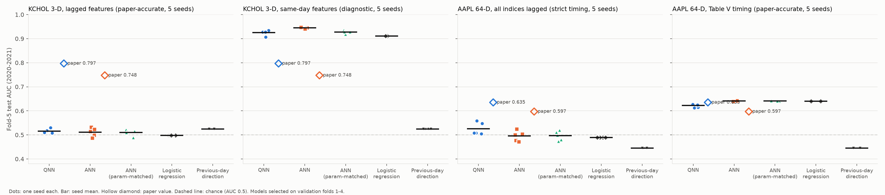
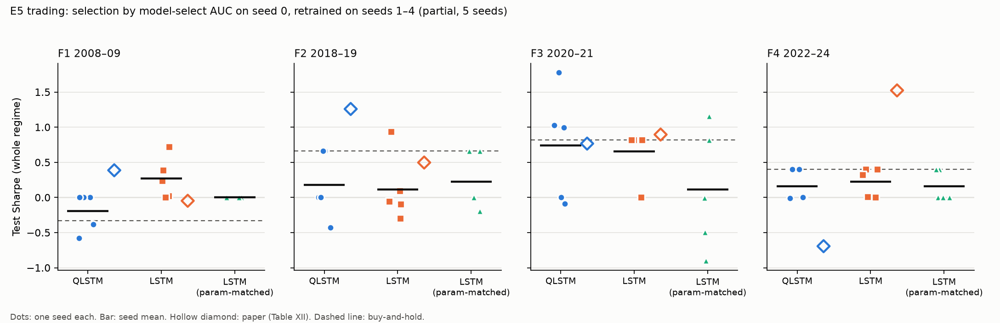
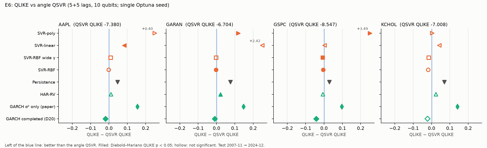
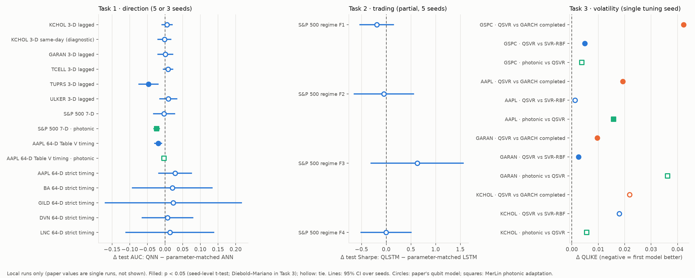

# Quantum vs. Classical Machine Learning: A Benchmark Study for Financial Prediction — Reproduction

Reproduction of arXiv:2601.03802.

**Status:** experiments, photonic adaptation (`PARTIAL_MERLIN_TRANSLATION`), fair comparison, documentation and the notebook are complete. Start with [`notebook.ipynb`](notebook.ipynb), a guided walkthrough that runs on CPU in about 3.5 minutes.

**Headline:** no quantum or photonic advantage is supported by any fair comparison.
- One task is reproduced quantitatively: S&P 500 direction (AUC 0.757 vs the paper's 0.750–0.766).
- The two abstract headline claims (AAPL and KCHOL) are not supported.

## Reference and Attribution

- **Paper:** Quantum vs. Classical Machine Learning: A Benchmark Study for Financial Prediction. arXiv preprint, 2026; cs.LG / quant-ph.
- **Authors:** Rehan Ahmad, Muhammad Kashif, Nouhaila Innan, Muhammad Shafique.
- **arXiv:** https://arxiv.org/abs/2601.03802
- **Original repository:** none released. We searched GitHub, Hugging Face, Semantic Scholar and the author pages (`VISITED_URLS.md`).
- **Attribution:** all code in this folder is an independent reimplementation. `lib/metrics.py::diebold_mariano` is adapted from `papers/QARIMA`. Cite the arXiv preprint for the method and the paper's numbers.

## Original Paper

The paper benchmarks simulated gate-based quantum models against classical models of the same family on three daily equity tasks.

1. **Directional classification** (Tables IX–XI). Predict whether the next day's close is above today's.
   - **Models:** four QNN families (SQ, MQ, Hybrid-SQ, Hybrid-MQ: fully quantum or with a classical pre-layer; single- or multi-qubit readout) against shallow ANNs.
   - **Feature sets:**
     - 3-D momentum indicators for 5 Turkish stocks;
     - 7-D cross-market returns for the S&P 500;
     - 64-D lagged returns of 8 indices plus the stock, for 5 U.S. stocks.
   - **Evaluation:** 5-fold walk-forward; test AUC, accuracy, precision and recall on fold 5 (2020–2021).
2. **Live trading** (Table XII).
   - **Models:** a QLSTM and a classical LSTM produce long/short/flat signals on the S&P 500.
   - **Regimes:** F1 2008–09, F2 2018–19, F3 2020–21, F4 2022–24.
   - **Metrics:** test AUC, annualized return, Sharpe and Sortino, with a 0.05% fee.
3. **Volatility forecasting** (Tables XIII–XIV).
   - **Target:** next-day 5-day realized variance.
   - **Models:** angle-encoded (10 qubits) or amplitude-encoded (5 qubits) QSVR, against linear/polynomial/RBF SVR and GARCH(1,1).
   - **Metrics:** QLIKE, MSE, R², directional accuracy and Diebold–Mariano tests.

**Main claims:**
- C1/C2 (abstract): hybrid QNNs beat ANNs on AAPL (64-D) and KCHOL (3-D).
- C5: the QLSTM has a higher Sharpe in F1 and F2.
- C7: the angle QSVR has the lowest QLIKE on KCHOL.
- C10: QSVRs match or exceed linear SVRs.

## Reproduction Scope, Claims, and Deviations

**Reproduced:**
- Every result table of the paper (IX–XIV) on all tickers and regimes.
- Table VI's volatility, max drawdown and skew, as a data check (E4, partial).
- E8 (amplitude dimension d = 16/64 and the training-window sweep) was **not run**.

**Claim verdicts** (judged against fair controls; details in [Fair Baselines](#fair-baselines)):

| Claim | Verdict |
|---|---|
| C1 QNN beats ANN on AAPL | UNSUPPORTED |
| C2 QNN beats ANN on KCHOL | UNSUPPORTED |
| C3 ANN wins on most other tickers | PARTIALLY_SUPPORTED |
| C4 hybrid preprocessing and multi-qubit readout drive QNN performance | UNRESOLVED (per-family ablation not analysed) |
| C5 QLSTM higher Sharpe in F1, F2 | UNSUPPORTED |
| C6 QLSTM higher AUC in all regimes | UNSUPPORTED |
| C7 QSVR lowest QLIKE on KCHOL | UNSUPPORTED (the "within 0.02–0.04 of RBF" part holds) |
| C8 QSVR beats linear and poly SVR | PARTIALLY_SUPPORTED |
| C9 amplitude QSVR competitive at d = 32 | PARTIALLY_SUPPORTED |
| C10 QSVR ≥ linear SVR | SUPPORTED in our runs (single tuning seed) |
| C11 the benchmark is fair | UNSUPPORTED |

**Implementation:** everything is written from scratch in PyTorch. `lib/statevector.py` is a batched exact-statevector simulator with the same noiseless semantics as the paper's TorchQuantum. The QLSTM layout was reconstructed from the paper's parameter counts and reproduces all four Table XII counts exactly.

**Deviations and filled gaps** (full list in `LOG.md`, "Phase 2 implementation decisions"):

- **Task 1 selection.**
  - Primary protocol (`leak_free`): select on validation folds 1–4 and test on fold 5.
  - The paper's protocol (`paper`) averages folds 1–5, which include the test window. It is reported alongside. It shifts test AUC by 0.015 on average, and by up to 0.06 on chance-level settings. Under it the QNN significantly beats its matched ANN in 4 chance-level settings (ULKER, AAPL strict, BA, LNC); under `leak_free`, in none.
- **Task 1 feature timing.**
  - The 3-D indicators use information up to day t−1.
  - `configs/e1_same_day_diagnostic.json` uses same-day indicators. It is a leakage diagnostic and reaches the paper's AUC level.
  - The 64-D features have two timings:
    - `strict`: all inputs lagged;
    - `table_v`: APAC/EU indices at lags 0–6, as the paper's Table V implies; `configs/e3_table_v.json`.
- **Task 1 training settings** are not stated in the paper. We assumed Adam, lr 1e-3, batch 32, at most 300 epochs, and early stopping with patience 30 on validation AUC.
- **Task 2 split.**
  - Primary: Fig. 6's split. Train on the history before each regime and backtest on the whole regime.
  - The text's within-regime 70/10/10/10 split is available with `--split-mode within_regime`.
- **Task 2 grid search under the RED reduction rule.** The full 30-candidate grid runs on seed 0. The selected candidates are then retrained with seeds 1–4.
- **Task 3 lags and window.**
  - Lags: 5+5 for E6 and 16+16 for E7.
  - Window: expanding, starting at 720 days, refit every 120 days.
  - The paper does not state its test window (R15).
  - The paper's GARCH forecasts the 5-day realized variance from its one-day σ² alone. We run that version (`garch_sigma2`) and a completed GARCH that adds the 4 squared returns already known at t (`garch`).
- **Fair baselines added** (not in the paper):
  - a parameter-matched ANN (±10% parameters) and LSTM (closest count);
  - logistic regression and majority class;
  - buy-and-hold and always-flat;
  - HAR-RV and persistence;
  - an RBF SVR with γ searched over a wide continuous range (`svr_rbf_wide`).
- **Photonic adaptation (MerLin).** This is an extension, not the paper's method; see [Photonic Assessment](#photonic-assessment-and-merlin-extension).
- **Hardware.** One Apple M4 laptop, CPU only. Everything is a noiseless simulation; there was no QPU access.

## Project Layout

```text
papers/QML_financial_benchmark/
├── README.md, requirements.txt, cli.json
├── notebook.ipynb    # guided walkthrough: claims, live controls, stored results, verdicts
├── configs/          # defaults.json + one JSON per experiment (table below)
├── lib/
│   ├── runner.py     # train_and_evaluate(cfg, run_dir): dispatches on cfg["task"]
│   ├── data.py, features.py        # Yahoo loaders, indicators, walk-forward/regime splits
│   ├── statevector.py, models.py   # batched statevector simulator; QNN, ANN, QLSTM, LSTM
│   ├── kernels.py, training.py, metrics.py, summary.py, experiment_logging.py
│   ├── photonic_merlin.py          # MerLin photonic kernel and photonic QNN
│   └── tasks/        # directional.py, trading.py, volatility.py
├── utils/            # data download, sweep launcher, statistics, figures, verification
├── tests/            # 51 tests (pytest)
├── results/          # curated CSV/JSON/PNG artifacts referenced below
├── models/           # empty: no trained models are kept
└── outdir/           # raw runs and sweeps (git-ignored, disposable)
```

## Install and How to Run

```bash
# From the repository root
python -m venv .venv
.venv/bin/python -m pip install -r papers/QML_financial_benchmark/requirements.txt
```

Download the data once. The python.org Python build needs the certifi CA bundle:

```bash
SSL_CERT_FILE=$(.venv/bin/python -c "import certifi; print(certifi.where())") \
  .venv/bin/python papers/QML_financial_benchmark/utils/download_yahoo_data.py
```

**Smoke runs** (seconds each; not paper results):

```bash
python implementation.py --paper QML_financial_benchmark --config configs/defaults.json
python implementation.py --paper QML_financial_benchmark --config configs/e5_reduced.json
python implementation.py --paper QML_financial_benchmark --config configs/e6_reduced.json
python implementation.py --paper QML_financial_benchmark --config configs/e6_merlin_reduced.json
python implementation.py --paper QML_financial_benchmark --config configs/e2_merlin_reduced.json
```

**Paper-scale runs** (one ticker, regime or seed per run):

```bash
python implementation.py --paper QML_financial_benchmark --config configs/e1_original.json --ticker KCHOL.IS --seed 0
python implementation.py --paper QML_financial_benchmark --config configs/e2_original.json --seed 0
python implementation.py --paper QML_financial_benchmark --config configs/e3_table_v.json --ticker AAPL --seed 0
python implementation.py --paper QML_financial_benchmark --config configs/e5_original.json --regime F2 --seed 0
python implementation.py --paper QML_financial_benchmark --config configs/e6_original.json --vol-ticker KCHOL.IS
python implementation.py --paper QML_financial_benchmark --config configs/e7_original.json --vol-ticker AAPL

# Equivalent from inside papers/QML_financial_benchmark
python ../../implementation.py --config configs/e1_original.json --ticker KCHOL.IS
```

**Seed sweeps** use `utils/sweep.py`. The exact command of every sweep (S1–S15) is in `LOG.md` under "Sweep Records". For example:

```bash
.venv/bin/python papers/QML_financial_benchmark/utils/sweep.py --config configs/e1_original.json \
  --name e1_kchol --seeds 0 1 2 3 4 --max-parallel 4 -- --ticker KCHOL.IS
```

The post-processing chain runs from the repository root and rebuilds every file in `results/`:

1. `utils/stats_directional.py`, `stats_trading.py` and `stats_volatility.py`.
2. `utils/plot_*.py`.
3. `utils/verify_sweeps.py --validator <validate_logging.py>`.
4. `utils/compare_fair.py`.
5. `utils/export_sweep_candidates.py`.
6. `utils/paper_vs_reproduced.py`.

## Configuration

`cli.json` is the authoritative list of paper-specific flags:
- `--ticker`
- `--feature-timing`
- `--regime`
- `--split-mode`
- `--vol-ticker`
- `--num-threads`

The shared runtime adds `--config`, `--seed`, `--dtype`, `--device`, `--outdir`, `--data-root` and `--log-level`. Each config sets `task` and a section named after it (`directional`, `trading` or `volatility`).

| Config | Paper | Content |
|---|---|---|
| `defaults.json` | — | Lightweight Task 1 smoke run on KCHOL.IS |
| `e1_original.json` | Table IX | 3-D lagged features; 24 QNN candidates (4 families × L = 1..6) and 10 ANN widths |
| `e1_same_day_diagnostic.json` | — | E1 with same-day indicators (leakage diagnostic) |
| `e2_original.json` | Table X | 7-D S&P 500 features; 7-qubit QNNs |
| `e3_original.json` | Table XI | 64-D strictly lagged features; amplitude QNNs on 2–6 qubits (72 candidates) |
| `e3_table_v.json` | Table XI | 64-D with the Table V timing (APAC/EU lags 0–6) |
| `e3_hybrid_angle.json` | — | 64-D with the hybrid 64→n angle reading |
| `e5_original.json` | Table XII | QLSTM vs LSTM trading, one regime per run (30 candidates) |
| `e5_stage2_F1.json` … `e5_stage2_F4.json` | Table XII | Seeds 1–4 on the seed-0 selections |
| `e5_reduced.json` | — | Trading smoke run |
| `e6_original.json` | Table XIII | Volatility, 5+5 lags, angle QSVR (10 qubits); SVR family, GARCH, HAR, persistence |
| `e6_garch_sigma2.json` | Table XIII | Adds the paper-style σ²-only GARCH |
| `e7_original.json` | Table XIV | Volatility, 16+16 lags, amplitude QSVR (d = 32, 5 qubits) |
| `e6_reduced.json` | — | Volatility smoke run |
| `e6_merlin.json` (+ `_reduced`) | — | MerLin photonic fidelity kernel in the E6 protocol |
| `e2_merlin.json` (+ `_reduced`) | — | MerLin photonic QNN in the E2 protocol |
| `e3_table_v_merlin.json` | — | MerLin photonic QNN, AAPL 64-D Table V timing |

## Data

**Source:** Yahoo Finance daily prices, the paper's source.
- `utils/download_yahoo_data.py` downloads the 18 symbols of Tables III–V for 2000-01-01 → 2024-12-31.
- Files go to `data/QML_financial_benchmark/yahoo_daily_prices/`: `csv/<SYMBOL>.csv`, `raw/<SYMBOL>.json` and `manifest.json` (SHA-256 checksums). The folder's README gives the details.
- The snapshot used for every result was fetched 2026-10-21T08:32Z.
- Override the data root with `DATA_DIR=/abs/path` or `--data-root /abs/path`.

**Transformations:**
- Turkish zero-volume rows that repeat the previous close are Yahoo exchange-holiday placeholders, and are dropped.
- Returns are log returns of adjusted closes.
- The Task 3 target is the next-day 5-day realized variance RV_{t+1} = (r²_{t−3} + … + r²_{t+1}) / 5, the mean of five squared daily log returns. Four of its five terms are known at t, which is why the completed GARCH matters.
- The 3-D indicators (RSI-14, %K-14 and the 3-day SMA of %K) follow the paper's formulas. They are shifted to t−1 unless the diagnostic config is used.

**Known limitations:**
- Yahoo revises adjusted prices. The snapshot is the paper's source but not its exact (undated) download.
- As a check, our ^GSPC series reproduces Table VI's volatility, max drawdown and skew.
- Turkish adjusted closes are non-positive before mid-2004. Any window that reaches them fails with an error.
- There is no fallback or synthetic data.

## Results Obtained and Comparison with the Paper

**How to read these results:**
- All values are test-set values on the local Yahoo snapshot.
- Values are mean ± sample std over seeds, unless labelled otherwise.
- Every number is generated from structured metrics by the scripts above.

**Scope labels:**
- `paper-accurate`: full protocol, ≥ 3 seeds.
- `partial`: reduced protocol.
- `preliminary`: single tuning seed.
- `diagnostic`: not the paper's protocol.

**Comparison columns** (the full table is [`results/paper_vs_reproduced.csv`](results/paper_vs_reproduced.csv)):
- **Delta** is reproduced minus paper.
- **Metric agreement** is "yes" when |delta| ≤ max(0.02, 2 × seed std).
- **Trend agreement** asks whether the local quantum − classical difference has the paper's sign at p < 0.05:
  - seed-level t-test for Tasks 1–2;
  - Diebold–Mariano for Task 3.
- "tie" means p ≥ 0.05.

### Task 1: directional classification (Tables IX–XI)

**Protocol:**
- Test on fold 5 (2020-01-02 → 2021-12-31).
- Select candidates by the `leak_free` rule (validation folds 1–4).
- The quantum − classical trend is QNN − ANN grid.

| Paper item | Claim | Setting | Model | Paper AUC | Reproduced AUC | Delta | Metric agr. | Trend agr. | Claim support | Seeds | Comment |
|---|---|---|---|---:|---:|---:|---|---|---|---:|---|
| Table IX | C2 | KCHOL 3-D lagged | QNN | 0.797 | 0.516 ± 0.009 | −0.281 | no | tie (p = 0.67) | UNSUPPORTED | 5 | All models at chance with leak-free features |
| Table IX | C2 | KCHOL 3-D lagged | ANN | 0.748 | 0.511 ± 0.018 | −0.236 | no | tie | UNSUPPORTED | 5 | |
| Table IX | C2 | KCHOL 3-D same-day | QNN | 0.797 | 0.926 ± 0.011 | +0.129 | n/a (diagnostic) | reversed (ANN better, p = 0.021) | UNSUPPORTED | 5 | Same-day features reach the paper's level: likely leakage (G1) |
| Table IX | C2 | KCHOL 3-D same-day | ANN | 0.748 | 0.944 ± 0.003 | +0.197 | n/a (diagnostic) | reversed | UNSUPPORTED | 5 | |
| Table IX | C3 | GARAN 3-D | QNN / ANN | 0.709 / 0.810 | 0.497 ± 0.023 / 0.515 ± 0.015 | −0.213 / −0.295 | no | tie | PARTIALLY_SUPPORTED | 5 | Chance level |
| Table IX | C3 | TCELL 3-D | QNN / ANN | 0.743 / 0.760 | 0.508 ± 0.010 / 0.492 ± 0.010 | −0.236 / −0.267 | no | tie | PARTIALLY_SUPPORTED | 5 | Chance level |
| Table IX | C3 | TUPRS 3-D | QNN / ANN | 0.904 / 0.904 | 0.469 ± 0.022 / 0.498 ± 0.024 | −0.435 / −0.406 | no | tie | PARTIALLY_SUPPORTED | 5 | Matched ANN beats QNN, p = 0.008 |
| Table IX | C3 | ULKER 3-D | QNN / ANN | 0.852 / 0.876 | 0.506 ± 0.017 / 0.505 ± 0.014 | −0.345 / −0.371 | no | tie | PARTIALLY_SUPPORTED | 5 | Chance level |
| Table X | C3 | S&P 500 7-D | QNN | 0.750 | 0.757 ± 0.008 | +0.008 | **yes** | tie (p = 0.93) | PARTIALLY_SUPPORTED | 5 | **Quantitatively reproduced**; logistic 0.767 |
| Table X | C3 | S&P 500 7-D | ANN | 0.766 | 0.757 ± 0.012 | −0.009 | **yes** | tie | PARTIALLY_SUPPORTED | 5 | |
| Table XI | C1 | AAPL 64-D Table V timing | QNN | 0.635 | 0.622 ± 0.008 | −0.013 | **yes** | reversed (ANN better, p = 0.006) | UNSUPPORTED | 5 | Level matches; the paper's ANN is under-tuned |
| Table XI | C1 | AAPL 64-D Table V timing | ANN | 0.597 | 0.641 ± 0.001 | +0.044 | no | reversed | UNSUPPORTED | 5 | |
| Table XI | C1 | AAPL 64-D strict timing | QNN / ANN | 0.635 / 0.597 | 0.525 ± 0.026 / 0.495 ± 0.021 | −0.110 / −0.102 | no | tie (p = 0.076) | UNSUPPORTED | 5 | Near chance without same-day APAC/EU returns |
| Table XI | C3 | BA 64-D strict | QNN / ANN | 0.618 / 0.738 | 0.519 ± 0.024 / 0.452 ± 0.032 | −0.099 / −0.286 | no | reversed (QNN better than grid ANN, p = 0.004) | PARTIALLY_SUPPORTED | 3 | Tie with the matched ANN (p = 0.52) and logistic |
| Table XI | C3 | GILD 64-D strict | QNN / ANN | 0.590 / 0.620 | 0.520 ± 0.050 / 0.475 ± 0.005 | −0.070 / −0.146 | QNN yes, ANN no | tie | PARTIALLY_SUPPORTED | 3 | Chance level |
| Table XI | C3 | DVN 64-D strict | QNN / ANN | 0.608 / 0.675 | 0.505 ± 0.028 / 0.497 ± 0.044 | −0.103 / −0.178 | no | tie | PARTIALLY_SUPPORTED | 3 | Chance level |
| Table XI | C3 | LNC 64-D strict | QNN / ANN | 0.663 / 0.694 | 0.494 ± 0.047 / 0.506 ± 0.016 | −0.169 / −0.189 | no | tie | PARTIALLY_SUPPORTED | 3 | Chance level |



- **Metric agreement** holds only where the features carry next-day signal:
  - E2;
  - AAPL with the Table V timing.
- **Turkish 3-D:** the paper's 0.71–0.90 AUCs are reachable only with same-day information (gap G1, `results/gap_sanity.json`).
- **U.S. 64-D:** the paper's levels need the Table V timing (G2, `results/gap_us64_timing.json`).
  - With it, the classical models beat the QNN on AAPL.
  - BA, GILD, DVN and LNC were run with strict timing only. Their Table V sweep (S12b) was stopped because the laptop was overloaded.
- **Per-seed statistics:** `results/e1_*_statistics.csv`, `e2_spx_statistics.csv`, `e3_*_statistics.csv`.

### Task 2: live trading (Table XII)

**Protocol:**
- Whole-regime backtest with a 0.05% fee.
- Selection by the `auc` rule: highest model-select AUC on seed 0, then retrained with seeds 1–4.
- **Label:** `partial` (RED reduction rule), 5 seeds.

| Paper item | Claim | Regime | Model | Paper Sharpe | Reproduced Sharpe | Delta | Metric agr. | Trend agr. | Claim support | Seeds | Comment |
|---|---|---|---|---:|---:|---:|---|---|---|---:|---|
| Table XII | C5 | F1 2008–09 | QLSTM | 0.39 | −0.19 ± 0.27 | −0.58 | no | tie (p = 0.10) | UNSUPPORTED | 5 | Buy & hold −0.33 |
| Table XII | C5 | F1 2008–09 | LSTM | −0.05 | +0.27 ± 0.30 | +0.32 | yes | tie | UNSUPPORTED | 5 | |
| Table XII | C5 | F2 2018–19 | QLSTM | 1.26 | +0.18 ± 0.48 | −1.08 | no | tie (p = 0.87) | UNSUPPORTED | 5 | Buy & hold +0.66 |
| Table XII | C5 | F2 2018–19 | LSTM | 0.50 | +0.12 ± 0.48 | −0.38 | yes | tie | UNSUPPORTED | 5 | |
| Table XII | C5 | F3 2020–21 | QLSTM | 0.77 | +0.74 ± 0.78 | −0.02 | yes | tie (p = 0.84) | UNSUPPORTED | 5 | Buy & hold +0.82 |
| Table XII | C5 | F3 2020–21 | LSTM | 0.89 | +0.65 ± 0.37 | −0.24 | yes | tie | UNSUPPORTED | 5 | |
| Table XII | C5 | F4 2022–24 | QLSTM | −0.69 | +0.16 ± 0.22 | +0.85 | no | tie (p = 0.36) | UNSUPPORTED | 5 | Buy & hold +0.40 |
| Table XII | C5 | F4 2022–24 | LSTM | 1.52 | +0.23 ± 0.21 | −1.30 | no | tie | UNSUPPORTED | 5 | |



- **Test AUCs** are about 0.50–0.55, as in the paper. QLSTM − LSTM AUC is not consistently positive (C6, UNSUPPORTED).
- **Random-score null band.** Random scores pushed through the paper's τ calibration give Sharpe ratios of about [−1.5, +0.9] per regime (G3, `results/gap_trading_null.json`). Every paper and local Sharpe sits inside that band.
- **τ-Sharpe rule.** The alternative selection rule's results are in `results/e5_trading.csv` and `results/e5_sharpe_tau_sharpe_rule.png`.

### Task 3: volatility forecasting (Tables XIII–XIV)

**Protocol:**
- QLIKE, lower is better. Expanding window 2007–2024 with about 4,300 test days.
- **Label:** `preliminary` (single Optuna seed); GARCH, HAR and persistence are deterministic.
- **Metric agreement is n/a:** the paper's test window is not stated (R15), so absolute QLIKE levels are not comparable; rankings are.
- **Trend direction:** paper and local differences are both QSVR − comparator; negative means QSVR better.

| Paper item | Claim | Ticker | QSVR angle (paper / ours) | SVR-RBF (paper / ours) | SVR-linear (paper / ours) | Paper GARCH σ²-only (paper / ours) | Completed GARCH (ours) | Trend agr. vs RBF | Claim support | Comment |
|---|---|---|---|---|---|---|---|---|---|---|
| Table XIII | C7 | ^GSPC | −8.294 / −8.547 | −8.328 / −8.552 | −7.875 / −8.544 | −8.249 / −8.451 | **−8.590** | yes (RBF better, DM p = 0.027) | UNSUPPORTED (KCHOL part) | QSVR within 0.005 of RBF |
| Table XIII | C7 | AAPL | −7.389 / −7.380 | −7.410 / −7.382 | −7.252 / −7.296 | −7.283 / −7.226 | **−7.400** | tie (p = 0.74) | UNSUPPORTED (KCHOL part) | QSVR within 0.001 of RBF |
| Table XIII | C7 | GARAN | −6.212 / −6.704 | −6.220 / −6.706 | −6.049 / −4.279 | −6.140 / −6.557 | **−6.713** | yes (p = 0.003) | UNSUPPORTED (KCHOL part) | Linear SVR has a failed refit block |
| Table XIII | C7 | KCHOL | **−6.435** / −7.008 | −6.425 / −7.026 | −6.293 / −6.966 | −6.359 / −6.867 | **−7.030** | tie (paper: QSVR better) | UNSUPPORTED | QSVR not lowest; RBF and completed GARCH lower |
| Table XIV | C9 | ^GSPC / AAPL / GARAN / KCHOL | amplitude QSVR: −8.182 / −7.307 / −5.615 / −6.180 (paper) vs −8.552 / −7.366 / −6.669 / −7.010 (ours) | | | | | behind RBF on 3/4 (significant on AAPL, KCHOL) | PARTIALLY_SUPPORTED | Amplitude kernel = classical cosine kernel |



- **C8:** the QSVR beats linear and polynomial SVR in direction on all four tickers. It is significant (DM p < 0.05) in 1/4 cases against linear and 3/4 against poly.
- **C10:** both encodings are at least as good as linear SVR on all four tickers (SUPPORTED in our runs). This contradicts the paper's own Table XIV.
- **GARCH:** "QSVR beats GARCH" holds only against the σ²-only GARCH (A1). The completed GARCH beats every kernel model and is significantly better than the QSVR on ^GSPC, AAPL and GARAN.
- **Sources:**
  - full metrics with DM tests: `results/e6_e7_seed0_table.csv`;
  - the σ²-only GARCH comparison: `results/e6_with_garch_sigma2.csv`.

### Sweeps: complete candidate tables

- **Durable rankings.** `outdir/` is disposable, so every sweep's full ranking is exported to `results/sweep_candidates/<sweep>.csv`, one row per (variant, seed, rule, family, candidate).
  - Columns include the declared score, its rank, a `tied_with_best` flag (within 1e-4) and a `selected` flag.
- **Sweep index.** [`results/sweep_index.csv`](results/sweep_index.csv) states each sweep's metric, direction, split, checkpoint rule, aggregation, run counts, completeness and tie-rule decisions.
- **Independent verification.** `utils/verify_sweeps.py` recomputed all 522 in-run selections from raw `candidates.csv` and they match. All 16 verified sweeps (S1–S11, S12a, S13–S15) are COMPLETE against their plans, and logging validation passes (`results/sweep_verification.json`). The stopped S12b is excluded as SUPERSEDED.
- **Selection rules:**
  - **Tasks 1 and 2:** maximize the declared validation score. Ties within 1e-4 go to fewer parameters, then grid order.
  - **Task 3:** each model is tuned per refit by Optuna (50 trials, validation QLIKE). There is no candidate grid; the table ranks every model by test QLIKE per ticker.

| Sweep | Experiment | Declared selection metric (direction) | Runs (done / expected) | Candidates per run | Selections decided by the tie rule | Scope |
|---|---|---|---|---:|---:|---|
| S1 `e1_kchol` | E1 KCHOL | mean val. AUC folds 1–4 / 1–5 (max) | 5 / 5 | 68 rows (34 × 2 rules) | 0 | paper-accurate |
| S3 `e1_kchol_sameday` | E1 diagnostic | as S1 | 5 / 5 | 68 | 1 | diagnostic |
| S7 `e1_turkish_rest` | E1, 4 tickers | as S1 | 20 / 20 | 68 | 5 | paper-accurate |
| S6 `e2_spx` | E2 | as S1 | 5 / 5 | 68 | 1 | paper-accurate |
| S2 `e3_aapl` | E3 AAPL strict | as S1 | 5 / 5 | 164 | 0 | paper-accurate (strict timing) |
| S8a/S8b `e3_us_rest_*` | E3, 4 tickers strict | as S1 | 4 / 4 + 8 / 8 | 164 | 0 | paper-accurate (strict timing), 3 seeds |
| S12a `e3_tablev_aapl` | E3 AAPL Table V | as S1 | 5 / 5 | 164 | 1 | paper-accurate |
| S12b `e3_tablev_us_rest` | E3, 4 tickers Table V | as S1 | stopped | — | — | SUPERSEDED (excluded from all results) |
| S4 `e5_stage1` | E5 grid, seed 0 | model-select AUC; τ-slice Sharpe (max) | 4 / 4 | 60 rows (30 × 2 rules) | 3 (τ-Sharpe rule only) | partial |
| S9, S11 `e5_stage2_*` | E5 seeds 1–4 | as S4, on the seed-0 selections | 12 / 12 + 4 / 4 | 10–12 | 2 | partial |
| S5 `e6_e7_seed0` | E6, E7 | test QLIKE (min) | 8 / 8 | 8 models | — | preliminary |
| S10 `e6_garch_sigma2` | E6 GARCH variants | test QLIKE (min) | 4 / 4 | 2 models | — | deterministic |
| S13 `e6_merlin` | photonic kernel | test QLIKE (min) | 4 / 4 | 1 model | — | preliminary, adaptation |
| S14 `e2_merlin` | photonic QNN E2 | as S1 | 5 / 5 | 52 | 1 | adaptation |
| S15 `e3_tablev_merlin` | photonic QNN AAPL | as S1 | 5 / 5 | 52 | 2 | adaptation |

- **Selections vary across seeds.** No single candidate is selected in every seed of any Task 1 sweep; see the `selected` column. For example:
  - S1's QNN selections span Hybrid-MQ and Hybrid-SQ at L = 5–6;
  - S12a's span Hybrid-SQ at n = 4–6.
- **Task 1 uncertainty** comes from the 3–5 seed repetitions.
- **Task 2 caveat:** stage 2 does not repeat the grid search, so seed-to-seed selection variance is not captured.

## Fair Baselines

The paper's baselines are not fair for its claims (`MISSING_OR_UNFAIR` for all three tasks):
- the ANNs are not parameter-matched, and the paper's AAPL ANN is under-tuned (0.597, where our ANN grid reaches 0.641 on the same features);
- the QLSTM/LSTM pairs differ up to 4× in parameter count;
- the RBF SVR's γ is restricted to `scale`/`auto`, while the QSVR tunes its feature map;
- the GARCH ignores the 4/5 of the 5-day realized variance already known at t.

Every claim is therefore judged against the fair controls planned in Phase 1, run in the same runs as the quantum models:
- **Task 1:** a parameter-matched ANN (±10% parameters) and logistic regression.
- **Task 2:** a closest-parameter LSTM, buy-and-hold and always-flat.
- **Task 3:**
  - an RBF SVR with γ searched widely under the same Optuna budget;
  - the completed GARCH, HAR-RV and persistence.

Focused tests for these controls are in `tests/test_baselines.py`.



**Tie rule:** a 95% CI over seeds that contains 0 (Tasks 1–2), or DM p ≥ 0.05 (Task 3).

| Claim | Outcome | Decisive evidence against the strongest fair control |
|---|---|---|
| C1 AAPL | UNSUPPORTED | Table V timing: QNN − matched ANN −0.019 [−0.029, −0.010], p = 0.005; QNN − logistic −0.018, p = 0.008 |
| C2 KCHOL | UNSUPPORTED | QNN − matched ANN +0.006 [−0.009, +0.020], p = 0.34: a tie at chance level |
| C3 classical wins elsewhere | PARTIALLY_SUPPORTED | The QNN is never significantly above the matched ANN in 12 settings. The classical models are significantly ahead on TUPRS (−0.047, p = 0.008) and AAPL Table V; the other 10 tie. QNN higher recall not reproduced. |
| C5 QLSTM Sharpe F1, F2 | UNSUPPORTED | QLSTM − matched LSTM: F1 −0.19 (p = 0.19), F2 −0.05 (p = 0.84), F3 +0.63 (p = 0.13), F4 −0.00 (p = 0.99) |
| C6 QLSTM AUC | UNSUPPORTED | Against the matched LSTM: F1 −0.001, F2 −0.003, F3 +0.040 (p = 0.055), F4 −0.016 (p = 0.045, LSTM better) |
| C7 QSVR on KCHOL | UNSUPPORTED | QSVR − RBF +0.018 (p = 0.34); QSVR − completed GARCH +0.022 (p = 0.24) |
| C8 QSVR beats linear, poly | PARTIALLY_SUPPORTED | Direction 4/4; significant 1/4 (linear), 3/4 (poly) |
| C9 amplitude QSVR | PARTIALLY_SUPPORTED | Behind RBF on 3/4 tickers; d = 64 not run; the kernel is classical |
| C10 QSVR ≥ linear SVR | SUPPORTED in our runs | 4/4 tickers, both encodings (single tuning seed) |

- **Cost.** Simulated wall-clock per training is 20× (QNN) to 150× (QLSTM) that of the classical counterparts (`results/phase5_timing.csv`).
- **Full tables:**
  - `results/phase5_comparison.csv`: 181 system rows;
  - `results/phase5_differences.csv`: differences with CIs and p-values.

## Photonic Assessment and MerLin Extension

**Status:** `PARTIAL_MERLIN_TRANSLATION`. These are adaptations, not the paper's method (`lib/photonic_merlin.py`). Each one keeps the paper model's scientific role.

| Task | Paper model → photonic model | Photonic result | Qubit model | Strongest fair classical |
|---|---|---|---|---|
| T3 volatility (E6), 4 tickers | Angle-QSVR fidelity kernel → SVR on a multi-photon fidelity kernel (phases π·x re-uploaded after fixed random MZI meshes) | QLIKE ^GSPC −8.544, AAPL −7.365, GARAN −6.668, KCHOL −7.003 | −8.547, −7.380, −6.704, −7.008 | Completed GARCH −8.590, −7.400, −6.713, −7.030 |
| T1 E2, S&P 500 7-D | QNN → photonic QNN (trainable MZI meshes, threshold readout), 5 seeds | AUC 0.745 ± 0.005 (140–182 parameters) | 0.757 ± 0.008 | Paired matched ANN 0.769; logistic 0.767 |
| T1 AAPL 64-D Table V | Hybrid QNN → hybrid photonic QNN, 5 seeds | AUC 0.635 ± 0.004 (450–688 parameters) | 0.622 ± 0.008 (1,088–4,275 parameters) | Paired matched ANN 0.638; logistic 0.640 |

- **Agreement with the qubit models:** the photonic models are within ±0.02 of them on 3/4 volatility tickers (GARAN +0.036) and on both classification tasks.
- **Against fair controls:** no photonic model is significantly better than any matched control.
  - Photonic QNN on E2 − matched ANN: −0.024, p = 0.0009.
  - On AAPL Table V: −0.003, p = 0.19 (tie).
- **Not translated:**
  - **Trading (QLSTM):** the protocol cannot separate models (G3).
  - **E7 amplitude kernel:** classical on any platform, because a fixed unitary cancels in the fidelity.
- **MerLin issues found** (angle-encoding `scale` ignored, `FidelityKernel` returning all ones, version string mismatch, kernel cost) are in `ACTION_REQUIRED_SEND_TO_MERLIN_TEAM.md`.

## Hardware-Aware Settings

All MerLin results are noiseless, lossless, analytic simulations; there is no hardware validation.
- **Software:** package `merlinquantum` 0.4.2. Note that `merlin.__version__` reports 0.4.1.
- **Machine:** Apple M4 CPU.

| Field | S13 photonic kernel (E6) | S14 photonic QNN (E2) | S15 photonic QNN (AAPL Table V) |
|---|---|---|---|
| Computation space | FOCK amplitudes (exact overlap); measured quantity = input-pattern return probability | UNBUNCHED | UNBUNCHED |
| Detector model | Threshold (hardware estimate of the fidelity); simulation exact | Threshold | Threshold |
| Photons | 2 or 3 (tuned; mostly 3) | 2 or 3 (selected: 3 in 3 seeds, 2 in 2) | 2 or 3 (selected: 2 in all seeds) |
| Modes | 10 | 7 | 6 or 8 (selected: 6 in 3 seeds, 8 in 2) |
| Input state | Spread single photons, n = 3: [1,0,0,1,0,0,0,1,0,0] | n = 3: [1,0,1,0,0,1,0]; n = 2: [1,0,0,0,1,0,0] | m = 6, n = 2: [1,0,0,1,0,0]; m = 8: [1,0,0,0,1,0,0,0] |
| Encoding | Phase π·x per mode, re-uploaded L ∈ {1,2,3} times after fixed random meshes (seeds 1234 + l) | Phases π·x or Linear(7→7) output, L ∈ {1,2} between trainable meshes | Linear(64→m) output phases, L ∈ {1,2} |
| Measurement | `MeasurementStrategy.amplitudes(FOCK)` → \|⟨ψ\|ψ′⟩\|² | `probs(UNBUNCHED)`; SQ′: P(last mode occupied); MQ′: Linear head | as S14 |
| Postselection | none | none | none |
| Simulator / QPU | MerLin SLOS CPU simulator, float64 | MerLin CPU, float32 | MerLin CPU, float32 |
| Shots | n/a (analytic) | n/a | n/a |
| Wall-clock | 14 min for 4 runs (2 workers) | 2 h 36 min for 5 runs | 2 h 23 min for 5 runs |
| Seeds | Optuna sampler seed 0 (deterministic kernel) | 0–4 | 0–4 |

**Scaling:**
- The FOCK dimension is C(m+n−1, n): 220 for m = 10, n = 3.
- The UNBUNCHED dimension is C(m, n).
- Both grow combinatorially, and the kernel Gram matrix costs O(N² · dim).

## Limitations

**Reduced or partial scope:**
- E5 uses the RED reduction rule. The grid search runs on seed 0 only, so the Task 2 results are `partial`.
- E6/E7 use a single Optuna tuning seed (`preliminary`).
- E8 (amplitude d = 16/64, training-window robustness) was not run.
- C9's degradation at d = 64 is untested.
- The Table V timing for 64-D was run for AAPL only. The BA, GILD, DVN and LNC sweep (S12b) was stopped because the laptop was overloaded, so C3 for those tickers rests on strict timing.
- C4 (per-family ablation) is unresolved. The candidate tables contain the data, but the analysis was not done.

**Assumptions about undisclosed paper details:**
- the Task 1 training settings;
- the Task 3 lag counts and test window (R15);
- the GARCH (p, q) choice (R14);
- the exact form of the paper's same-day leakage.

**Data:**
- The Yahoo snapshot is newer than the paper's undated download.
- Paper values are single runs, so the per-seed spreads above have no paper counterpart.

**Simulation:**
- Everything is noiseless statevector or MerLin analytic simulation, with no QPU and no shot noise.
- The photonic grids are smaller than the qubit grids.

## Notebook

`notebook.ipynb` is the entry point for readers. It contains:
- the claims;
- live known-answer checks;
- a reduced live E2 run;
- live leakage, feature-timing, GARCH and null-band controls;
- the stored full-sweep results;
- the photonic assessment;
- the claim-level conclusion.

Re-execute it in a fresh kernel, recording the evidence in `results/notebook_execution.json`:

```bash
.venv/bin/python papers/QML_financial_benchmark/utils/execute_notebook.py
```

## Tests

```bash
cd papers/QML_financial_benchmark
../../.venv/bin/python -m pytest -q   # 51 tests
```

The tests cover:
- statevector simulator correctness;
- the Table XII and ANN parameter counts;
- the amplitude-kernel identity;
- the metrics (QLIKE, Sharpe, Diebold–Mariano);
- data timing and splits on the local snapshot;
- the fair baselines (matched width, wide γ, HAR, persistence);
- the MerLin photonic kernel and QNN;
- the CLI flags;
- an end-to-end default run.

## Citation and License

Cite the original paper:

```bibtex
@misc{ahmad2026quantum,
  title  = {Quantum vs. Classical Machine Learning: A Benchmark Study for Financial Prediction},
  author = {Ahmad, Rehan and Kashif, Muhammad and Innan, Nouhaila and Shafique, Muhammad},
  year   = {2026},
  eprint = {2601.03802},
  archivePrefix = {arXiv}
}
```

The code in this folder is under the repository's MIT license. The Yahoo Finance data is subject to Yahoo's terms and is not redistributed.
