# Contextual Quantum Neural Networks for Stock Price Prediction — Reproduction

Status: reproduction run, compared with classical baselines, documented and
walked through in `notebook.ipynb` (Phases 01–07 complete).

Summary: the core mechanics of the paper reproduce. The trained loader
matches the context distribution, QSTL fits the joint target distribution
($F \approx 0.999$), and at the paper's learning rates the fidelity loss
trains where MSE does not. On public substitute data, with the test split and
classical baselines this reproduction adds, we could not confirm the
comparative claims (QMTL vs QSTL, scaling to more assets). In our setting
the best quantum and photonic models perform on par with a small logistic
regression. These results depend on details the paper leaves open, notably
the data, the KL definition and the exact circuit decomposition.

## Reference and Attribution

- Paper: Sharan Mourya, Hannes Leipold, Bibhas Adhikari, "Contextual Quantum
  Neural Networks for Stock Price Prediction", Scientific Reports 16:34413
  (2026), DOI [10.1038/s41598-025-34413-5](https://doi.org/10.1038/s41598-025-34413-5);
  arXiv [2503.01884](https://arxiv.org/abs/2503.01884) (v2, 15 Feb 2026).
- Original repository: none released. Data "available from the corresponding
  author upon reasonable request"; this reproduction uses public substitute
  data instead.
- This is an independent reimplementation. No code from the authors or third
  parties is reused.

## Original Paper

The paper binarizes daily stock moves (up = 1, down = 0), takes the last
$T = 3$ days as a context and trains a gate-based circuit whose prediction
qubit samples $P(\text{next} \mid \text{context})$. Training uses the "quantum batch gradient
update" (QBGU): the whole context distribution $\sum_c \sqrt{P(c)}\,\lvert c \rangle \lvert 0 \rangle$ passes
through the circuit once and a SWAP-test fidelity loss against the joint target
$\sum_{c,o} \sqrt{P(c, o)}\,\lvert c, o \rangle$ ($o$ = next step) is minimized with SPSA. The
paper argues (Eq. 18–20) that this one pass equals full-batch SGD over all
contexts. Quantum multi-task learning (QMTL) shares one block across assets
and adds label-selected asset-specific blocks ("share-and-specify").

Main claims: QMTL reaches lower KL divergence than single-task learning
(QSTL) with half the parameters (Table 1: Apple 0.0614 vs 0.1047, Google
0.0754 vs 0.1239; 16 vs 32 parameters), converges faster, scales to 4 and 8
assets with the same parameter count; the SWAP-test loss learns where MSE
fails; a trained loader prepares the context state; and the output degrades
gracefully under noise. The paper evaluates the fit to the training
distribution with one seed. This reproduction complements that with a held-out
test split, several seeds and classical reference models.

## Reproduction Scope, Claims, and Deviations

The claims are numbered C1–C10; each is tested against a classical reference
in [Fair Baselines](#fair-baselines). C10 (portfolio loading and downstream
quantum advantage) is theoretical and out of scope.

- **Data:** `substitute-data`, public CC0 Zenodo daily prices for the same
  eight tickers. Absolute KL values are not expected to match Table 1.
- **Simulator:** exact NumPy statevector instead of Qiskit. The SWAP test is
  analytic, $P(0) = (1 + F)/2$, with binomial shot sampling; a test checks it
  against the explicit controlled-SWAP circuit.
- **Inferred circuits:** QSTL = 4 layers of RY, RZ on 4 qubits + ring CNOT
  (32 parameters); QMTL = 1 shared + 1 asset-specific layer, the asset block
  label-controlled RY and RZ without CNOT as drawn in Fig. 7 (16 parameters
  per asset).
- **Optimizer:** SPSA with constant gains as in the paper (lr 0.1,
  perturbation 0.01, 10,000 shots), seeds 42–46.
- **Context register:** exact amplitudes by default; the paper's trained HEA
  loader (Fig. 4) is a config option.
- **Evaluation added:** a chronological 80/20 test split, test log-loss of the
  per-context prediction as primary metric, paired 95 % intervals over seeds,
  and classical reference models B0–B4.
- **Extensions (not in the paper):** a context-preserving circuit that uses
  the context qubits only as controls (E11), training-set sizes from 25
  windows, multi-step prediction up to 10 qubits with and without
  interference between paths (E14), L-BFGS on the shot-free loss, and a
  MerLin photonic adaptation.
- **Not done:** the noise study (C9, Fig. 22): it characterizes one model
  without a control, and the paper does not state where the noise acts. The
  shared + asset-specific logistic multi-task baseline: only pooled shrinkage
  (B4) is used, because no new baseline was added after the baseline plan.

## Project Layout

```text
papers/QNN_STOCK/
|-- README.md, INSIGHTS.md
|-- cli.json, requirements.txt, notebook.ipynb
|-- configs/    defaults.json, e2_* .. e14_* (paper and extension experiments),
|               p4_photonic_*_merlin.json, p5_baselines_*.json, sweeps/*.json
|-- lib/        data, statevector, circuits, model, optim, training,
|               baselines, metrics, photonic_merlin, runner, experiment_logging
|-- utils/      run_sweep, summarize_sweep, compare_phase5, build_notebook,
|               plotting and analysis scripts
|-- tests/      77 tests
|-- results/    curated tables and figures
|-- outdir/     raw run directories (not committed)
`-- models/     empty (.gitkeep)
```

## Install and How to Run

```bash
pip install -r papers/QNN_STOCK/requirements.txt
```

From the repository root:

```bash
python implementation.py --paper QNN_STOCK --help
python implementation.py --paper QNN_STOCK --config configs/e3_qstl_reduced.json         # smoke, seconds
python implementation.py --paper QNN_STOCK --config configs/defaults.json                # QSTL AAPL, paper settings, ~15 s
python implementation.py --paper QNN_STOCK --config configs/e4_qmtl_original.json        # Table 1 MTL
python implementation.py --paper QNN_STOCK --config configs/e3_baselines_classical.json  # baselines B0-B4
python implementation.py --paper QNN_STOCK --config configs/p4_photonic_n2_fock_ma5_merlin.json
```

Each run writes `outdir/run_YYYYMMDD-HHMMSS/` with `run.log`,
`run_status.json`, `config_snapshot.json`, `metrics.json`,
`distributions.json`, `losses.csv` and `params.npz`.

Full reproduction: every sweep plan in `configs/sweeps/` is an evaluation
matrix over seeds (a few hundred runs take minutes on 16 CPUs):

```bash
python papers/QNN_STOCK/utils/run_sweep.py --plan papers/QNN_STOCK/configs/sweeps/phase3_s1_core.json --workers 16
python papers/QNN_STOCK/utils/summarize_sweep.py papers/QNN_STOCK/outdir/sweeps/<sweep_dir> --out papers/QNN_STOCK/results/phase3_s1
python papers/QNN_STOCK/utils/compare_phase5.py --sweeps-root papers/QNN_STOCK/outdir/sweeps --out papers/QNN_STOCK/results/phase5
python papers/QNN_STOCK/utils/plot_phase5.py --results papers/QNN_STOCK/results/phase5
```

Walkthrough notebook (`notebook.ipynb`, generated by `utils/build_notebook.py`):
it explains the method, retrains the paper's QSTL, the context-preserving
variant, the baselines and a MerLin model live (about 9.5 minutes on a laptop
CPU), and loads the stored sweeps for the multi-seed results:

```bash
cd papers/QNN_STOCK
jupyter nbconvert --to notebook --execute --inplace notebook.ipynb
```

## Configuration

`cli.json` is the authoritative CLI schema (`--kind`
{qstl, qmtl, loader, baselines, photonic}, `--tickers`, `--epochs`,
`--epochs-per-task`, `--lr`, `--shots`, `--ma-window`, `--loader-mode`,
`--ansatz`, `--interaction-order`, plus the shared `--config`, `--seed`,
`--outdir`, `--data-root`, ...).

| Configs | Experiment |
|---|---|
| `defaults.json` | QSTL, AAPL, raw daily moves, paper hyperparameters |
| `e2_loader_original.json` | HEA context loader (Fig. 11–12) |
| `e3_qstl_original.json` / `_ma5` / `_hea_loader` / `_l2*` | QSTL (Table 1 STL), MA5, trained loader, 2-layer variants |
| `e3_baselines_classical.json` / `_ma5` | baselines B0–B4 on AAPL and GOOGL |
| `e4_qmtl_original.json` / `_ma5` | QMTL $K = 2$ (Table 1 MTL, Fig. 14, 16) |
| `e6_qstl_mse_original.json` | MSE loss (Fig. 17) |
| `e7_qmtl_k4_original.json` / `e7_qmtl_k8_original.json` | QMTL $K = 4$, $K = 8$ |
| `e8_qstl_d4.json` | $d = 4$ quantile levels, $T = 2$ (Fig. 19) |
| `e11_qstl_cc{1,2,3}[_ma5].json` | extension: context-preserving circuit, interaction order 1–3 |
| `e14_qstl_seq*`, `e14_qstl_ent*` | extension: multi-step circuits without and with interference |
| `p4_photonic_{n1,n2_dist,n2_fock,n2_unbunched}[_ma5]_merlin.json` | MerLin adaptation |
| `p5_baselines_{k4,k8,d4}.json` | baselines for C7 and C8 |
| `sweeps/*.json` | sweep plans |

## Data

- Public CC0 Zenodo per-ticker daily prices (Kulkarni & Tawade, 2024-06-26)
  for the eight paper tickers. Values match Yahoo Finance exports. The raw
  CSVs are not redistributed.
- Path: `data/QNN_STOCK/sp500_daily_prices_zenodo/<TICKER>_stock_data.csv`.
  Download (bash, repository root):

  ```bash
  D=data/QNN_STOCK/sp500_daily_prices_zenodo; mkdir -p "$D"
  for pair in AAPL:12563394 GOOGL:12557495 MSFT:12560190 AMZN:12552582 PEP:12561477 WDC:12566500 TXN:12565574 IBM:12563482; do
    t=${pair%%:*}; id=${pair##*:}
    curl -sSL -o "$D/${t}_stock_data.csv" "https://zenodo.org/api/records/$id/files/${t}_stock_data.csv/content"
  done
  ```

- Preprocessing (`lib/data.py`): `Close` prices up to 2020-09-25 (AAPL then has
  exactly the paper's 10,033 prices), optional stride-1 moving average (raw,
  MA3 for $K = 8$, MA5), one-step differences, sign binarization (zero moves
  -> 0) or quantile levels for $d = 4$, chronological 80/20 split of the
  $T + 1$ windows. AAPL: 8,023 training and 2,006 test windows; GOOGL: 3,240
  and 811.

## Results Obtained and Comparison with the Paper

Scope of every number: `substitute-data`, simulated, final epoch, seeds
42–46 (training-size sweep: 42–51), mean ± std over seeds. All numbers come
from 14 complete sweeps (1900 / 1900 runs; coverage and machines in
[`results/phase5/coverage.csv`](results/phase5/coverage.csv)) and the C5
learning-rate grid (50 / 50 runs, `results/phase5_c5`). The committed
results are the comparison tables (`results/phase5`, `results/phase5_c5`,
`results/phase4_p1`), the figures, and the small per-sweep tables used by
this README and the notebook. To keep the repository small, the full
per-candidate tables of sweeps S1–S12 are not committed;
`utils/summarize_sweep.py` regenerates them from the run directories, and
per-seed values (`results/phase3_s4/metrics_long.csv`) are kept only for
the headline metrics of sweep S4.

### Reproduced paper figures

Each figure is redrawn in the paper's style from our runs on substitute data
(seed 42, raw daily moves unless stated). The bars are our model output and
the line is the target computed from our data, so the targets differ from
the paper's.

| | |
|---|---|
| 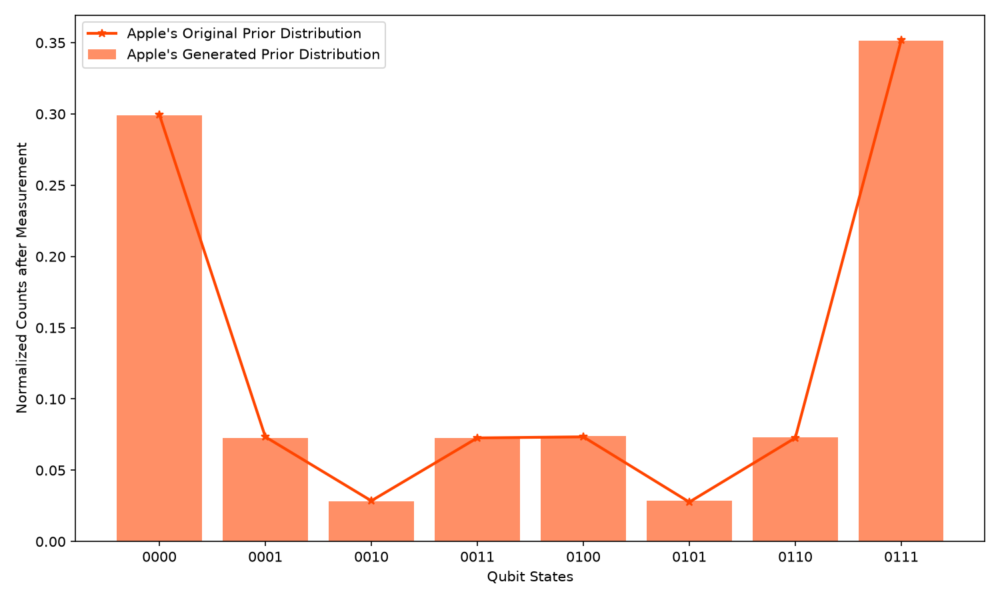 | 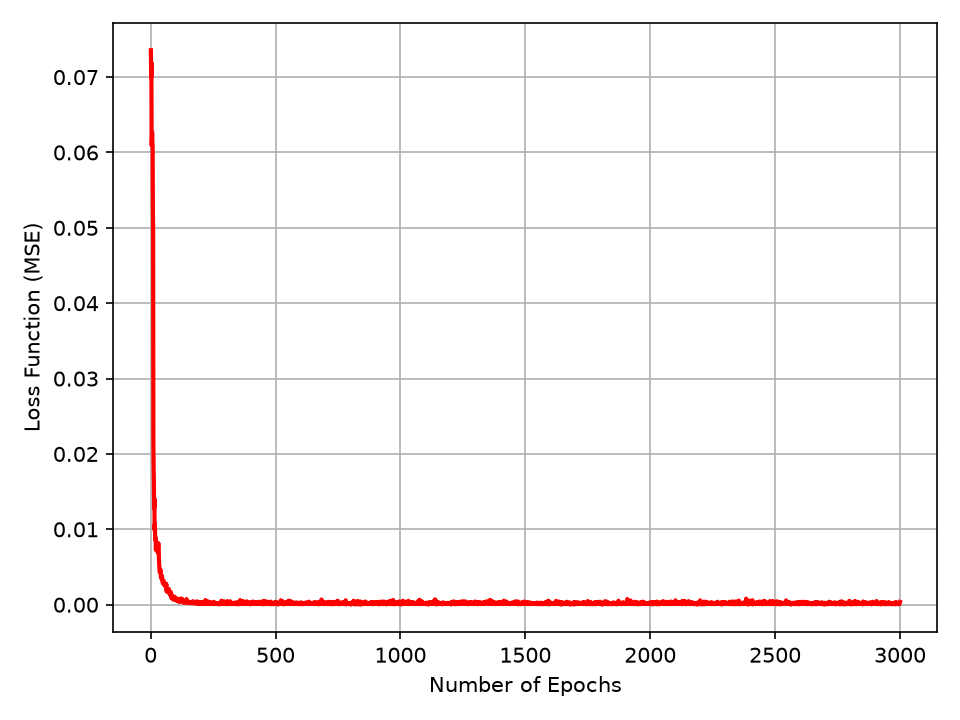 |
| **Fig. 11** Trained HEA loader against the AAPL context prior: the measured distribution matches closely (TVD 0.002–0.006). | **Fig. 12** Loader training loss. |
| 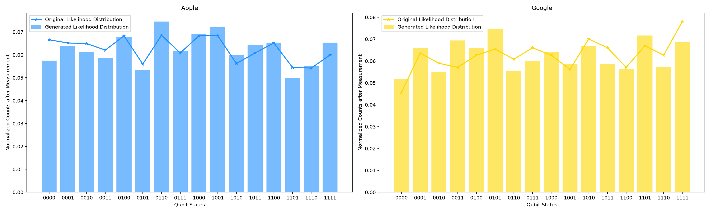 | 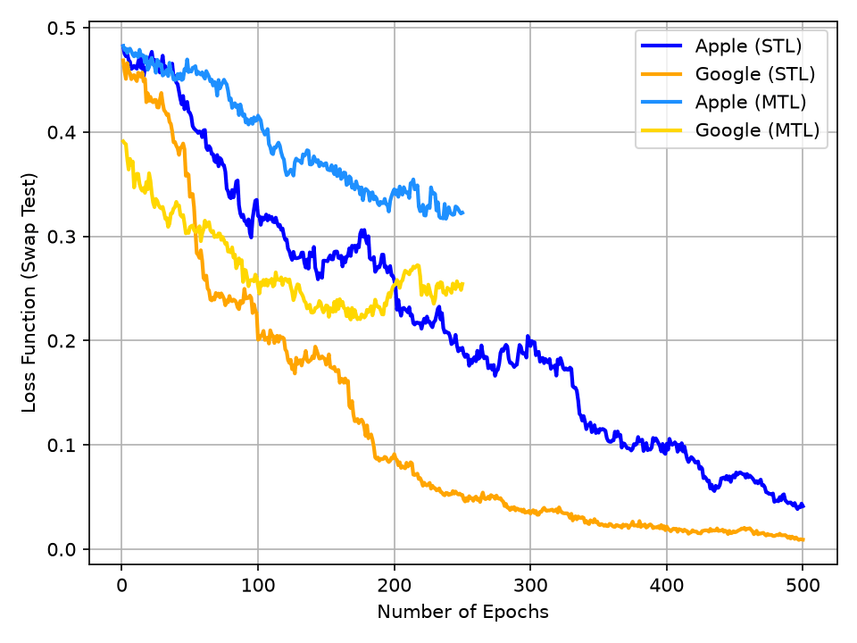 |
| **Fig. 13** QSTL joint output against the target, AAPL and GOOGL: close fit, $F \approx 0.999$. Our raw target is flatter than the paper's. | **Fig. 16** SWAP-test loss, STL vs MTL. Our curves start near the Eq. 14 bound of 0.5; the paper's start at 0.8–0.9, consistent with plotting $1 - F$. |
| 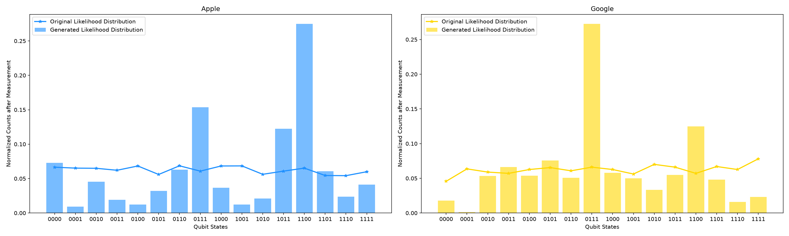 | 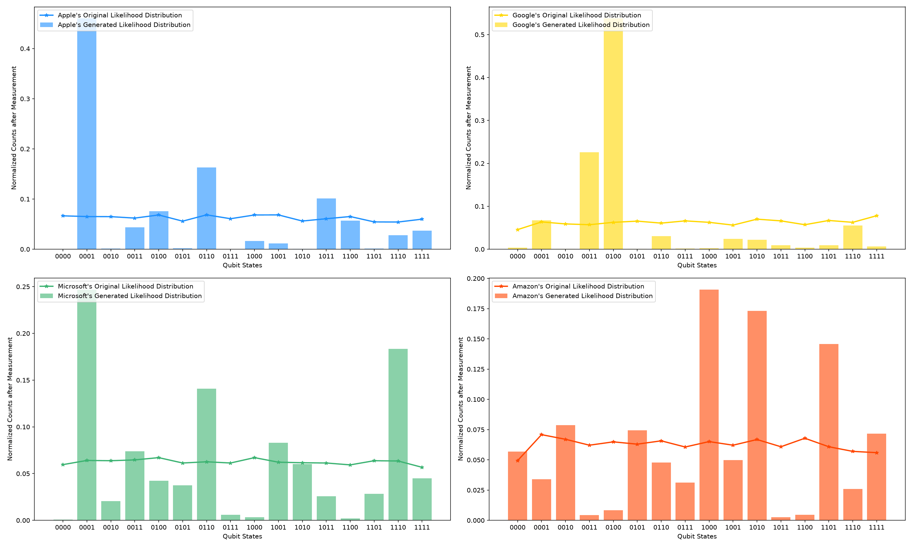 |
| **Fig. 14** QMTL, $K = 2$, at 250 epochs per asset: in our runs the fit is still incomplete ($F$ 0.09–0.55). | **Fig. 15** QMTL, $K = 4$. |
| 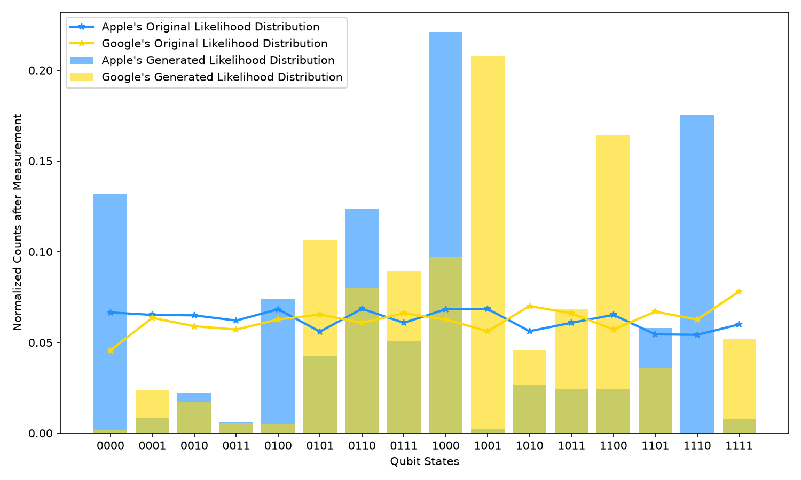 | 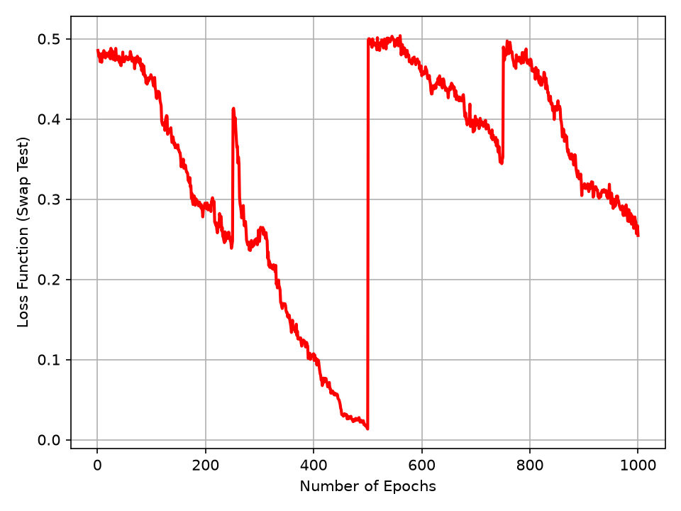 |
| **Fig. 17** MSE loss at the paper's learning rate: the output stays far from the target, as in the paper. | **Fig. 18** QMTL $K = 4$ loss curves. |
| 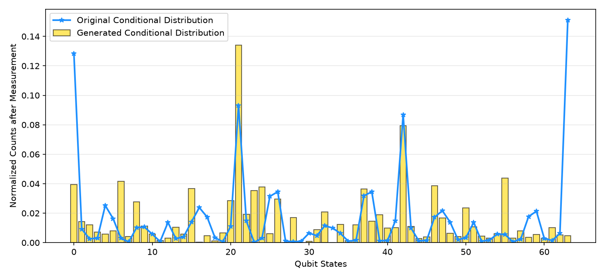 | 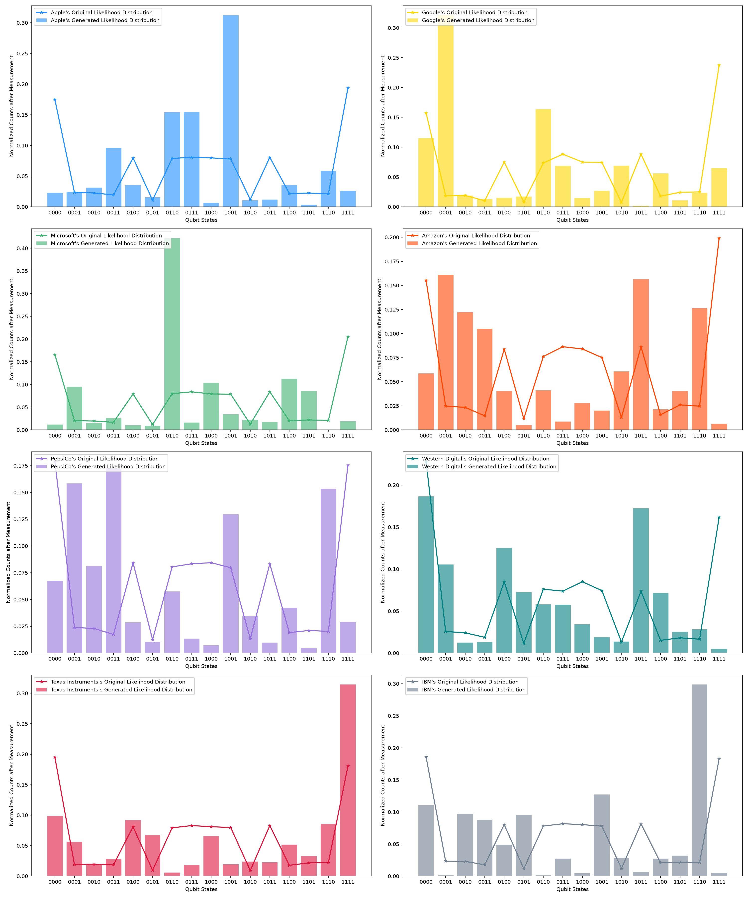 |
| **Fig. 19** $d = 4$ quantile levels, $T = 2$: the main peaks are captured, with a lower fidelity ($F = 0.24 \pm 0.08$ over seeds). | **Fig. 21** QMTL, $K = 8$ (MA3). |

Fig. 22 (noise) was not reproduced.

### Paper items

The paper's KL values cannot be compared numerically: the KL definition is
not specified and the data differ. Our values are the train-target
`kl_joint` of the joint-output readout, the closest to the paper's
protocol; other candidate definitions are in
[`results/paper_figures/table1_kl.csv`](results/paper_figures/table1_kl.csv).
"Claim support" uses the labels of the reproduction workflow and refers to
our setting only.

| Paper item | Claim tested | Paper value | Reproduced value | Delta | Metric agreement | Trend agreement | Claim support | Seeds | Comment |
|---|---|---:|---:|---:|---|---|---|---:|---|
| Table 1, AAPL STL (32 params) | C2 | KL 0.1047 | 0.0014 ± 0.0006 | −0.103 | no (definition, data) | n/a | see C2 | 5 | $F = 0.9988$ |
| Table 1, GOOGL STL | C2 | 0.1239 | 0.0027 ± 0.0011 | −0.121 | no | n/a | see C2 | 5 | $F = 0.9974$ |
| Table 1, AAPL MTL (16) | C2 | 0.0614 | 1.50 ± 1.34 | +1.43 | no | no: MTL above STL | `UNSUPPORTED` | 5 | not converged at 250 epochs/asset ($F = 0.18$) |
| Table 1, GOOGL MTL | C2 | 0.0754 | 0.34 ± 0.24 | +0.27 | no | no | `UNSUPPORTED` | 5 | $F = 0.50$ |
| Fig. 11, 12: loader | C6 | figure | TVD 0.002–0.006; state fidelity 0.00–0.57 | n/a | yes (probabilities) | yes for probabilities | `UNSUPPORTED` | 5 | MSE on probabilities does not fix the phases |
| Fig. 13: QSTL output | C1 | figure | joint $F \approx 0.999$; per-context at chance on MA5 | n/a | yes (joint) | yes (joint) | `UNSUPPORTED` for prediction | 5 | context register mixed at inference (retention 0.12–0.15) |
| Fig. 14: QMTL $K = 2$ | C2 | figure | $F$ 0.09–0.55 | n/a | no | no | `UNSUPPORTED` | 5 | not converged at 250 epochs/asset |
| Fig. 15, 18: QMTL $K = 4$ | C7 | figure | $F$ 0.06–0.36 | n/a | no | no | `UNSUPPORTED` | 5 | ties B0 at chance; sequential training forgets earlier assets |
| Fig. 16: loss curves | C3 | starts 0.8–0.9 | starts ≈ 0.48 | n/a | no (likely $1 - F$) | no | `UNSUPPORTED` | 5 | QMTL not faster at equal epochs |
| Fig. 17: MSE fails | C5 | figure | MSE $F = 0.06$ at lr $10^{-5}$ | n/a | yes | yes at the paper's lrs | `UNSUPPORTED` | 5 | at a shared lr of 0.1 MSE learns the distribution too |
| Fig. 19: $d = 4$, $T = 2$ | C8 | figure | $F = 0.24 \pm 0.08$ | n/a | no | no | `UNSUPPORTED` | 5 | test log-loss +0.72 above B0 |
| Fig. 21: QMTL $K = 8$ | C7 | figure | $F$ 0.06–0.24 | n/a | no | no | `UNSUPPORTED` | 5 | above B0 on all 8 assets by 0.11–0.15 |
| Fig. 22: noise | C9 | KL ≈ 0.10 | not run | n/a | n/a | n/a | `UNRESOLVED` | 0 | not implemented |
| Eq. 18–20: QBGU = SGD | C4 | derivation | gradient cosine ≈ 0 | n/a | no | no | `UNSUPPORTED` | 20 draws | different optima |

### Joint readout vs per-context readout

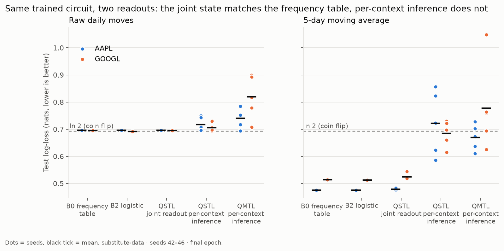

QBGU trains on one superposed input, so the loss shapes the circuit's
behaviour on that input. The QSTL circuit also rotates the context qubits.
When it is run on a single context $\lvert c \rangle \lvert 0 \rangle$, as at
prediction time, the contexts mix: MA5 test accuracy is $0.49 \pm 0.27$,
against 0.815 for the frequency table.

A simple variant that uses the context qubits only as controls (extension
E11) keeps the contexts separate and predicts well per context. It equals
$q(\text{up} \mid c) = \sin^2(a_c/2)$ with $a_c$ linear in the context bits,
so it performs on par with logistic regression (B2). This points to a
possible refinement of the architecture rather than a limit of the
contextual idea itself.

## Fair Baselines

The paper focuses on the quantum models, so classical references were
planned before the runs: B0 frequency table, B1 uniform / marginal, B2
logistic regression, B3 MLP (16 and 31 parameters), B4 pooled shrinkage
across assets. They select regularization on the last 12.5 % of the
training split. The primary metric is the test log-loss of the per-context
prediction, compared by seed with a 95 % interval; "not distinguishable" on
near-chance cells is not evidence of equivalence. Every number below comes
from `results/phase5/` (`utils/compare_phase5.py`). The outcome labels
describe our setting, not the paper as a whole.

| Claim | Matched comparison | Outcome |
|---|---|---|
| C1 QSTL learns the next-day conditional | paper circuit (32 params) against B0 and B3 MLP (31) | `UNSUPPORTED` for the per-context readout: not distinguishable on raw data (all at chance); higher by 0.17–0.25 on MA5. The joint readout, the paper's training target, matches B0 |
| C2 QMTL beats QSTL with half the parameters | QMTL against 2-layer QSTL, 16 params, 250 epochs per asset | `UNSUPPORTED`: no advantage in any of 4 cells; on MA5 above B4 and B3 by 0.17–0.23 |
| C3 QMTL converges faster | final fidelity at equal epochs per asset | `UNSUPPORTED`: lower in 1 cell, not distinguishable in 3 |
| C4 QBGU equals full-batch SGD | QBGU against per-sample SGD, equal shots | `UNSUPPORTED`: gradients disagree; end points differ by 0.43–0.85 where both train |
| C5 fidelity loss beats MSE | MSE against fidelity on a shared learning-rate grid, best lr per loss chosen on the training metric | `UNSUPPORTED`: both pick lr 0.1, where MSE reaches a lower train KL (fidelity higher by 0.0011 and 0.0015). At the paper's lrs (MSE $10^{-5}$) the paper's gap reproduces. Only the fidelity loss also prepares the target state ($F$ 0.999 against 0.07) |
| C6 trained loader loads the distribution | Fig. 4 loader against exact amplitudes | `UNSUPPORTED`: probabilities right, phases not; with a context-preserving circuit +0.12 to +1.08 |
| C7 QMTL scales to $K = 4, 8$ | QMTL against B0 and B4 on the same assets | `UNSUPPORTED`: $K = 4$ ties at chance; $K = 8$ above on all 8 assets by 0.11–0.15 |
| C8 $d = 4$ distributions align | against B0 and B2 on the same quantization | `UNSUPPORTED`: above by 0.72 and 0.37 |
| C9 noise robustness | — | `UNRESOLVED`: not implemented |
| MerLin adaptation (not a paper claim) | 2-photon interferometer against B2 | `UNRESOLVED` (parameters and tuning not matched): within 0.006 in every cell |

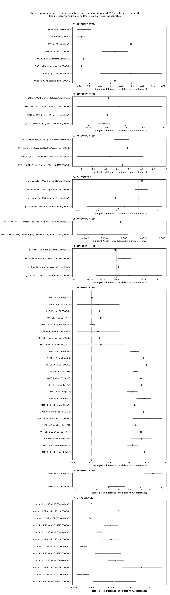

The C5 panel above is the shared learning-rate grid at the selected lr (MSE
minus fidelity; below 0 means MSE fits better). The grid (50 runs,
[`results/phase5_c5`](results/phase5_c5/pairs.csv)) separates the loss from
the step size:

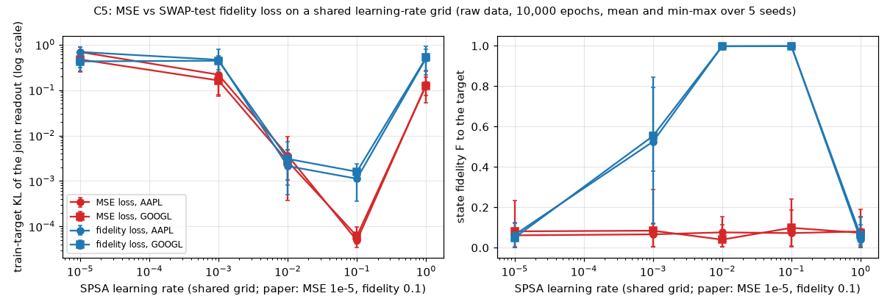

The extensions (context-preserving circuit, training-set sizes 25 to full,
multi-step prediction up to 10 qubits) give the same picture: the best
circuit stays within 0.009 nats of the logistic model of the same size.

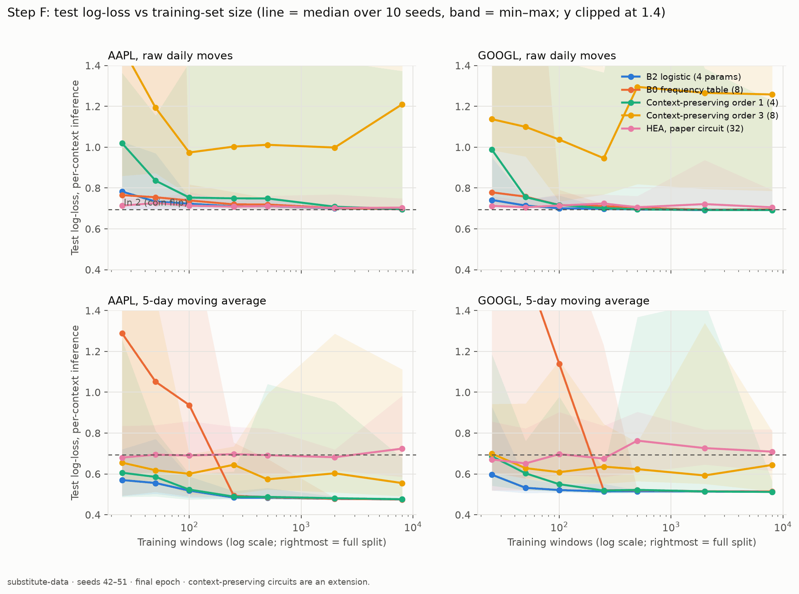

On this daily-direction task the quantum and photonic models reach the
level of a small classical model; we do not claim an advantage in either
direction.

## Photonic Assessment and MerLin Extension

An adaptation of the prediction task of
C1 only, simulated. The QBGU input (a superposition with data-defined
amplitudes), the gate circuit and the SWAP test have no passive
linear-optics counterpart, so they are not translated.

**Model** (`lib/photonic_merlin.py`). $T + 1$ modes: trainable mesh, phases
$\pi c_i$ on modes $1..T$, mesh, the same phases again, mesh.
$q(\text{up} \mid c)$ is the probability that the detector on mode 0 clicks.
Trained on the count-weighted log-likelihood (the objective of B2) with
Adam (lr 0.02, 1500 steps, not tuned).

**Result** (150 runs, AAPL and GOOGL, raw and MA5, $T$ = 3, 5, 6; full table
in [`results/phase4_p1/summary.md`](results/phase4_p1/summary.md)):

- The 2-photon model is within 0.006 nats of B2 in every cell, with 36 / 90 /
  126 trained phases against 4 / 6 / 7 logistic weights.
- A second photon, and indistinguishable against distinguishable photons,
  are not distinguishable in 10 of 12 cells.
- Threshold detection is slightly worse than photon-number resolution in 4
  cells and keeps 48–61 % of shots.

Limits: C1 only and horizon 1; photonic hyperparameters not tuned; no shot
noise, photon loss or QPU run.

## Hardware-Aware Settings

Every row: MerLin 0.4.2 / Perceval 1.3.1 exact CPU simulation, no sampling
(shot count n/a), no loss; exact gradients by autograd; encoding = phases
$\pi c_i$ on modes $1..T$, applied twice; measurement =
`MeasurementStrategy.probs`; modes 4 / 6 / 7 for $T$ = 3 / 5 / 6; seeds
42–46; wall-clock is one run (both tickers) on a laptop with 6 concurrent
runs.

| Variant | Computation space | Detector | Photons | Input state ($T$ = 3) | Postselection | Keep rate | Wall-clock per run, s ($T$ = 3 / 5 / 6) |
|---|---|---|---:|---|---|---|---|
| `n1` (ablation) | FOCK | photon-number-resolving | 1 | `[1,0,0,0]` | none | 1 | 83 / 167 / 218 |
| `n2_dist` (control) | FOCK, indistinguishability 0 | photon-number-resolving | 2 | `[1,0,1,0]` | none | 1 | 53 / 102 / 156 |
| `n2_fock` | FOCK | photon-number-resolving | 2 | `[1,0,1,0]` | none | 1 | 44 / 94 / 138 |
| `n2_unbunched` | UNBUNCHED | threshold | 2 | `[1,0,1,0]` | collision-free, renormalized | 0.48–0.61 | 56 / 111 / 219 |

Gate-model wall-clock on a remote 16-CPU Linux machine (per run, median over seeds,
`results/phase5/systems.csv`): paper QSTL with 3000 SPSA epochs 11–12 s;
baselines with their validation grid 29–40 s. No speed claim is tested.

## Limitations

The differences from the paper may come from any of the points below, so
they should not be read as errors in the original work.

- Substitute data; the paper's date ranges and preprocessing per experiment
  are not stated, and our raw AAPL target is flatter than the paper's
  Fig. 13 target (TVD 0.08).
- The KL definition behind Table 1 is not stated; no candidate definition
  reproduces it.
- Circuit decompositions and the QMTL parameter split are inferred from
  parameter counts.
- C9 (noise) is not implemented. The C5 grid uses raw data and the paper
  circuit only.
- The classical multi-task control is pooled shrinkage only.
- The decision rule's "parity" reading and the C4 and MerLin outcomes were
  settled after the comparison table was generated. The C5 grid's plan entry
  was written after two smoke checks (the grid itself was fixed before the
  sweep), and the C7 / C8 baselines were rerun on the same machine as the
  quantum runs without a prior plan entry (values changed by at most
  $7 \times 10^{-6}$).
- Shot-sampled SPSA runs are deterministic per machine but can differ across
  platforms for a given seed; conclusions rest on the seed distribution.
- MerLin results are simulated only.

## Tests

```bash
cd papers/QNN_STOCK
pytest -q
```

77 tests: data and baselines, statevector and SWAP test against the explicit
circuit, Fig. 7 asset block, context-preserving and multi-step circuits,
per-sample and L-BFGS training, loader, training-size subsets, the MerLin
model (shapes, gradients, seeding, two-photon interference, threshold keep
rate), CLI and a smoke run.

## Citation and License

Cite the original paper (DOI above). Code in this folder follows the
repository license (MIT). The raw price data are not redistributed.
