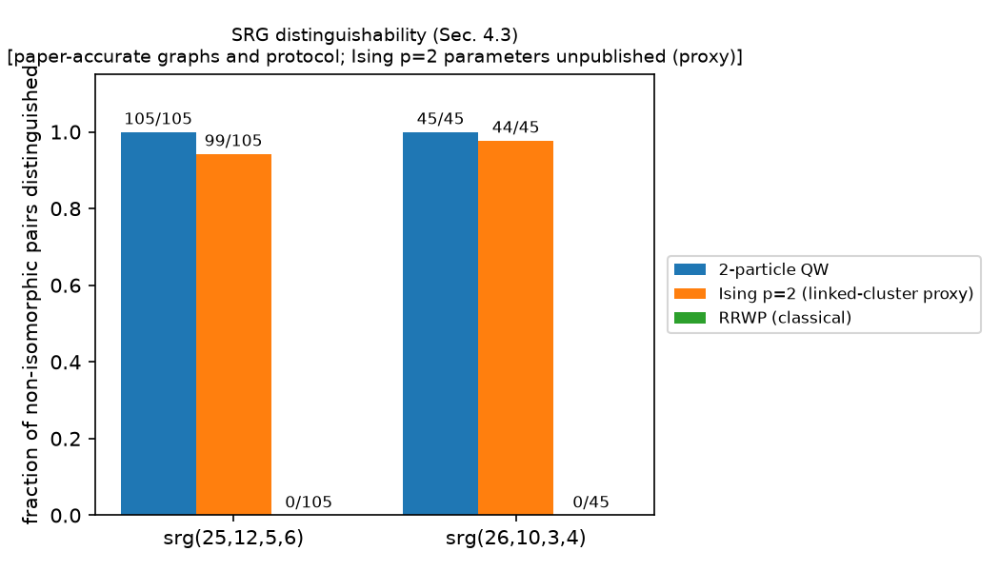
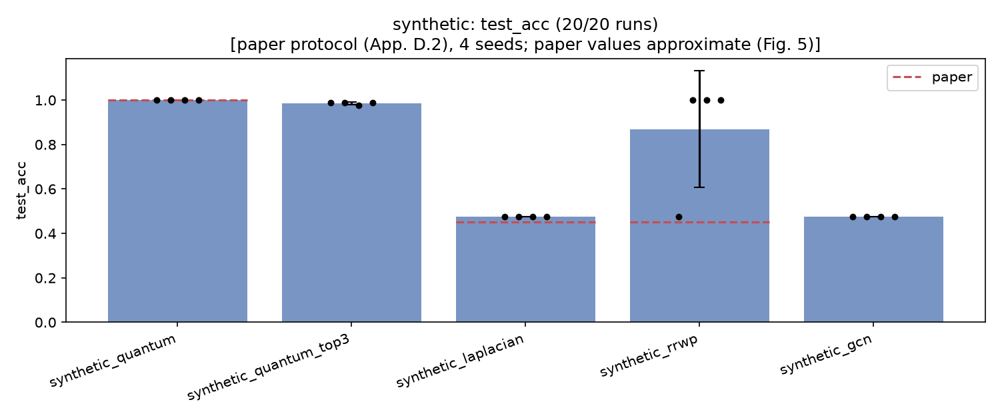
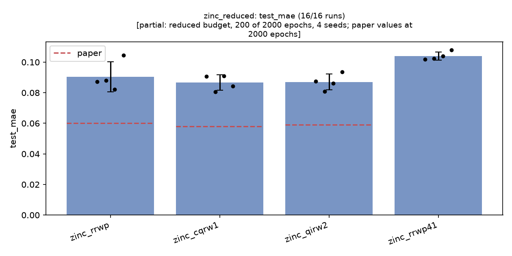
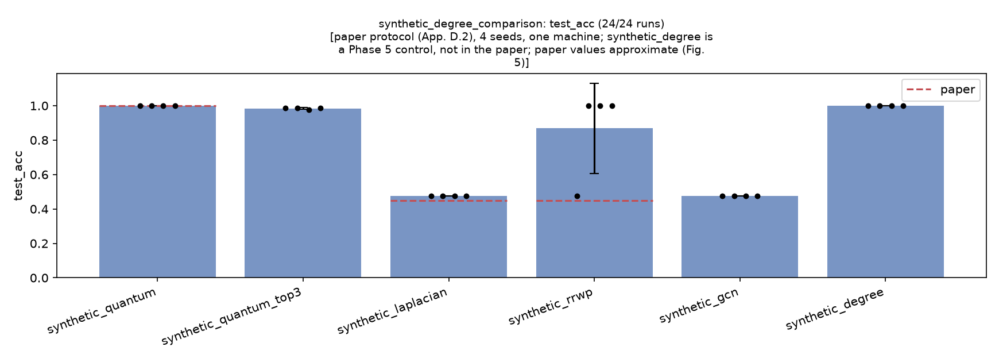
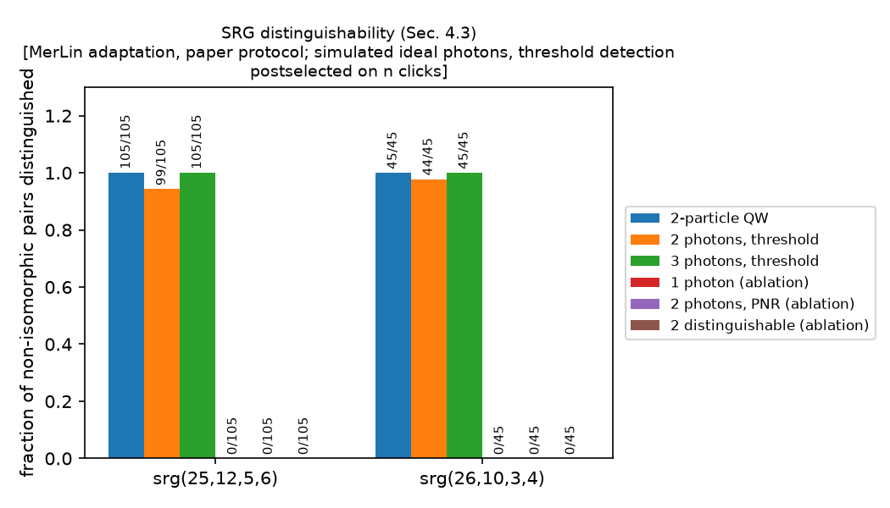
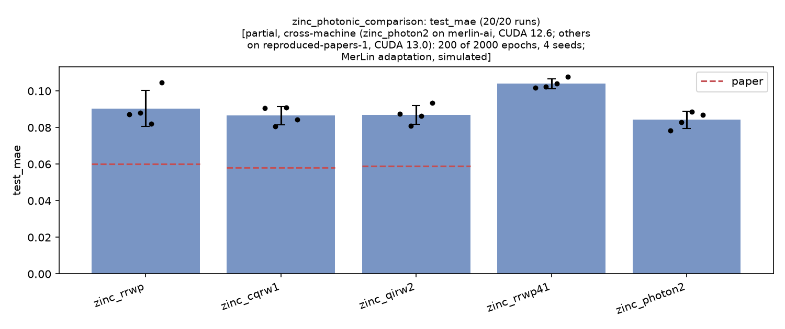

# Quantum Positional Encodings for Graph Neural Networks — Reproduction

## Reference and Attribution

> Slimane Thabet, Mehdi Djellabi, Igor Sokolov, Sachin Kasture, Louis-Paul
> Henry, Loïc Henriet, *Quantum Positional Encodings for Graph Neural
> Networks*, Proceedings of the 41st International Conference on Machine
> Learning (ICML 2024), arXiv:[2406.06547](https://arxiv.org/abs/2406.06547).

All scientific credit belongs to the original authors. The paper says its
code is in the supplementary material; no public repository for the quantum
encodings was found, so every encoding here is implemented from the paper's
text. The graph transformer is a dense-batch adaptation of the authors'
[official MIT-licensed GRIT implementation](https://github.com/LiamMa/GRIT),
which is built on GraphGPS: the layer equations and the paper's
hyperparameters are kept, and sparse PyG batching is replaced by padded
dense tensors. The SRG catalogs come from Ted Spence's page (cited by the
paper) and Brendan McKay's catalog; neither states a licence.

## Original Paper

Graph transformers need positional encodings (PEs) that tell each node where
it sits in the graph. Common choices are Laplacian eigenvectors (LE) and
relative random-walk probabilities (RRWP). The paper proposes PEs computed
from quantum dynamics on a Hamiltonian with the graph's topology, which a
quantum processor could in principle produce:

- **Ising ground-state correlations:** eigenvectors of the correlation
  matrix ⟨Z_i Z_j⟩ over the ground states of H = Σ_(i,j)∈E Z_i Z_j.
- **1-CQRW:** single-particle continuous-time quantum walk probabilities
  |⟨j|exp(−i H_XY t)|i⟩|² at 20 random times in [0.1, π].
- **2-QiRW:** powers of the normalised two-particle XY Hamiltonian, a
  quantum-inspired, classically computable analogue of RRWP.

Main claims:

1. **C1 (Table 1):** concatenating 1-CQRW or 2-QiRW to RRWP improves GRIT on
   five BenchmarkingGNNs datasets (best on ZINC, MNIST and CIFAR10). On ZINC
   the reported test MAE is 0.060 ± 0.002 (RRWP), 0.058 ± 0.002 (1-CQRW) and
   0.059 ± 0.004 (2-QiRW), 4 seeds, 2000 epochs.
2. **C2 (Sec. 4.3, Fig. 3, Prop. 4.6):** two-particle quantum-walk
   correlations distinguish non-isomorphic strongly regular graphs (SRGs) of
   the same family, which RRWP provably cannot.
3. **C3 (Sec. 5.2, App. D.2, Fig. 5):** on a synthetic ladder task, a GCN
   with Ising ground-state correlation eigenvectors reaches 100% accuracy
   with about 4k parameters, while classical models with LE or RRWP
   (10k-500k parameters) stay at about 45%.
4. Secondary: quantum features also help on ZINC-full and PCQM4Mv2 (Fig. 4),
   and theoretical expressivity results (Props. 4.1-4.7).

## Reproduction Scope, Claims, and Deviations

### What was reproduced

| ID | Claim | Where in paper | Reproduction test | Result |
| --- | ----- | -------------- | ----------------- | ------ |
| C1 | Quantum-walk encodings improve GRIT | Sec. 5.1, Table 1 | ZINC only: GRIT with RRWP, RRWP+1-CQRW, RRWP+2-QiRW and a 41-step RRWP width control, seeds 0-3, 200 of 2000 epochs | **Partial.** No separation between RRWP and the quantum encodings; the observed order matches Table 1, whose own margins are inside seed std. Comparison: unresolved. MNIST, CIFAR10, PATTERN, CLUSTER not run. |
| C2 | 2-particle walk separates same-family SRGs; RRWP cannot | Sec. 4.3, Fig. 3 | All 15 + 10 catalog graphs, five isomorphic permutations per graph | **Supported (paper-accurate):** 150/150 pairs vs 0/150, controls below 1e-9. The Ising p=2 branch is unresolved (parameters unpublished; a labelled proxy separates 143/150). |
| C3 | Ising correlations solve the ladder task; classical encodings fail | Sec. 5.2, App. D.2 | Same 800 graphs and split for every encoding, seeds 0-3, 200 epochs, constant lr 1e-3; plus a cosine-lr RRWP run and a degree-feature control | **Quantum result reproduced** (100% on every seed); Laplacian and no-encoding fail as reported. RRWP solves 3 of 4 seeds at constant lr, and a degree-feature GCN at the same capacity reaches 100%. Comparison: unresolved. |
| C4 | Large datasets (ZINC-full, PCQM4Mv2) | Fig. 4, Table 4 | — | Not run (compute). |
| C5 | Theoretical propositions | Props. 4.1-4.7 | — | Not re-derived; the SRG results are consistent with Props. 4.6-4.7. |
| Photonic (adaptation) | Not in the paper: a linear-optical version of the quantum walk | — | `srg_photonic.json`, `zinc_photon2_reduced.json` (MerLin, simulated) | `PARTIAL_MERLIN_TRANSLATION`: 3 photons separate all 150 SRG pairs; on ZINC the 2-photon encoding ties with 1-CQRW and 2-QiRW (partial, cross-machine). |

Result-scope labels: SRG results are paper-accurate; synthetic results use
the paper's protocol on a dataset built from its description; ZINC results
are partial (10% of the training budget). Photonic results are simulated
adaptations, not hardware runs.

### Deviations from the paper

- **Reduced Table 1 scope.** Only ZINC was run, for 200 of the paper's 2000
  epochs (the cosine schedule is compressed to 200 epochs), with seeds 0-3.
  One 2000-epoch ZINC run takes about 17 h on an NVIDIA L4, so the 60-run
  table did not fit the compute budget. MNIST, CIFAR10, PATTERN and CLUSTER
  have configs and adapter tests but no runs.
- **Extra controls (not in the paper).**
  - `zinc_rrwp41` gives RRWP 41 steps, so its input width matches RRWP plus
    a 20-channel quantum encoding (476,033 parameters).
  - `synthetic_quantum_top3` keeps only 3 of the 20 eigenvectors.
  - `synthetic_degree_classical` gives the quantum model's GCN one-hot node
    degree instead of quantum features (see Fair Baselines).
- **Synthetic learning rate.** App. D.2 states Adam at lr 1e-3 for 200 epochs
  with no schedule, so the synthetic configs use a constant lr. GRIT's cosine
  decay to 1e-6 (the PR's first setting) is kept as
  `synthetic_rrwp_cosine.json` because it changes the RRWP result.
- **Synthetic dataset construction is inferred.** App. D.2 and Figs. 7-8
  describe the ladder blocks but not every crossing detail; a type-2 crossing
  is implemented as a doubled antiferromagnetic interaction, which gives the
  figure's ground-state count. The text and the Fig. 8 caption disagree on
  which ladder type pairs with type 0 in each class; this only swaps the
  class labels.
- **SRG Ising parameters are unavailable.** The paper does not publish the
  parameter vector of its p=2 Ising circuit, so that branch uses a
  deterministic linked-cluster proxy, labelled `ising_p2_linked`. The
  interacting two-particle walk is exact.
- **Scalable ladder solver.** Arbitrary-graph Ising ground states use the
  explicit Hilbert space up to 18 nodes. The App. D.2 ladders (100-400
  nodes) use an exact four-boundary-state transfer program and an implicit
  correlation eigensolver.
- **Hardware.** GPU runs used NVIDIA L4 GPUs; the paper does not state its
  hardware.

## Project Layout

```text
papers/QPE_GNN/
├── README.md
├── requirements.txt
├── cli.json                      paper-specific shared-runtime flags
├── notebook.ipynb                claim-by-claim walkthrough (CPU, about 1.5 min)
├── configs/
│   ├── defaults.json             tiny CPU smoke run
│   ├── srg_paper_original.json   Sec. 4.3 SRG experiment
│   ├── synthetic_*_original.json App. D.2, one config per encoding
│   ├── synthetic_degree_classical.json, synthetic_quantum_top3.json,
│   │   synthetic_rrwp_cosine.json    controls added in this reproduction
│   ├── zinc_*_reduced.json       ZINC at 200 epochs (results below)
│   ├── <dataset>_*_original.json paper-scale Table 1 settings (not run)
│   ├── srg_photonic.json, zinc_photon2_reduced.json   MerLin adaptation
│   ├── sweeps/                   sweep and comparison plans
│   └── comparison/               Phase 5 comparison-table spec
├── lib/
│   ├── runner.py                 train_and_evaluate(cfg, run_dir)
│   ├── qpe.py                    RRWP, 1-CQRW, 2-QiRW, Ising correlations
│   ├── data.py                   synthetic ladders, PyG benchmark adapter
│   ├── pe_factory.py             per-graph positional-encoding tensors
│   ├── model.py                  dense GRIT, GRITLite, GCN, GatedGCN
│   ├── srg.py                    SRG catalogs and experiments
│   ├── photonic.py               interferometer walk features (MerLin and closed form)
│   ├── classical_baseline.py     degree one-hot control
│   └── experiment_logging.py     run and sweep evidence files
├── utils/
│   ├── run_sweep.py, summarise_sweep.py   sweep coordinator and summary
│   ├── plot_sweep.py, plot_srg.py         result figures
│   ├── compare_baselines.py               fair-comparison table
│   ├── export_history_summary.py          training-curve facts from raw runs into results/
│   └── plot_datasets.py, plot_pyg_datasets.py, plot_models.py,
│       plot_results.py, aggregate_synthetic.py   earlier PR tools (historical figures)
├── tests/                        pytest suite
├── results/                      curated summaries and figures
├── assets/figures/               dataset previews and earlier PR figures
├── models/                       (empty; no model weights are kept)
└── outdir/                       raw runs (git-ignored)
```

## Install and How to Run

```bash
python -m venv .venv
source .venv/bin/activate
pip install -r papers/QPE_GNN/requirements.txt
```

`requirements.txt` pins torch 2.12.1, which on PyPI is built for CUDA 13.0
(driver ≥ 580). On a machine with an older driver, install a matching build,
for example `torch==2.12.1+cu126` from `https://download.pytorch.org/whl/cu126`;
the photonic ZINC runs used that build.

Quick smoke run (CPU, seconds):

```bash
python implementation.py --paper QPE_GNN --config configs/defaults.json --seed 42
```

The walkthrough notebook (`notebook.ipynb`) runs on a CPU in about 1.5 minutes. It needs the SRG
catalogs (see Data) and reads the committed `results/`:

```bash
cd papers/QPE_GNN
jupyter nbconvert --to notebook --execute --inplace notebook.ipynb
```

Paper experiments, from the repository root (add `--device cuda:0` on a GPU):

```bash
# SRG distinguishability (Sec. 4.3), local CPU, about 2 min
python implementation.py --paper QPE_GNN --config configs/srg_paper_original.json --seed 0

# One synthetic run (App. D.2)
python implementation.py --paper QPE_GNN --config configs/synthetic_quantum_original.json --seed 0

# One reduced ZINC run (200 epochs, about 1.7 h alone on an L4)
python implementation.py --paper QPE_GNN --config configs/zinc_cqrw1_reduced.json --seed 0 --device cuda:0
```

The reported results were produced as sweeps; the exact commands are listed
under each results section. Each run writes
`papers/QPE_GNN/outdir/run_YYYYMMDD-HHMMSS/` with `config_snapshot.json`,
`run.log`, `run_status.json`, `metrics.json`, `best_model.pt` and, for
benchmark runs, `test_outputs.npz`. Long runs write `checkpoint.pt` every
`--checkpoint-every` epochs and resume with `--resume-from`. Sweeps write
`sweep.log`, `sweep_status.json` and `sweep_summary.json` in their sweep
folder; curated summaries and figures go to `results/`.

## Configuration

Configs are JSON and overlay `configs/defaults.json`. `cli.json` is the
authoritative list of paper-specific flags (`--epochs`, `--encoding`,
`--checkpoint-every`, `--resume-from`, ...). The shared runtime adds
`--config`, `--seed`, `--device`, `--outdir`, `--dtype` and `--log-level`.

| Key | Meaning |
| --- | ------- |
| `dataset` | `"ladder_concat"`, `"graph_reg"`, `"srg_pair"`, `"zinc"`, `"mnist"`, `"cifar10"`, `"pattern"` or `"cluster"`. SRG experiments use `"experiment": "srg_paper"` or `"srg_photonic"` instead. |
| `dataset_kwargs` | Dataset constructor arguments; synthetic configs set `node_encoding`, `pe_dim`, `per_class`, `length_range`, `seed`, `crossing_range`, `cache_path`. |
| `model` | `"grit"` (paper), `"grit_lite"` (smoke), `"gcn"` or `"gated_gcn"` (synthetic task). |
| `encoding` | `"rrwp"`, `"cqrw1"`, `"qirw2"`, `"ground_state_corr"`, `"laplacian"`, `"degree"` (control), `"rrwp_node"`, `"rrwp_edge"`, `"none"`, `"rrwp+cqrw1"`, `"rrwp+qirw2"` or `"rrwp+photon2"` (MerLin adaptation). |
| `rrwp_dim`, `qpe_dim` | RRWP steps and quantum-encoding channels for concatenated encodings (paper: 21 and 20). |
| `qpe_min_time`, `qpe_max_time` | Bounds of the seeded random 1-CQRW times (paper: 0.1 and π). |
| `qpe_initial_distribution` | Walk initial state: `"local"` (1-CQRW), `"adjacency"` (2-QiRW) or `"collision_free_pairs"` (photonic encoding). |
| `pe_dim` | Single-encoding width (synthetic: 20). |
| `epochs`, `batch_size`, `lr`, `weight_decay`, `warmup_epochs`, `minimum_lr` | Training; linear warmup then cosine decay to `minimum_lr` (`minimum_lr = lr` gives a constant rate). |
| `split_seed`, `train_frac`, `val_frac` | Synthetic split (fixed at 1729, 0.8/0.1/0.1). |
| `parameter_budget` | Upper bound on trainable parameters; training fails before epoch 1 when exceeded. |

## Data

Data lives under the shared data root, `data/QPE_GNN/`, never inside the
paper folder.

- **Synthetic ladders (App. D.2).** Generated by
  `lib/data.py::LadderConcatDataset`: 400 graphs per class, block lengths
  100-400, exactly two crossings, generator seed 314159, split seed 1729
  (640/80/80). Class 0 joins a type-0 and a type-1 ladder, class 1 a type-0
  and a type-2 ladder. Encoded records are cached in
  `data/QPE_GNN/synthetic/` (one file per encoding). No download.
- **SRG catalogs (Sec. 4.3).** All 15 `srg(25,12,5,6)` and all 10
  `srg(26,10,3,4)` graphs in `data/QPE_GNN/srg/`, read by `lib/srg.py` from
  the graph6 files. Spence's adjacency files and McKay's graph6 files hold
  the same graphs up to isomorphism (checked with `networkx.is_isomorphic`).

  ```bash
  mkdir -p data/QPE_GNN/srg && cd data/QPE_GNN/srg
  curl -fsSLO https://www.maths.gla.ac.uk/~es/SRGs/25-12-5-6
  curl -fsSLO https://www.maths.gla.ac.uk/~es/SRGs/26-10-3-4
  curl -fsSLO https://users.cecs.anu.edu.au/~bdm/data/sr251256.g6
  curl -fsSLO https://users.cecs.anu.edu.au/~bdm/data/sr261034.g6
  ```

- **ZINC (Table 1).** The 12k subset with the official BenchmarkingGNNs
  splits (10,000 / 1,000 / 1,000), downloaded by PyTorch Geometric on first
  use into `data/QPE_GNN/zinc/` (`molecules.zip`, 384 MB). In this
  reproduction it was downloaded only on the GPU machines.
- **MNIST, CIFAR10, PATTERN, CLUSTER.** Supported by the same PyG adapter
  (downloaded on demand, 1.7-2.5 GB each) but not downloaded or run here.

The figures in `assets/figures/` (dataset previews and earlier comparison
plots) come from the PR before this reproduction. They are illustrations,
not results; the earlier comparison plots predate the corrected 2-QiRW and
synthetic implementations.

## Results Obtained and Comparison with the Paper

All values below are read from the structured artifacts under `results/`.
Seed statistics are mean ± sample standard deviation over seeds 0-3. Every
sweep had its candidates, seeds, metric, checkpoint rule and tie rule fixed
before launch. No winner is declared unless the margin exceeds twice the
larger seed standard deviation and a paired test gives p < 0.05. GPU runs used
one NVIDIA L4.

### Summary against the paper

Paper values are as reported. Reproduced values are means ± sample std over
the listed seeds, read from `results/`. Delta = reproduced − paper.

| Paper item | Claim | Paper value | Reproduced value | Delta | Metric agreement | Trend agreement | Claim support | Seeds | Comment |
|---|---|---:|---:|---:|---|---|---|---:|---|
| Fig. 3, srg(25,12,5,6), 2-particle walk | C2 | all 105 pairs | 105/105 | 0 | yes | yes | supported | 1 (deterministic) | paper-accurate; controls ≤ 2.2e-15 |
| Fig. 3, srg(26,10,3,4), 2-particle walk | C2 | all 45 pairs | 45/45 | 0 | yes | yes | supported | 1 (deterministic) | paper-accurate |
| Prop. 4.6, RRWP on both families | C2 | 0 pairs | 0/150 | 0 | yes | yes | supported | 1 (deterministic) | |
| Fig. 3, Ising p=2 | C2 | all pairs | 143/150 (proxy) | N/A | N/A | N/A | unresolved | 1 (deterministic) | parameters unpublished; labelled proxy |
| Fig. 5, GCN + Ising GS correlations | C3 | ≈100% | 100.0 ± 0.0% | +0.0 pts | yes | yes | reproduced | 4 | val ≥ 0.95 by epoch 7-17 |
| Fig. 5, Laplacian eigenvectors | C3 | ≈45% | 47.5 ± 0.0% | +2.5 pts | yes | yes | reproduced | 4 | 47.5% = always predicting one class |
| Fig. 5, RRWP, constant lr (paper's stated lr) | C3 | ≈45% | 86.9 ± 26.3% | +41.9 pts | no | no | not reproduced | 4 | 3 of 4 seeds reach 100% after epoch 156 |
| Fig. 5, RRWP, cosine lr decay | C3 | ≈45% | 49.4 ± 3.8% | +4.4 pts | yes | yes | reproduced | 4 | schedule-dependent (diagnostic) |
| Table 1, ZINC, GRIT RRWP | C1 | 0.060 ± 0.002 | 0.0905 ± 0.0098 | +0.0305 | no (partial budget) | yes (tie) | unresolved | 4 | 200 of 2000 epochs |
| Table 1, ZINC, GRIT RRWP + 1-CQRW | C1 | 0.058 ± 0.002 | 0.0866 ± 0.0050 | +0.0286 | no (partial budget) | yes (lowest mean, tie) | unresolved | 4 | 200 of 2000 epochs |
| Table 1, ZINC, GRIT RRWP + 2-QiRW | C1 | 0.059 ± 0.004 | 0.0870 ± 0.0052 | +0.0280 | no (partial budget) | yes (tie) | unresolved | 4 | 200 of 2000 epochs |
| Table 1, MNIST, CIFAR10, PATTERN, CLUSTER | C1 | see paper | not run | N/A | N/A | N/A | not tested | — | compute scope |
| Fig. 4 / Table 4, ZINC-full, PCQM4Mv2 | C4 | see paper | not run | N/A | N/A | N/A | not tested | — | compute scope |

The photonic adaptation has no paper values; its results and hardware-aware
fields are under Photonic Assessment and Hardware-Aware Settings.

### Sweep register

Every sweep had a plan file (`configs/sweeps/`) fixed before launch with its
candidates, seeds, metric, direction, split, checkpoint rule, aggregation and
tie rule. Each full candidate table is in its `sweep_summary.json` (and
`.csv`), and the tables below show every candidate.

| Sweep / comparison | Plan | Metric (direction, split) | Checkpoint | Runs | Verdict | Ties and winners under the tie rule | Summary |
|---|---|---|---|---:|---|---|---|
| Synthetic D.2 | `synthetic.json` | test accuracy (max, 80-graph test split) | best validation accuracy | 20/20 | COMPLETE SWEEP | quantum and top-3 beat Laplacian and no-PE; quantum vs top-3 and vs RRWP tie | `results/synthetic_d2/` |
| RRWP cosine-lr diagnostic | `synthetic_lr_sensitivity.json` | as above, descriptive per seed | as above | 4/4 | COMPLETE SWEEP | none (single candidate) | `results/synthetic_d2_lr_sensitivity/` |
| Degree control | `synthetic_degree.json` | as above | as above | 4/4 | COMPLETE SWEEP | none (single candidate) | `results/synthetic_degree/` |
| C3 comparison | `synthetic_degree_comparison.json` | as above | as above | 24/24 | COMPLETE SWEEP | quantum ties degree and RRWP; quantum, top-3 and degree beat Laplacian and no-PE | `results/synthetic_degree_comparison/` |
| ZINC reduced | `zinc_reduced.json` (two launches by seed) | test MAE (min, 1,000-graph test split) | best validation MAE | 16/16 | COMPLETE SWEEP | only 1-CQRW better than RRWP-41; all else ties | `results/zinc_reduced/` |
| Photonic ZINC | `zinc_photon2_reduced.json` | as above | as above | 4/4 | COMPLETE SWEEP | none (single candidate) | `results/zinc_photon2/` |
| Photonic ZINC comparison (cross-machine) | `zinc_photonic_comparison.json` | as above | as above | 20/20 | COMPLETE SWEEP | photonic and 1-CQRW better than RRWP-41; all else ties | `results/zinc_photonic/` |

Tie rule for every comparison: no winner unless the mean margin exceeds
twice the larger seed std **and** a paired test gives p < 0.05. For accuracy
the test is an exact McNemar test on pooled predictions; for MAE it is a
Wilcoxon signed-rank test on seed-averaged per-graph errors.

### Strongly regular graphs (Sec. 4.3, Fig. 3): paper-accurate

`configs/srg_paper_original.json`, all 15 + 10 catalog graphs, five random
isomorphic permutations per graph, decision tolerance 1e-9.

| Family | 2-particle quantum walk | Ising p=2 (proxy) | RRWP | Max isomorphic-control distance (2-QW) | Paper |
| ------ | ----------------------- | ----------------- | ---- | -------------------------------------- | ----- |
| `srg(25,12,5,6)`, 105 pairs | 105/105 | 99/105 | 0/105 | 2.2e-15 | quantum all, RRWP none |
| `srg(26,10,3,4)`, 45 pairs | 45/45 | 44/45 | 0/45 | 2.1e-15 | quantum all, RRWP none |

The two-particle walk and RRWP rows match Fig. 3 and Prop. 4.6 exactly. The
paper does not publish its p=2 Ising parameters, so the Ising column is a
labelled linked-cluster proxy. It neither confirms nor refutes the paper's
Ising result.



Artifacts: `results/srg/srg_metrics.json`, `results/srg/srg_distances.png`.

### Synthetic ladder task (App. D.2, Fig. 5): paper protocol, 4 seeds

800 graphs (lengths 100-400), the same 0.8/0.1/0.1 split for every encoding,
200 epochs, Adam with a constant lr of 1e-3, and the best-validation model
evaluated once on the 80 test graphs. 0.475 is 38/80, the accuracy of always
predicting one class on this test split.

| Encoding | Params | Test accuracy per seed | Mean ± std | Paper (Fig. 5) |
| -------- | ------ | ---------------------- | ---------- | -------------- |
| GCN + Ising ground-state correlation eigenvectors (20) | 3,906 | 1.000, 1.000, 1.000, 1.000 | 1.000 ± 0.000 | ≈100% |
| Same, top-3 eigenvectors only (control, not in paper) | 3,906 | 0.988, 0.988, 0.975, 0.988 | 0.984 ± 0.006 | — |
| GCN + 20 Laplacian eigenvectors | 3,906 | 0.475 × 4 | 0.475 ± 0.000 | ≈45% |
| GatedGCN + 20-step RRWP edge features, constant lr | 7,074 | 0.475, 1.000, 1.000, 1.000 | 0.869 ± 0.263 | ≈45% |
| GatedGCN + RRWP, cosine lr decay to 1e-6 | 7,074 | 0.475, 0.550, 0.475, 0.475 | 0.494 ± 0.038 | ≈45% |
| GCN, no encoding | 3,298 | 0.475 × 4 | 0.475 ± 0.000 | — |
| GCN + one-hot node degree (Phase 5 control, not in paper) | 3,906 | 1.000 × 4 | 1.000 ± 0.000 | — |

- The quantum result reproduces on every seed; validation accuracy reaches
  0.95 by epoch 7-17.
- The classical failure reproduces for Laplacian eigenvectors and no encoding.
- RRWP depends on the schedule. Under cosine decay (the PR's original
  setting) every seed stays at chance, matching the paper. At the paper's
  stated constant lr, 3 of 4 seeds jump from chance to 100% between epochs
  156 and 179.
- A diagnostic found why: in this dataset construction, class-0 graphs have
  four degree-2 and four degree-4 nodes and class-1 graphs three of each.
  RRWP's first channel carries node degree, so the classes are separable in
  principle. The original dataset code is not released, so whether the
  paper's construction shares this property is unknown.



Artifacts: `results/synthetic_d2/sweep_summary.json` (also
`synthetic_d2_validation_curves.png`) and
`results/synthetic_d2_lr_sensitivity/sweep_summary.json`.

### ZINC (Table 1, first column): partial, 200 of 2000 epochs

GRIT on the official ZINC 12k splits, 4 seeds, 200 epochs with the cosine
schedule compressed to 200 epochs, best-validation checkpoint, test MAE.
Paper values are at 2000 epochs.

| Encoding | Params | Test MAE per seed | Mean ± std | Paper (2000 epochs) |
| -------- | ------ | ----------------- | ---------- | ------------------- |
| RRWP | 473,473 | 0.0872, 0.0880, 0.0821, 0.1046 | 0.0905 ± 0.0098 | 0.060 ± 0.002 |
| RRWP + 1-CQRW | 476,033 | 0.0906, 0.0805, 0.0909, 0.0844 | 0.0866 ± 0.0050 | 0.058 ± 0.002 |
| RRWP + 2-QiRW | 476,033 | 0.0876, 0.0809, 0.0862, 0.0935 | 0.0870 ± 0.0052 | 0.059 ± 0.004 |
| RRWP, 41 steps (width control) | 476,033 | 0.1017, 0.1024, 0.1039, 0.1079 | 0.1040 ± 0.0028 | — |

- **Metric agreement: no.** All MAEs are about 0.03 above the paper's. Train
  MAE at the selected epoch is 0.066-0.090, already above the paper's test
  MAE, and validation MAE was still falling at epoch 200. So the models are
  under-trained at this budget; it is not a generalisation gap.
- **Trend agreement: yes.** The observed order 1-CQRW < 2-QiRW < RRWP is the
  paper's. Under the tie rule the three are not distinguishable, as in
  Table 1, where the margins are inside seed std.
- **Width control:** the only separation is 1-CQRW better than the 41-step
  RRWP control (Wilcoxon p = 0.0029). Adding 21 RRWP channels hurts, while
  adding 20 quantum-walk channels does not.



Artifacts: `results/zinc_reduced/sweep_summary.json` (also
`zinc_reduced_validation_curves.png`).

### How these results were produced

From the repository root; the ZINC and synthetic sweeps ran on an L4 GPU.

```bash
python implementation.py --paper QPE_GNN --config configs/srg_paper_original.json --seed 0
python papers/QPE_GNN/utils/run_sweep.py --plan configs/sweeps/synthetic.json \
  --sweep-dir outdir/sweep_synthetic --device cuda:0 --workers 4
python papers/QPE_GNN/utils/run_sweep.py --plan configs/sweeps/synthetic_lr_sensitivity.json \
  --sweep-dir outdir/sweep_synthetic_lr_sensitivity --device cuda:0 --workers 4
# ZINC in two launches by seed (about 9.5 h each at 4 workers on an L4)
python papers/QPE_GNN/utils/run_sweep.py --plan configs/sweeps/zinc_reduced.json \
  --sweep-dir outdir/sweep_zinc_reduced_seeds01 --device cuda:0 --workers 4 --run-seeds 0 1
python papers/QPE_GNN/utils/run_sweep.py --plan configs/sweeps/zinc_reduced.json \
  --sweep-dir outdir/sweep_zinc_reduced_seeds23 --device cuda:0 --workers 4 --run-seeds 2 3
```

Summaries and figures, from inside `papers/QPE_GNN`:

```bash
python utils/summarise_sweep.py --sweep-dir outdir/sweep_zinc_reduced_seeds01 \
  --sweep-dir outdir/sweep_zinc_reduced_seeds23 --plan configs/sweeps/zinc_reduced.json \
  --output-dir results/zinc_reduced
python utils/plot_sweep.py --summary results/zinc_reduced/sweep_summary.json \
  --sweep-dir outdir/sweep_zinc_reduced_seeds01 --sweep-dir outdir/sweep_zinc_reduced_seeds23 \
  --name zinc_reduced --scope "partial: reduced budget, 200 of 2000 epochs, 4 seeds; paper values at 2000 epochs" \
  --output-dir results/zinc_reduced --paper-value zinc_rrwp=0.060 \
  --paper-value zinc_cqrw1=0.058 --paper-value zinc_qirw2=0.059
python utils/plot_srg.py --run-dir outdir/run_YYYYMMDD-HHMMSS --output-dir results/srg
```

## Fair Baselines

Each claim is compared with a classical baseline matched on the claim's own
axis. The comparison plan, including the decision rules, was fixed before
any new run; `LOG.md` records it with its amendments. The full table, with
provenance, scope, matching basis, run counts, parameters and wall-clock, is
generated from the result artifacts into
`results/comparison/comparison_table.md`.

| Claim | Advantage axis | Fair baseline and matching | Outcome |
| ----- | -------------- | -------------------------- | ------- |
| C1 (ZINC) | test MAE at equal architecture and budget | GRIT + RRWP (the paper's baseline) and GRIT + RRWP-41 (matches the PE width of RRWP + 20 quantum channels); same data, schedule, 200 epochs, seeds 0-3 | **Unresolved.** Neither quantum-walk encoding is distinguishable from RRWP. 1-CQRW beats the width control (p = 0.0029). Partial budget, ZINC only. |
| C2 (SRGs) | non-isomorphic pairs separated, controls at zero | RRWP on the same graphs, permutations and tolerance | **Supported.** 150/150 vs 0/150 pairs; controls ≤ 2.2e-15. |
| C3 (ladder task) | test accuracy at matched capacity | GCN + Laplacian eigenvectors (same model, 3,906 params), GatedGCN + RRWP, GCN without encoding, and a **degree control** added in this reproduction: the same GCN with one-hot node degree as its 20 input channels | **Unresolved.** The degree control matches the quantum encoding at 100% on every seed (identical predictions), so on this dataset construction a trivial classical feature recovers the result. The construction is inferred from the paper, which may differ. |
| Photonic SRG (adaptation) | as C2 | RRWP, same protocol | **Supported** as an adaptation: 3 photons separate 150/150 pairs. |
| Photonic ZINC (adaptation) | as C1 | RRWP and RRWP-41 | **Unresolved:** better than the width control, otherwise ties. Cross-machine, partial. |

Why the degree control was added: a Phase 3 diagnostic found that, in this
dataset construction, class-0 graphs have four degree-2 and four degree-4
nodes and class-1 graphs three of each. Node degree therefore carries the
class signal. The paper's classical encodings (Laplacian eigenvectors, RRWP)
are fair on capacity but do not control for this.

The degree control (`configs/synthetic_degree_classical.json`,
`lib/classical_baseline.py`) uses the quantum model's exact architecture,
data, split, optimiser and selection rule. It also learns more slowly:
validation accuracy first reaches 0.95 at epochs 51-129, against 7-17 for
the quantum encoding. Speed was neither claimed nor predeclared, so no
conclusion is drawn from it.



No quantum or photonic advantage is claimed. Every win in the table is
limited to its matched comparison and scope.

Wall-clock (from each run's `metrics.json`):

| Workload | Hardware | Wall-clock |
| -------- | -------- | ---------- |
| ZINC GRIT, 200 epochs | one L4, 4 runs at once | 4.8 h per run (candidate means within 0.3% of each other) |
| ZINC photonic encoding | another L4 (CUDA 12.6), 4 runs at once | 5.1 h per run (not compared across machines) |
| Synthetic task, 200 epochs | one L4, 4 runs at once | 124-143 s per run, including feature construction |
| SRG experiment, all methods | local CPU | 132 s |

Commands:

```bash
python papers/QPE_GNN/utils/run_sweep.py --plan configs/sweeps/synthetic_degree.json \
  --sweep-dir outdir/sweep_synthetic_degree --device cuda:0 --workers 4
cd papers/QPE_GNN
python utils/summarise_sweep.py --sweep-dir outdir/sweep_synthetic \
  --sweep-dir outdir/sweep_synthetic_degree \
  --plan configs/sweeps/synthetic_degree_comparison.json \
  --output-dir results/synthetic_degree_comparison
python utils/compare_baselines.py --spec configs/comparison/phase5_comparison.json \
  --output-dir results/comparison
```

## Photonic Assessment and MerLin Extension

**Translation status: `PARTIAL_MERLIN_TRANSLATION`.** This is an adaptation,
not part of the original paper. All results are simulated (no QPU).

Confidence:
- **SRG mapping: high.** MerLin and an independent closed form agree, and
  the controls sit at 1e-14.
- **ZINC: medium.** One reduced budget, a mixed-machine comparison, and ties
  only.

Translated: the SRG experiment and the ZINC positional encoding. Not
translated: the synthetic Ising task (C3) and the hard-core interaction
itself.

### Scientific role and mapping

The paper's claim is that coherent quantum walks give graph features that
classical random walks cannot. The clearest test is the interacting
(hard-core) two-particle walk, which separates strongly regular graphs that
RRWP cannot (C2). The photonic mapping keeps the paper's single-particle
propagator as a linear-optical interferometer:

- **Interferometer:** U(t) = exp(-i 2A t), with one optical mode per graph
  node (`lib/photonic.py::graph_unitary`).
- **Input:** n indistinguishable photons, one per mode, injected into every
  collision-free n-mode input.
- **Detection:** threshold detectors, postselected on exactly n clicks
  (MerLin `ComputationSpace.UNBUNCHED`).
- **Feature:** the output occupation covariance averaged over inputs, the
  same statistic the paper uses for SRGs
  (`lib/photonic.py::photonic_walk_covariance`).

Photons do not interact, so the hard-core interaction is not reproduced.
The only nonlinearity is postselection. Free bosons without postselection
are bounded like RRWP, because U lies in the SRG's Bose-Mesner algebra.
Postselection divides by a mass that depends on the input pair, and bosonic
interference couples all four cross relations of input and output pairs.
Together they make the statistic sensitive to four-vertex structure. The
ablations below confirm that both ingredients are needed.

| Mapping considered | Outcome |
| ------------------ | ------- |
| 1 photon (= 1-CQRW exactly, `test_photonic_1cqrw_matches_xy_cqrw`) | ablation only (single photon) |
| n ≥ 2 photons, threshold detection, n-click postselection | **selected** |
| n ≥ 2 photons, number-resolving detection, no postselection | rejected as main mapping (0 SRG pairs); kept as ablation |
| Simulating the hard-core interaction | rejected: needs photon nonlinearity or measurement-induced gates per hop |
| Ising ground-state correlations (C3) | excluded: preparing an Ising ground state is not an interferometer operation |

MerLin APIs used (merlinquantum 0.4.2, perceval-quandela 1.3.1; this
release still reports `merlin.__version__ == "0.4.1"`, the value
`photonic_check.json` records):
- `QuantumLayer` built from a Perceval circuit holding one `pcvl.Unitary(U)`;
- `MeasurementStrategy.probs(computation_space=UNBUNCHED or FOCK)`;
- batched complex amplitude inputs, one per input configuration, in float64.

A closed-form backend (2 × 2 permanents) computes the same distributions for
1-2 photons. `tests/test_photonic.py` checks it against MerLin to 1e-12.

### Results

**SRGs (Sec. 4.3), full protocol**: `configs/srg_photonic.json`, t = 1,
five isomorphic controls per graph, tolerance 1e-9.

| Method | srg(25,12,5,6) | srg(26,10,3,4) | Postselection success | Wall-clock (both families) |
| ------ | -------------- | -------------- | --------------------- | -------------------------- |
| Hard-core 2-particle walk (paper reference) | 105/105 | 45/45 | — | 105 s |
| 2 photons, threshold | 99/105 | 44/45 | 0.920 / 0.923 | 20 s |
| 3 photons, threshold | 105/105 | 45/45 | 0.780 / 0.787 | 754 s |
| 1 photon (ablation) | 0/105 | 0/45 | 1 | 1 s |
| 2 photons, number-resolving, no postselection (ablation) | 0/105 | 0/45 | 1 | 21 s |
| 2 distinguishable photons, postselected (ablation) | 0/105 | 0/45 | 0.960 / 0.962 | 1 s |

Every isomorphic control stays at or below 1.0e-14. Three photons preserve
the paper's SRG claim. Two photons miss 7 of 150 pairs, whose features agree
to 4e-16.



**ZINC (Table 1 column 1): partial and cross-machine.**
`configs/zinc_photon2_reduced.json` concatenates the two-photon threshold
covariance (20 channels, at the run's 1-CQRW times) to the 21 RRWP channels.
Everything else (GRIT, split, 200 epochs, schedule, checkpoint rule, seeds
0-3) matches the reduced ZINC runs above.

| Encoding | Test MAE (mean ± std, 4 seeds) | Tie-rule outcome vs photonic |
| -------- | ------------------------------ | ---------------------------- |
| RRWP + 2 photons (MerLin adaptation) | 0.0842 ± 0.0046 | — |
| RRWP + 1-CQRW | 0.0866 ± 0.0050 | not distinguishable (p = 0.46) |
| RRWP + 2-QiRW | 0.0870 ± 0.0052 | not distinguishable (p = 0.32) |
| RRWP | 0.0905 ± 0.0098 | not distinguishable (p = 0.073) |
| RRWP, 41 steps | 0.1040 ± 0.0028 | photonic better (p = 0.0051) |

The planned criterion was "not worse than RRWP + 1-CQRW or RRWP + 2-QiRW",
and it is met. Two caveats apply:
- **Machines:** the photonic runs used a second NVIDIA L4 machine with a CUDA
  12.6 torch build, while the other runs used CUDA 13.0. The user accepted
  this mixed-machine comparison. Wall-clock and memory are not compared.
- **Budget:** the same 200-epoch limit as the reduced ZINC runs applies.



Artifacts: `results/srg_photonic/srg_metrics.json`,
`results/zinc_photonic/sweep_summary.json`.

### How to run the photonic experiments

```bash
python implementation.py --paper QPE_GNN --config configs/srg_photonic.json --seed 0
python papers/QPE_GNN/utils/run_sweep.py --plan configs/sweeps/zinc_photon2_reduced.json \
  --sweep-dir outdir/sweep_zinc_photon2_reduced --device cuda:0 --workers 4
cd papers/QPE_GNN
python utils/summarise_sweep.py --sweep-dir outdir/sweep_zinc_reduced_seeds01 \
  --sweep-dir outdir/sweep_zinc_reduced_seeds23 --sweep-dir outdir/sweep_zinc_photon2_reduced \
  --plan configs/sweeps/zinc_photonic_comparison.json --output-dir results/zinc_photonic
python utils/plot_srg.py --run-dir outdir/run_YYYYMMDD-HHMMSS --output-dir results/srg_photonic \
  --scope "MerLin adaptation, paper protocol; simulated ideal photons, threshold detection postselected on n clicks"
```

## Hardware-Aware Settings

| Field | P1 SRG photonic rows | P2 ZINC `rrwp+photon2` |
| ----- | -------------------- | ---------------------- |
| Computation space | `UNBUNCHED` (threshold rows), `FOCK` (number-resolving ablation) | `UNBUNCHED` |
| Detector model | threshold; number-resolving for one ablation | threshold |
| Photon number | 2 and 3 (1 as ablation) | 2 |
| Modes | 25 or 26 (one per vertex) | atoms per molecule |
| Input state | every collision-free n-mode input (300 / 325 pairs, 2,300 / 2,600 triples) | every collision-free pair, N(N-1)/2 per graph and time |
| Encoding | U(t) = exp(-i 2A t), t = 1 | same U at 20 times per run, uniform in [0.1, π] (the run's 1-CQRW times) |
| Measurement | occupation covariance averaged over inputs | same, one N × N channel per time |
| Postselection | exactly n clicks (threshold rows); none (number-resolving ablation) | exactly 2 clicks; mean success 0.92-0.93 |
| Simulator | MerLin `QuantumLayer`, analytic, float64 (closed form for the distinguishable ablation) | closed-form permanents for all features; MerLin cross-check on 64 graphs × 20 times per run (max deviation ≤ 1.1e-16) |
| Shots | none: exact probabilities | none: exact probabilities |
| Wall-clock | see table above (local CPU) | 5.1 h per run, 4 runs at once on one L4 |
| Seeds | 0 (deterministic features) | 0, 1, 2, 3 |

Assumptions and limits:
- **Optics:** lossless, perfectly indistinguishable photons, ideal threshold
  detectors. Uniform loss only lowers the n-click rate and leaves the
  postselected distribution unchanged. Non-uniform loss, partial
  distinguishability and dark counts are not modelled.
- **Training:** no gradient flows through the optics. The photonic features
  are fixed, and GRIT is trained by autograd on the precomputed channels.
- **Cost:** it grows as C(N, n) inputs per graph and time; three photons cost
  754 s against 20 s for two on the SRGs. On hardware, each probability
  would need repeated shots, with the interferometer reprogrammed per graph
  and time.

## Limitations

- **Table 1 is reproduced only for ZINC, at 10% of the paper's epochs.**
  Absolute ZINC MAE is about 0.03 above the paper's because the models are
  under-trained at 200 epochs. Only relative comparisons (ties and the
  width control) are meaningful. MNIST, CIFAR10, PATTERN and CLUSTER have
  configs and adapter tests but no training runs.
- **The scalable ground-state solver is ladder-specific.** It uses a four-state
  transfer dynamic program and an implicit correlation eigensolver for the
  Appendix D.2 graph family. Arbitrary graphs still use exact enumeration and
  retain the small-graph size limit.
- **No PCQM4Mv2/OGB integration.** The current adapter supports PyG ZINC and
  `GNNBenchmarkDataset`, not the full benchmark set used by the paper.
- **Dense-batch GRIT.** The parameter counts match the paper exactly, but
  dense padding may differ numerically from the official sparse
  implementation at convergence. A 2000-epoch run would be needed to check
  this.
- **The synthetic task is solvable from node degree in this construction.**
  A GCN with one-hot degree reaches 100% at the quantum model's capacity, and
  RRWP (which carries degree) solves 3 of 4 seeds at constant lr. Whether the
  paper's own construction shares this degree imbalance cannot be checked
  without its code.
- **The Appendix D.2 crossing convention is inferred from the figure.** A
  type-2 crossing is represented as a doubled antiferromagnetic interaction.
  This produces the figure's nine ground states after quotienting the global
  spin-flip symmetry; a unit-weight diagonal produces only one such pair. The
  paper does not state this multiplicity in text.
- **The photonic adaptation has no particle interaction.** It replaces the
  paper's hard-core two-particle walk with free photons plus postselection.
  Two photons miss 7 of 150 SRG pairs, and three photons cost about 40×
  more. All photonic results are ideal-device simulations, not hardware
  runs.

## Tests

```bash
cd papers/QPE_GNN
pytest -q
```

The suite includes shared-runtime config and CLI coverage and configured PyG
data-root checks. The photonic tests need `merlinquantum` 0.4.2, pinned in
`requirements.txt`. Tests also cover
masked node classification and fail-fast feasibility validation. Full-GRIT
tests cover categorical node and edge encoders, stable padded attention and
signed-square-root gradients, attention dropout, pooling, node-level output,
warmup, weighted PATTERN accuracy, and the reported 476,033-parameter ZINC QPE
model.

Tests cover:

- QPE numerical sanity (unitarity, row-stochasticity, Ising/XY identities).
- Dataset construction and SRG-pair non-isomorphism.
- Full-GRIT node/pair updates, feature encoders, pooling, and parameter budget.
- GRIT-lite graph/node heads and GCN forward/backward shapes.
- Warmup/cosine scheduling and weighted PATTERN accuracy.
- Photonic 1-CQRW ↔ XY 1-CQRW exact equality.
- Closed-form photon distributions against MerLin (`UNBUNCHED` and `FOCK`,
  1-2 photons), postselection rates, permutation equivariance, and a tiny
  `rrwp+photon2` training run with its MerLin cross-check.
- The degree control (`tests/test_classical_baseline.py`): one-hot
  encoding, identical graphs and labels to the quantum dataset, the
  degree-count difference between classes, and parameter-count equality with
  the quantum model.
- Sweep coordination and summaries (`tests/test_sweep.py`), and checkpoint
  and resume (`tests/test_checkpointing.py`).

The full suite (101 tests) passed on 9 November 2026 in the paper's
environment (merlinquantum 0.4.2, CPU torch); the SRG tests are skipped when
the catalogs are not in `data/QPE_GNN/srg/`.

## Citation and License

```
@inproceedings{Thabet2024QPEGNN,
  title  = {Quantum Positional Encodings for Graph Neural Networks},
  author = {Thabet, Slimane and Djellabi, Mehdi and Sokolov, Igor and Kasture, Sachin and Henry, Lou{\"i}s-Paul and Henriet, Lo{\"\i}c},
  booktitle = {Proceedings of the 41st International Conference on Machine Learning (ICML)},
  year   = {2024},
  eprint = {2406.06547},
  archivePrefix = {arXiv},
  primaryClass  = {quant-ph},
}
```

This reproduction is released under the same license as the parent
`reproduced_papers` repository.
