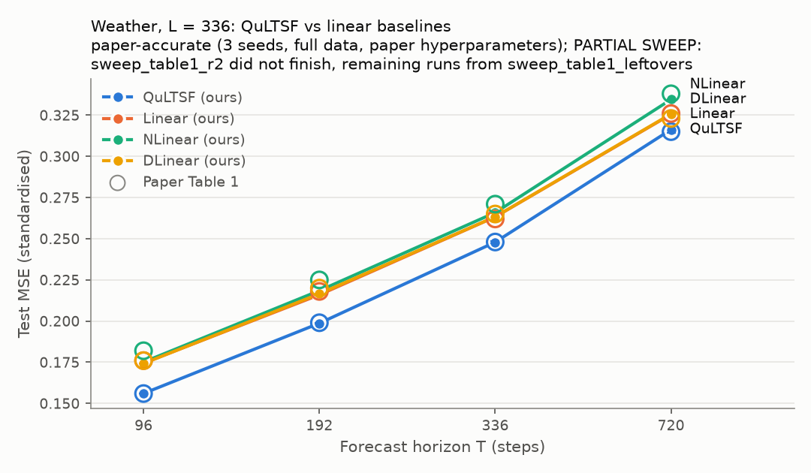
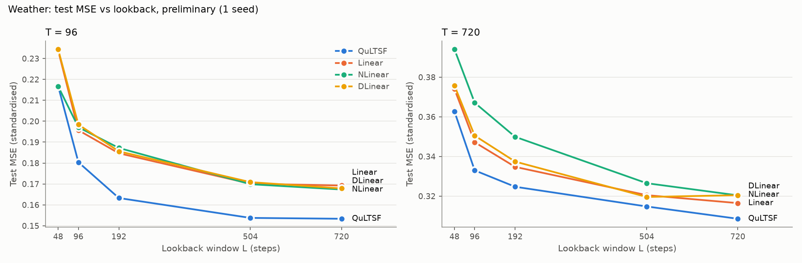
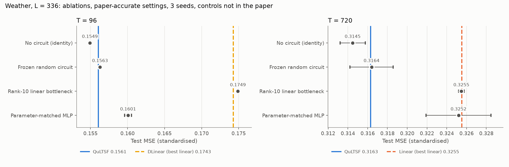
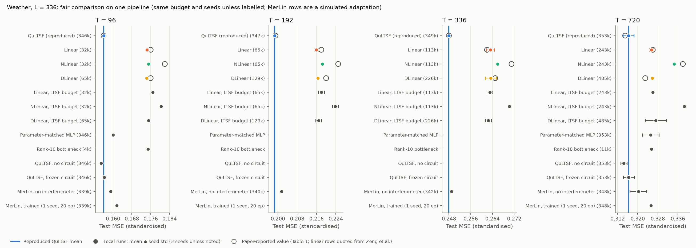
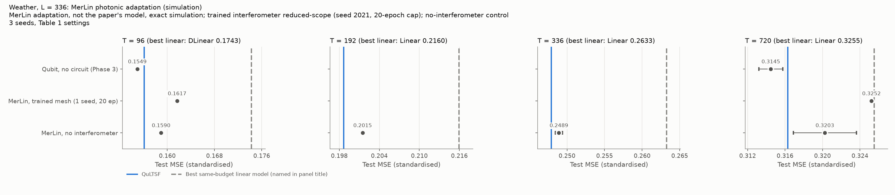

# QuLTSF: Long-Term Time Series Forecasting with Quantum Machine Learning - Reproduction

## Reference and Attribution

- Paper: *QuLTSF: Long-Term Time Series Forecasting with Quantum Machine
  Learning*, Hari Hara Suthan Chittoor, Paul Robert Griffin, Ariel Neufeld,
  Jayne Thompson, Mile Gu. arXiv:2412.13769 (v2, March 2025).
  https://arxiv.org/abs/2412.13769
- Original code: https://github.com/chariharasuthan/QuLTSF (read at commit
  `16121db`). It builds on LTSF-Linear (https://github.com/cure-lab/LTSF-Linear).
  The upstream repository states no licence; cite the paper and both
  repositories when reusing this comparison.
- The Linear, NLinear and DLinear baselines follow LTSF-Linear (Zeng et al.,
  *Are Transformers Effective for Time Series Forecasting?*, AAAI 2023).

## Original Paper

Long-term time series forecasting (LTSF) predicts the next T steps of a
multivariate series from its last L steps. Zeng et al. showed that one linear
layer per horizon (Linear, NLinear, DLinear) beats transformer forecasters on
the standard LTSF benchmarks. QuLTSF inserts a small quantum circuit between
two linear layers. Each of the 21 Weather channels is forecast independently
with shared weights:

```text
x[L] -> Linear(L -> 2^N) -> amplitude embedding on N qubits
     -> K StronglyEntanglingLayers -> <Z_i>, i = 1..N -> Linear(N -> T)
```

The paper uses N = 10 qubits and K = 3 layers (90 circuit parameters), Adam
with learning rate 1e-4, batch 16, and the upstream training budget (up to 100
epochs, early stopping with patience 20, `type3` learning-rate decay, seed
2021). It evaluates on the LTSF Weather dataset (Jena, 2020; 52,696 rows at
10-minute steps; 70/10/20 chronological split; train-fitted standardisation),
reports test MSE and MAE, and makes these claims:

- **Table 1** (L = 336, T in {96, 192, 336, 720}): QuLTSF has lower MSE and MAE
  than Linear, NLinear and DLinear. The baseline numbers are quoted from Zeng
  et al., not rerun.
- **Figs 2-3** (T = 96 and 720, L from 48 to 720): QuLTSF outperforms the three
  linear models at every L.
- **Sec. 6**: "incorporating a hidden quantum layer yielded additional
  improvements".

## Reproduction Scope, Claims, and Deviations

Reproduced:

- Table 1 for QuLTSF and all three linear baselines, plus a persistence
  (repeat last value) check, with 3 seeds (2021, 2022, 2023) per setting, all
  trained on one shared pipeline and budget.
- The linear baselines again under LTSF-Linear's own defaults (10 epochs,
  patience 3, `type1` decay), to test the quoted Table 1 numbers and the
  budget confound.
- Figs 2-3: L in {48, 96, 192, 504, 720} at T in {96, 720}, 1 seed (L = 336
  comes from Table 1).
- Ablations not in the paper, at T in {96, 720}, 3 seeds: the circuit removed
  (identity: amplitude embedding then PauliZ readout), a frozen random
  circuit, a rank-10 linear bottleneck `Linear(L -> 10) -> Linear(10 -> T)`,
  and a parameter-matched MLP.
- Diebold-Mariano tests on per-window test errors.

Claims tested (from the paper):

| ID | Claim | Paper evidence | Tested by |
|---|---|---|---|
| C1 | QuLTSF has lower MSE/MAE than Linear, NLinear, DLinear at L = 336 | Table 1 | Table 1 reruns, 3 seeds, same pipeline and budget |
| C2 | QuLTSF wins at every lookback L for T = 96 and 720 | Figs 2-3 | Lookback sweep, 1 seed |
| C3 | The hidden quantum layer causes the improvement | Sec. 6 (text) | Circuit-free, frozen-circuit, rank-10 and parameter-matched controls |
| C4 | Comparable to PatchTST/MTST | Sec. 5.6 (quoted values) | Not tested (out of scope) |

Updates and deviations:

- The circuit is simulated as an exact batched statevector in PyTorch
  (`lib/quantum_simulator.py`), with autograd gradients. Unit tests match
  PennyLane `default.qubit` outputs and gradients; the upstream PennyLane
  model is kept as `--simulator pennylane`.
- The test set is scored in full. Upstream drops up to 15 windows
  (`drop_last=True`); that variant is stored in every `metrics.json` and moves
  MSE by at most 0.00028.
- Batches are gathered on the GPU (`papers/shared/QuLTSF/data.py::WindowBatches`).
  A test shows they are identical to PyTorch's `DataLoader`, including the
  random-number stream.
- Runs used an NVIDIA L4 in float32. Table 1 used 6 parallel runs, and the 10
  runs that hit the 4-hour job limit were retried with 4 parallel runs.
- A MerLin photonic adaptation (not part of the paper) replaces the qubit
  hidden layer with an amplitude-encoded 4-photon state in 14 modes. It is
  run at reduced scope; see "Photonic Assessment and MerLin Extension". The
  earlier PR scaffold's angle-encoded photonic model was removed because it
  did not implement the paper's amplitude embedding.
- Not reproduced: the transformer baselines (FEDformer, Autoformer, Informer)
  and the PatchTST/MTST comparison in Sec. 5.6, all quoted from other papers.

## Project Layout

```text
papers/QuLTSF/
|-- cli.json                  paper CLI flags (authoritative schema)
|-- configs/                  defaults, Table 1, budget, ablation and smoke configs
|   `-- sweeps/               sweep plans (table1, budget, ablations, lookback, ...)
|-- lib/
|   |-- runner.py             train_and_evaluate(cfg, run_dir)
|   |-- models.py             QuLTSF, Linear, NLinear, DLinear, controls
|   |-- quantum_simulator.py  batched statevector circuit
|   |-- original_qultsf.py    upstream PennyLane reference
|   |-- qultsf_merlin.py      MerLin photonic adaptation
|   |-- training.py           training loop, schedules, early stopping
|   |-- statistics.py         Diebold-Mariano test
|   `-- plotting.py           figures
|-- utils/                    run_sweep.py, summarise_sweep.py, compare_results.py,
|                             fair_comparison.py, paper_agreement.py, plot_*.py
|-- tests/
`-- results/                  curated comparison tables and figures
```

The shared data pipeline lives in `papers/shared/QuLTSF/`.

## Install and How to Run

The quickest way in is [`notebook.ipynb`](notebook.ipynb). It runs on a CPU
in about 2 minutes: known-answer checks, a short live training run, and the
full results loaded from `results/`, with the claim-by-claim conclusion.

```bash
pip install -r papers/QuLTSF/requirements.txt
```

Quick smoke runs (from the repository root):

```bash
# Synthetic data, tiny model, CPU, seconds
python implementation.py --paper QuLTSF

# Real Weather data, 1 epoch of 50 batches
python implementation.py --paper QuLTSF --config configs/smoke_weather_reduced.json
```

One paper-accurate run (QuLTSF on an L4: about 30 s per epoch alone, about
100 s per epoch with 6 runs sharing the GPU; early stopping ends it after
38-72 epochs):

```bash
python implementation.py --paper QuLTSF --config configs/table1_qultsf_original.json \
  --prediction-horizon 96 --seed 2021 --device cuda:0
```

Full sweeps, one coordinator per plan (from the repository root):

```bash
python papers/QuLTSF/utils/run_sweep.py --plan configs/sweeps/table1.json \
  --sweep-dir outdir/sweep_table1 --device cuda:0 --workers 4
```

The other plans are `budget.json`, `ablations.json`, `lookback.json`,
`merlin_control.json` and `merlin_trained_reduced.json`.
Expect about 4-5 h for Table 1 with 4-6 workers on one L4, 3 h for lookback,
1.5 h for ablations and 5 min for budget.

Tables and figures from the finished sweeps (from `papers/QuLTSF`):

```bash
python utils/compare_results.py \
  --sweep-dir outdir/sweep_table1 --sweep-dir outdir/sweep_budget \
  --sweep-dir outdir/sweep_ablations --sweep-dir outdir/sweep_lookback \
  --plan configs/sweeps/table1.json --plan configs/sweeps/budget.json \
  --plan configs/sweeps/ablations.json --plan configs/sweeps/lookback.json \
  --out-dir outdir/comparison_<stamp>
python utils/plot_table1.py --comparison outdir/comparison_<stamp>/comparison.json
python utils/plot_lookback.py --comparison outdir/comparison_<stamp>/comparison.json
python utils/plot_ablations.py --comparison outdir/comparison_<stamp>/comparison.json
```

Replacing `--out-dir ...` with `--verify results/comparison.json` recomputes
everything and checks it against the committed table without writing files.

The fair-comparison table, its figure and the paper-agreement table come
from the same structured artifacts:

```bash
python utils/fair_comparison.py --sweep-dir outdir/sweep_table1 \
  --sweep-dir outdir/sweep_budget --sweep-dir outdir/sweep_ablations \
  --sweep-dir outdir/sweep_merlin_control --sweep-dir outdir/sweep_merlin_trained_reduced \
  --plan configs/sweeps/table1.json --plan configs/sweeps/budget.json \
  --plan configs/sweeps/ablations.json --plan configs/sweeps/merlin_control.json \
  --plan configs/sweeps/merlin_trained_reduced.json --out-dir outdir/fair_comparison_<stamp>
python utils/plot_fair_comparison.py --comparison outdir/fair_comparison_<stamp>/fair_comparison.json
python utils/plot_photonic.py --comparison outdir/comparison_<stamp>/comparison.json
python utils/paper_agreement.py --comparison outdir/comparison_<stamp>/comparison.json
```

## Configuration

- `configs/defaults.json`: synthetic smoke run (4 channels, L = 48, T = 24,
  N = 4 qubits, 2 epochs).
- `configs/table1_qultsf_original.json`: the paper's QuLTSF (Weather, L = 336,
  N = 10, K = 3, lr 1e-4, batch 16, 100 epochs, patience 20, `type3`).
- `configs/table1_{linear,nlinear,dlinear,persistence}_classical.json`: the
  baselines on the same budget.
- `configs/budget_{linear,nlinear,dlinear}_ltsf_classical.json`: LTSF-Linear
  defaults.
- `configs/ablation_*.json`: the four controls.
- `configs/table1_qultsf_merlin.json`,
  `configs/ablation_identity_interferometer_merlin.json`: the MerLin
  adaptation with a trained interferometer, and without one.
- Useful flags: `--prediction-horizon`, `--sequence-length`, `--model-name`,
  `--circuit {trainable,frozen,identity}`, `--simulator {torch,pennylane}`,
  `--epochs`, `--patience`. See `cli.json` for the full schema; the shared
  runtime adds `--config`, `--seed`, `--device`, `--dtype`, `--outdir`,
  `--data-root`.

Each run writes `outdir/run_YYYYMMDD-HHMMSS/` with `config_snapshot.json`,
`run.log`, `run_status.json`, `metrics.json` (test MSE/MAE, full and
drop-last, training history summary), `test_errors.npz` (per-window errors)
and `best_model.pt`. Sweeps write `sweep_status.json`, `sweep.log` and
`sweep_summary.{json,csv}`.

## Data

- LTSF Weather benchmark (Max Planck Institute for Biogeochemistry, Jena
  station, 2020; 21 variables, 52,696 rows), as distributed by Autoformer and
  linked from the upstream README. No licence is stated by the distributor or
  the station page; cite the MPI-BGC Jena station and Autoformer.
- Expected at `data/QuLTSF/weather/weather.csv` (runtime path
  `<data_root>/QuLTSF/weather/weather.csv`; override with `DATA_DIR` or
  `--data-root`). The loader checks sha256
  `34ee981d07313e51da2a50bb600072c8ae4a69cb4b0651f4cb93a069d7a2ba63`.
  Download from the repository root:

  ```bash
  mkdir -p data/QuLTSF/weather
  curl -sSL -o data/QuLTSF/weather/weather.csv \
    "https://drive.usercontent.google.com/download?id=1Tc7GeVN7DLEl-RAs-JVwG9yFMf--S8dy&export=download"
  ```

- The file is used unmodified, as upstream does: it has one duplicated
  timestamp (2020-05-12 06:00), one 100-minute gap (2020-05-29) and `-9999`
  sentinel values (`OT` 50 rows, `max. PAR` 30 rows, `wv` 1 row).
- All 21 variables are forecast jointly (`features_mode: "M"`, as in the
  upstream scripts), with `OT` as the last column.

## Results Obtained and Comparison with the Paper

Every reproduced paper value, with its delta and agreement:
[`results/paper_agreement.md`](results/paper_agreement.md), generated by
`utils/paper_agreement.py` from the verified comparison. A value agrees when
|Δ| ≤ max(2 × seed std, 0.002); 0.002 covers the paper's 3-decimal rounding
and reading values off its plots.

| Paper item | Claim tested | Paper value (MSE) | Reproduced value (MSE) | Delta | Metric agreement | Trend agreement | Claim support | Seeds | Comment |
|---|---|---:|---:|---:|---|---|---|---:|---|
| Table 1, QuLTSF, T = 96 | C1 | 0.156 | 0.1561 ± 0.0001 | +0.0001 | agrees | QuLTSF lowest | better than DLinear (p 7e-8) | 3 | paper-accurate |
| Table 1, QuLTSF, T = 192 | C1 | 0.199 | 0.1987 ± 0.0003 | -0.0003 | agrees | QuLTSF lowest | better than Linear (p 2e-4) | 3 | paper-accurate |
| Table 1, QuLTSF, T = 336 | C1 | 0.248 | 0.2479 ± 0.0005 | -0.0001 | agrees | QuLTSF lowest | better than Linear (p 0.009) | 3 | paper-accurate |
| Table 1, QuLTSF, T = 720 | C1 | 0.315 | 0.3163 ± 0.0022 | +0.0013 | agrees | QuLTSF lowest MSE; NLinear lower MAE | tie with Linear (p 0.13) | 3 | paper-accurate |
| Table 1, Linear/NLinear/DLinear (quoted from Zeng et al.) | C1 baselines | 12 values | see linked table | -0.0031 to +0.0042 | agree except DLinear T = 192, 336 (ours lower) | n/a | baselines reproduced | 3 | rerun at LTSF-Linear defaults |
| Fig. 2, QuLTSF, T = 96, L = 48-720 | C2 | 0.216-0.155 (read off plot) | 0.2168-0.1534 | -0.0016 to +0.0008 | agrees at all 5 L | QuLTSF lowest except a tie with NLinear at L = 48, as in the plot | preliminary | 1 | no DM test |
| Fig. 3, QuLTSF, T = 720, L = 48-720 | C2 | 0.362-0.307 (read off plot) | 0.3627-0.3086 | -0.0012 to +0.0016 | agrees at all 5 L | QuLTSF lowest | preliminary | 1 | no DM test |

All results below are test MSE / MAE on standardised data, mean ± sample
std over seeds 2021-2023 unless stated. Complete per-candidate tables for
every sweep (Table 1, budget, ablations, lookback, photonic), with run
counts and coverage: [`results/comparison.md`](results/comparison.md)
(machine-readable [`results/comparison.json`](results/comparison.json)).

### Table 1 (paper-accurate: 3 seeds, full data, paper hyperparameters)

Sweep record: PARTIAL SWEEP. The first Table 1 sweep hit its 4-hour job
limit with 42 of 52 runs finished. The other 10 (seed 2023: QuLTSF at every
T, NLinear at T = 336 and 720, DLinear at every T) were rerun unchanged in a
retry sweep. Every one of the 52 planned runs completed and passed logging
validation, and each run ID is counted once. The first sweep's coordinator
never recorded a final state, so the combined record keeps the PARTIAL
label.

| T | QuLTSF (ours) | QuLTSF (paper) | Linear | NLinear | DLinear | Persistence |
|---|---|---|---|---|---|---|
| 96 | 0.1561 ± 0.0001 / 0.2098 | 0.156 / 0.211 | 0.1744 / 0.2354 | 0.1751 / 0.2255 | 0.1743 / 0.2353 | 0.2591 / 0.2542 |
| 192 | 0.1987 ± 0.0003 / 0.2520 | 0.199 / 0.253 | 0.2160 / 0.2749 | 0.2185 / 0.2617 | 0.2166 / 0.2755 | 0.3092 / 0.2917 |
| 336 | 0.2479 ± 0.0005 / 0.2959 | 0.248 / 0.296 | 0.2633 / 0.3151 | 0.2659 / 0.2963 | 0.2634 / 0.3163 | 0.3764 / 0.3377 |
| 720 | 0.3163 ± 0.0022 / 0.3494 | 0.315 / 0.346 | 0.3255 / 0.3655 | 0.3346 / 0.3445 | 0.3258 / 0.3658 | 0.4652 / 0.3935 |



- QuLTSF's MSE matches the paper to within 0.0013 at every horizon: Table 1 is
  quantitatively reproduced.
- The baselines rerun under LTSF-Linear defaults agree with the numbers the
  paper quotes (|Δ| ≤ max(2 × seed std, 0.002)), except DLinear at T = 192 and
  336, where ours is lower (0.2169 vs 0.220, 0.2624 vs 0.265). Under the
  QuLTSF budget the baselines improve by at most 0.0025.
- Rule, fixed before the results were seen: QuLTSF is better only if its mean
  MSE is lower by more than twice the larger seed std and a Diebold-Mariano
  test gives p < 0.05. Under that rule it is better than the best linear model
  at T = 96, 192 and 336 (p = 7e-8, 2e-4, 0.009), and ties at T = 720
  (margin 0.009, p = 0.13). The verdicts are the same against the
  LTSF-default baselines.
- On MAE, NLinear is ahead of QuLTSF at T = 720 (0.3445 vs 0.3494).
- QuLTSF has 346k-353k trainable parameters, against 32k-243k for Linear and
  NLinear; 90 of them are in the circuit.

### Lookback (preliminary: 1 seed)



Every model improves as L grows, and QuLTSF is lowest at every L except
L = 48, T = 96, where it ties NLinear (0.2168 vs 0.2167). The paper's own
Fig. 2 shows the same tie, although its text says QuLTSF wins "in all cases".
Our curves match the plotted values within about 0.002 (for example T = 720,
L = 720: QuLTSF 0.3086, read from the paper as about 0.307).

### Verdict

| Claim | Verdict |
|---|---|
| Table 1 values | Quantitatively reproduced |
| QuLTSF beats the linear models (Table 1) | Partially supported: yes at T = 96, 192, 336; tie at T = 720 (MSE); NLinear has lower MAE at T = 720 |
| QuLTSF beats them at every lookback (Figs 2-3) | Trend reproduced, 1 seed; one tie at L = 48, T = 96, also visible in the paper |
| The quantum layer causes the improvement | Not supported: the same model without the circuit is as good or better |
| Photonic adaptation (MerLin, ours) | The photonic embedding keeps most of the gain over linear models (simulation); a trained interferometer did not help (preliminary) |

## Fair Baselines

Phase 1 fixed the advantage axis (forecast accuracy, test MSE/MAE) and
the matching criterion before any result: identical data, split, scaler,
loss, optimiser, budget, checkpoint rule and seeds for every model, with
parameter counts reported and one parameter-matched classical model. The
paper's own baselines are quoted from another paper under a different
budget, so we reran them on this pipeline under both budgets (baseline
state FAIR_AND_REPRODUCED). The planned "normalise plus trainable quadratic
forms" surrogate was not run; the circuit-free control answers the same
question.

### Controls: is the circuit what helps? (3 seeds, not in the paper)

| Control (params at T = 96) | T = 96 | T = 720 | QuLTSF vs control |
|---|---|---|---|
| No circuit, identity (346,144) | 0.1549 ± 0.0002 | 0.3145 ± 0.0013 | worse at 96 (p = 2e-5), tie at 720 |
| Frozen random circuit (346,144) | 0.1563 ± 0.0002 | 0.3164 ± 0.0022 | tie, tie |
| Parameter-matched MLP (346,063) | 0.1601 ± 0.0005 | 0.3252 ± 0.0033 | better, better |
| Rank-10 linear bottleneck (4,426) | 0.1749 ± 0.0002 | 0.3255 ± 0.0003 | better at 96, tie at 720 |
| QuLTSF (346,234) | 0.1561 ± 0.0001 | 0.3163 ± 0.0022 | |



Removing the circuit does not hurt: the identity control is significantly
better than QuLTSF at T = 96 and ties at T = 720, and freezing the circuit at
random weights changes nothing. What beats the linear models is the classical
part of the hidden layer. The input is mapped to 1024 values and normalised,
then the readout squares and signs them into 10 features. QuLTSF beats a
standard MLP of the same size (significant at T = 96 and 720), and the
circuit-free version has lower mean MSE than that MLP at both horizons.
The 10-wide linear bottleneck alone only matches Linear.

### Fair comparison of all systems

All systems ran on one pipeline (same data, split, scaler, optimiser,
budget, seeds and checkpoint rule), except where labelled. QuLTSF wins
against a system only if its mean test MSE is lower by more than twice the
larger seed std and a Diebold-Mariano test gives p < 0.05. Full table, with
run counts, parameters, wall-clock and the paper-reported values kept
separate: [`results/fair_comparison.md`](results/fair_comparison.md).



| Claim | Outcome | Basis |
|---|---|---|
| QuLTSF beats Linear/NLinear/DLinear (Table 1) | Partially supported | Better at T = 96, 192, 336; tie at 720. Better than a parameter-matched MLP at 96 and 720. The same holds against the paper's original baseline budget |
| QuLTSF wins at every lookback (Figs 2-3) | Partially supported, preliminary | Trend reproduced at 1 seed; one tie (L = 48, T = 96) |
| The quantum layer causes the gain (Sec. 6) | Unsupported | The circuit-free control matches or beats QuLTSF; a frozen random circuit ties |
| Comparable to PatchTST/MTST (Sec. 5.6) | Unresolved | Quoted values only; not rerun |

Wall-clock on one NVIDIA L4 (runs shared the GPU, so these describe cost,
not speed): QuLTSF 84-113 min per run, the linear models 2.5-25 min, the MLP
11-14 min, the circuit-free control 9-16 min, the MerLin no-interferometer
model 3-7 min, and the MerLin trained mesh about 2 h for 20 epochs.

No result here shows a quantum or photonic advantage. QuLTSF's edge over
the linear models is reproduced, but the same model without its circuit,
a purely classical calculation, does as well.

## Photonic Assessment and MerLin Extension

Status: MERLIN_IMPLEMENTATION, evaluated at reduced scope. This is an adaptation, not part of the paper, and every result is from simulation. The photonic
model keeps QuLTSF's structure and swaps the qubit layer for linear optics:

```text
x[336] -> Linear(336 -> 1001) -> L2 normalise
       -> amplitudes over the 1001 collision-free states of 4 photons in 14 modes
       -> trainable universal interferometer (one MZI mesh, 182 phases)
       -> click probability of each mode (threshold detectors) -> Linear(14 -> T)
```

C(14, 4) = 1001 keeps the embedding width close to QuLTSF's 2^10 = 1024, and
a per-mode click probability is a quadratic form of the state, like `<Z_i>`.
The control drops the interferometer, the photonic counterpart of the qubit
no-circuit control above.

| T | MerLin, trained mesh (seed 2021, 20 epochs) | MerLin, no interferometer (3 seeds) | QuLTSF | Best linear |
|---|---|---|---|---|
| 96 | 0.1617 / 0.2170 | 0.1590 ± 0.0002 / 0.2142 | 0.1561 | 0.1743 (DLinear) |
| 192 | not run | 0.2015 ± 0.0003 / 0.2575 | 0.1987 | 0.2160 (Linear) |
| 336 | not run | 0.2489 ± 0.0005 / 0.2978 | 0.2479 | 0.2633 (Linear) |
| 720 | 0.3252 / 0.3631 | 0.3203 ± 0.0034 / 0.3550 | 0.3163 | 0.3255 (Linear) |



- **The photonic embedding keeps most of QuLTSF's accuracy.** Without an
  interferometer it beats the best linear model at T = 96, 192 and 336, and
  ties at 720, the same pattern as QuLTSF. It is about 0.003 MSE behind
  QuLTSF at T = 96 and 192 (significant) and ties it at 336 and 720.
- **Training the mesh did not help** (preliminary). The trained run is worse
  than the no-interferometer model at T = 96 and ties at 720. Both trained
  runs hit the 20-epoch cap (best epochs 18 and 15), so they may be
  under-trained.

Scope: the no-interferometer photonic model ran at full scale (all four
horizons, 3 seeds, full budget). MerLin's exact simulation of the trained
mesh costs about 9 min per epoch on an L4: the full trained scope would
need 60-130 GPU-hours, so it ran at T = 96 and 720, seed 2021, capped at
20 epochs (labelled reduced-scope). A hand-written faster simulator was
prototyped and dropped because it did not reproduce MerLin's output.

## Hardware-Aware Settings

| Setting | Value |
|---|---|
| Computation space / detector | UNBUNCHED / threshold |
| Photons / modes | 4 / 14 |
| Input state and encoding | Data-dependent amplitude encoding over the 1001 collision-free basis states |
| Measurement | `MeasurementStrategy.mode_expectations(UNBUNCHED)` (14 click probabilities) |
| Postselection | Collision-free outputs, renormalised per input basis state (MerLin UNBUNCHED) |
| Simulator | MerLin exact simulation (merlinquantum 0.4.2, Perceval 1.3.1), NVIDIA L4; shots n/a; exact gradients |
| Wall-clock | Trained mesh: about 125 min per run for 20 epochs; no interferometer: 3-7 min per run |
| Seeds | Trained 2021; no interferometer 2021-2023 |

The trained mesh's gradients are exact (autograd through MerLin's simulation). No noise, loss or shot sampling is modelled. Preparing an arbitrary 1001-amplitude 4-photon input state is not possible on current hardware, so these results are not hardware validation.

## Limitations

- One dataset (Weather), as in the paper.
- The lookback study has one seed and no significance tests.
- Paper values for Figs 2-3 were read off the plots (about ±0.002).
- The transformer baselines and the PatchTST/MTST comparison are quoted, not
  rerun.
- Results are from exact noiseless simulation; no hardware or shot noise.
- The trained MerLin interferometer was run with only 1 seed, capped at
  20 epochs, and only at T = 96 and 720. MerLin's exact simulation of the
  1001-state space costs about 9 min per epoch on an L4, so the full scope
  would need 60-130 GPU-hours.
- Photonic results are simulation-only. An arbitrary 1001-amplitude
  4-photon input state cannot be prepared on current hardware, just as the
  paper's qubit amplitude embedding needs deep state-preparation circuits.

## Tests

```bash
cd papers/QuLTSF
pytest -q
```

67 tests cover:
- the data pipeline against upstream `Dataset_Custom` and PyTorch `DataLoader`;
- the circuit simulator and full model against PennyLane (outputs and gradients);
- parameter counts, schedules and early stopping;
- the MerLin adaptation: MerLin's basis order, the no-interferometer
  equivalence, the readout, gradients, seeding and config passthrough;
- sweep-plan expansion, the Diebold-Mariano estimator, figure rendering, the
  CLI and shared-runtime dispatch.

## Citation and License

```bibtex
@misc{chittoor2024qultsf,
  title         = {QuLTSF: Long-Term Time Series Forecasting with Quantum Machine Learning},
  author        = {Chittoor, Hari Hara Suthan and Griffin, Paul Robert and Neufeld, Ariel
                   and Thompson, Jayne and Gu, Mile},
  year          = {2024},
  eprint        = {2412.13769},
  archivePrefix = {arXiv},
  primaryClass  = {quant-ph}
}
```

This reproduction follows the repository's licence. The upstream QuLTSF code
states no licence; it is used here only as a reference implementation
(`lib/original_qultsf.py`), with attribution.
