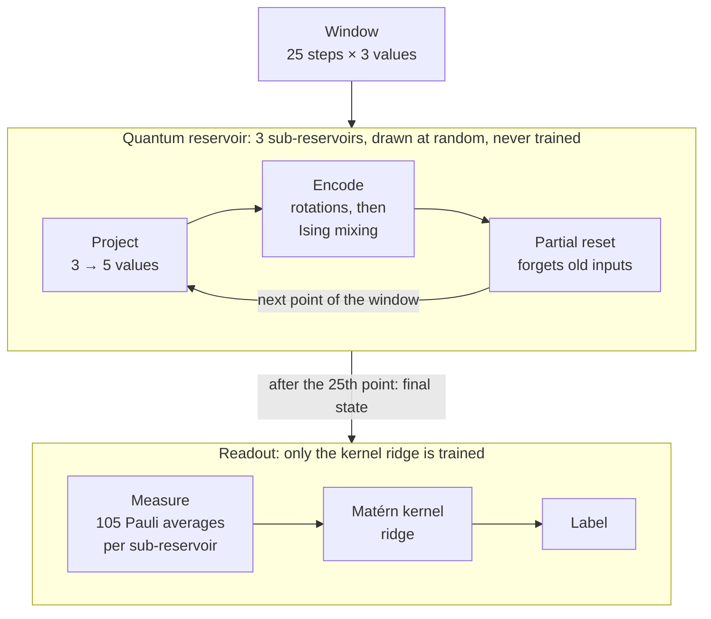
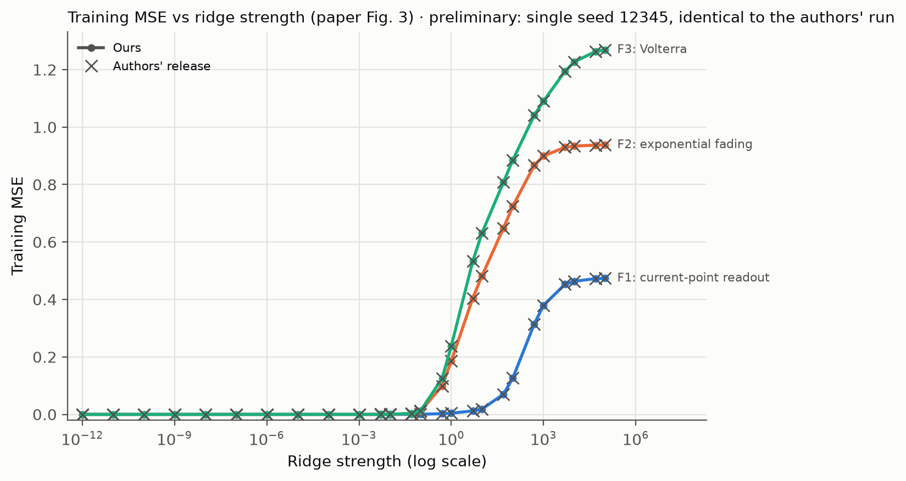
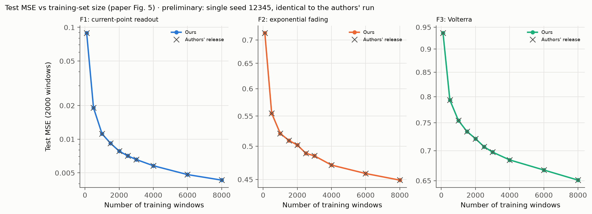
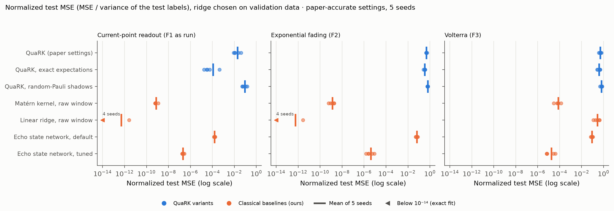
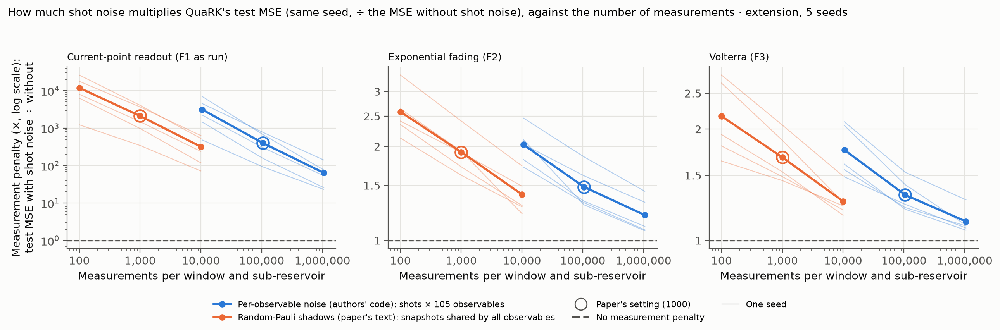

# QuaRK: A Quantum Reservoir Kernel for Time Series Learning - Reproduction

**The paper:** QuaRK is a quantum reservoir for time series designed to scale, with guarantees that it can fit any set of windows and generalizes on weakly dependent series.

**This reproduction:**
1. [The paper's experiments reproduce exactly, and its learning claims hold qualitatively.](#1-the-papers-experiments-reproduce-exactly-and-its-learning-claims-hold-qualitatively)
2. [On the paper's synthetic tasks, simple classical models reach a lower test error than QuaRK.](#2-on-the-papers-synthetic-tasks-simple-classical-models-reach-a-lower-test-error-than-quark)
3. [At equal measurement budget, the paper's classical shadows beat the noise model its code simulated.](#3-at-equal-measurement-budget-the-papers-classical-shadows-beat-the-noise-model-its-code-simulated)
4. [A photonic version of the reservoir matches QuaRK, with or without photon interference.](#4-a-photonic-version-of-the-reservoir-matches-quark-with-or-without-photon-interference)

## Reference and Attribution

- Paper: A. Aaraba, S. Cherkaoui, O. Ahmad, S. Wang, "QuaRK: A Quantum Reservoir Kernel for Time Series Learning", [arXiv:2602.13531](https://arxiv.org/abs/2602.13531) (v1, 2026)
- Original repository: https://github.com/abdo-aary/quark (MIT licence). We reproduce the paper-era code, commit `8f02ff1`, which drew the paper's figures.
- **Later work by the authors:** their later code (commit `c8cf7b6`) extends the paper with genuine classical shadows, an echo-state-network comparison on 10 real datasets and a validation-based protocol. We follow the paper and say where the later code addresses a point.

## Original Paper

**Message:** QuaRK is a quantum reservoir for time series designed to scale. A random projection decouples the number of qubits from the input dimension (Sec. 3.1.1), and the theorems guarantee that a reservoir whose qubit count grows only with the logarithm of the dataset size can fit any set of windows (Theorem 1) and generalizes on weakly dependent series (Theorem 2). The experiments (Sec. 4.2) show the training error reaching zero as the regularization λ_reg is relaxed (Figs. 3–4), and the test error decreasing like 1/√N with the number of training windows N (Fig. 5).

**How it works** (5 qubits, 3 sub-reservoirs, 1000 shots):



**Data:** windows of a synthetic 3-dimensional VARMA process (App. B), with three labels (App. B.2): current-point readout (F1: a single-step forecast in the text, the last point in the code), exponential fading (F2, a weighted sum of the window) and Volterra (F3, that sum plus a quadratic term).

## Reproduction Scope (including Updates and Deviations)

- **Reproduced:** Figs. 3–5 at the authors' seed (12345), then over 5 seeds.
- **Added (ours):** four classical baselines, QuaRK without shot noise and with classical shadows, shot budgets, reservoir sizes, a numerical evaluation of Theorem 2, and a photonic version in MerLin ([docs/photonic_adaptation.md](docs/photonic_adaptation.md)).
- **Deviations:** we follow the paper-era code, which produced the figures; λ_reg is chosen on validation data.

| Topic | Paper | Code at `8f02ff1` (followed) | Later code |
|---|---|---|---|
| F1 label | the next point | the last point | adds a future target |
| Shot noise | 1000 snapshots shared by all observables | 1000 shots on each of the 105 observables | genuine shadows |
| λ_reg in Fig. 5 | one fixed value | lowest test MSE | chosen on validation |
| Window stride | 100 | 125 | 100 |
| Matérn ν | ν > 1 (Theorem 2), but App. B.3 tunes ν ∈ {0.5, …, 5} | as App. B.3 | ν ∈ {1.5, 2.5, 5} |
| Ridge strength | scaled by N (Eq. 23) | not scaled, as App. B.3 | not scaled |

## Install and How to Run

```bash
pip install -r papers/QuaRK/requirements.txt
python implementation.py --paper QuaRK --config configs/smoke_reduced.json   # smoke run, not evidence
python implementation.py --paper QuaRK --config configs/quark_original.json --seed 12345
python implementation.py --paper QuaRK --config configs/quark_merlin.json --seed 12345   # photonic, ~11 min
```

The four sweeps behind the results (about 18 h on one 10-core CPU; `--validator` takes the ALPS `validate_logging.py` checker), then every table and figure (about 1.5 min):

```bash
for sweep in main_comparison shot_noise_ablation scaling photonic_adaptation; do
  python papers/QuaRK/utils/run_sweep.py papers/QuaRK/utils/sweep_specs/$sweep.json \
    --sweep-dir papers/QuaRK/outdir/sweep_$sweep --validator <path to validate_logging.py>
done
python papers/QuaRK/utils/make_results.py --run papers/QuaRK/outdir/run_<timestamp of the seed-12345 run>
```

## Configuration

One config per model in `configs/`, overlaying `defaults.json`: `quark*_original.json` (QuaRK), `*_classical.json` (baselines), `quark*_merlin.json` (photonic). `cli.json` lists the flags.

## Data

`lib/data.py` replays the authors' generator; at seed 12345 it equals their released dataset, which the paper-setting configs check. Download the release (24 MB) under the data root (`data/` or `$DATA_DIR`):

```bash
mkdir -p data/QuaRK/authors_release_v1.0.0
curl -L -o data/QuaRK/authors_release_v1.0.0/storage.zip \
  https://github.com/abdo-aary/quark/releases/download/v1.0.0/storage.zip
echo "ca1adc9c1a4f359f68e3bc45735552f1358baff086e859b7854c1d43eaca5567  data/QuaRK/authors_release_v1.0.0/storage.zip" | shasum -a 256 -c
unzip -q -o data/QuaRK/authors_release_v1.0.0/storage.zip -d data/QuaRK/authors_release_v1.0.0
```

Load the release's pickle only with an unpickler restricted to numpy arrays.

## Results Obtained and Comparison with the Paper

Metric: test MSE on 2,000 held-out windows divided by the test-label variance, mean over 5 seeds; "beats" means lower in a seed-by-seed comparison (difference beyond twice its standard error, a rule fixed before the runs). All tables: [`results/result_tables.md`](results/result_tables.md).

### 1. The paper's experiments reproduce exactly, and its learning claims hold qualitatively

At the authors' seed, our values match their released values within a relative 1.5·10⁻⁹:




**Look at:** the crosses (the authors' released values) sit on our curves. Fit examples (paper Fig. 4): [figure](results/fig4_fit_examples.png).

**Look at:** each claim of the paper against what we find over 5 seeds.

| Paper's claim | What we find |
|---|---|
| Training error reaches zero (Figs. 3–4) | Yes, but every kernel model does it, classical ones included: a consistency check, not evidence of learning |
| Test error falls like 1/√N (Fig. 5) | It falls on every task, but like 1/√N on F1 only ([figure](results/training_size_seeds.png)) |
| Generalization bound (Theorem 2) | At least 1,400 times the measured gap: too loose to be tested |

**Result:** the paper's figures are exact; its claims hold in direction, not in their quantitative form.

### 2. On the paper's synthetic tasks, simple classical models reach a lower test error than QuaRK



**Look at:** the top blue row (QuaRK, paper settings) sits to the right of every orange row (classical) on all three tasks, and every blue row does on F2 and F3; log axis, lower is better.

**Result:** every classical baseline beats QuaRK on every task, in 5 of 5 seeds. Even a random classical reservoir with QuaRK's 315 features and readout does (0.063 against 0.48 on F2), and shot noise is not the reason: without it, QuaRK still trails on F2 and F3 (a check added after the runs). On real data, the authors' later comparison is mixed (QuaRK better on 5 of 10 datasets).

### 3. At equal measurement budget, the paper's classical shadows beat the noise model its code simulated



**Look at:** at the same number of measurements (x-axis), orange (shadows, as in the paper's text) lies below blue (the code's model). The y-axis is the error with shot noise divided by the error without.

**Result:** at about 10⁴ measurements, shadows beat the code's model on every task, in 5 of 5 seeds (verdicts: [`results/result_tables.md`](results/result_tables.md), shot budget; seed counts: notebook). The paper's figures used the code's model, which spends 105 times more measurements than the text's 1000 shadows; the authors' later code adopts shadows.

### 4. A photonic version of the reservoir matches QuaRK, with or without photon interference

Per sub-reservoir, 3 photons in 14 modes in MerLin, with QuaRK's reset, readout and data, and ideal components; a control makes the photons distinguishable, so they cannot interfere.

**Look at:** the three columns, mean normalized test MSE, all without shot noise.

| Task | QuaRK, exact | Photonic, exact | Photonic, no interference |
|---|---:|---:|---:|
| F1 | 1.2·10⁻⁴ | 1.4·10⁻⁴ | 1.4·10⁻⁴ |
| F2 | 0.328 | 0.307 | 0.307 |
| F3 | 0.391 | 0.388 | 0.387 |

**Result:** the photonic reservoir matches QuaRK, and switching interference off changes nothing (means differ by at most 0.00102). Our reading: the accuracy comes from the nonlinear encoding and the fading memory, not from interference. Details: [`results/photonic_comparison.md`](results/photonic_comparison.md).

## Limitations

- **Synthetic data only, as in the paper;** with 3 input dimensions and 5 qubits, the projection never reduces the dimension, so the scalability argument is not tested.
- **Theorem 2 is checked numerically,** not its proof; all reservoirs here are classically simulable.

## Tests

```bash
cd papers/QuaRK && pytest -q
```

41 tests, among them the checks with known answers: the circuit against the closed-form reset, our features against the authors' release, MerLin against permanents; also every config and the results script.

## Citation and License

Cite the original paper (entry from arXiv); this reproduction follows the repository license.

```bibtex
@misc{aaraba2026quarkquantumreservoirkernel,
      title={QuaRK: A Quantum Reservoir Kernel for Time Series Learning},
      author={Abdallah Aaraba and Soumaya Cherkaoui and Ola Ahmad and Shengrui Wang},
      year={2026},
      eprint={2602.13531},
      archivePrefix={arXiv},
      primaryClass={cs.LG},
      url={https://arxiv.org/abs/2602.13531},
}
```
