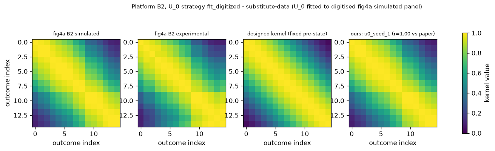
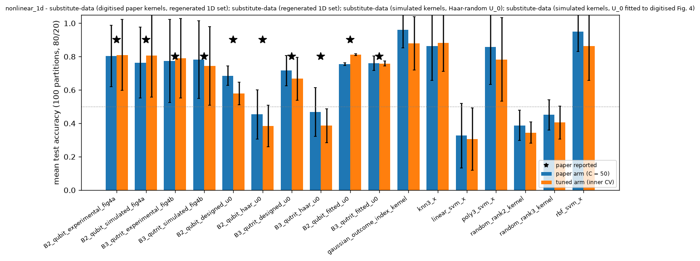
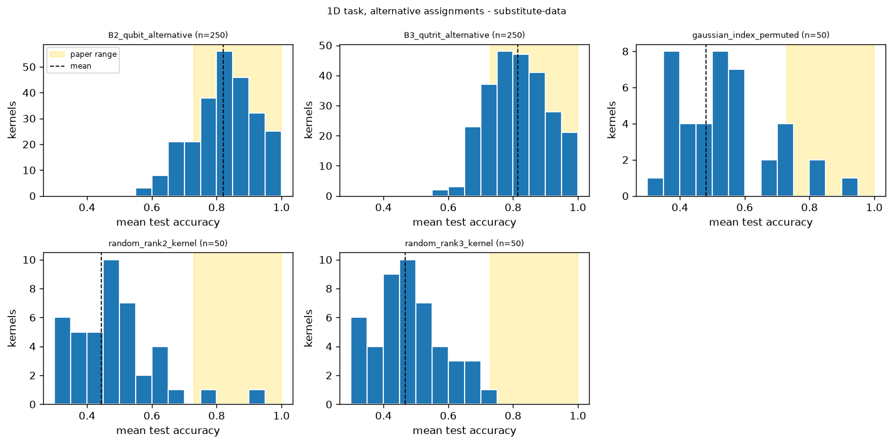
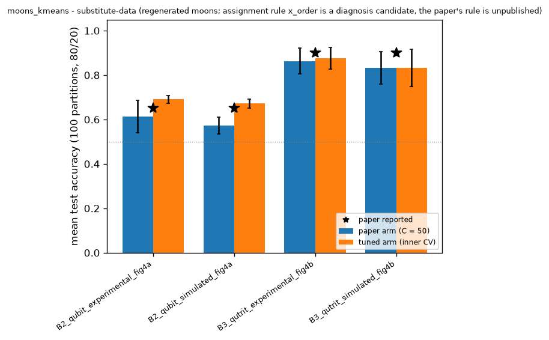
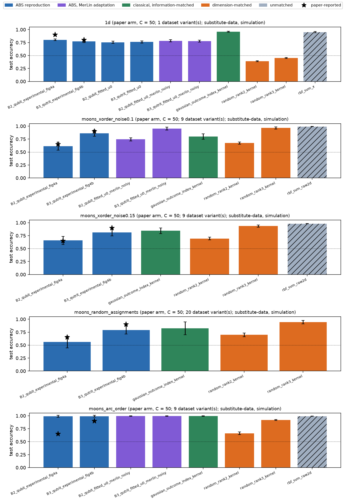
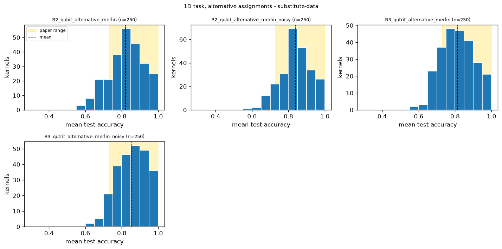

# Quantum Machine Learning with Adaptive Boson Sampling via Post-Selection - Reproduction

Status (2026-11-06): experiments run (Phase 03), MerLin adaptation done
(Phase 04, `MERLIN_IMPLEMENTATION`), fair classical comparison done (Phase 05: no
accuracy advantage for ABS kernels), documentation (Phase 06), and notebook
walkthrough (Phase 07, `notebook.ipynb`).
Every result is simulation or `substitute-data` (V4: regenerated datasets,
unpublished U_0 replaced); see Results below.

## Reference and Attribution

- Paper: Quantum machine learning with Adaptive Boson Sampling via post-selection,
  Nature Communications 16, 902 (2025).
- Authors: F. Hoch, E. Caruccio, G. Rodari, T. Francalanci, A. Suprano, T. Giordani,
  G. Carvacho, N. Spagnolo, S. Koudia, M. Proietti, C. Liorni, F. Cerocchi,
  R. Albiero, N. Di Giano, M. Gardina, F. Ceccarelli, G. Corrielli, U. Chabaud,
  R. Osellame, M. Dispenza, F. Sciarrino.
- DOI: https://doi.org/10.1038/s41467-025-55877-z
- arXiv: https://arxiv.org/abs/2502.20305 (v1, 27 Feb 2025)
- Original repository: none public; code and data are available from the
  corresponding authors on request.
- License and attribution notes: cite the paper (see Citation and License). No
  original code is reused. The article is CC BY-NC-ND 4.0. The digitised kernels
  under `results/digitized_kernels/` are values read from its figures.

## Original Paper

The paper builds quantum kernels for a support vector machine from an Adaptive
Boson Sampling (ABS) feature map:

- **Feature map.** Each data point is assigned one post-selected photon-count
  pattern p on k adaptive modes. That pattern selects an adaptive unitary U_p on
  the remaining modes, and the residual photons form the state |psi_p>.
- **Kernel.** The kernel is the squared overlap of these states. In the
  experiment it is the density-matrix fidelity of the tomographically
  reconstructed states.
- **Platforms.** The experiments run on integrated photonic chips: A [6,2,2,3]
  with an SPDC source, and with a quantum-dot source B1 and B2 [8,3,2,15]
  (qubits) and B3 [8,3,3,15] (qutrits).
- **Tasks.** A 15-point 1D dataset that is not linearly separable, and a 2D
  make_moons dataset (200 points) reduced to 15 K-means clusters. Accuracy is
  averaged over 100 random 80/20 partitions.
- **Reported accuracies.**
  - 1D: 0.90 (qubit) and 0.80 (qutrit).
  - Moons: 0.65 (qubit) and 0.90 (qutrit).
- **Fidelity with theory:** 0.94-0.999.

## Reproduction Scope, Claims, and Deviations

Claims tested and their final outcome (evidence in
[Results](#results-obtained-and-comparison-with-the-paper) and
[Fair Baselines](#fair-baselines)):

| ID | Claim | Outcome |
|---|---|---|
| C1 | The post-selected ABS feature map produces the predicted conditional states and kernels | `PARTIALLY_SUPPORTED`: platform A exact; B2/B3 reproduced with a fitted U_0; B1 not matched; hardware fidelities not testable |
| C2 | ABS kernels + SVM classify non-linear 1D data (0.90 / 0.80) and moons (0.65 / 0.90) | `PARTIALLY_SUPPORTED`: qutrit 1D reproduced, qubit 1D within digitisation sensitivity, moons levels depend on the unpublished assignment; matched classical kernels are as good or better |
| C3 | A larger output dimension (qutrit) gives higher accuracy | `PARTIALLY_SUPPORTED`: holds on moons under every rule tried, but random classical kernels of the same dimensions show the same gain; not in 1D |
| C4 | About 50 re-assigned kernels spread over about 0.73-1.0 in 1D | `SUPPORTED` with a substitute (fitted) U_0 |
| C5 | ABS kernel estimation is BQP-complete | `UNRESOLVED`: theory, out of scope |
| C6 | Post-selected ABS cannot be reproduced by one non-adaptive circuit | `UNRESOLVED`: not tested |


Everything is simulation. There is no hardware access, so the experimental
tomography and fidelities cannot be reproduced, only the ideal circuit
predictions.

| Paper item | What this repository does | Validity label |
|---|---|---|
| Fig. 3a-b, platform A [6,2,2,3] | Exact simulation of the published circuit. Kernel 0.2984 / 0.9660 / 0.3316 vs printed 0.298 / 0.966 / 0.331 (test `test_platform_a_reproduces_fig3b_theory_kernel`) | simulation of the paper circuit |
| Fig. 3d-e, platform B1 [8,3,2,15] | Exact simulation of the published circuit, compared with the digitised Fig. 3e heatmaps | simulation; reference digitised |
| Fig. 4, platforms B2 [8,3,2,15] and B3 [8,3,3,15] | The random U_0 is unpublished. We use (a) Haar-random U_0 over 10 seeds, (b) U_0 picked from 200 Haar candidates by closeness to the designed kernel (no paper data used) and (c) U_0 fitted by gradient descent to the digitised Fig. 4 "simulated" panel (5 independent fits) | substitute-data |
| Fig. 5a-c, 1D classification and alternative kernels | 1D labels from Fig. 5a. SVM C = 50, 100 random 80/20 partitions. Kernels: digitised from Fig. 4 and simulated. 50 alternative assignments (SI Note 4) | substitute-data |
| Fig. 5d-e, moons + K-means | `make_moons(200, noise 0.1)`, 3 data seeds x 3 K-means seeds, cluster-to-outcome assignment unpublished: arc order, order of centroid x-coordinate (also at noise 0.15), K-means label and 20 random assignments tested | substitute-data |
| SI Note 6, imperfect-source model (E9) | MerLin adaptation (Phase 04): Perceval source noise (indistinguishability 0.83, g2 0.02) and simulated tomography; no losses | MerLin adaptation, substitute-data for B2/B3 |
| Classical baselines (not in the paper) | Linear, RBF, poly and kNN on the raw features; Gaussian kernels over the outcome index and the cluster centroid; random rank-d kernels (d = 2, 3) | added |

Implementation decisions that fill gaps in the paper (details and evidence in
`LOG.md`):

- **Crossings.** Every crossing in Figs. 3-4 is an MZI,
  `B . diag(e^{i theta}, 1) . B` with 50:50 splitters `B`, and theta is its
  internal phase. This is the convention that reproduces the Fig. 3b numbers.
- **Platform-A outcome order.** The Fig. 3b index 0, 1, 2 is the photon detected
  on paper modes 6, 3, 2.
- **B2/B3 angle rule.** The index is `i = k + sum_{t=1}^{j} (5 - t)` (B2) or
  `(4 - t)` (B3), with (k, j) the (second, first) detector index of the two
  photons. This reading gives 15 distinct indices, i = 1..15, with
  phi_i = theta_i = i / 5.
- **B3 adaptive phases.** Which phase shifters carry phi_i in B3 is not stated.
  We put phi_i before each adaptive MZI.
- **Tuned arm.** Besides the paper arm (fixed C = 50), every model also gets a
  tuned arm: inner 3-fold CV on the training split, never the test split.

## Project Layout

```text
papers/adaptive_boson_sampling/
|-- README.md, LOG.md, INSIGHTS.md, FEEDBACK.md, CONFLUENCE.md, VISITED_URLS.md
|-- cli.json, requirements.txt, notebook.ipynb (walkthrough, about 2 min on CPU)
|-- configs/        defaults, smoke and one JSON per experiment (see Configuration)
|-- lib/
|   |-- runner.py       train_and_evaluate: platform_kernel and classification runs
|   |-- circuits.py     platforms A, B1, B2, B3 (MZI convention, angle rules)
|   |-- fock.py         Fock-space amplitudes and post-selection
|   |-- kernels.py      overlap / fidelity kernels, U_0 strategies, classical kernels
|   |-- u0_fit.py       U_0 fitted to a digitised kernel (autograd permanent)
|   |-- data.py         1D set, moons + K-means, cluster-to-outcome assignments
|   |-- models.py       ABS and classical model registry
|   |-- evaluation.py   SVM over 100 partitions, paper and tuned arms
|   |-- abs_merlin.py   Phase 04 MerLin backends (exact and noisy source)
|   `-- experiment_logging.py, plotting.py
|-- utils/          digitisation, diagnosis, sweep coordinator, comparisons, plots
|-- tests/          pytest suite (see Tests)
|-- results/        curated figures, tables, JSON summaries, run ledger, digitised kernels
|-- models/         empty: no trained models are kept (kernel SVMs are refit per partition)
`-- outdir/         raw run directories (not committed)
```

## Install and How to Run

```bash
pip install -r papers/adaptive_boson_sampling/requirements.txt

# One-off: digitise the Fig. 3e / Fig. 4 kernels from the cached figures
# (needed by the configs that use the paper's own kernels: *_original.json).
python papers/adaptive_boson_sampling/utils/digitize_figures.py

# Smoke run (3 partitions, seconds)
python implementation.py --paper adaptive_boson_sampling --config configs/smoke.json

# Paper experiments (each runs in seconds to minutes on a laptop CPU)
python implementation.py --paper adaptive_boson_sampling --config configs/kernel_platform_a_original.json
python implementation.py --paper adaptive_boson_sampling --config configs/classify_1d_original.json
python implementation.py --paper adaptive_boson_sampling --config configs/classify_moons_original.json

# From inside papers/adaptive_boson_sampling
python ../../implementation.py --config configs/smoke.json

# Notebook walkthrough (start Jupyter inside papers/adaptive_boson_sampling;
# about 2 minutes on a laptop CPU). utils/build_notebook.py regenerates it.
jupyter nbconvert --to notebook --execute --inplace notebook.ipynb
```

`notebook.ipynb` is the entry point for readers. It recomputes the key results
live from `lib/` and the committed `results/` files: the platform-A check, the
U_0 fits, 1D classification, the moons fair comparison, the alternative kernels
and the MerLin check. Results that would take too long live (the sweep and the
stored runs) are loaded from `results/`.

All runs (Phases 03-05) and their run directories are listed in `results/run_ledger.tsv`.
Tables, statistics and figures are regenerated from those run directories with:

```bash
cd papers/adaptive_boson_sampling
python utils/summarize_results.py $(grep -v "INTERRUPTED\|SUPERSEDED" results/run_ledger.tsv | cut -f2) --out results/summary_tables.md
python utils/compute_statistics.py --digitized-1d outdir/<classify_1d_original run> \
  --assignments outdir/<classify_moons_assignments_original run> \
  --alternatives outdir/<alternative_kernels_1d_fitted run> \
  --x-order outdir/<classify_moons_xorder_original run> outdir/<classify_moons_xorder_noise015 run> \
  --out results/statistics.json
python utils/diagnose_b1_ordering.py --out results/b1_diagnosis.json
python utils/diagnose_b1_models.py --out results/b1_models.json
python utils/digitization_sensitivity_1d.py --out results/digitization_sensitivity_1d.json
python utils/run_moons_assignment_sweep.py   # E8 rule sweep -> outdir/sweep_moons_assignment_rules/
python utils/compare_merlin_runs.py --kernel-pair <merlin run> <phase 3 run> ... --out results/merlin_comparison.json
python utils/render_moons_sweep_tables.py outdir/sweep_moons_assignment_rules
python utils/plot_kernel_comparison.py outdir/<platform_kernel runs>
cd utils && python plot_accuracy.py ../outdir/<classification runs on one dataset> --name accuracy_1d
python plot_alternative_kernels.py ../outdir/<alternative_kernels runs>
```

Each run writes `outdir/run_YYYYMMDD-HHMMSS/` containing:

- `config_snapshot.json`, `run.log`, `run_status.json`, `metrics.json`;
- `kernels.npz` and `kernels.png` for `platform_kernel` runs;
- `summary.csv` and `dataset_<variant>.npz` for `classification` runs.

## Configuration

`cli.json` is the authoritative flag schema. The paper flags are listed below,
plus the global runtime flags (`--config`, `--outdir`, `--seed`, `--dtype`,
`--device`, `--log-level`, `--data-root`). Only `--device cpu` and
`--dtype float64` are supported.

- `--n-partitions`: number of random 80/20 partitions for classification runs.
- `--svm-c`: C of the paper arm (the paper uses lambda = 50).
- `--platform`: platform of a `platform_kernel` run (A, B1, B2 or B3).
- `--kernel`: kernel estimator of a `platform_kernel` run (`overlap` or
  `fidelity`).

| Config | Experiment |
|---|---|
| `defaults.json` | Lightweight runnable default: 1D task, one Haar-U_0 B2 kernel plus an RBF baseline, paper arm only |
| `smoke.json` | Defaults with 3 partitions and both arms |
| `kernel_platform_a_original.json` | E1: platform A kernel vs the Fig. 3b printed values |
| `kernel_platform_b1_original.json` | E3: B1 kernel vs the digitised Fig. 3e |
| `kernel_platform_b{2,3}_haar.json` | E4/E5: B2/B3 kernels for 10 Haar-random U_0 |
| `kernel_platform_b{2,3}_designed.json` | E4/E5: B2/B3 kernels for U_0 selected by design agreement |
| `kernel_platform_b{2,3}_fitted.json` | E4/E5: B2/B3 kernels for U_0 fitted to the digitised Fig. 4 simulated panel (`u0.strategy = "fit_digitized"`, 5 fits x 8 starts) |
| `classify_1d_fitted.json` | E6: 1D task with the ideal kernels of the fitted U_0 |
| `classify_1d_{original,haar,classical}.json` | E6: 1D task with digitised paper kernels / simulated kernels / classical baselines |
| `classify_moons_{original,haar,classical}.json` | E8: moons + K-means over 3 x 3 seeds |
| `classify_moons_assignments_original.json` | E8: sensitivity to the cluster-to-outcome assignment (arc order, K-means label, 20 random) |
| `classify_moons_xorder_{original,noise015}.json` | E8: clusters assigned to outcomes in order of centroid x-coordinate, noise 0.1 and 0.15 (both arms) |
| `classify_moons_{xorder,xorder_noise015,assignments}_classical.json` | Phase 05 fair baselines: the classical models under exactly the data, assignments and partitions of the matching ABS config |
| `utils/run_moons_assignment_sweep.py` | E8 sensitivity sweep over 7 centroid-rank rules x 3 noise levels (`assignment = "centroid_rank"`, `rank_rule`), writes `outdir/sweep_moons_assignment_rules/` |
| `*_merlin.json`, `kernel_platform_b{1,2,3}_merlin_noisy.json`, `smoke_merlin.json` | Phase 04 MerLin adaptation: same experiments with `simulation.backend` / `platform_kernel.simulations` set to `merlin` (exact) or `merlin_noisy` (source noise + tomography) |
| `alternative_kernels_1d_{haar,fitted,classical}.json` | E7: 50 alternative assignments for design-selected U_0 (`haar`, kept for its historical name) and for fitted U_0, vs permuted and random classical kernels |

## Data

The paper publishes no dataset and no code. Its tasks use generated data (a
15-point 1D toy set, and scikit-learn `make_moons` with 200 points clustered into
15 groups by K-means), and the generation parameters are not published. The
experimental data (kernels, tomographic states, the fixed unitaries U_0) are
"available from the corresponding author upon request".

- **Author data:** not obtained.
- **Data used instead:** synthetic regeneration at run time, specified in
  `LOG.md` ("Synthetic Data Specification"). No files are needed under `data/`.
  - The 15-point 1D set, with labels read from Fig. 5a.
  - `make_moons(n_samples=200, noise=0.1)` with data seeds 0-2, plus K-means
    (15 clusters, seeds 0-2); noise 0.15 and 0.2 in the sweep. The
    cluster-to-outcome assignment is unpublished, so several rules are run: arc
    order, K-means label, 20 random assignments, and 7 centroid-rank rules
    (centroid x, -x, y, -y, x+y, x-y, angle).
  - Every result is labelled `substitute-data`. If author data arrive later,
    they go in `data/adaptive_boson_sampling/author_data/`.
- **Digitised paper kernels:** `utils/digitize_figures.py` reads the cached
  Fig. 3e and Fig. 4 PNGs and maps each cell to a value through the panel's
  colorbar. The output goes to
  `data/adaptive_boson_sampling/digitized/figure_kernels.npz` (used by runs) and
  `results/digitized_kernels/*.csv` plus `manifest.json` (committed). The diagonal
  is recovered within 0.01 of 1.
- **Public paper materials:** the arXiv PDF and HTML, the Nature published
  full-text XML (Europe PMC PMC11751292), the Supplementary Information, the
  peer-review file and Figures 2-5 are cached in
  `data/adaptive_boson_sampling/sources/`. Re-acquisition commands are in
  `LOG.md`.

**Limitation.** Without the author data, the moons sample, its seeds and the
cluster assignment are our own, so the reported accuracies cannot be matched
exactly.

## Results Obtained and Comparison with the Paper

### Summary against the paper

Accuracy: mean test accuracy over 100 random 80/20 partitions (seeds 0-99), SVM
C = 50. Agreement levels follow the repository convention: "quantitatively" means
within the reported or observed uncertainty, "qualitatively" means the trend
matches but the numbers do not.

| Paper item | Claim tested | Paper value | Reproduced value | Delta | Metric agreement | Trend agreement | Claim support | Seeds | Comment |
|---|---|---:|---:|---:|---|---|---|---|---|
| Fig. 3b, platform A kernel | C1 | 0.298 / 0.966 / 0.331 | 0.2984 / 0.9660 / 0.3316 | <= 6.3e-4 | quantitative | yes | supported | N/A (deterministic simulation) | sim |
| Fig. 3e, platform B1 kernel | C1 | heatmap | r = -0.12 (best over all 15! orders r = 0.92) | N/A | no | no | not supported for B1 | N/A (deterministic) | cause unresolved; calibrated chip phases suspected |
| Fig. 4a, B2 qubit kernel | C1 | heatmap (F = 0.987) | fitted U_0: r = 1.000 on the simulated panel (fitted), r = 0.991 on the experimental panel (not fitted) | MAE 0.002-0.003 / 0.027 | quantitative (simulated panel, not independent) | yes | supported, with a substitute U_0 | 5 U_0 fits x 8 starts | sub |
| Fig. 4b, B3 qutrit kernel | C1 | heatmap (F = 0.963) | fitted U_0: r = 0.994-0.996 / 0.963-0.970 | MAE 0.020-0.026 (simulated) | quantitative (simulated panel) | yes | supported, with a substitute U_0 | 5 U_0 fits x 8 starts | sub |
| State fidelities 0.94-0.999 | C1 | 0.94-0.999 | N/A | N/A | N/A | N/A | not testable | N/A | needs hardware tomography |
| Fig. 5a, 1D qubit | C2 | 0.90 | 0.803 (digitised exp.); 0.755 (fitted U_0) | -0.10 / -0.15 | no (5 SE), but within digitisation sensitivity (0.86 ± 0.05) | n/a | partially | partitions 0-99; 5 U_0 fits | sub |
| Fig. 5a, 1D qutrit | C2 | 0.80 | 0.773 (digitised exp.); 0.761 (fitted U_0) | -0.03 / -0.04 | quantitative (within about 1 SE) | n/a | supported | partitions 0-99; 5 U_0 fits | sub |
| Fig. 5b-c, alternative kernels | C4 | about 0.73-1.0, mean about 0.86 | 81-82 % in range, means 0.815-0.820 (exact); 88-94 %, 0.837-0.855 (MerLin noisy) | mean about -0.04 | qualitative | yes | supported | 5 U_0 fits x 50 assignments; partitions 0-99 | sub; the paper's selection of 50 kernels is unstated |
| Fig. 5d, moons qubit | C2 | 0.65 | 0.614 (centroid x, post hoc); 0.560 (20 random); 0.989 (arc order) | -0.04 (centroid x) | depends on the unpublished assignment | n/a | partially | 3 data x 3 K-means seeds; 20 random assignments | sub |
| Fig. 5e, moons qutrit | C2 | 0.90 | 0.863 (centroid x); 0.791 (random); 0.991 (arc) | -0.04 (centroid x) | depends on the assignment | n/a | partially | as above | sub |
| Moons, qutrit minus qubit | C3 | +0.25 | +0.249 (centroid x); +0.05 to +0.25 over all 21 swept rules | 0.00 (centroid x) | quantitative under centroid x | yes (21/21 rules, 19/20 random) | partially: random rank-3 vs rank-2 classical kernels gain +0.24 to +0.29 | as above | sub |
| 1D, qubit vs qutrit | C3 | 0.90 vs 0.80 | 0.803 vs 0.773 | difference -0.030 vs -0.10 | no | sign matches, not separated (95 % CI contains 0) | not supported in 1D (neither does the paper claim it there) | partitions 0-99 | sub |
| SI Note 6, imperfect source (E9) | C1 | implicit in F values | MerLin noisy model: B2/B3 agreement unchanged, B1 still unmatched | N/A | N/A | N/A | characterisation | seed 42 | MerLin adaptation |

The detailed tables below give the variability of each value.

All numbers come from the runs listed in `results/run_ledger.tsv` and are
tabulated at full precision in `results/summary_tables_*.csv` and
`results/statistics.json`. Accuracy is the mean test accuracy over 100 random
80/20 partitions (identical for all models), SVM C = 50 ("paper arm"). Spread =
std over instances (U_0 fits or seeds, dataset variants), or SE over partitions
where stated. Labels: **sim** = simulation of a published circuit, **sub** =
substitute-data (V4).

### Kernels (E1, E3-E5)

| Platform | Paper | Ours | Agreement with the digitised panel | Label |
|---|---|---|---|---|
| A [6,2,2,3], Fig. 3b | 0.298 / 0.966 / 0.331 | 0.2984 / 0.9660 / 0.3316 | max error 6.3e-4 | sim |
| B1 [8,3,2,15], Fig. 3e | heatmap | published circuit | r = -0.12 in our order; best over all orders r = 0.92 (random-state control 0.75). **Not matched** | sim |
| B2 [8,3,2,15], Fig. 4a | heatmap | 10 Haar U_0 | r = -0.02..0.59 (mean 0.21) | sub |
| B2 | heatmap | 10 design-selected U_0 | r = 0.59..0.94 (mean 0.77) | sub |
| B2 | heatmap | **5 U_0 fitted to the simulated panel** | simulated (fitted): r = 1.000, MAE 0.002-0.003. Experimental (not fitted): r = 0.991, MAE 0.027 | sub |
| B3 [8,3,3,15], Fig. 4b | heatmap | 10 Haar U_0 | r = -0.04..0.31 (mean 0.15) | sub |
| B3 | heatmap | 10 design-selected U_0 | r = 0.51..0.70 (mean 0.60) | sub |
| B3 | heatmap | **5 U_0 fitted to the simulated panel** | simulated (fitted): r = 0.994-0.996, MAE 0.020-0.026. Experimental (not fitted): r = 0.963-0.970 | sub |

r is the Pearson correlation of the upper triangle with the digitised panel.
Figures: `results/kernel_comparison_*.png`.

- **Fitted U_0.** A single 8-mode interferometer, placed in front of the
  published adaptive blocks, reproduces the paper's simulated kernels to within
  digitisation error. The fitted kernels also predict the experimental panels,
  which were not fitted, at r = 0.96-0.99. This confirms the B2/B3 circuits and
  the angle rule we inferred.
- **The fitted U_0 is not unique.** The 5 fits are different matrices with
  different post-selection probabilities. What they predict downstream (1D and
  alternative-kernel accuracies) agrees closely across fits; see below.



### 1D classification (E6, Fig. 5a)

| Kernel | Ours (paper arm) | Paper |
|---|---|---|
| Qubit, digitised Fig. 4a experimental | 0.803 ± 0.018 SE | 0.90 |
| Qubit, digitised Fig. 4a simulated | 0.763 ± 0.021 SE | 0.90 |
| Qubit, ideal kernel of the fitted U_0 (5) | 0.755 ± 0.008 | 0.90 |
| Qutrit, digitised Fig. 4b experimental | 0.773 ± 0.025 SE | 0.80 |
| Qutrit, digitised Fig. 4b simulated | 0.783 ± 0.023 SE | 0.80 |
| Qutrit, ideal kernel of the fitted U_0 (5) | 0.761 ± 0.043 | 0.80 |
| Qubit / qutrit, design-selected U_0 (10) | 0.686 / 0.716 | - |
| Qubit / qutrit, Haar U_0 (10) | 0.454 / 0.468 | - |
| Gaussian kernel on outcome index | 0.960 | not reported |
| RBF SVM on x | 0.950 | not reported |
| Linear SVM on x | 0.327 | not reported |

- **Qutrit.** Reproduced (0.76-0.78 vs 0.80, within 1 SE).
- **Qubit: the residual gap is within what the digitised figure can resolve.**
  Source: `results/digitization_sensitivity_1d.json`.
  - Two points at the class boundary (x = 9 and 10) are near-ties for the qubit
    kernel.
  - Perturbing the digitised experimental kernel by sigma = 0.01 (the
    colour-quantisation error) gives 0.86 ± 0.05; the central 90 % lies in
    0.79-0.93, and 30 % of the perturbed kernels reach the paper's 0.90.
  - The partition protocol also moves it. sklearn `train_test_split` seeds 0-99
    give 0.84 instead of 0.80, and C = 1000 gives 0.88.
  - The qutrit kernel is stable under the same tests (0.78 ± 0.01).
  - So the paper's 0.90 is consistent with the experimental qubit kernel, but it
    cannot be confirmed from a digitised figure.
  - The ideal (simulated) qubit kernel stays at 0.75-0.80 under every test. The
    paper's 0.90 therefore needs the experimental kernel.



### Alternative kernels (E7, Fig. 5b-c)

50 random outcome-to-circuit assignments (SI Note 4) per U_0:

| Model | Mean | Range | Inside the paper's 0.73-1.0 |
|---|---|---|---|
| Qubit (B2), fitted U_0 (5 x 50) | 0.820 | 0.55-1.00 | 82 % |
| Qutrit (B3), fitted U_0 (5 x 50) | 0.815 | 0.55-1.00 | 81 % |
| Qubit (B2), design-selected U_0 (50) | 0.809 | 0.63-0.97 | 82 % |
| Qutrit (B3), design-selected U_0 (50) | 0.672 | 0.42-0.93 | 36 % |
| Permuted Gaussian index kernel | 0.480 | 0.13-0.94 | - |
| Random rank-2 / rank-3 kernels | 0.444 / 0.467 | - | - |

- **Paper histograms (Fig. 5b-c).** Both encodings span about 0.73-1.0, with
  means of about 0.86.
- **Fitted U_0.** It brings the qutrit kernels into the paper's range (36 % ->
  81 %). The fraction depends on which of the non-unique fitted U_0 is used. The
  notebook's live fits (from the 1e-4-rounded CSV targets) give 96 % (qubit) and
  75 % (qutrit), still far above the classical controls (2-8 %). The earlier qutrit shortfall came from the substitute U_0, not from the
  method.
- **Means.** Ours are about 0.04 below the paper's, and our histograms have a
  tail down to 0.55. The paper picked "50 of these kernels" from experimental
  data, and the selection rule is not stated.



### Moons + K-means (E8, Fig. 5d-e)

The cluster-to-outcome assignment is unpublished and decides the levels. We ran
a declared sensitivity sweep (`moons_assignment_rules`) over 7 parameter-free
rules. Each rule ranks the clusters by a scalar of the centroid: x, -x, y, -y,
x+y, x-y, or the angle about the cloud centre.

- **Protocol.** 7 rules x 3 noise levels (0.1, 0.15, 0.2) = 21 candidates, one
  run each, 9 dataset variants per run. Metric: mean test accuracy over 100
  partitions (maximise), paper arm, test split, no checkpoint, mean and std
  (ddof = 1) over the 9 variants.
- **Completeness.** `COMPLETE SWEEP`: 21/21 runs completed and validated, 84
  (candidate, model) rows.
- **Selection.** None, by plan. No rule is a winner and no ties are declared.
- **Full table.** `results/moons_assignment_sweep.csv` (every candidate and
  model); plan, ledger and rendered table in `LOG.md`.

The table below shows a subset of the candidates.

Experimental digitised kernels, mean ± std over 9 variants:

| Assignment rule | Noise | Qubit (Fig. 4a) | Qutrit (Fig. 4b) | Qutrit - qubit |
|---|---|---|---|---|
| Centroid x | 0.1 | 0.614 ± 0.077 | 0.863 ± 0.061 | +0.249 (9/9 variants positive, paired t = 5.7) |
| Centroid x | 0.15 | 0.657 ± 0.081 | 0.812 ± 0.066 | +0.155 |
| Centroid -x | 0.1 | 0.614 ± 0.112 | 0.830 ± 0.074 | +0.216 |
| Centroid y | 0.1 | 0.810 ± 0.042 | 0.926 ± 0.078 | +0.117 |
| Angle | 0.1 | 0.764 ± 0.060 | 0.914 ± 0.048 | +0.150 |
| Centroid x+y | 0.1 | 0.539 ± 0.125 | 0.761 ± 0.113 | +0.222 |
| All 21 rule x noise candidates | 0.1-0.2 | 0.53-0.81 | 0.71-0.93 | +0.05..+0.25, **positive in 21/21** |
| 20 random assignments | 0.1 | 0.560 | 0.791 | +0.231 (19/20 positive) |
| Arc order (moon-following) | 0.1 | 0.989 ± 0.018 | 0.991 ± 0.017 | about 0 |
| **Paper** | ? | **0.65** | **0.90** | **+0.25** |
| RBF / poly / kNN on raw 2D | 0.1 | 0.992 / 0.991 / 0.995 | | |

- **Robust result.** The qutrit kernel beats the qubit kernel under every
  parameter-free rule and under random assignments. Only the moon-following arc
  order removes the gap, because every model is then near ceiling.
- **Rule-dependent result.** The paper's levels (0.65 / 0.90 and +0.25) are
  matched only by the centroid-x family at noise 0.1-0.15. That makes it a
  plausible reading of the paper's procedure, not a confirmed one: we noticed
  it in an exploration done after seeing the paper's numbers
  (`results/moons_assignment_rules.json`), then reran it as part of the declared
  sweep.
- **Why the qutrit kernel helps.** Under these rules the two moons interleave
  along the outcome index. The qubit kernel has two broad blocks and cannot
  follow the pattern; the qutrit kernel has four finer blocks.



### Verdict per claim

- **C1 (states and kernels).**
  - Exact for platform A.
  - B2/B3: a fitted U_0 reproduces the paper's simulated kernels to within
    digitisation error and predicts the experimental panels at r = 0.96-0.99.
    This supports the published adaptive circuits; U_0 itself remains
    unpublished.
  - B1 is not matched by the published circuit under any outcome order, any
    circuit convention that reproduces platform A, or a partial-distinguishability
    source model.
  - Hardware fidelities cannot be tested in simulation.
- **C2 (classification).**
  - Qutrit 1D: reproduced.
  - Qubit 1D: 0.80-0.84 on the digitised experimental kernel vs 0.90; the gap is
    within digitisation sensitivity.
  - Moons: the levels depend on the unpublished assignment rule. The
    centroid-x rule matches them (0.61 / 0.86 vs 0.65 / 0.90); other rules give
    0.53-0.81 / 0.71-0.93.
- **C3 (qutrit beats qubit).** Reproduced on moons, independent of the
  assignment rule: positive in 21/21 swept rules x noise levels and 19/20 random
  assignments; +0.25 under centroid x. In 1D both the paper and our runs have qubit at or
  above qutrit.
- **C4 (alternative kernels spread over about 0.73-1.0).** Reproduced with the
  fitted U_0: 82 % (qubit) and 81 % (qutrit) of the kernels fall in range.
- **Classical baselines.** These were not in the paper. See
  [Fair Baselines](#fair-baselines): matched
  classical kernels equal or beat the ABS kernels in most conditions, and the
  qutrit gain is reproduced by random classical kernels of the same dimension.

## Fair Baselines

The paper reports no classical baseline and claims no advantage over classical
kernels. We ran the baselines planned in Phase 01 on exactly the data,
cluster-to-outcome assignment, 100 partitions and SVM (C = 50) of each ABS
result. The protocol was frozen in `LOG.md` ("Phase 5 Comparison Plan") before
the runs.

- **Information-matched control:** a Gaussian kernel on the outcome index. It
  sees the same 15-outcome representation as the ABS kernel.
- **Dimension-matched control:** random rank-d kernels |<u_i|u_j>|^2 with u_i
  random unit vectors in C^d, so d = 2 for the qubit and d = 3 for the qutrit.
- **Unmatched references:** RBF/poly/kNN SVMs on the raw coordinates. They see
  more information.



Paper arm, mean test accuracy (`results/fair_comparison.md` has both arms,
variability and every paired difference):

| Condition | ABS qubit / qutrit (digitised exp.) | MerLin noisy, fitted U_0 | Gaussian outcome kernel | Random rank-2 / rank-3 | RBF, raw features | Paper |
|---|---|---|---|---|---|---|
| 1D | 0.803 / 0.773 | 0.784 / 0.775 | 0.960 | 0.388 / 0.451 | 0.950 | 0.90 / 0.80 |
| Moons, centroid-x, noise 0.1 | 0.614 / 0.863 | 0.746 / 0.952 | 0.799 | 0.673 / 0.965 | 0.992 | 0.65 / 0.90 |
| Moons, centroid-x, noise 0.15 | 0.657 / 0.812 | - | 0.844 | 0.695 / 0.935 | 0.980 | 0.65 / 0.90 |
| Moons, 20 random assignments | 0.561 / 0.791 | - | 0.825 | 0.699 / 0.944 | - | 0.65 / 0.90 |
| Moons, arc order | 0.989 / 0.991 | 0.996 / 0.996 | 0.996 | 0.662 / 0.917 | 0.992 | 0.65 / 0.90 |

Paired differences use the same partitions and dataset variants, with a 95 %
t-interval over variants (over partitions for 1D). We call a pair tied when the
difference is within ±0.02 or the interval contains 0.

- **1D:** the Gaussian outcome kernel beats every ABS kernel by 0.16-0.21, with
  the interval excluding 0. ABS kernels beat random kernels of the same dimension
  by 0.31-0.42.
- **Moons, information-matched control:**
  - The ABS qubit kernel is below it in every condition.
  - The ABS qutrit kernel is above it only for the centroid-x rule at noise 0.1:
    +0.06 for the digitised experimental kernel, +0.14 to +0.15 for the MerLin
    fitted kernels.
  - Elsewhere the qutrit kernel ties with it or falls below it.
- **Moons, dimension-matched control:** a random rank-3 kernel beats the Phase 3
  ABS qutrit kernels by 0.10-0.17 under the centroid-x and random rules. The
  MerLin noisy kernel ties with it.
- **Qutrit vs qubit (C3).** On moons, random rank-3 minus rank-2 kernels gain
  +0.24 to +0.29, as much as or more than the ABS qutrit gain (+0.16 to +0.25).
  The improvement follows from feature-space dimension, not from the ABS
  construction. In 1D neither ABS pair separates.
- **Alternative kernels (C4).** 81-94 % of re-assigned ABS kernels fall in
  0.73-1.0, against 2-8 % of permuted Gaussian or random rank-d kernels. Re-assigned ABS
  kernels keep a structure that suits this task. The permutation control is
  harsher than an ABS re-assignment, so this is not evidence of advantage.

**Resources.** No kernel has trained parameters beyond the SVM dual. Each ABS
data point is one post-selected outcome. With the fitted U_0 the accepted
outcomes carry a total probability of 0.25-0.64, and single outcomes go down to
3e-4, so a hardware kernel entry costs at least about 1/p shots plus
tomography. The classical kernels are closed-form. Wall-clock times, all on the
same CPU (simulator code, no speed claim):

| Run | Wall-clock |
|---|---|
| 1D, ABS fitted (includes the U_0 fits) | 69 s |
| 1D, MerLin | 217 s |
| 1D, classical | 31 s |
| Moons, classical (dominated by the tuned-arm grid on raw features) | 391 s |
| Moons, MerLin | 638 s |

**Claim outcomes (Phase 05):**

| Claim | Outcome |
|---|---|
| C2 classification | `PARTIALLY_SUPPORTED`: well above chance, but matched classical kernels are as good or better |
| C3 qutrit > qubit | `PARTIALLY_SUPPORTED`: holds on moons, but a generic dimension effect explains it |
| C4 alternative kernels | `SUPPORTED` (substitute U_0) |

No quantum or photonic advantage is supported. No extensions were run.

Reproduce:

```bash
python implementation.py --paper adaptive_boson_sampling --config configs/classify_moons_xorder_classical.json --seed 42
python implementation.py --paper adaptive_boson_sampling --config configs/classify_moons_xorder_noise015_classical.json --seed 42
python implementation.py --paper adaptive_boson_sampling --config configs/classify_moons_assignments_classical.json --seed 42
# inside papers/adaptive_boson_sampling; update the run dirs in the manifest first
python utils/compare_baselines.py --manifest results/fair_comparison_manifest.json --out results/fair_comparison
python utils/plot_fair_comparison.py results/fair_comparison.json --out results/fair_comparison.png
```

## Photonic Assessment and MerLin Extension

**Status: `MERLIN_IMPLEMENTATION`.** This is an adaptation of the simulation
framework, not part of the reproduction above. The paper is itself photonic, so
the ABS feature map maps directly onto MerLin (`lib/abs_merlin.py`). Every
programmed mesh becomes a `pcvl.Circuit` inside a `merlin.QuantumLayer`, built
with the same MZIs, inputs, detectors and outcome order.

Rejected mappings: a generic trainable MerLin classifier and MerLin's built-in
kernel classes (both drop the adaptive post-selection that defines the method),
and a single non-adaptive circuit (that is claim C6, not the paper's feature map).

- **Exact backend** (`simulation.backend = "merlin"`). It uses
  `MeasurementStrategy.partial(modes=<adaptive detectors>, ComputationSpace.FOCK)`;
  the post-selected branch carries the conditional residual state.
  - The kernels equal the Phase 3 numpy simulator to at most 3.8e-15 (A, B1, B2,
    B3).
  - 1D accuracies are identical.
  - Alternative-kernel accuracies are identical except for one SVM tie in
    25,000 partition evaluations. There the decision value is within libsvm's
    tolerance; see `results/merlin_svm_tie.json`.
- **Noisy backend** (`"merlin_noisy"`, the E9 imperfect-source model of SI
  Note 6). It uses `pcvl.NoiseModel(indistinguishability=0.83, g2=0.02)` with
  `probs(FOCK)`, simulated tomography on the residual modes, a linear-inversion
  density matrix, and the Uhlmann-fidelity kernel. Losses are not modelled.

| Result (MerLin adaptation) | Exact | Noisy source | Paper |
|---|---|---|---|
| B1 kernel vs Fig. 3e theoretical, r | -0.12 | -0.10 .. -0.09 (also g2 alone, PNR or threshold) | - |
| B2 kernel vs Fig. 4a experimental (5 fitted U_0), r / MAE | 0.991 / 0.027 | 0.98-0.99 / 0.023-0.036 | - |
| B3 kernel vs Fig. 4b experimental, r / MAE | 0.96-0.97 / 0.055-0.063 | 0.95-0.97 / 0.056-0.082 | - |
| 1D qubit / qutrit | 0.755 / 0.761 | 0.784 / 0.775 | 0.90 / 0.80 |
| Alternative kernels, qubit: mean, share in 0.73-1.0 | 0.820, 82 % | 0.837, 88 % | about 0.86, about 0.73-1.0 |
| Alternative kernels, qutrit | 0.815, 81 % | 0.855, 94 % | about 0.86, about 0.73-1.0 |
| Moons, centroid x, qubit / qutrit | 0.714 / 0.942 | 0.746 / 0.952 | 0.65 / 0.90 |

What the noisy model shows:

- **B1.** The source model rules out the multiphoton term as the explanation for
  the B1 mismatch. Perceval at indistinguishability 0.83 also reproduces our
  Phase 3 partial-distinguishability model exactly, an independent cross-check.
- **B2/B3 kernels.** The source model does not change the agreement with the
  experimental panels.
- **Alternative kernels.** It moves the histograms towards the paper's
  experimental ones.



- **Evidence.** Full commands, runs and the per-run table are in `LOG.md`
  ("Phase 4 Adaptation Record"); the comparison is in
  `results/merlin_comparison.json`.

## Hardware-Aware Settings

Every MerLin run is simulated on CPU: exact probabilities, no shot sampling, no
QPU. All runs use runner seed 42. There are no trainable photonic parameters: U_0
is fixed (fitted to the paper's kernel, not to labels), and there are no
gradients. Encoding: each data point is mapped to one post-selected outcome p,
which selects the adaptive mesh (index encoding, as in the paper).

| Run | Space | Detector | Photons / modes | Input state (0-indexed) | Measurement | Post-selection | Wall-clock |
|---|---|---|---|---|---|---|---|
| A exact | FOCK | ideal PNR | 2 / 6 | [0,0,1,0,0,1] | `partial([0,1,2,5])` | detected string p | 3 s |
| B1 exact | FOCK | ideal PNR | 3 / 8 | [1,0,1,0,1,0,0,0] | `partial([0,1,2,3,4,7])` | p, no bunching | 3 s |
| B2 exact | FOCK | ideal PNR | 3 / 8 | [0,0,1,1,1,0,0,0] | `partial([0,3,4,5,6,7])` | p | 32 s |
| B3 exact | FOCK | PNR (pseudo-PNR bunched) | 3 / 8 | [0,0,0,1,1,1,0,0] | `partial([3,4,5,6,7])` | p incl. bunched | 33 s |
| B1/B2/B3 noisy | FOCK | threshold (B1 also PNR) | 3 (+ g2 photons) / 8 | as above | `probs(FOCK)` + 3 (qubit) or 7 (qutrit) tomography settings | clicks match p, one residual click | 50-89 s |
| 1D classification, exact + noisy (B2, B3; 5 U_0 fits) | as above | as above | 3 / 8 | as above | as above | as above | 217 s |
| Alternative kernels 1D, exact + noisy (5 x 50 assignments) | as above | as above | 3 / 8 | as above | as above | as above | 255 s |
| Moons, exact + noisy (18 dataset variants) | as above | as above | 3 / 8 | as above | as above | as above | 638 s |

- **Computation space.** FOCK, not UNBUNCHED, because B3 post-selects bunched
  outcomes and MerLin source noise requires FOCK.
- **Version.** MerLin 0.5.0.dev0 (a local development checkout) with Perceval
  1.2.4; PyPI 0.4.2 is untested.

## Limitations

- **Simulation only.** The hardware fidelities and the tomographic states are not
  reproducible here.
- **B2/B3 U_0 is fitted, not published.** The fitted U_0 is one of many matrices
  that reproduce the digitised kernel. Its downstream predictions agree across 5
  independent fits, but it is not the authors' matrix. The fit uses paper data
  (the digitised simulated panel), so its kernel agreement is not an independent
  test; the experimental panel and the accuracies are.
- **Digitised kernels.** They carry colour-quantisation error (about 0.01). That
  is enough to move the qubit 1D accuracy across 0.79-0.93.
- **B1 kernel not matched.** We ruled out:
  - the outcome order (`results/b1_diagnosis.json`);
  - 176 circuit conventions, of which only the 4 equivalent ones that reproduce
    platform A were kept (`results/b1_models.json`);
  - a partial-distinguishability source model at HOM visibility 0.5-1.0. It
    raises the kernel floor towards the paper's 0.21 but leaves r near -0.1;
  - the multiphoton term (g2 = 0.02, MerLin noisy backend, Phase 04).

  The remaining candidate is the chip's calibrated phases.
- **Moons assignment.** The paper does not state the cluster-to-outcome mapping.
  The centroid-x rule matches the paper's levels, but we noticed it after seeing
  the paper's numbers. The sweep only shows that it is the one parameter-free
  rule family, among the 7 tried, that does.
- **E9 (imperfect-source model)** is covered only by the MerLin adaptation:
  source noise and tomography, with no losses, no calibrated chip phases and
  linear-inversion tomography.
- **Small 1D test sets.** Each 1D test set has 3 points, so the accuracy of a
  single partition is 0, 1/3, 2/3 or 1. Means carry an SE of about 0.02 for the
  partition draw alone.
- **Moons is nearly a lookup task.** With about 13 points per cluster, every
  outcome appears in training. Any kernel of enough rank can memorise the cluster
  labels, which is why random rank-3 kernels score so high. Only the 1D task
  tests generalisation to unseen outcomes.
- **Tuned arm on 1D.** Inner 3-fold CV on 12 training points selects noisy
  hyperparameters. The paper arm is the like-for-like comparison.

## Tests

```bash
cd papers/adaptive_boson_sampling
pytest -q
```

The tests cover:

- Fock amplitudes against Perceval SLOS, and Hong-Ou-Mandel suppression;
- the platform-A kernel against Fig. 3b;
- the [m, n, d, D] labels of every platform, and the B2/B3 index rule;
- validity of every kernel (unit diagonal, symmetry, positive semi-definiteness),
  and overlap = fidelity for pure states;
- the synthetic data specification, and that the data root resolves to the
  repository's `data/`;
- the runner's evidence files, and failure recording;
- the centroid x-order moons assignment, and recovery of a known U_0 kernel by
  the U_0 fit;
- the MerLin adaptation (`tests/test_abs_merlin.py`): equality with the numpy
  simulator, bunched B3 outcomes in FOCK, noiseless tomography, noise reaching the
  layer, qutrit reconstruction, and post-selection rules;
- the Phase 05 baselines (`tests/test_fair_baselines.py`): each classical config
  mirrors its ABS twin, the matched kernel follows the outcome assignment, and the
  paired-difference and tie rules work.

## Citation and License

```bibtex
@article{hoch2025adaptive,
  title   = {Quantum machine learning with Adaptive Boson Sampling via post-selection},
  author  = {Hoch, F. and Caruccio, E. and Rodari, G. and Francalanci, T. and Suprano, A. and Giordani, T. and Carvacho, G. and Spagnolo, N. and Koudia, S. and Proietti, M. and Liorni, C. and Cerocchi, F. and Albiero, R. and Di Giano, N. and Gardina, M. and Ceccarelli, F. and Corrielli, G. and Chabaud, U. and Osellame, R. and Dispenza, M. and Sciarrino, F.},
  journal = {Nature Communications},
  volume  = {16},
  pages   = {902},
  year    = {2025},
  doi     = {10.1038/s41467-025-55877-z}
}
```
