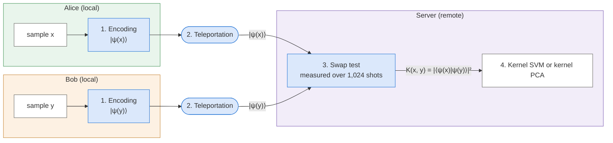

# Distributed and Secure Kernel-Based Quantum Machine Learning - Reproduction

## Reference and Attribution

- Paper: "Distributed and Secure Kernel-Based Quantum Machine Learning", Transactions on Machine Learning Research (2025)
- Authors: Arjhun Swaminathan, Mete Akgün
- OpenReview: https://openreview.net/forum?id=3jdI0aEW3k
- arXiv: https://arxiv.org/abs/2408.10265 (v3, the version read for this reproduction)
- Original repository: https://github.com/mdppml/distributed-secure-kernel-based-QML (commit `aed2cf9` used here), archived on Zenodo as v1.0: https://doi.org/10.5281/zenodo.18743937
- License and attribution notes: the authors' repository is MIT-licensed, like this one. This folder re-implements their pipeline; `lib/protocol.py` ports their circuits gate for gate to Qiskit 2.x.

## Summary

- **The paper:** two data holders can obtain a quantum kernel between their private samples without sending their data: teleportation moves the encoded states to a server, whose swap test computes the kernel (claim 1), with accuracy comparable to centralised computation (claim 2). The paper validates this as a proof of concept, in simulation and with amplitude encoding only ([protocol](#original-paper)).
- **The reproduction:** the proof of concept holds. Shot-by-shot simulations of the authors' circuits follow the swap-test law, distributed or centralised ([check](results/protocol_check.png)), and Table 1 is reproduced, with 12 of 15 cells within the paper's fold std ([Table 1](#table-1-paper-protocol-accuracy)).
- **MerLin:** the swap test translates exactly to photonics (register-wise Hong–Ou–Mandel interference: same law, same accuracies within 2 σ in 8 of 9 settings); teleportation does not translate deterministically to linear optics ([MerLin results](#photonic-assessment-and-merlin-extension)).
- **Limits:**
  - "Comparable to classical" does not hold against a fair baseline: without the leaks of the authors' protocol, a tuned classical SVM is higher on every dataset, and on Framingham, with C chosen by accuracy as planned, the quantum kernel predicts the majority class ([Table 1 bis](#other-results)).
  - Security is argued, not tested: all parties run as one simulated circuit, and the server receives about 1,024 copies of each encoded state per kernel entry ([Limitations](#limitations)).

## Original Paper

Two data holders want to train a kernel method on their joint data without revealing their samples. A kernel SVM never needs the samples themselves, only their pairwise similarities (the kernel matrix). The paper computes each similarity with a quantum protocol:



Blue boxes: quantum states; white boxes: classical data; frames: where each step runs.

The server cannot read the states it receives, since a measurement destroys a state and gives a single bit; the swap test only reveals how similar the two states are. Teleportation uses Bell pairs from a third party, the helper, which never sees the data.

The paper also proposes quantum feature maps for the polynomial, RBF and Laplacian kernels (Sec. 4); its experiments use amplitude encoding only. It evaluates the protocol on three public tabular datasets (accuracy with stratified 5-fold CV, Table 1), with depolarizing noise (Fig. 3), and with the number of shots on Digits images (Fig. 4).

The paper makes three claims:

- **Claim 1: correct kernel.** The distributed protocol computes the same kernel as a centralised swap test (proof in App. A).
- **Claim 2: comparable accuracy.** Distributed quantum accuracy is comparable to centralised quantum and classical accuracy (Table 1).
- **Claim 3: security.** The protocol is secure against semi-honest parties, argued from no-cloning and destructive measurement (Sec. 1 and 6.3).

## Reproduction Scope, Claims, and Deviations

Claims 1 and 2 are tested; claim 3 is an argument and is not tested (see Limitations).

- **Claim 1: correct kernel.** Shot-by-shot Aer runs of the authors' circuits follow the swap-test law (see "Simulation setup" below).
- **Claim 2: comparable accuracy.** Table 1 is reproduced on the authors' data files, with the paper's stratified 5-fold CV and 1,024 shots. The paper claims "comparable", not "better", accuracy.

Fig. 3 and 4 are reproduced as side results.

Updates and deviations:

- **Simulation setup.**
  - **Why:** simulating every kernel entry shot by shot, as the authors do on an HPC cluster (Sec. 7), is too costly for us.
  - **What:** each shot reads 0 with a known probability (App. A), so we draw the 1,024 shots directly from that law: same kernel, same shot noise, at a fraction of the cost.
  - **How:** `lib/kernels.py`; shot-by-shot Aer runs of the authors' circuits follow the same law (`results/protocol_check.png`; notebook, Section 2), which also checks claim 1. Runs on a 10-core macOS CPU (Python 3.14, Qiskit 2.5.2, Aer 0.17.2). Details: `docs/swap_test_kernel.md`.
- **Protocols.**
  - **Why → What:**
    - reproduce Table 1 in the authors' conditions → `paper`, the authors' evaluation as is;
    - keep test information out of training (oversampled copies in the test folds, component count chosen on the test folds) and tune classical baselines fairly → `corrected`, everything fitted on the training folds only.
  - Both give the same conclusions in balanced accuracy.
  - **How:** `lib/data.py::build_dataset` and `lib/evaluation.py` (`paper_kernel_svm`, `paper_kernel_pca`, `corrected_cv`). Details: `docs/protocols.md`.
- **Additional baselines** (not in the paper).
  - **Why:** to see whether shot noise or the square the swap test imposes holds the quantum kernel back, whether it is comparable to a fair classical model, and whether it learns at all.
  - **What:** the exact kernel without shot noise, the exact cosine kernel (the linear kernel the paper names), tuned RBF and polynomial SVMs, and a majority-class predictor.
  - **How:** `configs/accuracy_<dataset>_reference.json` (paper protocol), `_corrected.json` and `_fair_classical.json` (corrected protocol); results in Table 1 bis and `results/fair_comparison.md`.
- **Seeds.**
  - **Why:** the authors' code sets no seed for the shots or the oversampling.
  - **What:** we repeat each run with seeds 0–4, which change only these two draws; the CV folds and the evaluated subset stay the authors' fixed ones.
  - **How:** `--seed` drives `lib/data.py` (oversampling) and `lib/runner.py` (shots); `utils/run_sweep.py --seeds 0 1 2 3 4`.
- **Photonic adaptation** (not in the paper).
  - **Why:** to check whether the protocol maps onto photonic hardware.
  - **What:** the encoding and the swap test are translated (2 photons per register; Hong–Ou–Mandel interference with a parity readout, which follows the same law); teleportation is not, as it has no deterministic linear-optics counterpart.
  - **How:** `lib/photonic_merlin.py`; results in "Photonic Assessment and MerLin Extension", details in `docs/swap_test_kernel.md`.

## Install and How to Run

```bash
# From the repository root
python -m venv .venv
source .venv/bin/activate
pip install -r papers/distributed_secure_kernels/requirements.txt

python implementation.py --paper distributed_secure_kernels --help

# Smoke run (Wine, paper protocol, seconds)
python implementation.py --paper distributed_secure_kernels --config configs/defaults.json

# One paper experiment for one seed
python implementation.py --paper distributed_secure_kernels --config configs/accuracy_parkinsons_original.json --seed 0

# A full 5-seed sweep (writes outdir/sweep_<id>_<stamp>/ with summary.json); the stored sweeps are listed below
python papers/distributed_secure_kernels/utils/run_sweep.py --sweep-id table1_original --seeds 0 1 2 3 4 --workers 5 \
    --configs configs/accuracy_{wine,parkinsons,framingham}_original.json configs/accuracy_{wine,parkinsons,framingham}_reference.json

# Protocol check (App. A): per-shot Aer runs of the authors' circuits, then the figure (about 3 minutes)
python implementation.py --paper distributed_secure_kernels --config configs/protocol_equivalence_original.json --seed 0
python implementation.py --paper distributed_secure_kernels --config configs/protocol_equivalence_four_qubits.json --seed 0
python papers/distributed_secure_kernels/utils/plot_protocol_check.py
# writes results/protocol_check.png: every point should lie on the diagonal, nearly all inside the grey band
```

Walkthrough: `notebook.ipynb` (run it from this folder) follows the messages: it reruns Table 1, Table 1 bis, the MerLin runs on Wine and Parkinson's, and Fig. 4 with five seeds, checks them against the stored sweeps, and shows `results/`. It takes about 75 s on a laptop CPU.

Runs write `outdir/run_YYYYMMDD-HHMMSS/` and sweeps `outdir/sweep_<id>_<stamp>/`; neither is committed. Curated tables and figures are in `results/`. `docs/reproduce.md` lists the config and sweep behind each result and the scripts that rebuild `results/`.

## Configuration

`cli.json` is the authoritative list of paper-specific flags: `--protocol`, `--n-splits` and `--cv-random-state`, plus the sweep identity flags that `utils/run_sweep.py` sets. `configs/` holds one JSON config per experiment and variant (`accuracy_<dataset>_original.json` for Table 1, for example); `docs/reproduce.md` maps each one to its experiment.

## Data

Datasets live under `data/distributed_secure_kernels/` (moved with `--data-root` or `DATA_DIR`), one folder per dataset with a `SHA256SUMS` file; they are not tracked in git.

| Dataset | Folder | Source | Licence |
|---|---|---|---|
| Wine (178 samples, 13 features, 3 classes) | `wine/` | scikit-learn 1.9.1 bundled file (`load_wine`) | UCI, shipped with scikit-learn |
| Digits (1,797 samples, 64 pixels, 10 classes) | `digits/` | scikit-learn 1.9.1 bundled file (`load_digits`) | UCI, shipped with scikit-learn |
| Parkinson's (195 recordings, 22 features) | `parkinsons/` | authors' repository, commit `aed2cf9`; UCI dataset 174 (Little 2007) | CC BY 4.0 |
| Framingham (4,238 patients, 15 features; 14 used) | `framingham/` | authors' repository, commit `aed2cf9`; Kaggle dataset by A. Bhardwaj (2022) | "Unknown" on Kaggle |

To recreate them, clone the authors' repository into `data/distributed_secure_kernels/sources/authors_repo` and copy its two data files and the two scikit-learn files (`wine_data.csv`, `digits.csv.gz` from `sklearn/datasets/data/` of the installed scikit-learn) into the folders above; check with `shasum -a 256 -c SHA256SUMS` in each folder.

Limitations:
- Parkinson's is the UCI file the authors' code reads; the paper cites another Parkinson's dataset (Sakar et al. 2019).
- Framingham is the authors' copy; its size differs from the Kaggle file, which was not compared because its download needs a login.

## Results Obtained and Comparison with the Paper

Every result below is rerun or loaded in `notebook.ipynb`, against the stored sweeps. Stratified 5-fold CV; kSVM: kernel SVM, kPCA: kernel PCA followed by a linear SVM. Paper: one run, ± fold std. Ours: mean ± std over seeds 0–4. The cell-by-cell differences and the matching rule are in `results/paper_comparison.md`.

### Table 1 (paper protocol, accuracy)

| Dataset | Method | | Centralised classical | Centralised quantum | Distributed quantum |
|---|---|---|---:|---:|---:|
| Wine | kSVM | paper | 0.986 ± 0.017 | 0.880 | 0.887 ± 0.026 |
| | | ours | 0.986 ± 0.000 | 0.907 ± 0.019 | 0.896 ± 0.009 |
| Parkinson's | kSVM | paper | 0.820 ± 0.064 | 0.787 | 0.798 ± 0.080 |
| | | ours | 0.805 ± 0.013 | 0.772 ± 0.021 | 0.756 ± 0.035 |
|  | kPCA | paper | 0.787 ± 0.072 | 0.745 | 0.766 ± 0.074 |
| | | ours | 0.812 ± 0.005 | 0.703 ± 0.045 | 0.700 ± 0.047 |
| Framingham | kSVM | paper | 0.679 ± 0.011 | 0.631 | 0.634 ± 0.014 |
| | | ours | 0.689 ± 0.003 | 0.634 ± 0.009 | 0.639 ± 0.010 |
|  | kPCA | paper | 0.679 ± 0.009 | 0.625 | 0.642 ± 0.009 |
| | | ours | 0.682 ± 0.004 | 0.625 ± 0.000 | 0.625 ± 0.000 |

12 of 15 cells fall within the paper's fold std; distributed and centralised quantum differ only by shot noise.

### Other results

- **Fig. 3** (paper protocol, noise; `results/fig3.png`): noise lowers accuracy, less than in the authors' logs (Parkinson's kernel SVM at 1 %: 0.707 against 0.633). The drop depends on whether state preparation is noisy, which the paper does not state; noise is not one of our messages.
- **Fig. 4** (paper protocol, shots; `results/fig4.png`): our accuracy rises little with shots (0.760 at 128 shots, 0.788 at 1,024), less than the paper's (0.71 to 0.83); our steps are smaller than the seed spread at 128 shots.
- **Table 1 bis** (corrected protocol, balanced accuracy; classical linear and RBF SVMs tuned by inner cross-validation; `results/table1_bis.md`): without the leaks of the authors' protocol, a classical SVM is higher beyond 2 σ of the seed spread on every dataset, and on Framingham, with C chosen by accuracy as planned, the quantum kernel predicts the majority class (balanced accuracy 0.50; 0.595 with the paper's C = 1). Even with the authors' protocol, the linear SVM is higher beyond 2 σ in 4 of the 5 Table 1 cells. Full comparison: `results/fair_comparison.md`.

## Photonic Assessment and MerLin Extension

This is an adaptation, not the paper's method (see "Photonic adaptation" above), simulated with MerLin on CPU with ideal photon-number-resolving detectors (FOCK space), ideal state preparation, no loss and no postselection. In every run, the photonic probability matches the swap-test law to within 2.6 × 10⁻⁸. Paper protocol, accuracy, mean ± std over seeds 0–4; notebook, Section 6.

| Dataset | Method | Centralised quantum | Distributed quantum | MerLin photonic |
|---|---|---:|---:|---:|
| Wine | kSVM | 0.907 ± 0.019 | 0.896 ± 0.009 | 0.909 ± 0.013 |
| Parkinson's | kSVM | 0.772 ± 0.021 | 0.756 ± 0.035 | 0.764 ± 0.019 |
|  | kPCA | 0.703 ± 0.045 | 0.700 ± 0.047 | 0.706 ± 0.045 |
| Framingham | kSVM | 0.634 ± 0.009 | 0.639 ± 0.010 | 0.632 ± 0.011 |
|  | kPCA | 0.625 ± 0.000 | 0.625 ± 0.000 | 0.625 ± 0.000 |

- **Table 1 settings** (4 photons on 12 modes for Wine and Framingham, 16 for Parkinson's; 1,024 shots; `results/table1_merlin.md`): the photonic kernel matches the distributed gate-model kernel within 2 σ of the seed spread in every cell.
- **Fig. 4 settings** (Digits: 4 photons on 24 modes; 128 to 1,024 shots; `results/fig4_merlin.png`): the two agree within 2 σ at 128, 256 and 512 shots. At 1,024 shots MerLin is higher by 0.032, just above the 2 σ tolerance (0.029); the two kernels follow the same law, so this comes from independent shot draws.
- **Fig. 3 settings:** not run. The paper's noise is depolarizing noise on qubit gates, much of it in the teleportation, which is not translated; photonic noise (distinguishable photons, loss) would be a different study, not comparable with Fig. 3.

## Limitations

- **Proof of concept only:** simulation on one machine, amplitude encoding only (the proposed feature maps are never used for learning), and a tuned classical SVM beats the quantum kernel (Table 1 bis), although it tunes hyperparameters that the quantum kernel does not have.
- **Security is argued, not tested:** all parties run as one simulated circuit on one standardised dataset, and we only check that the clients' messages are uniform. Our inference: the server receives about 1,024 × m copies of each encoded state, which could let it estimate the data.
- **Side results:** the authors' Qiskit version (which decides where the Fig. 3 noise acts) and Digits evaluation script are unknown, their Framingham noisy values stay unexplained, and the cost of teleportation under noise is not measured.

## Tests

43 tests: data loading and oversampling, kernels and shot statistics, exact noisy probabilities and per-shot Aer agreement, protocol circuits, both evaluation protocols, CLI wiring and a smoke run through the shared runtime, the photonic swap test and the fair-baseline grids.

```bash
cd papers/distributed_secure_kernels
pytest -q
```

## Citation and License

The authors ask to cite the paper and the code as follows.

Paper:

```bibtex
@article{
swaminathan2025distributed,
title={Distributed and Secure Kernel-Based Quantum Machine Learning},
author={Arjhun Swaminathan and Mete Akg{\"u}n},
journal={Transactions on Machine Learning Research},
issn={2835-8856},
year={2025},
url={https://openreview.net/forum?id=3jdI0aEW3k},
note={}
}
```

Code:

```bibtex
@software{Swaminathan2025QML,
  author    = {Swaminathan, A. and Akg{\"u}n, M.},
  title     = {Distributed and Secure Kernel-Based Quantum Machine Learning - code},
  version = {v1.0},
  year      = {2025},
  publisher = {Zenodo},
  doi       = {10.5281/zenodo.18743937},
  url       = {https://doi.org/10.5281/zenodo.18743937}
}
```

Dataset licences are listed under "Data".
