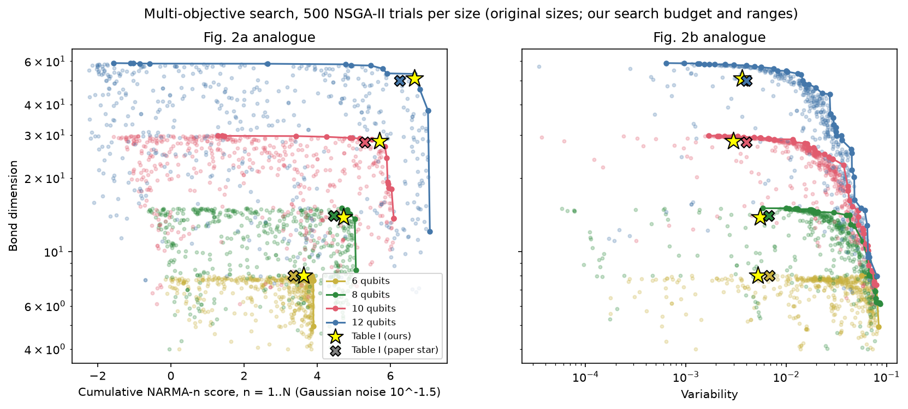
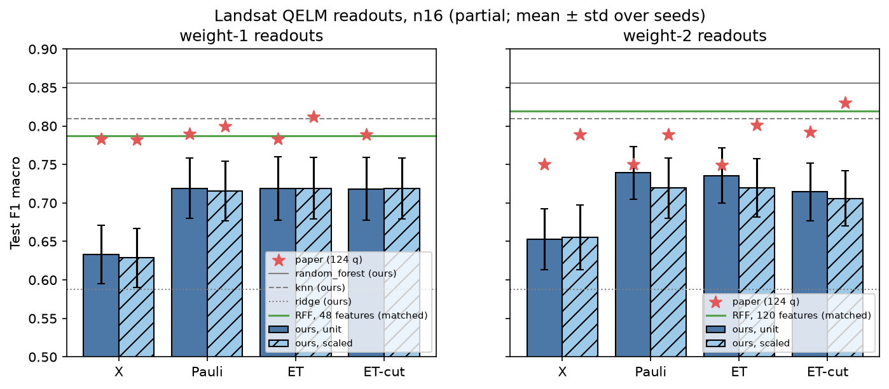
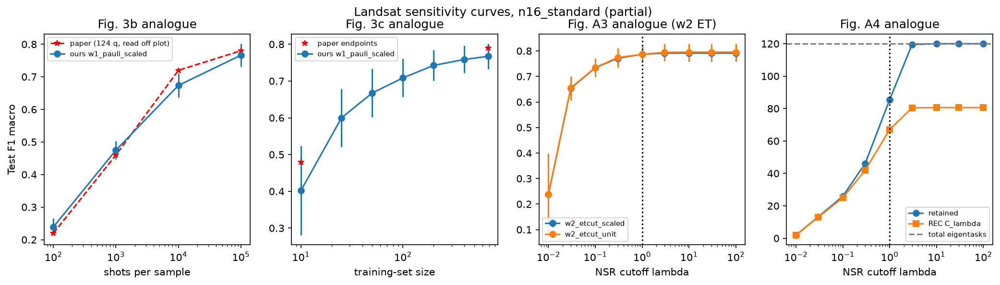
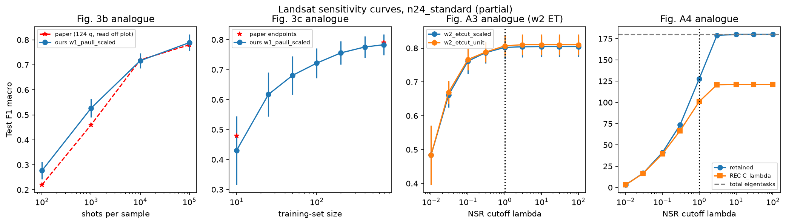
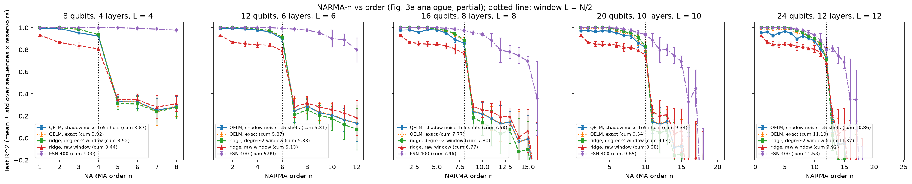
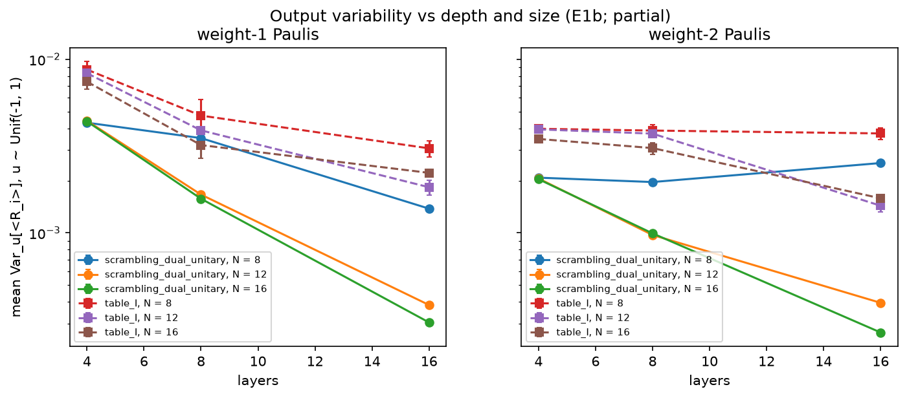
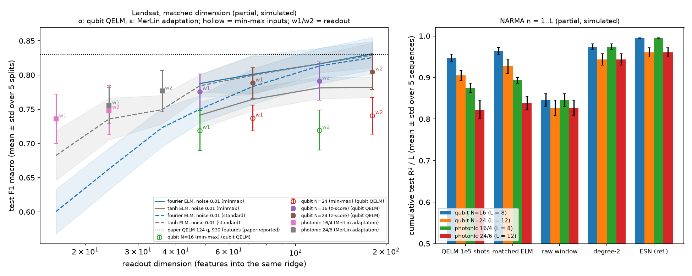
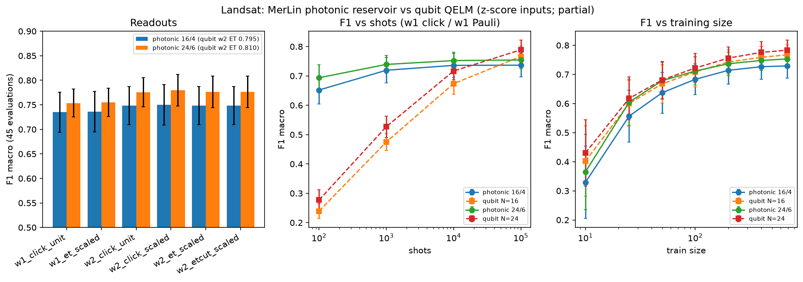

# Breaking Concentration Barriers for Quantum Extreme Learning on Digital Quantum Processors — Reproduction

Status (2026-10-28):

- **Phase 3 (experiments): complete.** Every planned experiment that can run without a QPU
  has run. E9 (energy forecasting) is blocked because the paper does not name its data.
- **Phase 4 (MerLin photonic adaptation): `PARTIAL_MERLIN_TRANSLATION`**, simulated. It
  is an adaptation, not part of the reproduction.
- **Phase 5 (fair comparison): done.** No quantum or photonic advantage is found or claimed.

All numbers are `partial` (reduced qubit counts, simulation instead of hardware) unless
stated otherwise. `LOG.md` holds the run records, ledgers and diagnoses; `INSIGHTS.md`
holds the reusable lessons.

## Reference and Attribution

- Paper: *Breaking concentration barriers for quantum extreme learning on digital quantum
  processors* (arXiv preprint, quant-ph, v1 2026-03-13)
- Authors: Timothée Dao, Yilmaz, Shehzad, Pere, Ghosh, Wittmann, Brunschwiler, Cortiana,
  O'Meara, Woerner, Tacchino
- arXiv: https://arxiv.org/abs/2603.13005
- Original repository: none linked on the arXiv page.
- License and attribution notes: the arXiv listing is CC BY-SA 4.0. Cite the original paper
  when using this reproduction.

## Original Paper

The paper builds a quantum extreme learning machine (QELM), a quantum reservoir with a trained
linear readout, on IBM superconducting processors (up to 124 qubits, more than 5,000 two-qubit
gates). Hardware noise and exponential concentration can make reservoir outputs
indistinguishable across inputs. The authors handle this with (i) multi-objective hyperparameter
tuning over observable variability, capacity, and task performance, and (ii) a local eigentask
analysis for feature selection. Tasks: time-series forecasting (NARMA-n) and satellite image
classification (Statlog Landsat, F1 macro). Claims: an operating regime found at small scale
transfers across tasks and to larger systems, and performance is competitive with strong
classical baselines. The paper makes no quantum-advantage claim.

## Reproduction Scope, Claims, and Deviations

No IBM QPU is available. The 72- and 124-qubit hardware experiments are replaced by exact
statevector simulation at reduced size, with exact finite-shot statistics of randomized
local Pauli measurements. The best attainable validity is reduced-scale.

| Paper experiment | Here | Config |
|---|---|---|
| Fig. 4 / A2: Landsat readouts X / Pauli / ET / ET-cut x w1/w2 x scaling (124 q) | N = 16 (local) and 24 (GPU), 36 layers, 1e5 shots, 5 splits x 3 reservoirs x 3 shot seeds | `landsat_readouts_reduced_n16.json`, `_n24.json` (+ `_standard` variants) |
| Fig. 3b / 3c, A1, A3, A4: shots, training size, NSR cutoff, retained eigentasks and REC | same runs | same |
| Fig. 4 lines / Table A2: classical baselines | the 9 Table A2 models plus matched random-feature ELMs, degree-2 ridge, tuned RF/kNN/SVM | `landsat_classical.json`, `landsat_classical_standard.json` |
| Fig. 3a: NARMA-n R^2 vs n (24 / 72 q hardware) | N = 8, 12, 16 (local), 20, 24 (GPU) with exact, Gaussian and shadow-noise features, plus raw-window, degree-2, ELM and ESN baselines | `narma_scaling_reduced_n*.json` |
| Fig. 2 / Table I: multi-objective search, position of Table I | NSGA-II at 6/8/10/12 q with 4/4/8/8 layers | `pareto_search_n*.json` |
| Concentration (motivating claim) | variability vs N and depth, Table I vs a scrambling point | `concentration.json`, `concentration_scrambling.json` |
| App. C energy forecasting | not reproduced (data source not identified) | none |

Claims and their outcome (full inventory in `LOG.md`, "Claim Inventory"):

| ID | Claim | Outcome here |
|---|---|---|
| C1 | Multi-objective tuning finds a regime (Table I) near the Pareto front at 6–12 q | supported (except Fig. 2b at 8 q, narrowly) |
| C2 | Table I transfers to larger systems and other tasks without retuning | supported at N ≤ 24; hardware sizes untested |
| C3 | Local eigentask readouts, NSR scaling and the NSR cutoff improve F1 | not supported at N ≤ 24 |
| C4 | QELM is competitive with classical baselines and beats ridge on raw features | partially supported |
| C5 | F1 improves with shots and training size | supported (trend) |
| C6 | NSR-scaled eigentasks are stable around λ = 1; 299/930 retained | partially supported (count yes, F1 optimum no) |
| C7 | Memory edge at n ≈ N/2 | supported |
| C8 | Table I avoids concentration | qualitatively supported (N ≤ 16) |
| C9 | 12-q QELM matches an ESN-400 on energy prices | unresolved (no data) |

Updates and deviations (details and evidence in `LOG.md`, "Phase 2 Implementation"):

- Own batched torch statevector simulator (no Qiskit). Each disjoint qubit pair is sampled
  from its exact randomized-measurement marginal.
- The circuit follows paper Fig. 1. Each block is `RZ(h)` on the second qubit, `RZZ(J)`,
  `RX(b)` on both qubits, `RZZ(J)`, `RZ(h)` on the second qubit. The Bell pairs sit on
  `(1,2), ..., (N-1,0)`, offset from the first layer. The gate angle factor is not printed
  in the paper. With each gate read as `exp(-i theta P)` (`angle_scale = 2`), Table I
  reproduces the Fig. 2 stars (see Results).
- NARMA inputs map `u ~ Unif(0, 0.5)` onto Unif(-1, 1) (`4u - 1`). The paper's formula
  `2u - 1` contradicts its stated Unif(-1, 1); the literal map is available as an ablation.
- Landsat at 16/24 qubits uses the paper's 36 layers with an input shift of 8, so all 72
  stacked inputs are fed. The 860-row subsample and the 80/20 split are our own (stratified,
  seeded); the paper's are unpublished.
- The paper does not state how Landsat inputs are scaled before encoding. Min-max [-1, 1]
  was declared primary before the runs; z-score inputs are reported as a variant after gap
  diagnosis D6.
- Ridge penalty selected on the training split (LOO for classification, contiguous 5-fold
  for NARMA). Local eigentasks solve the paper's pencil `V h = beta^2 G h` with
  finite-shot-corrected `V` and `G`.
- scikit-learn 1.9 instead of 1.7.1: AdaBoost uses SAMME because SAMME.R was removed.
- More seeds than the paper's single hardware run, and fair baselines (matched-dimension
  random-feature ELMs, tuned classical models, ESN) that the paper does not report.
- A MerLin photonic adaptation (Phase 4) and a matched-baseline comparison (Phase 5) are
  additions, labelled as such below.

## Project Layout

```text
papers/qelm_concentration/
|-- README.md, LOG.md, INSIGHTS.md, FEEDBACK.md, CONFLUENCE.md
|-- cli.json, requirements.txt, notebook.ipynb
|-- configs/            defaults.json plus one JSON per experiment (smoke, reduced, merlin, classical)
|-- lib/
|   |-- runner.py        train_and_evaluate: dispatches cfg["task"]
|   |-- reservoir.py     batched statevector kicked-Ising brickwall (paper Fig. 1)
|   |-- observables.py   randomized local Pauli measurements, shadow estimators
|   |-- eigentasks.py    local eigentask pencil, NSR cutoff, REC
|   |-- readout.py       ridge readouts (LOO / contiguous k-fold alpha)
|   |-- mps.py           MPS bond-dimension estimate (Fig. 2 capacity axis)
|   |-- data.py          Landsat subset and split, NARMA generator
|   |-- baselines.py     Table A2 models, matched random-feature ELMs, degree-2 ridge, ESN
|   |-- qelm.py          QELM feature pipeline
|   |-- qelm_merlin.py   MerLin photonic reservoir (Phase 4 adaptation)
|   `-- *_task.py, merlin_tasks.py   one module per task
|-- utils/              summary, plotting, selection-verification and Phase 5 comparison scripts
|-- tests/              unit, integration and tiny-run tests
|-- results/            curated summaries (.md/.json) and figures used in this README
|-- models/             empty (.gitkeep): no trained artifacts are kept
`-- outdir/             raw run directories (not committed)
```

## Install and How to Run

Use a dedicated environment. `merlinquantum` needs numpy >= 2, which can break older
packages in a shared env.

```bash
conda create -n qelm_concentration python=3.12
conda activate qelm_concentration
pip install -r papers/qelm_concentration/requirements.txt
```

Smoke runs (seconds each, not results):

```bash
python implementation.py --paper qelm_concentration --config configs/smoke.json
python implementation.py --paper qelm_concentration --config configs/pareto_search_smoke.json
python implementation.py --paper qelm_concentration --config configs/concentration_smoke.json
python implementation.py --paper qelm_concentration --config configs/smoke_merlin.json
```

Reproduction runs (from the repo root; the n20/n24 configs expect a CUDA GPU):

```bash
python implementation.py --paper qelm_concentration --config configs/landsat_readouts_reduced_n16.json
python implementation.py --paper qelm_concentration --config configs/landsat_readouts_reduced_n16_standard.json
python implementation.py --paper qelm_concentration --config configs/landsat_classical.json
python implementation.py --paper qelm_concentration --config configs/narma_scaling_reduced_n12.json
python implementation.py --paper qelm_concentration --config configs/pareto_search_n8.json
python implementation.py --paper qelm_concentration --config configs/concentration.json
```

MerLin photonic adaptation (Phase 4; local CPU, 1 to 45 minutes each):

```bash
python implementation.py --paper qelm_concentration --config configs/concentration_merlin.json
python implementation.py --paper qelm_concentration --config configs/landsat_readouts_merlin_m16.json
python implementation.py --paper qelm_concentration --config configs/landsat_readouts_merlin_m24.json
python implementation.py --paper qelm_concentration --config configs/narma_scaling_merlin_m16.json
python implementation.py --paper qelm_concentration --config configs/narma_scaling_merlin_m24.json
```

Fair baseline on z-score inputs (Phase 5; about 8 minutes on a laptop):

```bash
python implementation.py --paper qelm_concentration --config configs/landsat_classical_standard.json
```

From inside `papers/qelm_concentration`, use `python ../../implementation.py --config configs/<name>.json`.

Each run writes `outdir/run_YYYYMMDD-HHMMSS/` with `config_snapshot.json`, `run.log`,
`run_status.json`, `metrics.json` and task artifacts: `trials.csv` for the Pareto search,
and `probabilities_split*_res*.npz` (exact pair POVM probabilities, for re-sampling shots)
for Landsat. The summaries in `results/` are regenerated by the `utils/` scripts; the exact
commands are in `LOG.md`.

## Configuration

- `configs/defaults.json` holds the paper's Table I hyperparameters, the shared reservoir,
  readout and dataset settings, and a lightweight runnable Landsat readout run at 8 qubits.
  Named configs overlay it.
- Settings are grouped by task: `task` selects one of `landsat_readouts`,
  `landsat_classical`, `narma_scaling`, `pareto_search` or `concentration`, and that task
  reads its own section (`cfg[task]`). The MerLin tasks `landsat_readouts_merlin` and
  `narma_scaling_merlin` reuse the `landsat_readouts` and `narma_scaling` sections;
  `concentration_merlin` reads its own. Each MerLin task also reads `merlin_reservoir`
  (`n_modes`, `n_photons`, `n_layers`, `encoding_period`, `input_shift`, `angle_scale`,
  `chunk_size`). Dataset settings live under `dataset.landsat` (including
  `input_scaling`: `minmax` or `standard`) and `dataset.narma`.
- Key reservoir settings: `n_qubits`, `n_layers`, `encoding_period` (4 = 1 encoding : 3
  dynamics layers), `input_shift`, `angle_scale`, `brickwall_offset`, `block_order`,
  `bell_pairs` and `chunk_size` (samples simulated at once; bounds memory).
- `cli.json` is the authoritative CLI schema. Paper flags: `--task`, `--n-qubits`,
  `--n-layers`, `--chunk-size`, `--batch-size`, `--n-trials`. Global flags (`--config`,
  `--seed`, `--dtype`, `--device`, `--outdir`, `--data-root`, `--log-level`) come from the
  shared runtime.
- `data_root` defaults to `../../data`, i.e. the repository `data/` folder. Override it with
  `--data-root` (use `--data-root "$DATA_DIR"` for the environment variable).

## Data

- **Statlog (Landsat Satellite)**, UCI ML Repository id 146 (the dataset the paper cites),
  DOI [10.24432/C55887](https://doi.org/10.24432/C55887), CC BY 4.0. Stored at
  `data/qelm_concentration/statlog_landsat/` (`sat.trn` 4435 rows, `sat.tst` 2000 rows; 36
  features + label, classes 1, 2, 3, 4, 5, 7). Acquire it from the repository root with:

  ```bash
  mkdir -p data/qelm_concentration/statlog_landsat && cd data/qelm_concentration/statlog_landsat
  curl -sSL -o statlog+landsat+satellite.zip \
    https://archive.ics.uci.edu/static/public/146/statlog+landsat+satellite.zip
  unzip -o statlog+landsat+satellite.zip
  ```

  - **Transformations:** both files are pooled (6435 rows). A stratified, seeded 860-row
    subset is drawn and split 80/20 (688 train / 172 test) per split seed 0–4. Features are
    scaled with statistics fitted on the training split only: min-max to [-1, 1] (primary)
    or z-score (variant). The 36 features are tiled twice (`n_copies = 2`) to give the 72
    encoded inputs.
  - The paper also subsamples 860 rows but does not publish which ones or its split, so
    absolute Landsat scores are `reduced-scope` with respect to the paper's selection.
- **NARMA-n** time series are synthetic by definition (paper App. A) and generated on the fly
  (`lib/data.py`), seeded per sequence (seeds 0–4).
- **Energy-market prices** (paper App. C) are not available: the paper does not name its source.
  That experiment is not reproduced.

## Results Obtained and Comparison with the Paper

Scope labels: `partial` means reduced qubit count or simulation instead of the paper's
hardware. Values are means over all seeds (Landsat QELM: 5 splits x 3 reservoirs x 3 shot
draws = 45 evaluations; classical: 5 splits; NARMA: 5 sequences x 3 reservoirs = 15). Paper
values are from the text, or read off the plots (±0.003 for Fig. 4, coarser for Fig. 3).
Sources are the structured artifacts in `results/` and the run directories named in `LOG.md`.

### Summary table

Landsat values are for N = 24, w-scaled readouts, given as min-max (primary) / z-score
(variant). Delta is reproduced minus paper, for the same two readings.

| Paper item | Claim tested | Paper value | Reproduced value | Delta | Metric agreement | Trend agreement | Claim support | Seeds | Comment |
|---|---|---:|---:|---:|---|---|---|---:|---|
| Fig. 2a / Table I, 6/8/10/12 q | C1 | NARMA score 3.35 / 4.45 / 5.3 / 6.25 | 3.63 / 4.71 / 5.70 / 6.65 | +0.28 / +0.26 / +0.40 / +0.40 | close (within 9 %) | yes | supported | 1 search × 500 trials × 10 realisations per size | Table I near the Fig. 2a front at every size |
| Fig. 2 / Table I bond dim | C1 | 8 / 14 / 28 / 50 | 8.0 / 13.8 / 28.3 / 51.1 | ≤ 1.1 | yes | yes | supported | same | |
| Fig. 2b / Table I variability | C1, C8 | 6.8 / 6.7 / 4.0 / 4.0e-3 | 5.2 / 5.5 / 3.0 / 3.6e-3 | −10 % to −25 % | approximate | yes | supported (Fig. 2b near front except 8 q) | same | variability aggregation not stated in paper |
| Fig. 4, w1 X | C3 | 0.782 | 0.690 / 0.725 | −0.092 / −0.057 | no | — | — | 45 | shot-noise limited at N = 24 |
| Fig. 4, w1 Pauli | C3 | 0.800 | 0.734 / 0.785 | −0.066 / −0.015 | z-score only | — | — | 45 | |
| Fig. 4, w1 ET | C3 | 0.812 | 0.737 / 0.788 | −0.075 / −0.024 | z-score only | — | — | 45 | |
| Fig. 4, w2 Pauli | C3 | 0.789 | 0.739 / 0.807 | −0.050 / +0.018 | z-score only | — | — | 45 | |
| Fig. 4, w2 ET | C3 | 0.801 | 0.741 / 0.804 | −0.060 / +0.003 | z-score only | — | — | 45 | |
| Fig. 4, w2 ET-cut (λ = 1) | C3, C6 | 0.830 | 0.731 / 0.802 | −0.099 / −0.028 | no | — | — | 45 | |
| Fig. 4, w1 ET − Pauli | C3 | +0.012 | +0.003 (z-score) | −0.009 | no | no | not supported | 45 paired | within per-split noise |
| Fig. 4, w2 ET-cut − ET | C3, C6 | +0.029 | −0.003 (z-score) | −0.032 | no | no | not supported | 45 paired | F1 rises monotonically with λ up to no-cut |
| Fig. A4, eigentasks retained at λ = 1 | C6 | 299 / 930 (32 %) | 37.5 % (N = 16 min-max); 71 % (z-score) | +5.5 pp / +39 pp | min-max only | — | partial | 45 | |
| Fig. 3b, F1 vs shots 1e2–1e5 | C5 | 0.22 / 0.46 / 0.72 / 0.78 | 0.28 / 0.53 / 0.72 / 0.79 (z-score) | +0.06 / +0.07 / 0.00 / +0.01 | yes | yes | supported | 45 | min-max ≈ 0.05 lower |
| Fig. 3c, F1 vs train size 10 → 688 | C5 | 0.48 → 0.79 | 0.43 → 0.78 (z-score) | −0.05 / −0.01 | yes | yes | supported | 45 | still rising at 688 |
| Fig. 4 / Table A2, ridge on raw features | C4 | 0.608 | 0.588 | −0.020 | yes | — | — | 5 splits | |
| Fig. 4 / Table A2, RF / kNN / MLP / SVM | C4 | 0.840 / 0.834 / 0.830 / 0.809 | 0.856 / 0.810 / 0.835 / 0.842 | +0.016 / −0.024 / +0.005 / +0.033 | within ~1 split-std | — | — | 5 splits | other 5 models in `results/landsat_classical_summary.md` |
| Fig. 4, QELM vs classical | C4 | QELM below RF/kNN, above ridge | same ordering | — | — | yes | partially supported | 45 / 5 | below matched random features too (Fair Baselines) |
| Fig. 3a, NARMA R² at 24 q, n ≤ 12 | C2, C7 | 0.85–0.97 (hardware) | 0.73–0.97 (1e5-shot shadow, simulated) | lower edge −0.12 | approximate | yes | supported | 15 | hardware vs simulation |
| Fig. 3a, NARMA R² at 24 q, n > 12 | C7 | 0.2–0.45 | 0.15 at n = 13, then ≤ 0 | −0.05 or lower | approximate | yes (sharp edge at n = N/2) | supported | 15 | |
| Fig. 3a, 72 q | C2, C7 | 0.62–0.92 for n ≤ 36 | not run | N/A | N/A | N/A | untested | — | not exactly simulable |
| Concentration (Sec. II, Fig. 2b) | C8 | qualitative (theory) | Table I keeps 2–7x the variability of a scrambling point at 16 layers | N/A | N/A | yes | qualitatively supported | 3 reservoirs | N ≤ 16 |
| App. C energy forecasting | C9 | MSE 1.08e-3 / 7.49e-4, 76.3 % | not run | N/A | N/A | N/A | unresolved | — | data source not identified |

### Sweeps and searches

No hyperparameter-selection sweep was run: no candidate is picked from a grid for later use.
The studies with several candidates are:

- **E1 Pareto search (C1):**
  - Setup: one optuna NSGA-II run per size, 500 trials each, 10 reservoir realisations per
    trial, Table I enqueued as trial 0.
  - Objectives, all maximised: noiseless and noisy NARMA score (n = 1..N), MPS bond
    dimension and observable variability.
  - Analysis rule (declared before launch): Table I is "near the front" when its Pareto rank
    is ≤ 1 or its normalised front distance is ≤ 0.1.
  - Coverage: complete, 4/4 runs with 500/500 finite trials each.
  - Verification: re-checked from `trials.csv` by `utils/verify_phase3_selection.py`
    (`results/phase3_selection_verification.json`).
  - Uncertainty: one search seed per size, so the rank and distance carry unquantified
    search variance; 8 q Fig. 2b misses the rule by 0.012.
  - The full candidate set is in each run's `trials.csv`; the projection table below is
    `results/pareto_summary.md`.
- **Curves inside E5:** λ (E7/E8), shots (E3) and training size (E4) are fixed grids reported
  as curves. The headline λ = 1 was fixed a priori. Full curves are in
  `results/landsat_n*_summary.md`.
- **Tuned classical baselines:** an internal grid on a validation split carved from train,
  scored by validation F1 macro and evaluated once on test. The selected parameters are
  stored per split in the run's `metrics.json`.
- **Gap diagnostics D1–D6:** controlled one-factor checks with no selection. D4/D5/D6 used 2
  realisations and are labelled preliminary. D6 (input scaling) was then confirmed by full
  45-evaluation runs.

### Hyperparameter regime (paper Fig. 2, Table I; claim C1) — original sizes



| Qubits / layers | Table I, ours: noisy NARMA score / bond dim / variability | Paper star | Fig. 2a rank, distance | Fig. 2b rank, distance | 4-D rank | NARMA-only optimum |
|---|---|---|---|---|---|---|
| 6 / 4 | 3.63 / 8.0 / 5.2e-3 | 3.35 / 8 / 6.8e-3 | 0, 0.000 (near) | 1, 0.609 (near) | 0 | 3.90 |
| 8 / 4 | 4.71 / 13.8 / 5.5e-3 | 4.45 / 14 / 6.7e-3 | 3, 0.050 (near) | 12, 0.112 (not near) | 0 | 5.06 |
| 10 / 8 | 5.70 / 28.3 / 3.0e-3 | 5.3 / 28 / 4.0e-3 | 0, 0.000 (near) | 10, 0.045 (near) | 0 | 6.09 |
| 12 / 8 | 6.65 / 51.1 / 3.6e-3 | 6.25 / 50 / 4.0e-3 | 1, 0.041 (near) | 8, 0.093 (near) | 0 | 7.08 |

- **Result:** Table I is non-dominated in the full 4-objective space at every size.
  **C1 is supported**, except Fig. 2b at 8 qubits (narrowly).
- **Trade-off, not optimum:** the NARMA-only optimum is 0.3–0.4 higher, so Table I is a
  trade-off point.
- **Score range:** the NARMA score sums orders n = 1..N. The paper's text says 1..N/2,
  but its stars exceed that range's maximum; see `LOG.md`. Table I is also near the
  front under the text definition (`results/pareto_summary.md`).

### Landsat classification (Fig. 3b/3c, Fig. 4, Fig. A1–A4; claims C3–C6) — `partial`

The paper ran 124 qubits on IBM hardware; we simulate 16 and 24 qubits with exact
finite-shot randomized measurements (1e5 shots), on our own stratified 860-row subset.

| Readout (F1 macro) | N = 16, min-max | N = 24, min-max | N = 16, z-score | N = 24, z-score | Paper, 124 q (unit / scaled) |
|---|---|---|---|---|---|
| w1 X | 0.633 / 0.629 | 0.691 / 0.690 | 0.653 / 0.661 | 0.721 / 0.725 | 0.783 / 0.782 |
| w1 Pauli | 0.719 / 0.715 | 0.731 / 0.734 | 0.776 / 0.775 | 0.790 / 0.785 | 0.790 / 0.800 |
| w1 ET | 0.719 / 0.719 | 0.736 / 0.737 | 0.777 / 0.776 | 0.792 / 0.788 | 0.783 / 0.812 |
| w2 X | 0.653 / 0.656 | 0.713 / 0.713 | 0.712 / 0.710 | 0.755 / 0.754 | 0.750 / 0.789 |
| w2 Pauli | 0.739 / 0.720 | 0.757 / 0.739 | 0.795 / 0.791 | 0.810 / 0.807 | 0.750 / 0.789 |
| w2 ET | 0.736 / 0.720 | 0.754 / 0.741 | 0.795 / 0.791 | 0.810 / 0.804 | 0.749 / 0.801 |
| w2 ET-cut (lambda = 1) | 0.714 / 0.706 | 0.738 / 0.731 | 0.787 / 0.787 | 0.807 / 0.802 | 0.792 / 0.830 |

Per-cell std is 0.025–0.045 (n = 45). Each cell gives unit / scaled. N = 24 z-score inputs
give the best QELM numbers (w2 Pauli / ET 0.81), at or above the paper's 124-qubit values for
every readout except w1/w2 X and the scaled ET-cut.





- **Shots and training size (C5): trend reproduced.**
  - With z-score inputs, F1 vs shots is 0.24 / 0.48 / 0.67 / 0.77 at 1e2–1e5 for N = 16
    and 0.28 / 0.53 / 0.72 / 0.79 for N = 24 (paper ≈ 0.22 / 0.46 / 0.72 / 0.78).
  - F1 vs training size rises from 0.40 (10 samples) to 0.77 (688) at N = 16 and from
    0.43 to 0.78 at N = 24, still rising (paper 0.48 → 0.79).
  - Min-max inputs give the same shapes, about 0.05 lower.
- **Readouts (C3, C6): not reproduced.** Paired differences on identical seeds, n = 45:
  - Eigentasks ≈ Pauli: +0.000 to +0.004, against the paper's +0.012.
  - The NSR cutoff never beats keeping all eigentasks (−0.004 to −0.010): F1 rises
    monotonically with lambda up to no-cut in every configuration (Fig. A3 analogue).
  - NSR- or signal-aware scaling ≈ or below unit variance: 0.000 to −0.018, against the
    paper's +0.01 to +0.05.
  - The fraction of eigentasks retained at lambda = 1 is 37.5 % (N = 16, min-max), close to
    the paper's 32 %, but 71 % with z-score inputs (N = 16 and 24).
  - N = 24 z-score gives the same picture: ET − Pauli +0.003 (w1) / −0.002 (w2), cut − no-cut
    −0.003, scaled − unit −0.003 to −0.006 (all n = 45).
- **Classical comparison (C4): partially supported.** Every QELM readout beats ridge on raw
  features (0.588; paper 0.608) and stays below RF, SVM and MLP. Our Table A2 baselines match
  the paper's within about one split-std (`results/landsat_classical_summary.md`). The
  matched-dimension comparison is in "Fair Baselines".
- **Gap diagnosis.**
  - With exact probabilities (no shot noise), the N = 16 feature map already reaches the
    paper's F1 (0.79 w1, 0.82 w2).
  - The shortfall at 1e5 shots is shot noise, driven mainly by the input scaling: z-score
    inputs give larger input-dependent rotations and more signal per shot.
  - Deeper circuits (more uploads) concentrate and lose to shot noise. Shallower circuits
    do not help.
  - Going from 16 to 24 qubits adds +0.01 to +0.06 F1 (paired).

### NARMA forecasting (Fig. 3a; claims C2, C7) — `partial`



| Qubits (layers, window L) | QELM, shadow noise 1e5 shots | QELM, Gaussian 10^-1.5 | Ridge on degree-2 window | Ridge on raw window | ESN-400 |
|---|---|---|---|---|---|
| 8 (4, 4) | 3.87 | 3.63 | 3.92 | 3.44 | 4.00 |
| 12 (6, 6) | 5.81 | 5.45 | 5.88 | 5.13 | 5.99 |
| 16 (8, 8) | 7.58 | 6.92 | 7.80 | 6.77 | 7.96 |
| 20 (10, 10) | 9.34 | 8.53 | 9.64 | 8.38 | 9.85 |
| 24 (12, 12) | 10.86 | 9.78 | 11.32 | 9.92 | 11.53 |

Values are cumulative test R^2 over n = 1..L, at Table I with no retuning (15 evaluations).
- **Memory (C7): supported.** R^2 stays high up to n ≈ L = N/2 (≥ 0.86 at 16 q), then
  drops sharply, and the memory edge moves with N, as in Fig. 3a. Checked from 8 to 24 qubits
  (24 q: 0.73 at n = 12, 0.15 at n = 13).
- **Transfer (C2):** Table I works across sizes and tasks without retuning.
- **Against classical baselines:** see "Fair Baselines".

### Concentration (motivating claim C8) — `partial`



- **Table I degrades slowly with depth.** Variability falls 2.8–4x from 4 to 16 layers,
  and only mildly with N at fixed depth.
- **The scrambling reference concentrates much faster.** At the dual-unitary
  kicked-Ising point (J = pi/8, b = pi/4) variability falls 14x over the same range at
  16 q. At 16 layers Table I keeps 2–7x more variability.
- **This qualitatively supports the paper's concentration argument.** It covers N <= 16
  only.

### Not reproduced

- 72- and 124-qubit hardware runs: no QPU, and not exactly simulable.
- Energy-price forecasting (App. C): the data source is not identified.

## Fair Baselines

The protocol was frozen in `LOG.md` ("Phase 5 Comparison Plan") before the one new run.

- **Baseline state: `MISSING_OR_UNFAIR`.** The paper's Landsat baselines are untuned and
  see 36 raw features against the QELM's 372–930. The paper reports no NARMA baseline.
- **Fair baseline (planned in Phase 1):** a random-feature map (random Fourier or tanh
  features, feature noise 0.01) with the **same readout dimension**, the same ridge, alpha
  grid, splits and input scaling as each QELM. Dimensions: qubit w1 = 3N, w2 = 15N/2;
  photonic w1 = m, w2 = 3m/2.
- **New in Phase 5:** the same baseline on z-score inputs and at the MerLin dimensions
  16/24/36 (`configs/landsat_classical_standard.json`).
- **NARMA:** the baselines already ran in every QELM run (same sequences and window).
- **Decision rule:** "clearly above" means a paired difference over the 5 splits or
  sequences that is > 0.01 F1 (or 1 % of the baseline's R²) and > 2 standard errors.



| System (Landsat, F1 macro) | w1: QELM vs matched RFF | w2: QELM vs matched RFF | vs matched tanh ELM (w1 / w2) |
|---|---|---|---|
| qubit N=16, min-max | 0.719 vs 0.787 (48 features), baseline above | 0.720 vs 0.816 (120), baseline above | tie / baseline above |
| qubit N=24, min-max | 0.737 vs 0.801 (72), baseline above | 0.741 vs 0.831 (180), baseline above | baseline above / above |
| qubit N=16, z-score | 0.776 vs 0.750 (48), QELM above | 0.791 vs 0.813 (120), no clear separation | tie / baseline above |
| qubit N=24, z-score | 0.788 vs 0.783 (72), no clear separation | 0.804 vs 0.825 (180), baseline above | baseline above / above |
| MerLin 16/4 (adaptation) | 0.736 vs 0.601 (16), QELM above | 0.749 vs 0.663 (24), QELM above | QELM above / tie |
| MerLin 24/6 (adaptation) | 0.755 vs 0.663 (24), QELM above | 0.777 vs 0.723 (36), QELM above | tie / QELM above |

- **References** (same splits, not dimension-matched): ridge on raw features 0.588; tuned RF
  0.862, SVM 0.843; untuned MLP 0.835. Every QELM beats raw ridge and trails the tuned models.
- **NARMA** (cumulative R² at 1e5 shots):
  - every QELM is clearly above ridge on the raw window, except MerLin 24/6, which ties it;
  - every QELM is clearly below a matched tanh ELM, degree-2 window ridge and ESN-400.
- **Shots:** the photonic reservoir beats the qubit QELM at 1e2–1e4 shots and trails it at
  1e5. This is not a matched-capacity comparison.
- **Wall-clock:** classical baselines take 7–8 minutes on the laptop; the quantum simulations
  take 1.4 minutes (MerLin 16/4) to 18 hours (qubit N = 24 on an L4 GPU). These are
  simulation costs, not hardware costs.
- **Claim outcomes:** C4 partially supported (beats raw ridge, not a matched random-feature
  map); C2/C7 supported, with no classical advantage; C3/C6 unsupported at N ≤ 24.
- **Small-dimension caveat:**
  - The MerLin margins at 16–36 features (0.01–0.05 against the stronger, tanh, family)
    are measured against random features with fixed, untuned hyperparameters.
  - The tanh family was found to be stronger at small dimensions only after the protocol
    was frozen, so the primary rule is unchanged.
- Full table, paired differences, wall-clock and commensurability:
  `results/phase5_comparison.md`. Regenerate with `python utils/compare_phase5.py ...`
  (exact command in `LOG.md`, "Phase 5 comparison results").

## Photonic Assessment and MerLin Extension

**Status: `PARTIAL_MERLIN_TRANSLATION`** (adaptation, `partial`, simulated). The photonic
version keeps the paper's central idea (a fixed reservoir in a structured, non-concentrating
regime, read out locally with finite shots and a ridge readout) and drops what has no
photonic counterpart.

- **Mapping** (`lib/qelm_merlin.py`):
  - The kicked-Ising brickwall becomes a fixed brickwall of beam splitters and phase
    shifters on `m` modes holding `m / 4` photons. For one photon in a mode pair, BS(θ) acts
    like RX(θ) and the phase shifter like RZ, so Table I's b, h and a_in carry over (θ = 2b,
    or 2 · a_in · u on every 4th, encoding layer).
  - The ZZ interaction has no linear-optical counterpart and is dropped. The chain is open,
    and there are no Bell pairs.
  - Readouts are click probabilities of disjoint mode pairs (w1: per mode; w2: n_a, n_b,
    n_a·n_b per pair), local eigentasks, and the NSR cutoff.
- **Rejected alternative** (`LOG.md`, "Phase 4 Adaptation Plan"): MerLin's default
  `UNBUNCHED` computation space (see Hardware-Aware Settings).



| Pre-declared criterion | 16 modes / 4 photons | 24 modes / 6 photons | Result |
|---|---|---|---|
| Landsat best w2 ET F1 within 0.05 of qubit | 0.749 vs 0.795 (−0.047) | 0.777 vs 0.810 (−0.033) | preserved (narrowly at 16/4) |
| NARMA 1e5-shot cumulative R² within 10 % of qubit; edge at n = L | 7.00 vs 7.58 (−7.7 %); 0.83 → 0.25 | 9.87 vs 10.86 (−9.1 %); 0.63 → 0.17 | preserved |
| Concentration: Table I > balanced, Haar; Haar falls with modes | all seeds and weights at 24 modes, 16 layers; Haar 1.2e-3 → 3.8e-4 from 8 to 24 modes | | preserved |

- **Readouts:** on Landsat, eigentasks ≈ click probabilities (−0.002 to −0.003, n = 45),
  and the NSR cutoff removes nothing at 1e5 shots.
- **Shots:** photonic click features are cheap to estimate, giving F1 0.65 at 100 shots
  against the qubit's 0.24, but they plateau lower (0.74 vs 0.77).
- **NARMA:** the photonic reservoir is no better than ridge on the raw window, and it
  collapses under the paper's additive Gaussian noise of 10^-1.5 (cumulative 3.5 / 4.0),
  because its outputs vary by only a few percent across inputs.
- **Concentration:** see `results/merlin_concentration.png`. Unlike the qubit case,
  variability rises with depth, because deeper circuits re-encode the input more often.
- **Not translated:**
  - E1 (no photonic bond-dimension analogue; Table I is transferred, not re-optimised);
  - E10 (classical baselines are unchanged);
  - hardware, E9, and min-max inputs.
- Full numbers and paired differences: `results/merlin_summary.md` and `LOG.md` ("Phase 4
  MerLin results").

## Hardware-Aware Settings

Every MerLin run is a simulation; none ran on photonic hardware.

| Field | Value |
|---|---|
| Computation space | `FOCK`. MerLin's default `UNBUNCHED` renormalises on collision-free outcomes (it kept only 20 % of the probability in a probe), which would distort shot-budget comparisons |
| Detector model | Ideal threshold detector on every mode (`pcvl.Detector.threshold()`) |
| Photon number / modes | 4 / 16 and 6 / 24 (Landsat, NARMA); 2/8, 3/12, 4/16, 6/24 (concentration) |
| Input state | One photon every 4 modes from mode 0, e.g. `[1,0,0,0,1,0,0,0,...]` |
| Encoding | Beam-splitter angle θ = 2 · 0.2 · u on the blocks of every 4th layer |
| Measurement strategy | `MeasurementStrategy.probs(FOCK)` with threshold detectors; click marginals of mode pairs |
| Postselection | none |
| Simulator / QPU | MerLin 0.4.1 analytic simulation (Perceval 1.3.1), CPU; not hardware |
| Shot count | Multinomial samples of pair click marginals: 1e5 headline; 1e2–1e5 sweep (Landsat). Binomial per feature at 1e5 (NARMA) |
| Gradients | None: the reservoir is fixed, and the ridge readout is closed-form |
| Loss / noise | Lossless, perfectly indistinguishable photons, no dark counts |
| Seeds | Landsat: splits 0–4 × reservoirs 0–2 × shot seeds 0–2. NARMA: sequences 0–4 × reservoirs 0–2. Concentration: reservoirs 0–2 |
| Wall-clock (local CPU, 2 threads each) | concentration 18 min 22 s; Landsat 16/4 1 min 22 s, 24/6 44 min 30 s; NARMA 16/4 2 min 23 s, 24/6 29 min 35 s |

## Limitations

- Hardware-scale experiments (72/124 qubits on IBM Heron) and hardware noise are not
  reproduced; exact simulation is limited to about 24 qubits.
- The gate angle factor, the MPS protocol and the optuna search setup are not stated in the
  paper; our choices (angle factor checked against Fig. 2) are documented in `LOG.md`.
- The Landsat subsample and split differ from the paper's (which are unpublished).
- **QELM input scaling is unstated:**
  - It changes Landsat F1 by 0.05–0.08 at 1e5 shots.
  - Both readings are reported. The min-max runs were declared as primary before the
    diagnosis.
- **Eigentask claims at reduced size:**
  - The eigentask, NSR-cutoff and NSR-scaling claims were tested only at N <= 24, without
    hardware noise.
  - The paper's margins (0.01–0.03 F1) come from a single hardware run on one split, while
    our per-evaluation std is about 0.03.
- **MerLin adaptation:**
  - It assumes ideal photonics (no loss, distinguishability or detector inefficiency).
  - The Table I values come through a single-particle correspondence and are not tuned for
    photons.
  - The Landsat criterion is met by a 0.003 margin at 16 modes.
- **Fair comparison:** the random-feature baselines keep the E10 hyperparameters
  (`fourier_bandwidth = 2.0`, `tanh_input_scale = 1.0`) on z-score inputs. A
  validation-tuned bandwidth could narrow the small-dimension MerLin margins.
- **E1 search setup is ours:** the search ranges, the trial budget (500) and the sampler
  (NSGA-II) are our choices, with one search seed per size.

## Tests

```bash
cd papers/qelm_concentration
pytest -q
```

81 tests pass (2026-10-28). They cover:

- the statevector against a dense-matrix reference, and RDMs against a dense partial trace;
- POVM completeness and the classical-shadow estimators and their variance;
- the eigentask pencil and counts, the NSR cutoff and REC;
- the MPS bond-dimension search;
- the NARMA recursion and windows, and the Landsat split (skipped when the data is
  missing);
- every named config resolving, a tiny run of every task, and CLI wiring;
- MerLin: photonic click marginals against an independent permanent calculation (1e-9),
  threshold detection without postselection, seeding and frozen parameters, readout shapes,
  and tiny runs of the three MerLin tasks;
- Phase 5: matched baseline dimensions for every compared readout, the z-score split
  matching the MerLin split, and seeded random features.

## Citation and License

```bibtex
@article{dao2026breaking,
  title   = {Breaking concentration barriers for quantum extreme learning on digital quantum processors},
  author  = {Dao, Timoth{\'e}e and others},
  journal = {arXiv preprint arXiv:2603.13005},
  year    = {2026}
}
```

This reproduction's code follows the repository license. The paper is CC BY-SA 4.0 on arXiv.
