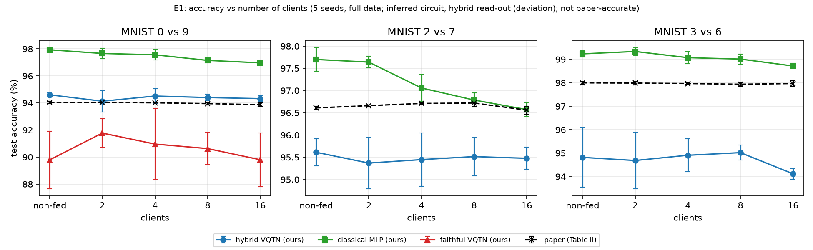
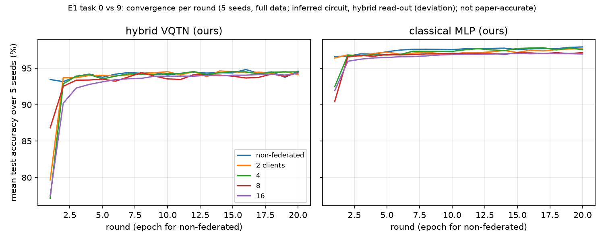
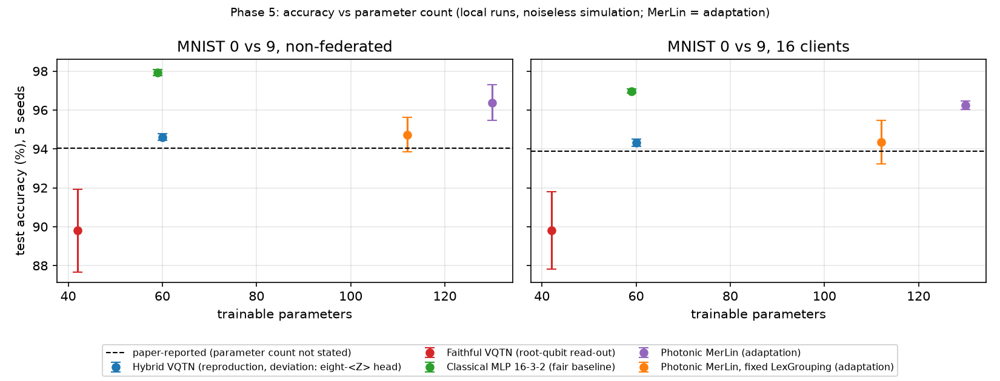
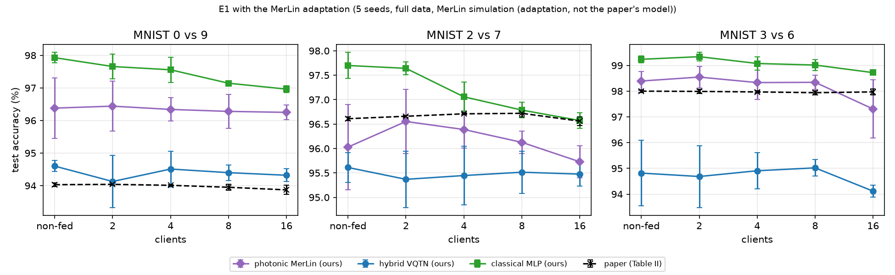

# Quantum Federated Learning With Decentralized Data — Reproduction

Status: the machine-learning part of the paper (E1 binary MNIST, E2 4-class MNIST, VQTN classifier) is reproduced with 5 seeds, compared with the paper, adapted to a photonic MerLin classifier and compared with fair baselines. E3 (QAOA) and E4 (VQE) are implemented and smoke-tested but were descoped and not run. Federated accuracy matching non-federated accuracy within 20 rounds is supported; the paper's statement that federation *improves* accuracy is not; the paper's absolute accuracies are matched on 0 vs 9 only; a size-matched classical model beats every quantum and photonic model.

## Reference and Attribution

- Paper: Quantum Federated Learning With Decentralized Data, IEEE Journal of Selected Topics in Quantum Electronics, vol. 28, no. 4, art. 6500110, July/August 2022
- Authors: Rui Huang, Xiaoqing Tan, Qingshan Xu
- DOI: https://doi.org/10.1109/JSTQE.2022.3170150
- Original repository: none found (three web searches on 2026-10-27; the paper states none)
- License and attribution: IEEE copyright; cite the paper. The PDF is used for reading only and is not redistributed.

## Original Paper

The paper proposes quantum federated learning (QFL) for variational quantum algorithms. Several clients each hold a private, non-i.i.d. and unbalanced local dataset. In every communication round the server picks K clients and sends them the global circuit parameters. Each client trains locally (batch size B, E epochs, a parameter-shift stochastic gradient, qSGD) and returns its parameters, and the server averages them. Only parameters, never data, leave a client.

Three local models are demonstrated, all simulated noiselessly with TensorFlow Quantum:

- a variational quantum tensor network (VQTN) classifier on MNIST downsampled to 4x4 pixels (three binary tasks 0/9, 2/7, 3/6 with 2, 4, 8 and 16 clients, and a 4-class task 2/3/6/7 with 4 clients);
- QAOA for MaxCut on random six-qubit 3-regular graphs (2, 4, 8 clients);
- VQE for molecular hydrogen over 54 bond lengths (2, 4, 8 clients).

Main claims: federated accuracy is comparable to the non-federated VQTN and in places better (Tables II and III, differences of 0.01 to 0.15 points); 20 rounds suffice; QFL also works for QAOA and VQE. No quantum advantage over classical learning is claimed, and privacy is argued by construction, not tested.

## Reproduction Scope, Claims, and Deviations

| ID | What | Paper location | Status here |
|---|---|---|---|
| E1 | VQTN binary MNIST tasks, federated (2, 4, 8, 16 clients) vs non-federated | Sec. III-A1, Tables II and III | done, 5 seeds |
| E2 | VQTN 4-class MNIST, 4 clients | Sec. III-A2, Table IV, Fig. 4 | done, 5 seeds, plus a non-federated reference |
| E3 | QAOA MaxCut | Sec. III-B, Fig. 5 | implemented and smoke-tested, descoped, not run |
| E4 | VQE H2 | Sec. III-C, Fig. 6 | implemented and smoke-tested, descoped, not run |
| controls | parameter-matched classical federated MLP; i.i.d. partition; faithful-circuit sensitivity | not in the paper | done, 5 seeds |
| MerLin | photonic classifier in the same federated loop | not in the paper (adaptation) | done, 5 seeds |

| Claim | Statement | Outcome here |
|---|---|---|
| C1a | Federated accuracy is comparable to non-federated (Table II) | supported |
| C1b | QFL improves on / is superior to non-federated (Sec. III-A1, Table III text) | unsupported |
| C2 | 20 communication rounds suffice | supported |
| C3 | 4-class accuracy 81.80 % (Table IV) | unresolved |
| C4, C5 | QFL works for QAOA and VQE | not tested (descoped) |
| C6, C7 | privacy; NISQ suitability | not tested (argued, not measured, in the paper) |

Deviations from the paper (details in `LOG.md`):

- **Backend.** A PyTorch statevector simulator (`lib/statevector.py`) replaces TensorFlow Quantum and TensorFlow Federated, which are not installed in this repository's environment. The federated loop is implemented directly (`lib/federated.py`).
- **Gradients.** Autograd through the simulation replaces parameter-shift qSGD. A test checks that the parameter-shift derivative equals the autograd derivative for every VQTN angle, so only the derivative estimator differs.
- **VQTN circuit (inferred).** The paper gives only Eq. (2). Used here: two pixels per qubit (`RZ(pi x_odd) RY(pi x_even)`), a seven-node tree of trainable `RY` pairs and `RXX` entanglers, repeated twice (2 layers, 42 angles), Adam with learning rate 0.03 and initial angle scale 0.1. Depth, learning rate and initial scale were chosen on a validation split in a 36-run calibration sweep.
- **Read-out (the most important deviation).** With the paper-faithful root-qubit read-out the calibrated circuit reaches only about 87 % on 0 vs 9 (paper: 94 %). A one-at-a-time diagnosis located the bottleneck in that read-out. The primary model therefore adds a classical linear layer on the eight single-qubit <Z> values (60 parameters in total), which is **not** the paper's read-out. The faithful circuit is reported as a sensitivity row.
- **Client partition (inferred).** Per-class Dirichlet(alpha = 0.5) split of the training set, giving label skew and unbalanced client sizes; the paper shows label histograms only. An i.i.d. control is reported.
- **Aggregation.** Sample-count-weighted FedAvg over all clients each round (Eq. 18 and Algorithm 2 disagree). Only trainable parameters are averaged, which matters for the MerLin layers' constant buffers and is arithmetically identical for the other models.
- **MNIST test set.** The standard 10,000 images; the paper's "100,000 testing" images is a typo.
- **E3 and E4 deviations** (implemented, not run): QAOA loss `1 - <C>/C_max` per graph; VQE angle as a Chebyshev series of the bond length; 2-qubit H2 Hamiltonian derived with PySCF and checked against full CI.

## Project Layout

```text
papers/qfl_decentralized_data/
|-- README.md, LOG.md, VISITED_URLS.md, FEEDBACK.md, INSIGHTS.md, CONFLUENCE.md
|-- cli.json, requirements.txt, notebook.ipynb (scientific walkthrough, runs in about 1 minute)
|-- configs/        defaults.json and one overlay per experiment and variant
|-- lib/            runner.py (entry point), federated.py, task.py, data.py, mnist_task.py,
|                   vqtn.py, classical.py, vqtn_merlin.py (MerLin adaptation), sweep.py,
|                   statevector.py, experiment_logging.py, qaoa.py, vqe.py, h2.py
|-- utils/          run_sweep.py, sweep_plans/*.json, report_sweep.py, compare_with_paper.py,
|                   compare_merlin.py, fair_comparison.py, plot_results.py, export_sweep_tables.py
|-- results/        curated comparison tables, figures, results/sweeps/<sweep_id>.md,
|                   runs.json (one record per stored run, read by the notebook)
|-- tests/          70 tests
|-- models/, outdir/   (outdir holds raw runs and is ignored by Git)
```

## Install and How to Run

```bash
python -m venv .venv
source .venv/bin/activate
pip install -r papers/qfl_decentralized_data/requirements.txt
```

Quick smoke runs (seconds, reduced and not evidence), from the repository root:

```bash
python implementation.py --paper qfl_decentralized_data --config configs/e1_reduced.json
python implementation.py --paper qfl_decentralized_data --config configs/e1_merlin_reduced.json
```

Single runs at paper settings (about one to two minutes each on a laptop CPU):

```bash
python implementation.py --paper qfl_decentralized_data --config configs/e1_original.json --seed 1
python implementation.py --paper qfl_decentralized_data --config configs/e1_merlin.json --seed 1
```

`configs/e1_original.json` uses the defaults (1 layer, root-qubit read-out); the reported hybrid VQTN and its controls are defined by the sweep plans below, which override these values.

Full five-seed reproduction (about 4 hours on a laptop CPU in total), one sweep at a time from the repository root. Each plan under `utils/sweep_plans/` predeclares its runs and selection rule; the coordinator writes `sweep.log`, `sweep_status.json`, `ledger.json` and `summary.json` into `outdir/sweeps/<sweep_id>/`:

```bash
for plan in e1_vqtn_hybrid e2_vqtn_hybrid control_classical_e1 control_classical_e2 control_iid_vqtn_0v9 sensitivity_faithful_0v9 e1_merlin e2_merlin sensitivity_merlin_lexgroup_0v9; do
  python papers/qfl_decentralized_data/utils/run_sweep.py papers/qfl_decentralized_data/utils/sweep_plans/$plan.json
done
cd papers/qfl_decentralized_data
python utils/compare_with_paper.py outdir/sweeps results
python utils/plot_results.py outdir/sweeps results
python utils/compare_merlin.py outdir/sweeps results
python utils/fair_comparison.py outdir/sweeps results
python utils/export_sweep_tables.py outdir/sweeps results
python utils/export_runs.py outdir/sweeps results   # results/runs.json, read by notebook.ipynb
```

The calibration and diagnosis sweeps (`calibration_vqtn_e1_0v9`, `diagnose_vqtn_components`, `diagnose_vqtn_known_answer_zhead`, `calibration_merlin_e1_0v9`) run the same way. Running from inside the paper folder also works (`python ../../implementation.py --config configs/<name>.json`).

## Configuration

`cli.json` is the authoritative flag list. Paper-specific flags: `--rounds`, `--n-clients`, `--partition {noniid,iid}`, `--mode {federated,centralized}`, `--batch-size`, `--lr`. Global flags (`--config`, `--outdir`, `--seed`, `--dtype`, `--device`, `--log-level`, `--data-root`) come from the shared runtime.

`configs/defaults.json` is E1 task 0 vs 9 with 2 clients and the root-qubit read-out. Overlays: `e1_original`, `e1_2v7_original`, `e1_3v6_original`, `e1_centralized` (non-federated control), `e1_classical` (16-1-2 MLP, 21 parameters, matching the 1-layer circuit), `e1_iid_control`, `e2_original`, `e1_merlin` (selected photonic adaptation), `e3_original`, `e4_original`, and one `*_reduced` smoke config per experiment. The reported runs use the sweep plans in `utils/sweep_plans/`, which set the calibrated values (2 layers, `z_head` read-out, lr 0.03) and the matched classical widths (16-3-2, 59 parameters; 16-4-4, 88 parameters). Required keys are validated by `lib/runner.py`; a missing key raises a `KeyError` and the run is recorded as `FAILED`.

Each run writes `run.log`, `run_status.json`, `config_snapshot.json` and `metrics.json` (per-round history, final report, parameter count) into its run directory. Raw runs stay in `outdir/`; curated tables and figures are in `results/`.

## Data

MNIST (original data) lives in `data/qfl_decentralized_data/mnist/raw/`. The paper's cited page http://yann.lecun.com/exdb/mnist/ now returns 404, so the four files come from the torchvision mirror (identical, MD5-verified). Re-acquire with:

```bash
D=data/qfl_decentralized_data/mnist/raw; mkdir -p $D && cd $D && for f in train-images-idx3-ubyte.gz train-labels-idx1-ubyte.gz t10k-images-idx3-ubyte.gz t10k-labels-idx1-ubyte.gz; do curl -sSL -O https://ossci-datasets.s3.amazonaws.com/mnist/$f; done
```

Images are reduced to 4x4 by exact 7x7 block means and divided by 255. Override the data root with `DATA_DIR` or `--data-root`.

## Results Obtained and Comparison with the Paper

Scope label for every local number: **5 seeds (1 to 5), full MNIST subsets, paper rounds (20) and batch size (20); circuit, client partition and learning rate are inferred; the primary VQTN uses a hybrid eight-<Z> linear read-out (a documented deviation); not paper-accurate.** Values are the final-round test accuracy, mean +- standard deviation over seeds. Paper values are paper-reported, not run locally. A difference is called meaningful only if it exceeds the larger of the two standard deviations.

| Paper item | Claim tested | Paper value | Reproduced value (hybrid VQTN) | Delta | Metric agreement | Trend agreement | Claim support | Seeds | Comment |
|---|---|---:|---:|---:|---|---|---|---:|---|
| Table II, 0 vs 9 (non-fed., 2, 4, 8, 16 clients) | C1a, C1b | 93.87 to 94.04 % | 94.13 to 94.60 % | +0.09 to +0.57 | close: within noise in 2 cells, above in 3 (the paper's std is as small as 0.02) | yes: flat across client counts | C1a supported, C1b unsupported | 5 | hybrid read-out needed; faithful circuit 89.8 to 91.8 % |
| Table II, 2 vs 7 | C1a, C1b | 96.56 to 96.72 % | 95.37 to 95.61 % | -1.00 to -1.29 | no (below in all 5 cells) | yes: flat | C1a supported, C1b unsupported | 5 | |
| Table II, 3 vs 6 | C1a, C1b | 97.94 to 98.00 % | 94.12 to 95.02 % | -2.92 to -3.85 | no (below in all 5 cells) | yes: flat except 16 clients (-0.70, within noise) | C1a supported, C1b unsupported | 5 | cause not isolated |
| Table III, AUC and F1 | C1b | AUC 0.9813 to 0.9975; F1 0.9386 to 0.9806 | AUC 0.9834 to 0.9934; F1 0.9409 to 0.9561 | task-dependent | partial (AUC 0v9 and 2v7 at or above, 3v6 below; F1 follows accuracy) | yes: no federated setting separates from non-federated | C1b unsupported | 5 | full values in `results/comparison_e1.md` |
| Table IV, 4-class, 4 clients | C3 | 81.80 % | 73.73 +- 0.49 % | -8.07 | no | yes: same per-class F1 order (digit 2 hardest, then 3, 6, digit 7 easiest) | unresolved | 5 | non-federated 76.16 +- 2.35 % (not in the paper) |
| Sec. IV, 20 rounds | C2 | "only 20 rounds" | 99 % of final accuracy within 2.0 to 8.0 rounds | n/a | n/a | yes | supported | 5 | classical MLP: 1.2 to 2.8 rounds |
| Fig. 2 (non-i.i.d. clients) | context | label-skewed clients | i.i.d. control within noise of non-i.i.d. (0v9, 2 and 16 clients) | n/a | n/a | n/a | n/a | 5 | the skewed split costs nothing detectable here |

Per-setting tables (all 15 E1 cells, AUC, F1, per-class E2 metrics, rounds to 99 %): [results/comparison_e1.md](results/comparison_e1.md), [results/comparison_e2.md](results/comparison_e2.md).




**Sweeps.** Every sweep's full candidate table, declared rule (metric, direction, split, checkpoint, aggregation, tie tolerance), coverage and outcome is in `results/sweeps/`. All 13 sweeps are complete, with 0 failed runs:

| Sweep | Purpose | Runs | Outcome | Table |
|---|---|---:|---|---|
| `calibration_vqtn_e1_0v9` | depth x lr x init scale, faithful circuit, validation split | 36 / 36 | three-way tie within 0.005 (2 layers lr 0.03 init 1.0 or 0.1; 3 layers lr 0.03 init 0.1); the leader is not meaningfully better (gap 0.002, std 0.06); 2 layers, lr 0.03 and init 0.1 used (the init choice is a post-hoc tie-break, recorded) | [link](results/sweeps/calibration_vqtn_e1_0v9.md) |
| `diagnose_vqtn_components` | one-at-a-time diagnosis of the gap | 24 / 24 | diagnosis only; only the read-out (+6.7 points) and a smaller encoding scale (-11.3) exceed noise | [link](results/sweeps/diagnose_vqtn_components.md) |
| `diagnose_vqtn_known_answer_zhead` | known-answer follow-up, 0 vs 1 | 3 / 3 | 94.5 %; the data ceiling of the 4x4 features (logistic regression 97.4 %) made the predeclared 98 % threshold unattainable | [link](results/sweeps/diagnose_vqtn_known_answer_zhead.md) |
| `e1_vqtn_hybrid`, `e2_vqtn_hybrid` | reported hybrid VQTN | 75 / 75, 10 / 10 | reporting | [E1](results/sweeps/e1_vqtn_hybrid.md), [E2](results/sweeps/e2_vqtn_hybrid.md) |
| `sensitivity_faithful_0v9` | root-qubit read-out, 0 vs 9 | 25 / 25 | reporting | [link](results/sweeps/sensitivity_faithful_0v9.md) |
| `control_classical_e1`, `control_classical_e2` | matched classical MLP | 75 / 75, 10 / 10 | reporting | [E1](results/sweeps/control_classical_e1.md), [E2](results/sweeps/control_classical_e2.md) |
| `control_iid_vqtn_0v9` | i.i.d. partition control | 10 / 10 | reporting | [link](results/sweeps/control_iid_vqtn_0v9.md) |
| `calibration_merlin_e1_0v9` | photonic: superposition placement x encoding scale x photons | 36 / 36 | single winner, superposition replacing the first mesh, scale 1.0, 2 photons (96.91 % validation, gap 1.04 points over runner-up, larger than both std) | [link](results/sweeps/calibration_merlin_e1_0v9.md) |
| `e1_merlin`, `e2_merlin`, `sensitivity_merlin_lexgroup_0v9` | photonic adaptation | 75 / 75, 10 / 10, 25 / 25 | reporting | [E1](results/sweeps/e1_merlin.md), [E2](results/sweeps/e2_merlin.md), [LexGrouping](results/sweeps/sensitivity_merlin_lexgroup_0v9.md) |

## Fair Baselines

The paper's own baseline (the same VQTN trained non-federated on the pooled data) is the right control for its claims, and it was reproduced (baseline state `FAIR_AND_REPRODUCED`). A parameter-matched classical federated MLP (16-3-2 tanh, 59 parameters against 60; 16-4-4, 88 against 78 for the 4-class task) was run on identical data, partitions, rounds and seeds as an additional control. Its learning rate (0.03) was not tuned, which handicaps the classical side. Generated by `utils/fair_comparison.py` from the runs' metrics: [results/fair_comparison.md](results/fair_comparison.md).

| Claim | Outcome |
|---|---|
| C1a: federated accuracy comparable to non-federated | **Supported.** Within noise in 11 of 12 cells for the hybrid VQTN, 4 of 4 for the faithful VQTN and 12 of 12 for the photonic adaptation |
| C1b: QFL improves on / is superior to non-federated | **Unsupported.** No cell above for any quantum model; the paper's 0.01 to 0.15-point differences are below the observed seed noise (0.2 to 2.6 points) |
| C2: 20 rounds suffice | **Supported.** 99 % of final accuracy within 2 to 9.4 rounds. Not quantum-specific: the classical MLP needs 1.2 to 2.8 |
| C3: 4-class 81.80 % | **Unresolved.** Hybrid VQTN 73.73 %; the photonic 83.81 % is an adaptation, not the paper's method |

| Pair | Status | Result |
|---|---|---|
| Hybrid VQTN vs classical MLP (60 vs 59 params) | commensurable | classical better in 15 of 15 E1 cells, by 1.1 to 4.7 points; also on E2 (89.85 vs 73.73) |
| Faithful VQTN vs classical MLP (42 vs 59) | partially commensurable | classical better in 5 of 5 cells (0 vs 9), by 5.9 to 8.1 points |
| Photonic adaptation vs classical MLP (130 vs 59) | partially commensurable | classical better in 15 of 15 cells, by 0.7 to 1.7 points; the larger photonic model still loses, so "no photonic advantage" holds a fortiori |
| Photonic adaptation vs hybrid VQTN (130 vs 60) | partially commensurable | photonic above in 13 of 15 cells (+0.3 to +3.9) |

**No quantum or photonic advantage** is supported by this evidence. Wall-clock on an Apple M5 laptop CPU (3 runs in parallel, 3 threads each): 4 to 6 s per classical E1 run against 76 to 199 s per simulated quantum or photonic run. This is simulation cost, not an algorithmic property.



## Photonic Assessment and MerLin Extension

Status **`MERLIN_IMPLEMENTATION`**. The paper's claim concerns federated training of a trainable quantum classifier, so a trainable photonic classifier whose phases are averaged by the same FedAvg loop preserves that role. The tree layout of the gate circuit plays no role in the claims and was not ported literally. Rejected mappings: a literal tree of 2-mode blocks, a frozen photonic reservoir with a classical read-out (only classical weights would be federated), and `FOCK` mean photon numbers (single-photon interference only). **Label: adaptation, not the paper's model; noiseless simulation, not hardware validation.**

Model (`lib/vqtn_merlin.py`): 8 modes, then a fixed 50:50 superposition layer (requested in this reproduction), even pixels as phases, a trainable mesh, odd pixels, a trainable mesh, and threshold detection. The 8 click probabilities feed a linear head (130 parameters). A 36-run calibration on validation data chose the placement (superposition instead of the first mesh), the phase scale (pi x pixel) and the photon number (2). Placed in front of a full trainable mesh, the superposition layer brought no benefit, as expected, since the mesh absorbs any fixed unitary.

| Setting | Paper | Photonic (MerLin) | Hybrid VQTN | Classical MLP |
|---|---|---|---|---|
| 0 vs 9, non-federated | 94.03 | 96.38 +- 0.93 | 94.60 +- 0.17 | 97.93 +- 0.16 |
| 0 vs 9, 16 clients | 93.87 | 96.25 +- 0.23 | 94.32 +- 0.20 | 96.96 +- 0.11 |
| 2 vs 7, non-federated | 96.61 | 96.03 +- 0.87 | 95.61 +- 0.30 | 97.70 +- 0.27 |
| 2 vs 7, 16 clients | 96.56 | 95.73 +- 0.33 | 95.48 +- 0.25 | 96.57 +- 0.16 |
| 3 vs 6, non-federated | 98.00 | 98.39 +- 0.38 | 94.82 +- 1.27 | 99.24 +- 0.13 |
| 3 vs 6, 16 clients | 97.97 | 97.31 +- 1.13 | 94.12 +- 0.23 | 98.72 +- 0.08 |
| 4-class, 4 clients | 81.80 | 83.81 +- 1.52 | 73.73 +- 0.49 | 89.85 +- 1.04 |

All 15 E1 settings and the read-out sensitivity: [results/comparison_merlin.md](results/comparison_merlin.md).



- **Federation costs nothing detectable for the photonic model either.** 12 of 12 federated vs non-federated comparisons are within noise (predeclared criterion (a), met).
- **The photonic model is better than the hybrid VQTN** by more than the predeclared 2.0-point tolerance in 6 of 15 settings. Criterion (b) is therefore not met, because the photonic results are higher. They are also above the paper on 0 vs 9, on 3 vs 6 (except 16 clients) and on the 4-class task.
- **It is not better than a classical MLP.** The classical baseline is better in all 15 settings and on the 4-class task.
- **A fully photonic read-out** (a fixed `LexGrouping` of the 28 outcomes, no classical parameter, 112 parameters) reaches 93.5 to 94.7 % on 0 vs 9, the paper's level, and 1.7 to 4.9 points above the faithful gate circuit.

## Hardware-Aware Settings

| Field | Primary photonic model (`e1_merlin`, `e2_merlin`) | Fixed-read-out sensitivity |
|---|---|---|
| Computation space | `UNBUNCHED` | `UNBUNCHED` |
| Detector model | threshold (collision-free outcomes only) | threshold |
| Photon number | 2 | 2 |
| Number of modes | 8 | 8 |
| Input state | `[1,0,0,0,1,0,0,0]` | `[1,0,0,0,1,0,0,0]` |
| Encoding | one phase per pixel, phase = pi x pixel; even pixels then odd pixels, around trainable meshes | same |
| Measurement strategy | `mode_expectations(UNBUNCHED)`, 8 click probabilities, then `Linear(8, C)` | `probs(UNBUNCHED)`, 28 outcomes, fixed `LexGrouping(28, 2)` |
| Postselection | collision-free outcomes, renormalised; acceptance probability not recorded | same |
| Simulator / QPU | MerLin 0.4.1 (Perceval 1.3.1) analytic CPU simulator; no QPU | same |
| Shot count | n/a (analytic) | n/a |
| Gradients | exact (autograd) | exact |
| Noise and loss | none | none |
| Wall-clock per run | E1 76 to 163 s; E2 302 to 325 s (Apple M5 CPU) | 145 to 159 s |
| Seeds | 1 to 5 | 1 to 5 |

## Limitations

- The circuit structure, read-out, client partition and learning rate are inferred, and the primary model is a hybrid, not the paper's circuit; absolute accuracies depend on these choices.
- The 3 vs 6 and 4-class results are 3 and 8 points below the paper; the diagnosis covered only 0 vs 9, so their cause is not isolated.
- Everything is noiseless simulation: no QPU, no shot noise, no cross-check against TensorFlow Quantum.
- E3 (QAOA) and E4 (VQE) were not run; the privacy and NISQ-suitability claims are not tested.
- The MerLin adaptation is simulated without noise, loss or detector inefficiency. Its post-selection acceptance probability was not recorded, and it has more parameters (130) than the hybrid VQTN (60) and its own calibration budget.
- Only the quantum models were calibrated. The classical MLP reused their learning rate without tuning, and only one classical architecture was run; no classical model was size-matched to the photonic adaptation.
- Trained model weights were not saved.

## Tests

```bash
cd papers/qfl_decentralized_data
pytest -q
```

70 tests cover the simulator against matrix exponentials, parameter-shift versus autograd, the VQTN, classical and MerLin models (shapes, normalisation, parameter counts, gradient flow, seeding, encoding-stage wiring, computation space), partition properties, the one-batch data-loader check, FedAvg arithmetic including parameters-only averaging, the sweep coordinator end to end, the H2 mapping against PySCF full CI, and the runner artifacts. Data and PySCF tests skip with a clear reason when MNIST or PySCF are missing.

## Citation and License

Cite: R. Huang, X. Tan and Q. Xu, "Quantum Federated Learning With Decentralized Data," IEEE J. Sel. Topics Quantum Electron., vol. 28, no. 4, 2022, doi:10.1109/JSTQE.2022.3170150. MNIST: LeCun, Cortes and Burges, CC BY-SA 3.0 as stated for the torchvision mirror. Repository code follows the repository license.
