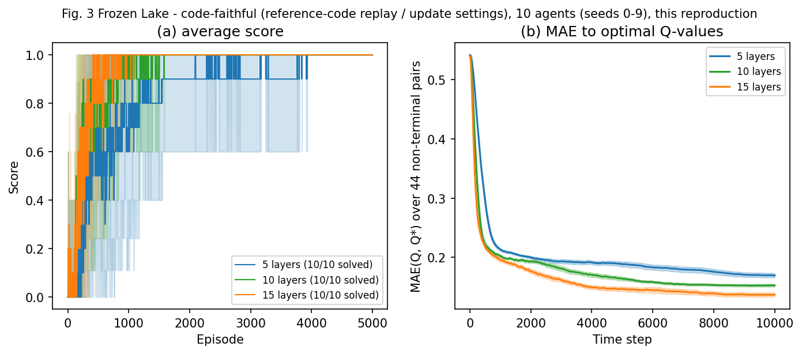
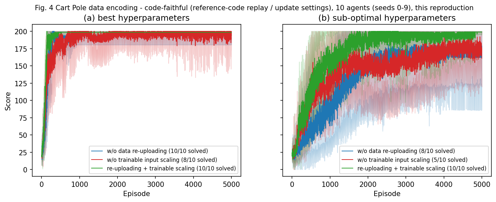
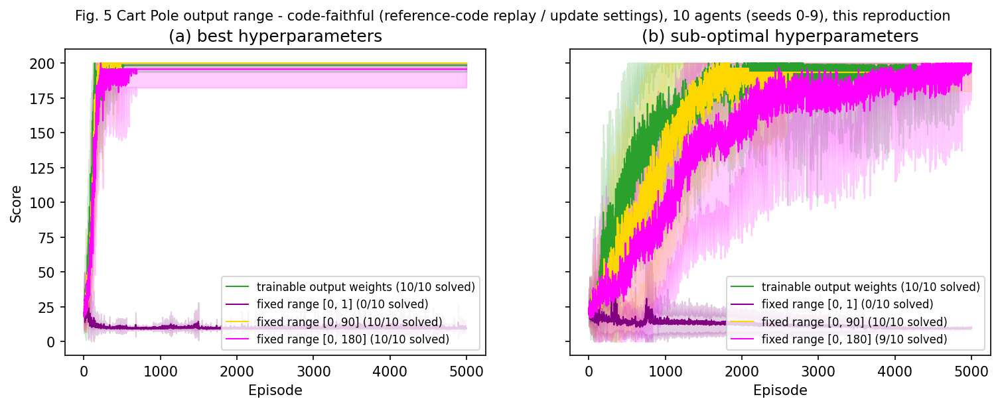
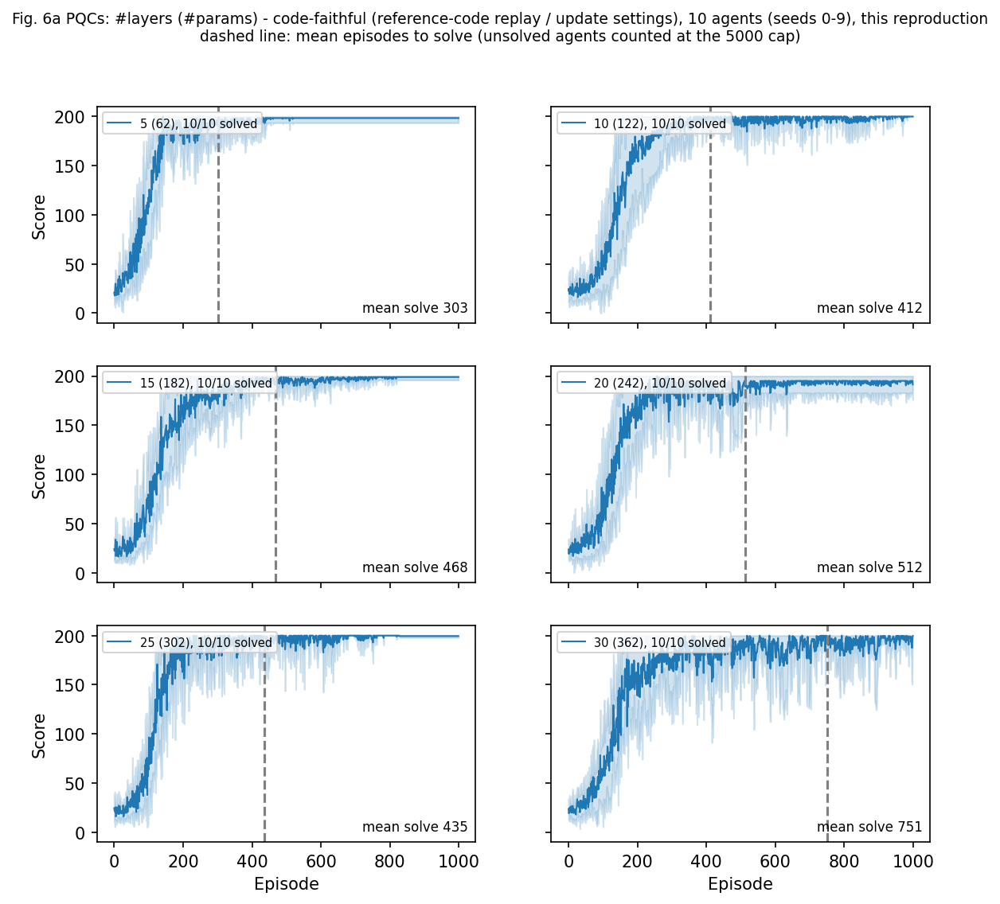
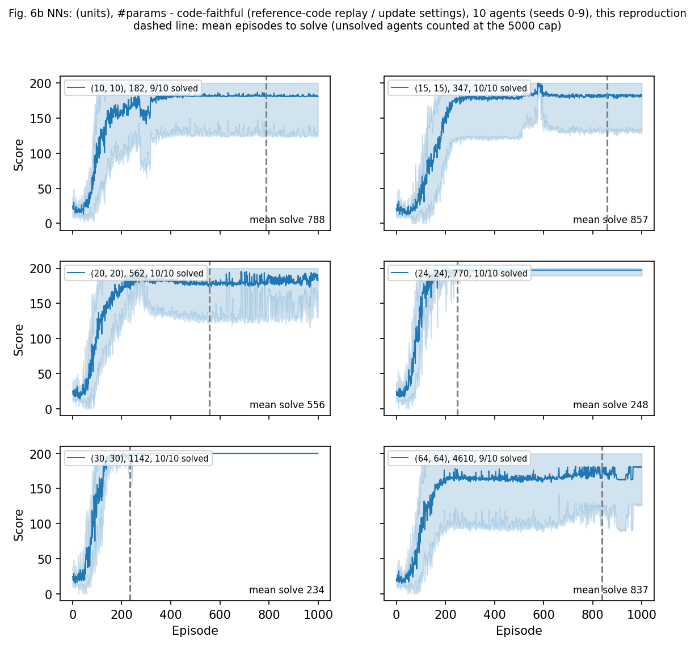

# Quantum agents in the Gym: a variational quantum algorithm for deep Q-learning - Reproduction

Status: complete and handed over. The reproduction, the photonic MerLin
adaptation, the fair comparison and the walkthrough notebook
(`notebook.ipynb`) are finished and documented here. Full provenance in `LOG.md`;
transferable lessons in `INSIGHTS.md`; workflow feedback in `FEEDBACK.md`;
MerLin-team items in `ACTION_REQUIRED_SEND_TO_MERLIN_TEAM.md`; a page ready for
Confluence in `CONFLUENCE.md`.

## Reference and Attribution

- Paper: A. Skolik, S. Jerbi, V. Dunjko, "Quantum agents in the Gym: a variational quantum algorithm for deep Q-learning", Quantum 6, 720 (2022).
- DOI / arXiv: [10.22331/q-2022-05-24-720](https://doi.org/10.22331/q-2022-05-24-720) / [arXiv:2103.15084](https://arxiv.org/abs/2103.15084)
- Original repository: https://github.com/askolik/quantum_agents (TensorFlow Quantum). The repository has no license file, so it was used only as a read-only reference; no code was copied.
- The paper is published under CC-BY 4.0.

## Original Paper

The paper trains deep Q-learning (DQN) agents whose Q-function is a
parametrized quantum circuit (PQC) on 4 qubits instead of a neural network.
Each layer encodes the state with RX rotations, then applies trainable RY/RZ
rotations and a ring of CZ gates. Q-values are rescaled expectation values of
Z observables. The authors study:

- Frozen Lake (4x4, deterministic): basis-state encoding, one Z per action;
  agents with 5, 10 and 15 layers all solve it, deeper circuits converge faster
  and get closer to the optimal Q-values (Fig. 3).
- Cart Pole v0: the output range of the PQC must match the range of optimal
  Q-values, so trainable output weights `w_o` are needed (Fig. 5); data
  re-uploading and trainable input weights `w_d` are both needed (Fig. 4).
- PQCs with 5-30 layers vs NNs with two hidden layers of 10-64 units (Fig. 6);
  best individual agents (Fig. 7). The paper makes no quantum-advantage claim:
  the best NN solves Cart Pole about twice as fast as the best PQC on average.

Metric: episodes until the environment is solved (Cart Pole: mean score >= 195
over the last 100 episodes; Frozen Lake: 100 consecutive successes), averaged
over 10 agents, plus the mean absolute error to the optimal Q-values for
Frozen Lake.

## Reproduction Scope, Claims, and Deviations

Reproduced: Figs. 3, 4, 5, 6 and 7 (experiments E1-E5), each with 10 agents
(seeds 0-9) and the paper's 5000-episode cap. Not reproduced: Fig. 8 (Q-value
surface of one agent, E6), the analytic toy of Sec. 3.2 (E7), the Sec. 4
theory, and the authors' hyperparameter search (ranges not reported).

Two complete run sets are reported:

| Run set | Label | What differs |
|---|---|---|
| paper-table | `paper-accurate` | hyperparameters exactly as in the paper's Appendix B tables |
| code-faithful | `code-faithful` | the two settings where the authors' released code differs from the table and changes the results: Cart Pole replay memory unbounded (code) instead of 10000 (table); Frozen Lake model update every step (code) instead of every 5 steps (table) |

The code-faithful set is the one to compare with the paper's figures: the
figures were produced by the code, and with these two settings the main
numbers match (see Results).


Claims and outcomes (full inventory with evidence in `LOG.md`; outcome labels
follow the repository's validity policy; "partially supported" means the trend
reproduces but a stated value or sub-claim does not):

| Claim | Statement (short) | Outcome |
|---|---|---|
| C1 | PQC solves Frozen Lake; deeper circuits converge faster and get closer to Q* | partially supported (all agents solve, trend reproduced; depth gap in MAE 0.033 vs ~0.05) |
| C2 | Output range must match Q*; trainable output weights best | partially supported ([0,1] never solves, [0,90] solves; [0,180] with sub-optimal hyperparameters solves 9/10 where the paper shows failure) |
| C3 | Re-uploading and trainable input scaling are both needed | partially supported (both ablations slower and less reliable, but they still solve; the paper's "do not solve" is not reproduced) |
| C4 | A value-based PQC solves Cart Pole v0 to specification | supported (10/10, mean 303 episodes vs ~320) |
| C5 | More parameters help only up to a point; NN about 2x faster than PQC | partially supported (non-monotonic trend reproduced; at matched parameters the tuned PQC is faster at ~65 parameters and the tuned NN at ~300) |
| C6 | Best individual PQC and NN agents are close | supported, descriptive (208 vs 206; 191 vs 186) |
| C7 | Hyperparameters and architecture matter more than parameter count | partially supported (follows from C2-C5; tuning turned the NN (5,5) from 5/10 to 10/10 solved) |
| C8 | Learned Cart Pole Q-function is smooth (Fig. 8) | not tested |
| C9 | Policy-gradient separation extends to Q-learning (Sec. 4) | out of numerical scope (theory) |
| C10 | Capped Q-table toy (Sec. 3.2) | not tested |

Other updates and deviations:

- Framework: exact statevector simulation in PyTorch (autograd), not
  TensorFlow Quantum. Agents of one configuration train together in one
  process with independent seeds; a test checks that an agent's results do not
  depend on which other agents run with it.
- Environments: Gymnasium 1.4.0 instead of gym 0.17.2; dynamics checked equal
  by source comparison. Frozen Lake episodes end at 100 steps, as in the
  authors' runs (the paper text says 200; a variant with 200 shows no clear
  difference: 8/10 solved vs 9/10, overlapping intervals).
- Frozen Lake circuit: the authors' code (not Fig. 1) adds a final RZ/RY layer
  and uses all-to-all CZ gates; with Fig. 1's ring the last layer cannot change
  the Z readout and only 4/10 agents solve. The code's circuit and its
  near-zero initialisation U[-0.05, 0.05] are used (the initialisation
  reproduces the paper's starting MAE of 0.54).
- Frozen Lake MAE is computed over the 44 non-terminal state-action pairs
  (the only definition that reproduces the paper's starting value).
- Cart Pole encoding: arctan (paper text); the code's tanh is tested as a
  variant and makes no clear difference (also not for the ablation arms: `diag_tanh`, 8 configs).
- Optimizer: Adam with the Keras/TensorFlow 2.3 update rule, AMSGrad for the
  circuit angles, plain Adam for `w_d` and `w_o`, as in the code.
- Added baselines (labelled `added-baseline`): NN with 49 parameters on Frozen
  Lake; NNs (5,5) with 67 and (14,14) with 310 parameters, matched to the
  5-layer (62) and 25-layer (302) PQCs.
- Hardware: Frozen Lake and quantum Cart Pole runs on an NVIDIA L4 (remote),
  NN runs on a laptop CPU (Apple M5). Only learning metrics are compared
  across machines, never wall-clock.

## Project Layout

```text
papers/quantum_agents_deep_q_learning/
|-- README.md, LOG.md, INSIGHTS.md, FEEDBACK.md, CONFLUENCE.md, VISITED_URLS.md
|-- ACTION_REQUIRED_SEND_TO_MERLIN_TEAM.md   # items for the MerLin team
|-- requirements.txt, cli.json
|-- configs/        # 125 JSON configs (naming table under "Configuration")
|-- lib/            # runner.py (entry point), dqn.py (vectorised DQN), models.py (PQC, NN),
|                   # qfunction_merlin.py (photonic Q-function), circuits.py, optim.py, data.py,
|                   # reference.py (Frozen Lake Q*), metrics.py, plotting.py, experiment_logging.py
|-- utils/          # run_batch.py (batch coordinator), compute_statistics.py, plot_paper_figures.py,
|                   # compare_merlin.py, select_phase5.py, compare_phase5.py, build_readme_tables.py,
|                   # benchmark_devices.py, diagnose_frozenlake_qstar_fit.py,
|                   # screen_photonic_frozenlake_designs.py, verify_e4_e5_statistics.py
|-- tests/          # 79 tests
|-- results/        # curated statistics, tables, selections, figures/, verification/
|-- outdir/         # raw runs and batches (disposable; batches/<id>/ hold evidence)
|-- models/         # unused (final parameters stay with each run)
`-- notebook.ipynb  # executed walkthrough (about 4 minutes on CPU)
```

## Install and How to Run

```bash
python -m venv .venv && source .venv/bin/activate
pip install -r papers/quantum_agents_deep_q_learning/requirements.txt
```

`requirements.txt` pins `merlinquantum==0.4.2` (MerLin adaptation) and
`gymnasium==1.4.0`; other papers in this repository pin older MerLin
versions in their own requirements, so use a separate environment if you need
both.

Notebook (live cells about 4 minutes on a CPU; reads the stored results in
`results/`). Use the repository environment as the Jupyter kernel:

```bash
cd papers/quantum_agents_deep_q_learning
PATH=<repo>/.venv/bin:$PATH JUPYTER_PATH=<repo>/.venv/share/jupyter \
    python -m jupyter nbconvert --to notebook --execute --inplace notebook.ipynb
```

Smoke run (2 agents, 3 episodes, under a minute):

```bash
# From the repository root
python implementation.py --paper quantum_agents_deep_q_learning --config configs/defaults.json --seed 42
```

One paper configuration (10 agents in one process):

```bash
python implementation.py --paper quantum_agents_deep_q_learning \
    --config configs/e2e3_cartpole_optimal_full_codefaithful.json --device cuda:0
```

Several configurations concurrently (what produced the results; one
`outdir/batches/<batch_id>/` folder per batch):

```bash
python papers/quantum_agents_deep_q_learning/utils/run_batch.py --batch-id cf_frozenlake \
    --device cuda:0 --max-parallel 4 \
    --configs e1_frozenlake_l5_codefaithful e1_frozenlake_l10_codefaithful e1_frozenlake_l15_codefaithful
```

Statistics and figures from the batch folders (from the paper folder):

```bash
python utils/compute_statistics.py --set code-faithful --output-dir results \
    --batches outdir/batches/{cf_frozenlake,cf_cartpole_optimal,cf_cartpole_suboptimal,cf_e4_pqc_depth,cf_e4_nn_width}
python utils/plot_paper_figures.py --set code-faithful --output-dir results/figures \
    --batches outdir/batches/{cf_frozenlake,cf_cartpole_optimal,cf_cartpole_suboptimal,cf_e4_pqc_depth,cf_e4_nn_width}
```

(`--set paper-table` with the batches `e1_frozenlake cartpole_optimal
cartpole_optimal_red_full cartpole_suboptimal e4_pqc_depth e4_nn_width` for
the paper-table set.) The exact batch commands are in `LOG.md`.

Tables, selections and comparisons (from the paper folder; each script reads
only structured artifacts):

```bash
python utils/select_phase5.py --batches outdir/batches/e5_select_nn --models mlp_5_5 mlp_14_14 --output results/phase5_selection_nn.json
python utils/compare_phase5.py --batches outdir/batches/{e5_eval_nn,e5_eval_pqc,cf_e4_pqc_depth,cf_e4_nn_width,cf_cartpole_optimal,merlin_core} --output-dir results
python utils/build_readme_tables.py --output-dir results
python -I utils/verify_e4_e5_statistics.py     # independent recomputation, read-only
```

Approximate cost on an L4 with 6-8 configurations in parallel: Frozen Lake
batch ~1 h; each Cart Pole batch 3-6 h (bounded by agents that never solve and
run all 5000 episodes).

## Configuration

`cli.json` is the authoritative CLI schema (`--seeds`, `--max-episodes`,
`--n-layers`, `--batch-size`, `--update-model-every`, `--update-target-every`,
`--lr`, `--encoding-activation`, `--greedy-eval-episodes`, plus the runtime's
`--config`, `--seed`, `--device`, `--dtype`, `--outdir`, `--log-level`).

Config naming in `configs/`:

| Pattern | Meaning |
|---|---|
| `defaults.json` | smoke config (2 agents, 3 episodes) |
| `e1_frozenlake_*`, `e2e3_cartpole_{optimal,suboptimal}_*`, `e4_cartpole_{pqc_lN,mlp_W_W}_*` | experiments E1-E4 |
| `*_original` / `*_classical` | paper-table hyperparameters (quantum / NN) |
| `*_codefaithful` | the same with the code's replay / update setting |
| `*_variant`, `*_diagnostic` | single-change controlled variants (paper vs code) |
| `*_reduced` | 5 agents, 2000 episodes (`partial`); superseded by the full runs |
| `*_merlin` | Phase 4 photonic adaptation (code-faithful training settings) |
| `*_merlin_reupload` | Phase 4 diagnostic: Frozen Lake basis phases re-uploaded |
| `*_merlin_8modes`, `*_merlin_dualrail` | Phase 4 design study: Frozen Lake single-encoding designs |
| `e5_select_*`, `e5_eval_*` | Phase 5 tuning grid (seeds 100-104) and evaluation of selected settings (seeds 0-9) |

Missing config keys raise an error; there are no silent defaults.

## Data

No dataset: experience comes online from Gymnasium's `CartPole-v0` and
`FrozenLake-v1(is_slippery=False)`. **Acquisition:** the environments ship in
`gymnasium==1.4.0` (installed from `requirements.txt`; no download, no
credentials). The authors' repository publishes no data or results (its
`data/` folder holds placeholders). **Fallback or synthetic data:** none was
needed. **Transformations:** Cart Pole observations are used raw (the model
applies `arctan(x w_d)` or the NN consumes them directly); Frozen Lake state
indices become 4 bits (basis state, bit 0 most significant). **Path actually
used:** Gymnasium's registered environments at run time; the replay buffer
holds the interaction history of each agent. Dynamics equality between gym
0.17.2 and Gymnasium 1.4.0 was checked by source comparison (episode cap,
float32 observations and random streams differ; see LOG.md, Data Acquisition
Log). Reference copies of the gym 0.17.2 and Gymnasium 1.4.0 environment sources
(provenance only, not imported) are under
`data/quantum_agents_deep_q_learning/gym_environments/` with `SHA256SUMS`; the
paper PDF and the authors' repository clone (read-only reference, no license)
are under `data/quantum_agents_deep_q_learning/sources/`.

Outputs: each run writes `outdir/run_YYYYMMDD-HHMMSS/` (or
`outdir/batches/<batch>/runs/<config>/run_*` inside a batch) with `run.log`,
`run_status.json`, `config_snapshot.json`, `metrics.json`, `scores.npz`,
`score_curve.png` (and `q_star_mae.png` for Frozen Lake) and
`final_parameters.pt`. Curated results are in `results/`.

## Results Obtained and Comparison with the Paper

All rows use 10 agents (seeds 0-9) and a 5000-episode cap, labelled
`paper-accurate` (paper-table set) or `code-faithful`. "Mean episodes" is the
mean 0-based episode index at which an agent met the solve rule, with
unsolved agents counted at 5000; 95% percentile-bootstrap intervals over
agents. Paper values marked "~" were read by eye from the paper's figures
(about +-20 episodes); the paper's text and Fig. 6 disagree on the best
average PQC and NN (both given). Full tables: `results/statistics.md`,
`results/statistics_codefaithful.md`; the table below is generated by
`python utils/build_readme_tables.py --output-dir results` from
`results/statistics*.json` (`results/readme_results_table.md`). "Delta" is
reproduced minus paper mean episodes (code-faithful set); "within CI" means
the paper value lies in our 95% interval. "Claim support" uses the claim
inventory in `LOG.md`; per-claim verdicts are summarised under "What matches
and what does not".

| Paper item | Claim tested | Paper value | Reproduced value (code-faithful) | Delta | Metric agreement | Trend agreement | Claim support | Seeds | Comment (paper-table value) |
|---|---|---|---|---:|---|---|---|---:|---|
| Fig. 3a, FL 5 layers | C1: all agents solve | all 10 solve | 10/10 solved, mean 1323 [857, 1982] | -- | count matches | time falls with depth: yes | supported | 10 (0-9) | paper-table: 9/10 solved, mean 2297 [1447, 3170] |
| Fig. 3a, FL 10 layers | C1: all agents solve | all 10 solve | 10/10 solved, mean 821 [623, 1067] | -- | count matches | time falls with depth: yes | supported | 10 (0-9) | paper-table: 8/10 solved, mean 2355 [1510, 3324] |
| Fig. 3a, FL 15 layers | C1: all agents solve | all 10 solve | 10/10 solved, mean 749 [638, 885] | -- | count matches | time falls with depth: yes | supported | 10 (0-9) | paper-table: 10/10 solved, mean 1462 [1041, 1948] |
| Fig. 3b, FL 5 layers | C1: MAE to Q* (44 non-terminal pairs, step 10000) | ~0.19 | 0.169 (s.e.m. 0.004) | -0.021 | lower than paper | ordering by depth: yes | partially supported | 10 (0-9) | paper-table: 0.197; start value 0.54 matches |
| Fig. 3b, FL 10 layers | C1: MAE to Q* (44 non-terminal pairs, step 10000) | ~0.17 | 0.152 (s.e.m. 0.002) | -0.018 | lower than paper | ordering by depth: yes | partially supported | 10 (0-9) | paper-table: 0.192; start value 0.54 matches |
| Fig. 3b, FL 15 layers | C1: MAE to Q* (44 non-terminal pairs, step 10000) | ~0.155 | 0.137 (s.e.m. 0.004) | -0.018 | lower than paper | ordering by depth: yes | partially supported | 10 (0-9) | paper-table: 0.181; start value 0.54 matches |
| Fig. 4a / 5a, CP full, best hparams | C3/C4: solves Cart Pole | <= 600 (text); ~320 (Fig. 6a) | 10/10 solved, mean 303 [254, 364] | -17 | within CI | yes | supported | 10 (0-9) | paper-table: 10/10 solved, mean 617 [415, 866] |
| Fig. 4a, CP w/o re-uploading, best | C3: re-uploading needed | does not solve (text) | 10/10 solved, mean 394 [308, 523] | -- | not reproduced | no: about as fast as full | not supported | 10 (0-9) | paper-table: 10/10 solved, mean 659 [439, 951]; paper's Fig. 4a curve ~190 |
| Fig. 4a, CP w/o input weights, best | C3: trainable w_d needed | does not solve (text) | 8/10 solved, mean 1420 [450, 2714] | -- | not reproduced (8/10 solve) | yes: slower and less reliable | partially supported | 10 (0-9) | paper-table: 5/10 solved, mean 3199 [1951, 4398] |
| Fig. 4b, CP full, sub-optimal | C3: full model robust to hparams | <= 3000 (text) | 10/10 solved, mean 1901 [1187, 2791] | -- | within text bound | yes | supported | 10 (0-9) | paper-table: 9/10 solved, mean 3106 [2254, 3951] |
| Fig. 4b, CP w/o re-uploading, sub-opt. | C3 | does not solve (text) | 8/10 solved, mean 2961 [2152, 3858] | -- | not reproduced | yes: slower, 8/10 solve | partially supported | 10 (0-9) | paper-table: 5/10 solved, mean 3889 [3099, 4593] |
| Fig. 4b, CP w/o input weights, sub-opt. | C3 | does not solve (text) | 5/10 solved, mean 3472 [2405, 4554] | -- | not reproduced | yes: 5/10 solve | partially supported | 10 (0-9) | paper-table: 1/10 solved, mean 4752 [4258, 5000] |
| Fig. 5a, CP fixed [0,1], best | C2: range must match Q* | never solves | 0/10 solved, mean 5000 [5000, 5000] | -- | matches | yes | supported | 10 (0-9) | paper-table: 0/10 solved, mean 5000 [5000, 5000] |
| Fig. 5a, CP fixed [0,90], best | C2 | solves | 10/10 solved, mean 279 [239, 334] | -- | matches | yes | supported | 10 (0-9) | paper-table: 10/10 solved, mean 401 [290, 540] |
| Fig. 5a, CP fixed [0,180], best | C2 | solves (slower) | 10/10 solved, mean 350 [279, 445] | -- | matches | yes | supported | 10 (0-9) | paper-table: 10/10 solved, mean 843 [568, 1149] |
| Fig. 5b, CP fixed [0,1], sub-opt. | C2 | never solves | 0/10 solved, mean 5000 [5000, 5000] | -- | matches | yes | supported | 10 (0-9) | paper-table: 0/10 solved, mean 5000 [5000, 5000] |
| Fig. 5b, CP fixed [0,90], sub-opt. | C2 | solves (~4500) | 10/10 solved, mean 1649 [1249, 2054] | -- | matches (solves earlier) | yes | supported | 10 (0-9) | paper-table: 8/10 solved, mean 3206 [2398, 3978] |
| Fig. 5b, CP fixed [0,180], sub-opt. | C2: [0,180] can fail completely | complete failure | 9/10 solved, mean 2686 [1803, 3645] | -- | not reproduced | no | not supported | 10 (0-9) | paper-table: 9/10 solved, mean 2317 [1656, 3077]; implementation and settings match the reference code; unexplained |
| Fig. 6a, PQC 5 layers | C5: non-monotonic in parameters | ~320 | 10/10 solved, mean 303 [254, 364] | -17 | within CI | non-monotonic: yes | partially supported | 10 (0-9) | paper-table: 10/10 solved, mean 617 [415, 866] |
| Fig. 6a, PQC 10 layers | C5: non-monotonic in parameters | ~635 | 10/10 solved, mean 412 [272, 592] | -223 | outside CI | non-monotonic: yes | partially supported | 10 (0-9) | paper-table: 10/10 solved, mean 576 [361, 866] |
| Fig. 6a, PQC 15 layers | C5: non-monotonic in parameters | ~690 | 10/10 solved, mean 468 [342, 604] | -222 | outside CI | non-monotonic: yes | partially supported | 10 (0-9) | paper-table: 10/10 solved, mean 474 [348, 652] |
| Fig. 6a, PQC 20 layers | C5: non-monotonic in parameters | ~770 | 10/10 solved, mean 512 [373, 715] | -258 | outside CI | non-monotonic: yes | partially supported | 10 (0-9) | paper-table: 10/10 solved, mean 790 [467, 1279] |
| Fig. 6a, PQC 25 layers | C5: non-monotonic in parameters | ~350 | 10/10 solved, mean 435 [314, 575] | +85 | within CI | non-monotonic: yes | partially supported | 10 (0-9) | paper-table: 10/10 solved, mean 428 [336, 524]; text: 500 for 25 layers |
| Fig. 6a, PQC 30 layers | C5: non-monotonic in parameters | ~940 | 10/10 solved, mean 751 [518, 1022] | -189 | within CI | non-monotonic: yes | partially supported | 10 (0-9) | paper-table: 10/10 solved, mean 692 [548, 859] |
| Fig. 6b, NN (10,10) | C5: non-monotonic in parameters | ~1110 | 9/10 solved, mean 788 [276, 1747] | -322 | within CI | non-monotonic: yes | partially supported | 10 (0-9) | paper-table: 10/10 solved, mean 990 [367, 1926] |
| Fig. 6b, NN (15,15) | C5: non-monotonic in parameters | ~540 | 10/10 solved, mean 857 [278, 1771] | +317 | within CI | non-monotonic: yes | partially supported | 10 (0-9) | paper-table: 9/10 solved, mean 919 [375, 1874] |
| Fig. 6b, NN (20,20) | C5: non-monotonic in parameters | ~430 | 10/10 solved, mean 556 [263, 893] | +126 | within CI | non-monotonic: yes | partially supported | 10 (0-9) | paper-table: 10/10 solved, mean 1048 [390, 1935]; text: 250 for (20,20) |
| Fig. 6b, NN (24,24) | C5: non-monotonic in parameters | ~415 | 10/10 solved, mean 248 [219, 280] | -167 | outside CI | non-monotonic: yes | partially supported | 10 (0-9) | paper-table: 9/10 solved, mean 862 [264, 1847] |
| Fig. 6b, NN (30,30) | C5: non-monotonic in parameters | ~250 | 10/10 solved, mean 234 [207, 267] | -16 | within CI | non-monotonic: yes | partially supported | 10 (0-9) | paper-table: 10/10 solved, mean 385 [247, 593] |
| Fig. 6b, NN (64,64) | C5: non-monotonic in parameters | ~345 | 9/10 solved, mean 837 [225, 1819] | +492 | within CI | non-monotonic: yes | partially supported | 10 (0-9) | paper-table: 9/10 solved, mean 1032 [229, 2144] |
| Fig. 7, fastest PQC agent | C6: best agents close | 206 | 208 (e2e3_cartpole_optimal_full_original) | +2 | within 5 episodes | yes | supported (descriptive) | 10 (0-9) per config | extreme-value statistic over 6 configs; no inference |
| Fig. 7, fastest NN agent | C6: best agents close | 186 | 191 (e4_cartpole_mlp_30_30_classical) | +5 | within 5 episodes | yes | supported (descriptive) | 10 (0-9) per config | extreme-value statistic over 6 configs; no inference |

### What matches and what does not

Frozen Lake (C1), code-faithful set:

- All 30 agents solve; time to solve falls with depth (mean 1323 / 821 / 749
  episodes for 5 / 10 / 15 layers): **trend reproduced**.
- MAE to Q* over the 44 non-terminal pairs at time step 10000: 0.169 / 0.152 /
  0.137 (paper Fig. 3b, read by eye: ~0.19 / 0.17 / 0.155). The 5-vs-15-layer
  gap is 0.033 [95% CI 0.023, 0.042] vs ~0.05 in the paper: direction and
  ordering reproduced, size smaller.
- With the paper table's update every 5 steps, 3 of 30 agents do not solve and
  the MAE falls several times more slowly than in Fig. 3b.

Cart Pole output range (C2): fixed range [0,1] never solves (0/10 in all four
settings), and [0,90] solves; **reproduced**. Trainable `w_o` is not clearly
faster than fixed [0,90] or [0,180] (no clear separation in either run set, Mann-Whitney p >
0.1). **Not reproduced:** fixed [0,180] with the sub-optimal hyperparameters
solves 9/10 (8/10 with the code's tanh encoding), where the paper's Fig. 5b
shows complete failure. Implementation and settings match the authors' code;
this gap is unexplained.

Cart Pole encoding (C3): with sub-optimal hyperparameters both ablations are
slower and less reliable than the full model (w/o re-uploading 8/10, w/o
`w_d` 5/10, full 10/10); with the best hyperparameters w/o `w_d` is slower
(8/10) and w/o re-uploading is about as fast as the full model. The paper
states that neither ablation solves within 5000 episodes; that absolute
statement is **not reproduced**, in either run set or with the code's tanh
encoding. The paper's own Fig. 4a curves for these arms sit near 190,
which suggests the text is stricter than the plotted data.

Solving Cart Pole to specification with a value-based PQC (C4):
**reproduced**. The 5-layer full model solves in 303 episodes on average (paper Fig. 6a
~320).

Parameter count (C5): neither the PQC depth scan nor the NN width scan
improves monotonically with parameters, as in the paper. These are
descriptive statistics, not a selection: no configuration is chosen or
reused from them. Lowest observed mean episodes (code-faithful set): PQC 5
layers 303, next 10 layers 412 and 25 layers 435 (paper Fig. 6a: 5 layers
~320, 25 layers ~350); NN (30,30) 234 (paper ~250). Across depths the
differences are partly within seed spread (Kruskal-Wallis p = 0.015 over the
6 depths; neighbouring depths have overlapping 95% intervals); across widths
there is no clear separation (p = 0.095). PQCs with 10-20 layers solve faster
here than in the paper's Fig. 6a. Parameter-matched added baselines: the
62-parameter PQC solves faster than the 67-parameter NN (5,5) (p < 0.001;
the NN solves only 5/10); the 302-parameter PQC and the 310-parameter NN
(14,14) show no clear separation.

Fastest single agents (C6; the paper's Fig. 7 statistic, a minimum over 60
agents per model family, descriptive only): PQC 208 episodes (5 layers), NN
191 episodes ((30,30)); paper 206 and 186. These match the paper's values
closely; as an extreme-value statistic it carries no inference.

Figures (both sets): `results/figures/fig3_frozenlake*.png`,
`fig4_encoding_ablation*.png`, `fig5_readout_ablation*.png`,
`fig6a_pqc_depth*.png`, `fig6b_nn_width*.png`, `fig7_best_agents*.png`
(suffix `_codefaithful` for the code-faithful set).







## Fair Baselines

The paper makes no quantum-advantage claim; its PQC-vs-NN comparison (Fig. 6)
uses NNs that are not parameter-matched (smallest NN 182 parameters vs 62 for
the 5-layer PQC) and unreported tuning budgets. The comparison planned before any result was
observed is added here: **sample efficiency (episodes to solve Cart Pole) at
matched parameter count with an equal tuning budget.** Pairs: PQC 5 layers
(62) vs NN (5,5) (67), and PQC 25 layers (302) vs NN (14,14) (310). All four
models got the same 6-setting grid (batch {16, 32, 64} x target update {1,
30}) on separate selection seeds 100-104; the setting with the lowest median
episodes to solve was then evaluated on seeds 0-9 (code-faithful training
settings otherwise identical). Full table: `results/phase5_comparison.md`;
figure: `results/figures/fig_phase5_matched.png`; selections:
`results/phase5_selection_{nn,pqc}.json`; generated tables:
`results/readme_phase5_table.md` (this section) via
`python utils/build_readme_tables.py --output-dir results`. Baseline state: the
paper's NN arms are `MISSING_OR_UNFAIR` for the parameter-count axis
(not matched, tuning budget unreported), so matched NNs were added; the paper's
internal ablations (C2, C3) are `FAIR_AND_REPRODUCED` and reused. Rows marked
context (untuned NNs, the paper's own NN widths, MerLin) are shown for
reference and are only partially commensurable with the matched pairs.

| System | Role | Scope | Successful / expected runs | Params | Solved | Median episodes [95% CI] | Mean | Wall-clock, hardware |
|---|---|---|---:|---:|---:|---|---:|---|
| PQC 5 layers, tuned | paper method | paper-method-tuned | 1 / 1 | 62 | 10/10 | 214 [195, 266] | 262 | 1947 s, remote L4 |
| NN (5,5), tuned | added fair baseline | added-baseline-tuned | 1 / 1 | 67 | 10/10 | 298 [252, 1520] | 964 | 199 s, laptop CPU |
| PQC 25 layers, tuned (= paper setting) | paper method | code-faithful | 1 / 1 | 302 | 10/10 | 332 [254, 616] | 435 | 6770 s, remote L4 |
| NN (14,14), tuned | added fair baseline | added-baseline-tuned | 1 / 1 | 310 | 10/10 | 232 [214, 297] | 304 | 53 s, laptop CPU |
| PQC 5 layers, paper setting | paper method (context) | code-faithful | 1 / 1 | 62 | 10/10 | 303 [224, 337] | 303 | 2759 s, remote L4 |
| NN (5,5), untuned | baseline before tuning (context) | added-baseline | 1 / 1 | 67 | 5/10 | 4910 [622, 5000] | 3236 | 263 s, laptop CPU |
| NN (14,14), untuned | baseline before tuning (context) | added-baseline | 1 / 1 | 310 | 10/10 | 387 [240, 2164] | 1168 | 198 s, laptop CPU |
| NN (20,20), paper setting | paper baseline (context) | code-faithful | 1 / 1 | 562 | 10/10 | 250 [199, 900] | 556 | 110 s, laptop CPU |
| NN (30,30), paper setting | paper baseline (context) | code-faithful | 1 / 1 | 1142 | 10/10 | 216 [199, 272] | 234 | 29 s, laptop CPU |
| MerLin 5 layers (adaptation) | photonic adaptation | merlin-adaptation (simulated) | 1 / 1 | 82 | 10/10 | 280 [203, 400] | 304 | 6028 s, remote CPU |

| Pair | Median A | Median B | Median difference A-B [95% CI] | Mann-Whitney p | Verdict | Status |
|---|---:|---:|---|---:|---|---|
| PQC 5 layers, tuned vs NN (5,5), tuned | 214 | 298 | -84 [-1306, -16] | 0.00459 | PQC 5 layers, tuned faster | COMMENSURABLE |
| PQC 25 layers, tuned (= paper setting) vs NN (14,14), tuned | 332 | 232 | 100 [18, 392] | 0.00911 | NN (14,14), tuned faster | COMMENSURABLE |
| MerLin 5 layers (adaptation) vs NN (5,5), tuned | 280 | 298 | -18 [-1168, 95] | 0.241 | no clear separation | PARTIALLY_COMMENSURABLE |
| MerLin 5 layers (adaptation) vs PQC 5 layers, tuned | 280 | 214 | 66 [-22, 174] | 0.13 | no clear separation | PARTIALLY_COMMENSURABLE |

- At ~65 parameters the tuned PQC solves faster than the tuned NN (median
  214 vs 298 episodes, p = 0.005); at ~300 parameters the tuned NN is faster
  (232 vs 332, p = 0.009). **Neither family is better in general**; the
  paper's "NNs are about twice as fast" holds at the larger matched size, not
  at the smallest. Differences are moderate and rest on 10 agents.
- Tuning matters as much as the model family: the untuned NN (5,5) solved
  only 5/10.
- **No quantum advantage is claimed.** This is classical simulation of a
  small circuit on one task; compute cost goes the other way (NN runs 29-263
  s on a laptop CPU vs PQC runs 1947-6770 s on an L4 GPU, different hardware,
  not a fair speed comparison).
- The MerLin adaptation (simulated, untuned, 82 parameters) shows no clear
  separation from either the tuned PQC or the tuned NN at ~65 parameters
  (partially commensurable).
- Extensions: none.

### Tuning-grid sweep: complete candidate table

Declared rule (Phase 5 Comparison Plan, LOG.md): per model, metric = median over the 5 selection agents (seeds 100-104) of the 0-based solve episode, unsolved censored at 5000; direction: lower is better; split: online interaction on selection seeds (evaluation seeds 0-9 are disjoint); checkpoint: final (agents stop at solve); aggregation: median over agents; tie tolerance 5% of the best median, ties go to the smaller batch, then the smaller target interval.

| Model | Params | Batch | Target update | Median episodes | Solved (of 5) | Status |
|---|---:|---:|---:|---:|---:|---|
| mlp_5_5 | 67 | 16 | 1 | 1837 | 3 |  |
| mlp_5_5 | 67 | 16 | 30 | 5000 | 1 |  |
| mlp_5_5 | 67 | 32 | 1 | 2222 | 3 |  |
| mlp_5_5 | 67 | 32 | 30 | 5000 | 2 |  |
| mlp_5_5 | 67 | 64 | 1 | 2557 | 3 |  |
| mlp_5_5 | 67 | 64 | 30 | 1487 | 5 | selected |
| mlp_14_14 | 310 | 16 | 1 | 258 | 4 |  |
| mlp_14_14 | 310 | 16 | 30 | 290 | 5 |  |
| mlp_14_14 | 310 | 32 | 1 | 214 | 5 | selected |
| mlp_14_14 | 310 | 32 | 30 | 295 | 5 |  |
| mlp_14_14 | 310 | 64 | 1 | 241 | 5 |  |
| mlp_14_14 | 310 | 64 | 30 | 217 | 5 | tied within 5% |
| pqc_l5 | 62 | 16 | 1 | 327 | 5 |  |
| pqc_l5 | 62 | 16 | 30 | 227 | 5 |  |
| pqc_l5 | 62 | 32 | 1 | 206 | 5 |  |
| pqc_l5 | 62 | 32 | 30 | 255 | 5 |  |
| pqc_l5 | 62 | 64 | 1 | 221 | 5 |  |
| pqc_l5 | 62 | 64 | 30 | 194 | 5 | selected |
| pqc_l25 | 302 | 16 | 1 | 1073 | 5 |  |
| pqc_l25 | 302 | 16 | 30 | 897 | 5 |  |
| pqc_l25 | 302 | 32 | 1 | 304 | 5 |  |
| pqc_l25 | 302 | 32 | 30 | 499 | 5 |  |
| pqc_l25 | 302 | 64 | 1 | 437 | 5 |  |
| pqc_l25 | 302 | 64 | 30 | 271 | 5 | selected |

Completeness: COMPLETE SWEEP, 24 of 24 planned candidate runs observed and COMPLETED (4 models x 6 settings), validated with `validate_logging.py`; `utils/select_phase5.py` raises on any missing, duplicate or non-100-104-seed candidate. Selections and ties:

- mlp_5_5: best median 1487; selected `e5_select_mlp_5_5_b64_t30_classical`; no ties
- mlp_14_14: best median 214; selected `e5_select_mlp_14_14_b32_t1_classical`; tied: e5_select_mlp_14_14_b64_t30_classical (smaller batch wins)
- pqc_l5: best median 194; selected `e5_select_pqc_l5_b64_t30`; no ties
- pqc_l25: best median 271; selected `e5_select_pqc_l25_b64_t30`; no ties

Uncertainty: each candidate has only 5 agents, so medians carry large sampling noise, in particular for NN (5,5) (medians of 1487-5000 with 1-5 of 5 solved); the selection is a protocol step, not evidence that the chosen setting is optimal. The selected settings were evaluated once on seeds 0-9 (`results/phase5_comparison.md`).

## Photonic Assessment and MerLin Extension

**Status: `MERLIN_IMPLEMENTATION`, reduced-scope validation** (E1 and E2/E3;
the E4 depth scan and E5 are not run photonically). This is an
*adaptation*, labelled `merlin-adaptation`, not part of the reproduction.

Mappings considered (details in `LOG.md`, Phase 4 Photonic Assessment): the
chosen angle-encoded re-uploading interferometer with per-action click
probabilities; rejected: grouping the output distribution into actions
(couples the Q-values of different actions), dual-rail qubit emulation
(needs post-selected CZ gates, not photonic-native), amplitude encoding
(removes the encoding question the paper studies), and a frozen reservoir
with a trained readout (changes the learning mechanism). Assessment
confidence: high for Cart Pole, high for the Frozen Lake limit; a follow-up
design study (more photons and modes, dual-rail input-state encoding) found no
single-encoding design that works; designs outside that family
(photon-number-resolving readout, adaptive measurement, nonlinear elements)
were not tested.

Mapping (`lib/qfunction_merlin.py`): the paper's claims are about a
bounded-output circuit used as a DQN Q-function, so the photonic model keeps
that role rather than the qubit gates. 6 modes, 3 photons, input state
`[1,0,1,0,1,0]`; each layer is a brickwork of Mach-Zehnder interferometers on
neighbouring modes (10 phases); the state enters as phase shifters on modes
0-3 (Cart Pole: `arctan(x_i w_d)`, re-uploaded every layer; Frozen Lake:
`pi * bit_i`, once, as in the paper); Q(s, a) = click probability of a
threshold detector on readout mode a (times `w_o` when trained), which is
bounded in [0, 1] like `(<Z>+1)/2`. The full Fock space is simulated and
collapsed to click / no-click, so there is no post-selection (MerLin's
unbunched space would post-select on 3-click events). All circuit phases are
passed to MerLin as inputs so the DQN loop, optimizer and target network are
shared with the qubit model; environments, hyperparameters (code-faithful),
seeds 0-9 and metrics are identical.

Results (10 agents each; solved, mean episodes with unsolved counted at
5000 and 95% bootstrap interval; Mann-Whitney p vs the code-faithful qubit
run; full table `results/merlin_comparison.md`, curves
`results/figures/fig_merlin_vs_qubit.png`):

| MerLin config | Solved (MerLin / qubit) | Mean episodes MerLin [95% CI] | Mean episodes qubit [95% CI] | MWU p | Agreement | Params (MerLin / qubit) | Wall-clock s (MerLin) |
|---|---:|---|---|---:|---|---|---:|
| `e1_frozenlake_l10_merlin` | 0/10 / 10/10 | 5000 [5000, 5000] | 821 [623, 1070] | 6.4e-05 | MerLin slower | 110 / 88 | 9528 |
| `e1_frozenlake_l10_merlin_dualrail` | 0/10 / 10/10 | 5000 [5000, 5000] | 821 [622, 1069] | 6.4e-05 | MerLin slower | 154 / 88 | 1264 |
| `e1_frozenlake_l10_merlin_reupload` | 10/10 / 10/10 | 501 [457, 547] | 821 [622, 1071] | 0.0017 | MerLin faster | 110 / 88 | 484 |
| `e1_frozenlake_l15_merlin` | 0/10 / 10/10 | 5000 [5000, 5000] | 749 [638, 883] | 6.4e-05 | MerLin slower | 160 / 128 | 13163 |
| `e1_frozenlake_l15_merlin_reupload` | 10/10 / 10/10 | 545 [498, 594] | 749 [639, 877] | 0.0073 | MerLin faster | 160 / 128 | 625 |
| `e1_frozenlake_l5_merlin` | 0/10 / 10/10 | 5000 [5000, 5000] | 1323 [854, 1999] | 6.4e-05 | MerLin slower | 60 / 48 | 7639 |
| `e1_frozenlake_l5_merlin_8modes` | 0/10 / 10/10 | 5000 [5000, 5000] | 1323 [857, 1994] | 6.4e-05 | MerLin slower | 84 / 48 | 3226 |
| `e1_frozenlake_l5_merlin_dualrail` | 0/10 / 10/10 | 5000 [5000, 5000] | 1323 [859, 1998] | 6.4e-05 | MerLin slower | 84 / 48 | 803 |
| `e1_frozenlake_l5_merlin_reupload` | 7/10 / 10/10 | 2093 [1002, 3392] | 1323 [858, 1996] | 0.85 | no clear separation | 60 / 48 | 3636 |
| `e2e3_cartpole_optimal_fixed_range_180_merlin` | 10/10 / 10/10 | 375 [294, 480] | 350 [277, 445] | 0.76 | no clear separation | 80 / 60 | 10298 |
| `e2e3_cartpole_optimal_fixed_range_1_merlin` | 0/10 / 0/10 | 5000 [5000, 5000] | 5000 [5000, 5000] | 1 | no clear separation | 80 / 60 | 4219 |
| `e2e3_cartpole_optimal_fixed_range_90_merlin` | 10/10 / 10/10 | 825 [284, 1775] | 279 [239, 335] | 0.41 | no clear separation | 80 / 60 | 39479 |
| `e2e3_cartpole_optimal_full_merlin` | 10/10 / 10/10 | 304 [244, 370] | 303 [253, 363] | 0.79 | no clear separation | 82 / 62 | 6028 |
| `e2e3_cartpole_optimal_no_input_weights_merlin` | 5/10 / 8/10 | 3122 [1908, 4298] | 1420 [450, 2721] | 0.023 | MerLin slower | 62 / 42 | 44289 |
| `e2e3_cartpole_optimal_no_reuploading_merlin` | 3/10 / 10/10 | 3613 [2226, 5000] | 394 [308, 521] | 0.0029 | MerLin slower | 66 / 46 | 41502 |
| `e2e3_cartpole_suboptimal_fixed_range_180_merlin` | 7/10 / 9/10 | 3100 [2200, 4020] | 2686 [1817, 3625] | 0.49 | no clear separation | 80 / 60 | 28073 |
| `e2e3_cartpole_suboptimal_fixed_range_1_merlin` | 0/10 / 0/10 | 5000 [5000, 5000] | 5000 [5000, 5000] | 1 | no clear separation | 80 / 60 | 3296 |
| `e2e3_cartpole_suboptimal_fixed_range_90_merlin` | 5/10 / 10/10 | 3193 [2075, 4302] | 1649 [1241, 2058] | 0.16 | no clear separation | 80 / 60 | 31176 |
| `e2e3_cartpole_suboptimal_full_merlin` | 8/10 / 10/10 | 1989 [1107, 3071] | 1901 [1172, 2757] | 0.97 | no clear separation | 82 / 62 | 26146 |
| `e2e3_cartpole_suboptimal_no_input_weights_merlin` | 2/10 / 5/10 | 4615 [4066, 5000] | 3472 [2391, 4514] | 0.12 | no clear separation | 62 / 42 | 26232 |
| `e2e3_cartpole_suboptimal_no_reuploading_merlin` | 0/10 / 8/10 | 5000 [5000, 5000] | 2961 [2117, 3858] | 0.00075 | MerLin slower | 66 / 46 | 19831 |

- **Cart Pole (C2, C4) preserved.** The full photonic model solves exactly
  as fast as the qubit one (304 vs 303 episodes); fixed output range [0,1]
  never solves, [0,90] and [0,180] solve with the best hyperparameters.
- **Encoding (C3) preserved, more strongly than in the qubit reproduction.**
  Without re-uploading or without trainable input scaling the photonic
  agents are clearly worse, even with the best hyperparameters (3/10 and
  5/10 vs 10/10 for the full model); with sub-optimal hyperparameters the
  photonic model without re-uploading never solves. This is closer to the
  paper's statement than our qubit runs are.
- **Frozen Lake (C1) not preserved by the paper's design.** Encoded once,
  the photonic agents never learn at any depth. A supervised test
  (`utils/diagnose_frozenlake_qstar_fit.py`, `results/verification/frozenlake_qstar_fit.txt`)
  shows why: a single phase encoding followed by linear optics cannot
  represent the Frozen Lake Q-values (error stuck at 0.149 for every seed and
  depth). Re-uploading the same basis phases before every layer removes the
  limit (diagnostic runs: 7/10, 10/10, 10/10 solved; 10 and 15 layers faster
  than the qubit agents; error to Q* 0.205 / 0.128 / 0.083, falling with depth).
- **Design study: other single-encoding designs do not fix Frozen Lake.**
  More modes and photons (8 / 4, 10 / 5) and a dual-rail input-state encoding
  (the state sets which mode of each pair holds a photon, the photonic twin of
  a qubit basis state) were screened with the supervised test
  (`utils/screen_photonic_frozenlake_designs.py`,
  `results/verification/frozenlake_design_screen.txt`) and run as agents:
  0/10 solved for 8 modes / 4 photons and for dual-rail at 5 and 10 layers.
  Dual-rail fits Q* slightly better (error 0.135 vs 0.149) but not enough.
  Re-uploading is the ingredient that works.
- The photonic models have more parameters (Cart Pole 82 vs 62); no
  parameter-matched claim is made.

Run the photonic batches:

```bash
python papers/quantum_agents_deep_q_learning/utils/run_batch.py --batch-id merlin_core --device cpu \
    --max-parallel 8 --configs <the 15 configs/*_merlin.json stems>
python papers/quantum_agents_deep_q_learning/utils/compare_merlin.py \
    --merlin-batches papers/quantum_agents_deep_q_learning/outdir/batches/merlin_core \
    --qubit-batches papers/quantum_agents_deep_q_learning/outdir/batches/{cf_frozenlake,cf_cartpole_optimal,cf_cartpole_suboptimal} \
    --output-dir papers/quantum_agents_deep_q_learning/results
```

## Hardware-Aware Settings

Applies to every executed MerLin configuration (simulation only; no hardware
or shot-based execution). Shared fields: computation space `FOCK` (simulated)
with threshold-occupancy readout (`MeasurementStrategy.probs(FOCK,
occupancy_readout=True)`); detector model threshold (click / no-click per
mode); post-selection none; simulator MerLin 0.4.2 analytic (exact
probabilities, no shots), exact autograd gradients; ideal lossless
components, indistinguishable photons, no noise model; seeds 0-9 (10 agents
per configuration). Per-configuration rows are in `LOG.md` ("Hardware-aware
report", "Design study results").

| Configuration group | Configs | Photons | Modes | Input state | Encoding | Measurement | Machine | Wall-clock per config (s) |
|---|---:|---:|---:|---|---|---|---|---|
| Cart Pole, planned (6 arms x 2 hparam sets) | 12 | 3 | 6 | [1,0,1,0,1,0] | phase shifters on modes 0-3, `arctan(x_i w_d)`, re-uploaded each of 5 layers (single encoding in the no-re-uploading arm; `w_d` fixed in the no-input-weights arm) | P(click) on modes [2,3] x `w_o` (trainable) or fixed factor | remote CPU, 1 thread, 8 runs in parallel | 3296-44289 |
| Frozen Lake, planned (5, 10, 15 layers) | 3 | 3 | 6 | [1,0,1,0,1,0] | phase `pi * bit_i` on modes 0-3, encoded once | P(click) on modes [1,2,3,4] | remote CPU | 7639-13163 |
| Frozen Lake, diagnostic (basis phases re-uploaded) | 3 | 3 | 6 | [1,0,1,0,1,0] | as above, re-injected before every layer | as above | remote CPU | 484-3636 |
| Frozen Lake, design study (8 modes with phase encoding once; dual-rail input state 5 and 10 layers) | 3 | 4 | 8 | [1,0,1,0,1,0,1,0] | phase encoding once, or dual-rail preparation MZIs (internal phase `pi * (1 - bit_i)`) | P(click) on modes [2,3,4,5] | laptop CPU (Apple M5), 1 thread, 3 runs in parallel | 803-3226 |

Scaling note: 3 photons in 6 modes give 56 Fock states (41 click patterns), 4
photons in 8 modes 162; the cost per Cart Pole lockstep step (10 agents) was
32-83 ms on the remote CPU, about 2-3x the qubit simulator on the L4 (12-36
ms), and the remote CPU was faster than the L4 for these small Fock spaces
(40.5 vs 68.9 ms, `outdir/benchmark/remote1_merlin_*`). MerLin 0.4.2 reports
`merlin.__version__ == "0.4.1"`. Simulation results are not hardware
validation.

## Limitations

- 10 agents per configuration, as in the paper: intervals on mean episodes are
  wide (often +-30%), so differences between neighbouring depths or widths are
  mostly within seed spread.
- Paper reference values for Figs. 3b and 6 are read by eye.
- The authors tuned each Fig. 6 configuration with an unreported search; we use
  their reported settings only, so the paper's own PQC-vs-NN comparison is not
  budget-matched (see the added parameter-matched NNs).
- Two gaps remain unexplained (fixed [0,180] sub-optimal; the absolute "do not
  solve" statement for the encoding ablations).
- The fair comparison covers one task (Cart Pole), two matched pairs and a
  6-setting grid per model selected on 5 seeds; the paper's own tuning is not
  reproduced, and PQC and NN run times come from different hardware.
- Fig. 8 (E6) and the Sec. 3.2 toy (E7) are not reproduced yet.
- Gymnasium instead of gym; random streams differ from the original runs.
- Quantum runs used an L4 GPU, NN runs a laptop CPU, MerLin runs the remote CPU; wall-clock is not compared.
- The MerLin adaptation is simulated with ideal components and covers E1-E3 only.

## Tests

```bash
cd papers/quantum_agents_deep_q_learning
pytest -q
```

79 tests: simulator vs a gate-by-gate NumPy reference, MerLin model vs an independent Perceval SLOS simulation, parameter counts (all
of Tables 3-4), optimizer vs the Keras update rule, Frozen Lake Q*, replay
memory, solve rule, agent independence, runner smoke run.

## Citation and License

```bibtex
@article{skolik2022quantum,
  title   = {Quantum agents in the Gym: a variational quantum algorithm for deep Q-learning},
  author  = {Skolik, Andrea and Jerbi, Sofiene and Dunjko, Vedran},
  journal = {Quantum},
  volume  = {6},
  pages   = {720},
  year    = {2022},
  doi     = {10.22331/q-2022-05-24-720}
}
```

This reproduction's code is new and follows the repository's license. The
original repository has no license and was used only as a reference.
