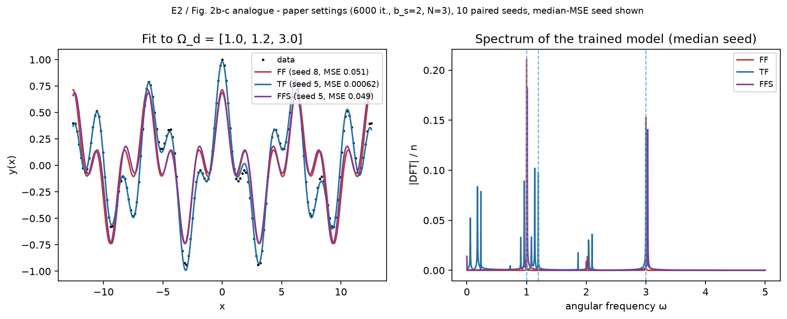
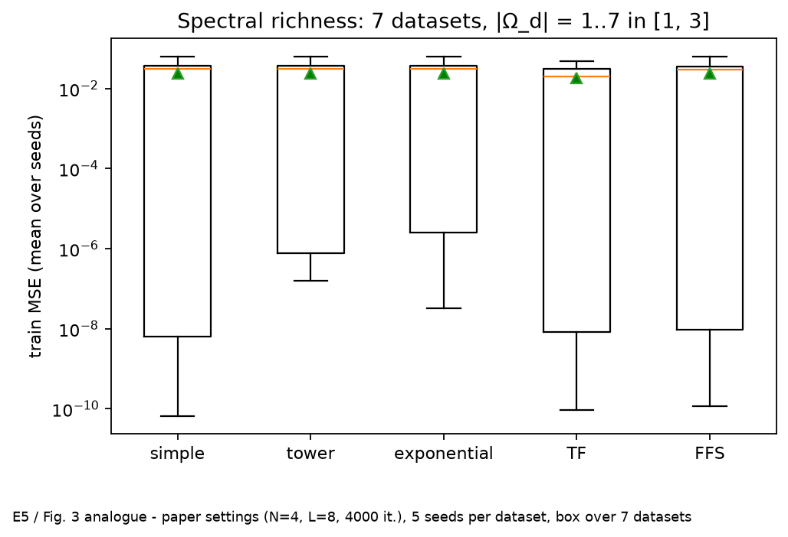
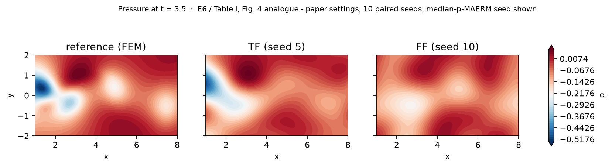
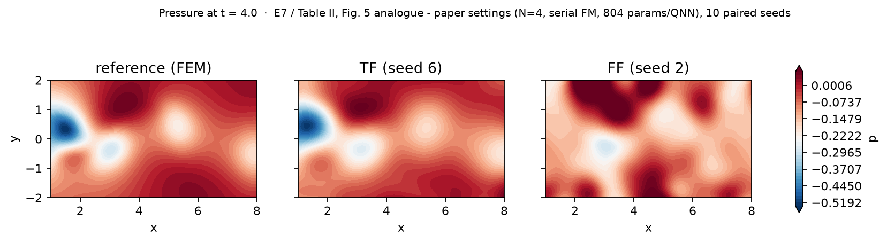
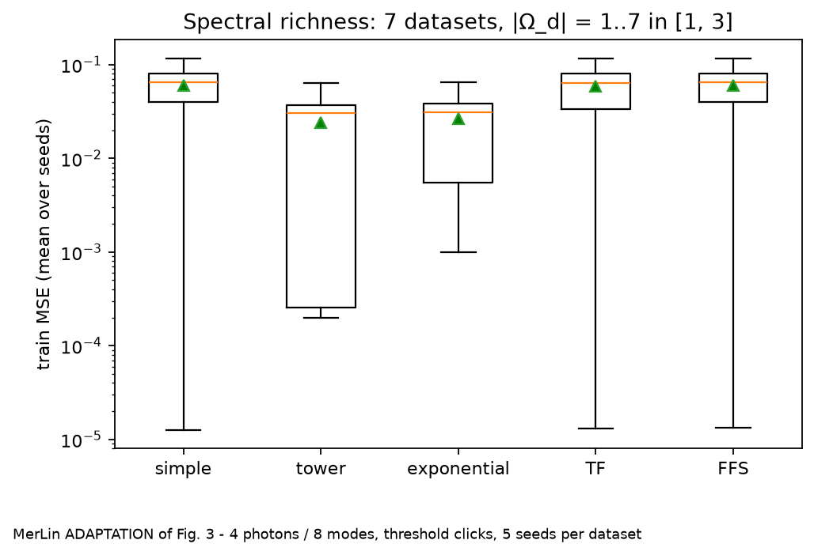

# Let Quantum Neural Networks Choose Their Own Frequencies - Reproduction

> Status: gate-model reproduction complete (Phase 3): all paper experiments run with
> the paper's settings and multiple seeds, plus fairness controls. Photonic (MerLin)
> adaptation complete (Phase 4, status `MERLIN_IMPLEMENTATION`, simulation only).
> Full evidence, decisions and ledgers: `LOG.md`.

## Reference and Attribution

- Paper: *Let Quantum Neural Networks Choose Their Own Frequencies*, Phys. Rev. A 109, 042421 (2024)
- Authors: Ben Jaderberg, Antonio A. Gentile, Youssef Achari Berrada, Elvira Shishenina, Vincent E. Elfving
- DOI: [10.1103/PhysRevA.109.042421](https://doi.org/10.1103/PhysRevA.109.042421)
- arXiv: [2309.03279](https://arxiv.org/abs/2309.03279) (v1 2023-09-06, v2 2024-04-22)
- Original repository: none released (searched GitHub, Hugging Face, Papers with Code; see `VISITED_URLS.md`)
- License and attribution notes: the paper is cited below; this repository's code is an independent reimplementation.

## Original Paper

Quantum models with angle encoding compute truncated Fourier series whose
accessible frequencies are fixed by the eigenvalues of the data-encoding
generator Hamiltonians. The paper adds trainable parameters to those generators,
producing trainable-frequency (TF) models whose spectrum is learned during
training. Numerical studies analyse the learned spectra and apply TF models to
a Navier-Stokes solving task, comparing against fixed-frequency (FF) models.

The TF model replaces each encoding gate `R_y(x)` by `R_y(θ_m x)`, with `θ_m`
trainable and initialised at 1, so a TF model starts as the conventional FF model.
Main claims: (Sec. V, Fig. 2) FF QNNs cannot fit a cosine series with irregular
frequencies {1, 1.2, 3}, while TF learns non-uniform gaps and fits it; (Fig. 3) TF
beats simple, tower and exponential FF feature maps on average and in the worst case
when the number of data frequencies is unknown; (Sec. VI, Table I, Fig. 4) on a
physics-informed (DQC) solve of the 2D Navier–Stokes cylinder wake (Re = 100), TF
lowers the MAERM error of u, v and p with one extra parameter per encoding gate;
(App. C, Table II) the same holds for an over-parameterised model. Metric: MAERM =
mean absolute error relative to the median, per time step, min / max / mean over
t = 0.5…5.5, averaged over 10 runs.

## Reproduction Scope (including Updates and Deviations)

Reproduced with the paper's hyperparameters (App. B) in noiseless statevector
simulation: Fig. 2a/b/c (E1, E2), the FF depth ablation up to L = 128 (E3), the
global-scale statement of Sec. V (E4), Fig. 3 (E5), Table I + Fig. 4 (E6), Table II +
Fig. 5 (E7) and the circuit-cost factor (E8). Seeds: 10 paired seeds (E1, E2, E4, E6,
E7), 5 (E5), 3 (E3). Original cylinder-wake data (Raissi et al.), full grid.

Updates and deviations:

- Own PyTorch statevector simulator (≤ 6 qubits, complex128), autograd instead of the
  parameter-shift rule (identical values in noiseless simulation). Circuits are evaluated
  in the Pauli-Y eigenbasis with fused ansatz layers — exact (tested against gate-by-gate
  evaluation to 1e-12) and 58× faster.
- Added fairness controls not in the paper: FF + one trainable input scale per coordinate
  (FF+S), min–max input normalisation, an lr-robustness check, and small classical
  references (MLP, Fourier regressor, MLP PINN) for context.
- Paper ambiguities and inconsistencies (A1–A16 in `LOG.md`), most importantly: N = 3
  qubits for Fig. 2 (text vs appendix disagree; both run); MAERM uses the median of |y|
  (this reproduces the paper's TF v error exactly; the signed median is also reported);
  Navier–Stokes inputs are raw physical coordinates by default (the paper does not say;
  min–max variant run); App. C layout inferred from its 804-parameter count; the paper's
  cost factor 1.07 is 1.033 when counted consistently.
- Photonic (MerLin) adaptation: see "Photonic (MerLin) Adaptation" below; it is an
  adaptation, not part of the paper.

## Install and How to Run

```bash
conda create -y -n trainable_freq -c conda-forge --override-channels python=3.12 pip
conda activate trainable_freq
pip install -r papers/trainable_frequency_qnn/requirements.txt
```

Quick smoke runs (seconds):

```bash
# From the repo root
python implementation.py --paper trainable_frequency_qnn --help
python implementation.py --paper trainable_frequency_qnn --config configs/fig2b_tf_original.json --iterations 300
python implementation.py --paper trainable_frequency_qnn --config configs/ns_table1_tf_smoke_reduced.json

# From inside papers/trainable_frequency_qnn
python ../../implementation.py --config configs/fig2b_tf_original.json --iterations 300
```

Paper-setting runs (one seed each; set `--seed`):

```bash
python implementation.py --paper trainable_frequency_qnn --config configs/fig2a_ff_original.json   # E1, ~5 s
python implementation.py --paper trainable_frequency_qnn --config configs/fig2b_tf_original.json   # E2 TF, ~11 s
python implementation.py --paper trainable_frequency_qnn --config configs/fig2b_ff_original.json   # E2 FF
python implementation.py --paper trainable_frequency_qnn --config configs/ns_table1_tf_original.json  # E6 TF, ~13 min on CPU
python implementation.py --paper trainable_frequency_qnn --config configs/ns_table1_ff_original.json  # E6 FF, ~17 min on CPU
```

Each run writes `papers/trainable_frequency_qnn/outdir/run_YYYYMMDD-HHMMSS/` with
`run.log`, `run_status.json`, `config_snapshot.json`, `metrics.json`,
`losses.csv`, `predictions.npz` and, for toy QNN runs, `spectrum.npz`
(Navier–Stokes runs also save `model_state.pt`).

## Configuration

`cli.json` is the authoritative paper-specific CLI schema: `--iterations`,
`--batch-size`, `--lr`, `--n-qubits`, `--n-layers`, `--frequency-mode
{fixed,trainable,global_scale}`, `--feature-map {simple,tower,exponential}` and
`--coordinate-transform {raw,minmax}`. Global flags (`--config`, `--outdir`,
`--seed`, `--dtype`, `--device`, `--log-level`, `--data-root`) come from the
shared runtime.

| Config | Experiment |
|---|---|
| `defaults.json` | E2 TF QNN (base for every overlay) |
| `fig2a_ff_original.json` | E1, Fig. 2a: FF on {1, 2, 3} |
| `fig2b_{ff,tf,ffs}_original.json` | E2, Fig. 2b–c: FF / TF / FF + global scale on {1, 1.2, 3} |
| `fig2b_{mlp,fourier}_classical.json` | E2 classical context references |
| `e4_scaled_{ff,ffs}_original.json` | E4: FF / FF + global scale on {1.5, 3, 4.5} |
| `fig3_{simple,tower,exponential,tf,ffs}_original.json` | E5, Fig. 3 models (frequency set swept in Phase 3) |
| `ns_table1_{ff,tf,ffs}_original.json` | E6, Table I / Fig. 4 |
| `ns_table1_mlp_classical.json` | E6 classical PINN context reference |
| `ns_table1_tf_smoke_reduced.json` | Navier–Stokes smoke (3 iterations) |
| `ns_appc_{ff,tf}_original.json` | E7, App. C / Table II |
| `*_merlin.json` (17 + smoke) | MerLin photonic adaptation of E1, E2 (+ UNBUNCHED ablation), E4, E5, E6 (Phase 4) |

Main model keys: `model.family` (`qnn`, `mlp`, `fourier`), `model.layout`
(`toy`, `ns_parallel`, `ns_serial`), `model.entangler` (`cnot`, `cz`),
`model.feature_map`, `model.frequency_mode`. The Navier–Stokes inputs use raw
physical coordinates by default (`dataset.coordinate_transform`, LOG.md A7).

## Data

- Toy regression tasks (Fig. 2, Fig. 3): synthetic cosine series generated on
  the fly; no external data.
- Navier–Stokes tasks (Table I, Fig. 4, App. C): the original cylinder-wake
  dataset (Re = 100, NekTar FEM) of Raissi, Perdikaris and Karniadakis
  (arXiv:1711.10566), from the authors' repository
  [maziarraissi/PINNs](https://github.com/maziarraissi/PINNs) (MIT license),
  pinned to commit `932f50a2d8ef4e80d1456bbae6887a73ff5166ef`. Expected path:
  `data/trainable_frequency_qnn/cylinder_nektar_wake/cylinder_nektar_wake.mat`
  (24.1 MB, git blob SHA `0098e4098c1df61b009137c60e3a506f8ccd27e2`). It holds
  `X_star` (5000 × 2, a 100 × 50 grid over x ∈ [1, 8], y ∈ [−2, 2]), `t`
  (200 steps, 0 to 19.9, Δt = 0.1), `U_star` (5000 × 2 × 200, u and v) and
  `p_star` (5000 × 200). The full file is used; the paper's t ∈ [0, 5.5]
  window and 10 × 5 data sub-grid are selected in code.

```bash
# From the repo root
mkdir -p data/trainable_frequency_qnn/cylinder_nektar_wake
curl -sSL -o data/trainable_frequency_qnn/cylinder_nektar_wake/cylinder_nektar_wake.mat \
  https://raw.githubusercontent.com/maziarraissi/PINNs/932f50a2d8ef4e80d1456bbae6887a73ff5166ef/main/Data/cylinder_nektar_wake.mat
git hash-object data/trainable_frequency_qnn/cylinder_nektar_wake/cylinder_nektar_wake.mat
# expect 0098e4098c1df61b009137c60e3a506f8ccd27e2
```

The `data/` folder is git-ignored, so each machine (including the remote GPU
machines used for the Navier–Stokes runs) must run this command once.

## Results Obtained and Comparison with the Paper

All numbers are means over seeds (± std), paper settings, noiseless simulation; label
`paper-accurate` unless stated. Tables: `results/*_results.md`; figures: `results/*.png`.

**Fig. 2 — irregular frequencies (E2, N = 3, 10 paired seeds), train MSE**

| Model | Params | Train MSE |
|---|---:|---:|
| FF (paper baseline) | 36 | 5.08e-2 ± 0.06e-2 |
| FF + global scale | 37 | 5.37e-2 ± 0.79e-2 |
| **TF** | 39 | **1.16e-3 ± 1.36e-3** |
| FF, L = 128 (E3, 1152 params) | 1152 | 6.70e-2 ± 1.03e-2 |

TF is lower than FF in 10/10 seeds (Wilcoxon p = 0.002); the learned θ_F
(≈ 0.9, 1.05, 1.1) match the paper's {0.89, 1.05, 1.04}. Fig. 2a (E1): FF fits
{1, 2, 3} with median MSE 6.4e-3 (N = 3) / 4.0e-4 (N = 4).


**Sec. V global-scale statement (E4)** — not reproduced as stated: FF with a trainable
global scale started at 1 does not fit {1.5, 3, 4.5} (MSE 0.125); started at 1.5 it fits
to ~1e-11 (E4b). Frequency parameters only move locally under gradient descent.

**Fig. 3 — spectral richness (E5, N = 4, 5 seeds per dataset), train MSE over 7 datasets**

| Model | Mean | Worst | Best |
|---|---:|---:|---:|
| simple FF | 0.0243 | 0.0641 | 7e-11 |
| tower FF | 0.0242 | 0.0641 | 2e-7 |
| exponential FF | 0.0242 | 0.0640 | 3e-8 |
| **TF** | **0.0187** | **0.0492** | 9e-11 |
| exponential FF with prior-knowledge input scale (E5b) | 3.0e-5 | 2.0e-4 | 6e-8 |

The paper's ranking is reproduced (TF best mean and worst case, ties on the best case,
robust to lr 1e-3…1e-2 for the mean). The mechanism differs: all FF maps fail identically
for k ≥ 4 because those frequency sets are non-integer; the paper's "too few / too many
frequencies" pattern appears only when FF inputs are scaled by the data's base frequency,
and then exponential FF beats TF.


**Table I — Navier–Stokes (E6, 10 paired seeds), mean MAERM % (min / max / mean)**

| | Paper FF | Ours FF | Paper TF | Ours TF |
|---|---|---|---|---|
| u | 16.8 / 18.3 / 17.5 | 19.5 / 20.7 / 20.1 | 12.8 / 14.2 / 13.2 | 8.4 / 10.0 / 9.0 |
| v | 90.3 / 122 / 103.2 | 56.8 / 66.2 / 61.0 | 27.4 / 34.3 / 30.4 | 27.4 / 34.7 / 30.4 |
| p | 62.9 / 78.3 / 73.2 | 61.1 / 92.9 / 76.2 | 51.0 / 62.8 / 57.0 | 37.0 / 58.8 / 45.6 |

TF < FF for u, v, p in 10/10 seeds (p = 0.002). Controls: FF + per-coordinate trainable
scale (3 params per QNN) reaches u 11.2, v 35.6, p 49.9 (5 seeds) — most of the gap — and
TF remains lower in 5/5 seeds; with min–max inputs TF < FF in 5/5 seeds. A small classical
MLP PINN (188 params per network) reaches u 4.0, v 17.1, p 30.7 (context only).


**Table II — over-parameterised (E7, 10 paired seeds), mean MAERM %**

| | Paper FF | Ours FF (raw) | Paper TF | Ours TF (raw) | FF+S | FF min–max | TF min–max |
|---|---:|---:|---:|---:|---:|---:|---:|
| u | 7.7 | 31.5 | 6.2 | 6.6 | 6.1 | 4.9 | 4.4 |
| v | 26.0 | 73.2 | 18.9 | 20.1 | 20.6 | 21.2 | 18.2 |
| p | 45.2 | 123 | 36.8 | 34.8 | 32.4 | 31.7 | 25.0 |

Our TF reproduces Table II within about one seed-std. Our raw-input FF is stuck on a
plateau (more iterations do not help); FF with min–max inputs or 3 trainable scales
matches TF (FF+S vs TF: no difference, 2–3/5 seeds), so the raw-input gap is an
input-scaling effect. With min–max inputs for both, TF is still lower in 5/5 seeds by
small margins (u 0.5, v 3.0, p 6.7 points; 5 seeds, p = 0.0625).


**Verdicts** (claim IDs as in `LOG.md`): C1 irregular frequencies — supported
(quantitative). C2 FF fits its natural frequencies — supported; the global-scale variant
only with a suitable initial scale. C3 spectral richness — partially supported (ranking
yes, mechanism no). C4 Table I — partially supported (TF < FF robustly; most of the gain
is recoverable by 3 scale parameters). C5 Table II — partially supported (TF matches the
paper; the advantage over FF shrinks to a small but consistent margin once inputs are
scaled). C6 overhead — supported (C_f = 1.033, +4 % wall-clock). C7 "sensible default" —
partially supported.

## Photonic (MerLin) Adaptation

Status **`MERLIN_IMPLEMENTATION`**: a MerLin **adaptation** of the paper's FF / TF models,
simulated only (no QPU). Model: `lib/qnn_merlin.py`; configs `configs/*_merlin.json`; sweeps
`configs/sweeps/m*.json` (320 runs, all validated).

Mapping: trainable MZI mesh → phase-shifter encoding `φ = γ·w·x` on the encoding modes → mesh
(Navier–Stokes: plus a re-upload block). `w` fixed at 1 (FF), trainable per mode (TF) or one
trainable scale per input (FF+S). A phase shifter `exp(iφn̂)` makes the output a Fourier
series whose frequencies are photon-number differences weighted by `γ·w` — integers for FF,
learnable for TF. Readout: threshold detectors without post-selection, as a fixed click
observable (#clicks on even modes − #clicks on odd modes), simulated from `FOCK`
probabilities. MerLin's default `UNBUNCHED` space post-selects collision-free outcomes, which
breaks the finite spectrum, so it is only run as an ablation. 3 photons in 6 modes (E1, E2,
E4, E6 per network), 4 photons in 8 modes (E5); input state `[1, 0, 1, 0, …]`; exact
probabilities, exact autograd gradients. Full hardware-aware table:
`results/merlin_hardware_report.md`.

| Experiment | Photonic result (mean over seeds) | Same as the qubit reproduction? |
|---|---|---|
| E1, FF on {1, 2, 3} | train MSE 0.093 | No: the ω = 3 coefficient is capped near 0.05 |
| E2, {1, 1.2, 3} | TF 0.057 < FF+S 0.067 < FF 0.101 (10/10 seeds) | Ranking yes; TF/FF 0.56 vs 0.02 for qubits |
| E4 / E4b, {1.5, 3, 4.5} | init 1 ≈ 0.16; init 1.5 ≈ 0.065 | Pattern yes; no near-perfect fit |
| E5, Fig. 3 | tower FF best (mean 0.024, worst 0.064); TF 0.059 / 0.117 | **No, inverted** |
| E6, Table I (MAERM %, u / v / p) | TF 21.7 / 94.9 / 81.2; FF 96.8 / 90.8 / 125; FF+S 22.6 / 113 / 105 | Partly: TF < FF on u and p 10/10, not on v (3/10) |



What carries over and what does not:

- The FF-vs-TF mechanism carries over directly (integer vs learnable photonic spectra), and
  TF beats FF on irregular frequencies as in the paper.
- Linear optics with single-photon inputs caps the coefficients of frequencies that need
  several photons in the encoding modes (a NOON-like term), so the photonic "simple" map
  cannot express its own highest frequency. A tower or exponential map carries the same
  frequency on one photon through a high-γ mode and avoids the cap. TF starts as the simple
  map and only moves its multipliers locally, so it inherits the bottleneck: the paper's
  "TF as a sensible default" argument does not transfer to this photonic setting.
- On Navier–Stokes, photonic FF does not train with raw coordinates; most TF seeds (and all
  FF+S seeds) shrink the x multipliers and switch off the time encoding, so TF's gain over FF
  is mostly input rescaling; 2/10 TF seeds learn a richer spectrum (u 13–15, v 43,
  p 52–60). All photonic errors are well above the qubit models'.

## Limitations

- Noiseless statevector simulation only, as in the paper; no shot noise or hardware.
- The paper does not state its Navier–Stokes input normalisation, batch composition or
  data-cell positions (A7, A8); our FF-vs-TF gaps depend strongly on the first.
- Several controls use 5 seeds (smallest attainable two-sided Wilcoxon p = 0.0625); their
  5/5 outcomes are consistent signs, not established significance.
- Ansatz initialisation (uniform [0, 2π)) and the FF+S control are our choices.
- Remote runs used 4 parallel workers on an 8-vCPU L4 host; wall-clock numbers are not
  comparable to single-process timings.
- Photonic results are noiseless, lossless simulations with indistinguishable photons and
  exact probabilities; one architecture (mesh–encode–mesh, 3–4 photons, spread input state)
  was tested, so the photonic limits found may depend on that choice. E3 (depth) and E7
  (App. C) were not translated.

## Tests

```bash
cd papers/trainable_frequency_qnn
pytest -q
```

## Citation and License

```bibtex
@article{jaderberg2024tfqnn,
  title   = {Let Quantum Neural Networks Choose Their Own Frequencies},
  author  = {Jaderberg, Ben and Gentile, Antonio A. and Achari Berrada, Youssef and Shishenina, Elvira and Elfving, Vincent E.},
  journal = {Physical Review A},
  volume  = {109},
  pages   = {042421},
  year    = {2024},
  doi     = {10.1103/PhysRevA.109.042421}
}
```
